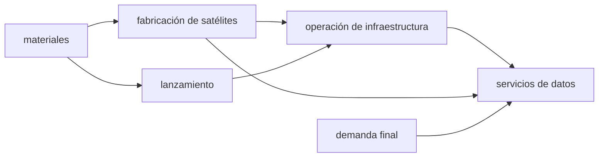

# B124-C01 — Cadena de valor de industria espacial

<!-- nav:top -->
[🏠 Programa](../../../../README.md) · [📚 Bloque B124](../../../tronco-comun/B124-industria-economia-etica-y-proyectos-espaciales.md) · [← Anterior: B123-C04 — Arbitraje y resolución de controversias espaciales](../../../tronco-comun/B123-responsabilidad-danos-y-controversias-espaciales.md#b123-c04) · [Siguiente: B124-C02 — Agencias científicas y empresas →](../B124-C02-agencias-cientificas-y-empresas/CLASE.md)
<!-- /nav -->

## 1. Ubicación, nivel y alcance

Clase 1 del bloque B124 y primera del área A11. Nivel N3. Aquí aprendes a leer una industria como una cadena de etapas que se compran unas a otras y a medir cuánto valor agrega cada una. Usas la idea de «aguas arriba» (materiales, fabricación, lanzamiento) y «aguas abajo» (operación y servicios que usan datos o señales satelitales) y la separas de la de «ganancia». **Esta clase es educativa: no es asesoría financiera ni de inversión.** Todas las cifras son sintéticas.

## 2. Por qué esta clase existe

El bloque necesita un mapa común antes de hablar de costos, financiamiento o contratos: ¿quién le compra a quién y dónde queda el valor? Ninguna clase anterior del programa trata la estructura económica de la industria espacial. La decisión central: **¿cómo se reparte el valor agregado entre etapas y cuánto arrastra la demanda final de cada una?**

## 3. Lo que podrás hacer al terminar

1. Distinguir producto bruto, compras intermedias, demanda final y valor agregado.
2. Resolver un modelo insumo-producto `x = A x + f` por eliminación gaussiana.
3. Verificar la solución con una segunda vía, la serie de Neumann.
4. Calcular el valor agregado por etapa y su participación en el total.
5. Interpretar el multiplicador de producto de cada etapa.
6. Rotular qué es consultado (nada numérico) y qué es sintético (todo número).

La evidencia es la **ficha de cadena de valor con valor agregado por etapa** del ejercicio 12 (sección 20).

## 4. Con qué llegas y cómo comprobarlo

1. ¿Qué es el valor agregado?
2. ¿Qué significa «aguas arriba» y «aguas abajo»?
3. ¿Qué es una matriz y su inversa?
4. ¿Qué es una demanda final?
5. ¿Qué es una verificación por segunda vía?

<details>
<summary>Ver respuestas</summary>

1. Lo que una etapa añade al valor de lo que compra: ventas menos compras a proveedores. 2. Arriba: etapas cercanas a materiales y fabricación; abajo: las cercanas al usuario final de los datos o servicios. 3. Un arreglo de números; la inversa deshace el efecto de multiplicar por ella. 4. Lo que se compra para uso final y no como insumo de otra etapa. 5. Calcular lo mismo con otro método y comparar.
</details>

Con cuatro o cinco aciertos, sigue; si no, repasa los prerrequisitos.

## 5. Un caso de contexto y casos de referencia

El Handbook on Measuring the Space Economy de la OCDE (2.ª ed., 2022) es la referencia habitual para definir los segmentos aguas arriba y aguas abajo, pero **no se consultó**: solo apareció en una búsqueda el 2026-11-11 y por eso la clase no cita ninguna de sus definiciones ni cifras. El **ejemplo conductor** es una cadena sintética de 5 etapas con una demanda final de `200` um: el valor agregado total es `127,805` um, y los servicios de datos aportan el `27,4%`. Todo es **sintético**.

## 6. Vocabulario

El **producto bruto** `x` es lo que produce cada etapa. Las **compras intermedias** `A` son lo que una etapa compra a otra por unidad producida. La **demanda final** `f` es lo que se compra para uso final. El **valor agregado** `VA` es lo que la etapa suma. El **multiplicador** es la producción total que genera una um de demanda final de una etapa. **Aguas arriba** son las etapas proveedoras; **aguas abajo**, las que usan sus productos.

## 7. Modelo mental



*Descripción textual:* los materiales alimentan la fabricación y el lanzamiento, estos alimentan la operación y esta, junto con la fabricación, alimenta los servicios de datos; la demanda final entra en cada etapa.

Analogía: una cadena de montaje de varias fábricas donde cada una vende a la siguiente y solo la última vende al público. Límite: aquí las etapas también venden directamente a la demanda final y compran fuera de la cadena, algo que la analogía lineal no recoge.

## 8. La explicación, paso a paso

### 8.1 Del producto bruto al valor agregado

El producto bruto cumple `x = A x + f`, es decir `x = (I − A)⁻¹ f`. El valor agregado de la etapa `j` es lo que queda de su producto tras pagar a los proveedores de la cadena `Σ_i A_ij` y a los de fuera `e_j`: `VA_j = x_j (1 − Σ_i A_ij − e_j)`. Con los datos sintéticos, el producto bruto total es `286,150` um para una demanda final de `200,0` um.

### 8.2 Una identidad que sirve de control

Sumando todas las etapas, `Σ VA = Σ f − Σ e x`: el valor agregado total es la demanda final menos lo comprado fuera de la cadena. Aquí `127,805000` um `= 200,0 − 72,195`; el error es `0,0e+00`.

### 8.3 Segunda vía de cálculo

La serie de Neumann `x = f + A f + A² f + …` converge porque cada columna de `A` más `e` suma menos de 1. Con 400 términos coincide con la eliminación gaussiana dentro de `0,0e+00`.

### 8.4 Multiplicadores y posición

El multiplicador de la etapa `j` es la suma de la columna `j` de `(I − A)⁻¹`. Una um de demanda final de fabricación de satélites genera `1,200` um de producto bruto en la cadena; una de servicios de datos, `1,603`. Las etapas aguas abajo tienen mayor multiplicador porque compran a varias etapas; los materiales, que no compran a nadie de la cadena, tienen 1. Como la cadena no tiene ciclos, la serie de Neumann termina exacta.

## 9. Magnitudes, símbolos y unidades

| Símbolo | Qué es | Unidad | Valor / nota |
|---|---|---|---|
| `x` | producto bruto de una etapa | um/periodo | sintético |
| `A` | compras intermedias por unidad producida | — | 0 a 0,35 (sintético) |
| `f` | demanda final | um/periodo | 5 a 100 (sintético) |
| `e` | fracción comprada fuera de la cadena | — | 0,20 a 0,30 (sintético) |
| `VA` | valor agregado | um/periodo | calculado |

## 10. Convenciones y referencias

Un periodo (por ejemplo un año) y unidades monetarias sintéticas (um) sin relación con ninguna moneda. Sin impuestos, sin importaciones por etapa distintas de `e`, sin inventarios. Los datos y la estructura de la cadena no representan ninguna industria real.

## 11. De dónde sale lo que afirmamos

| ID | Fuente | Localizador | Respalda | Estado |
|---|---|---|---|---|
| — | OECD, Handbook on Measuring the Space Economy, 2.ª ed. (2022) | — | definición de segmentos aguas arriba y aguas abajo | No consultado (solo apareció en una búsqueda el 2026-11-11) |
| — | Modelo insumo-producto, eliminación gaussiana, serie de Neumann | — | verificados entre sí en el laboratorio | No consultados en una fuente concreta |
| — | Matriz `A`, `e`, `f` | — | todas las cifras | Sintético |

Límites: no se consultó ninguna estadística de la industria espacial; ninguna cifra corresponde a una empresa, un país ni un mercado reales.

## 12. Cómo ver el resultado

| Magnitud | Valor |
|---|---|
| Valor agregado total | 127,805 um |
| Participación de servicios de datos | 27,4% |
| Participación de materiales | 13,2% |
| Multiplicador de la fabricación | 1,200 |
| Error de la identidad | 0,0e+00 |

Descripción larga: los servicios de datos retienen la mayor parte del valor agregado y tienen el mayor multiplicador; los materiales, el menor.

## 13. Ejemplo trabajado

**Paso 1 · Planteo.** Dos etapas: `x₁ = 0,2 x₂ + 10` y `x₂ = 60`. Con `f₁ = 10`.

**Paso 2 · Producto.** `x₁ = 0,2 · 60 + 10 = 22`.

**Paso 3 · Valor agregado.** Si `e₁ = 0,3` y la etapa 1 no compra a nadie de la cadena: `VA₁ = 22 (1 − 0 − 0,3) = 15,4`.

**Paso 4 · Control.** La etapa 2 compra `0,2 · 60 = 12` a la etapa 1; con `x₂ = 60` y `e₂ = 0,1`: `VA₂ = 60 (1 − 0,2 − 0,1) = 42`.

## 14. Distintas formas de describirlo

**Por tabla:** `x`, `VA`, participación. **Por matriz:** `A` y `(I − A)⁻¹`. **Por identidad:** valor agregado total frente a demanda final. **Por multiplicador:** columnas de la inversa. **Por grafo:** flechas proveedor-cliente.

## 15. Práctica guiada

**Ejercicio 1 · con los pasos indicados.** Calcula `VA` de una etapa con `x = 50`, `Σ A = 0,2`, `e = 0,3`. *Pasos:* `x (1 − ΣA − e)`.

<details><summary>Solución comentada</summary>

`50 · 0,5 = 25` um.
</details>

**Ejercicio 2 · con una pista.** ¿Qué fracción del producto de la etapa de servicios de datos se queda como valor agregado? *Pista:* `1 − ΣA − e` de su columna.

<details><summary>Solución comentada</summary>

`1 − 0,40 − 0,25 = 0,35`.
</details>

**Ejercicio 3 · casi autónomo.** Suma de `VA` si `Σ f = 200` y `Σ e x = 60`. 

<details><summary>Solución comentada</summary>

`200 − 60 = 140` um.
</details>

## 16. Práctica autónoma, transferencia e integrador

**Ejercicio 4 · autónomo.** ¿Cuál es el valor agregado de los materiales? (valor del laboratorio)

<details><summary>Solución comentada</summary>

`16,905` um (`13,2%`).
</details>

**Ejercicio 5 · autónomo.** ¿Y el de los servicios de datos?

<details><summary>Solución comentada</summary>

`35,000` um (`27,4%`).
</details>

**Ejercicio 6 · autónomo.** ¿Cuál es el multiplicador de la operación de infraestructura?

<details><summary>Solución comentada</summary>

`1,552`.
</details>

**Ejercicio 7 · autónomo.** ¿Cuánto produce en total la cadena (`Σ x`)?

<details><summary>Solución comentada</summary>

`286,150` um.
</details>

**Ejercicio 8 · autónomo.** Compara la suma de `VA` con la demanda final.

<details><summary>Solución comentada</summary>

`127,805` frente a `200,0`: la diferencia `72,195` es lo comprado fuera.
</details>

**Ejercicio 9 · transferencia.** **Transferencia.** Una agencia compra satélites directamente (sube `f₁`). ¿Qué etapa se beneficia más?

<details><summary>Solución comentada</summary>

Primero la fabricación y, por arrastre, los materiales; su multiplicador es `1,200`.
</details>

**Ejercicio 10 · transferencia.** **Transferencia.** Si `e` baja a la mitad (más compras dentro de la cadena nacional), ¿qué le pasa al valor agregado?

<details><summary>Solución comentada</summary>

Sube: cada etapa retiene más (`1 − ΣA − e` crece) y la suma de `VA` se acerca a `Σ f`.
</details>

**Ejercicio 11 · transferencia.** **Transferencia.** Un informe afirma «los servicios de datos son el 80 % de la industria». ¿Qué falta preguntar?

<details><summary>Solución comentada</summary>

Si se mide producto bruto o valor agregado, qué etapas incluye y de qué fuente sale; el modelo sintético da `27,4%`, que no es un dato real.
</details>

**Ejercicio 12 · integrador.** **Integrador.** Elabora tu *ficha de cadena de valor con valor agregado por etapa*: tabla de `x`, `VA`, participación y multiplicador, identidad de control, segunda vía y lista de qué es consultado y sintético, con el aviso de que es educativa.

<details><summary>Solución comentada</summary>

Secciones 8.1–8.4 y la salida del laboratorio.
</details>

## 17. Laboratorio: cadena de valor sintética

El script [cadena_de_valor.py](cadena_de_valor.py) resuelve el modelo insumo-producto por eliminación gaussiana, lo verifica con la serie de Neumann y con la identidad de valor agregado (**comprueba** error menor que 1e-9 en ambas). Tarda menos de 10 s en un equipo común.

**Datos:** ninguna cifra consultada; matriz `A`, `e` y `f` **sintéticas**. **Predice antes de ejecutar:** ¿qué etapa tendrá mayor valor agregado? (los servicios de datos.) **Ejecución del 2026-11-11:**

```text
Python 3.12.9 (biblioteca estandar)
Cadena de valor SINTETICA (ilustrativa); unidades monetarias sinteticas (um) por periodo.
Demanda final total = 200.0 um ; compras fuera de la cadena = 72.195 um
 etapa                          x[um]    VA[um]   VA[%]  multiplicador
 materiales                      24.150   16.905   13.2     1.000
 fabricacion de satelites        53.000   29.150   22.8     1.200
 lanzamiento                     49.000   26.950   21.1     1.150
 operacion de infraestructura    60.000   19.800   15.5     1.552
 servicios de datos             100.000   35.000   27.4     1.603
Suma de VA = 127.805000 um ; demanda final - compras externas = 127.805000 um
Identidad (error) = 0.00e+00 ; solucion directa frente a serie de Neumann (error) = 0.00e+00
Pruebas superadas.
```

```bash
python programa/clases/B124/B124-C01-cadena-de-valor-de-industria-espacial/cadena_de_valor.py
```

**Límites:** modelo lineal de coeficientes fijos, sin impuestos, inventarios ni precios; la cadena no representa ninguna industria real.

## 18. Errores frecuentes y cómo corregirlos

**Confundir producto bruto con valor agregado.** Se corrige con 8.1: el producto bruto cuenta varias veces lo que se compra a otras etapas.

**Tomar la cadena sintética como un dato de mercado.** Se corrige con la sección 10.

**Pensar que más multiplicador es siempre mejor.** Se corrige con 8.4: el multiplicador no dice cuánto valor queda en la etapa.

**Dar por buena la solución con un solo método.** Se corrige con 8.3.

## 19. Cómo sabrás que vas bien

Tras la sección 8: ¿qué etapa esperabas con más valor agregado y cuál salió? Si dudas, repasa el ejemplo 13. Tras el laboratorio: ¿qué comprueba? (ver la sección 17).

## 20. Qué entregas y cómo se evalúa

El producto es tu **ficha de cadena de valor con valor agregado por etapa** (ejercicio 12).

| Criterio | Inicial | En desarrollo | Logrado | Destacado |
|---|---|---|---|---|
| Conceptos | Los confunde | Parciales | Calcula `x` y `VA` | Explica los límites |
| Cálculo | Sin unidades | Con errores | Tablas completas con unidades | Calcula casos nuevos |
| Numérico | Sin comprobar | Un caso | Contraste con una segunda vía | Interpreta las diferencias |
| Fuentes | Sin fuente | Sin fecha | Fuentes con fecha y estado | Declara lo ilustrativo y lo no consultado |
| Límites | No los nombra | Uno | Tres | Discute qué falta del modelo |

**Condiciones críticas (no se compensan con promedio):** rotular los datos como sintéticos o ilustrativos; no presentar el resultado como asesoría financiera, legal ni de inversión; citar solo lo consultado.

## 21. Ética, seguridad y límites

Clase educativa: **no es asesoría financiera, legal, tributaria ni de inversión** y no sustituye a un profesional habilitado ni a la normativa vigente; ningún resultado debe usarse para decidir una compra, un contrato, una inversión o un seguro reales. Evita presentar una cadena de valor inventada como si describiera a una empresa o país concretos. Los modelos son simplificados y sus datos son sintéticos o ilustrativos. Accesibilidad: tablas equivalentes a las gráficas, fórmulas en texto, ejercicios sin conexión.

## 22. Para cerrar y seguir

Una cadena sintética de 5 etapas con una demanda final de `200` um genera `286,1` um de producto bruto y `127,8` um de valor agregado; los servicios de datos se quedan con el `27,4%`. Con esta clase queda el mapa de quién le compra a quién.

**Glosario español–inglés.** valor agregado · *value added*; aguas arriba · *upstream*; aguas abajo · *downstream*; demanda final · *final demand*; insumo-producto · *input–output*.

**Continuidad.** [B124-C02](../B124-C02-agencias-cientificas-y-empresas/CLASE.md) distingue el papel de las agencias y de las empresas en esa cadena.

**Referencias:** ver sección 11.

<!-- nav:bottom -->
---

[← Anterior: B123-C04 — Arbitraje y resolución de controversias espaciales](../../../tronco-comun/B123-responsabilidad-danos-y-controversias-espaciales.md#b123-c04) · [📚 Bloque B124](../../../tronco-comun/B124-industria-economia-etica-y-proyectos-espaciales.md) · [Siguiente: B124-C02 — Agencias científicas y empresas →](../B124-C02-agencias-cientificas-y-empresas/CLASE.md)
<!-- /nav -->
