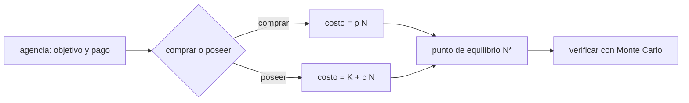

# B124-C02 — Agencias científicas y empresas

<!-- nav:top -->
[🏠 Programa](../../../../README.md) · [📚 Bloque B124](../../../tronco-comun/B124-industria-economia-etica-y-proyectos-espaciales.md) · [← Anterior: B124-C01 — Cadena de valor de industria espacial](../B124-C01-cadena-de-valor-de-industria-espacial/CLASE.md) · [Siguiente: B124-C03 — Mercados downstream y upstream →](../B124-C03-mercados-downstream-y-upstream/CLASE.md)
<!-- /nav -->

## 1. Ubicación, nivel y alcance

Clase 2 del bloque B124. Nivel N3. Una agencia puede construir y operar su propio sistema o comprar un servicio a una empresa. Aquí aprendes a comparar las dos vías con un punto de equilibrio y con la incertidumbre del costo de capital, y recalculas precios por asiento desde un informe de la Oficina del Inspector General (OIG) de la NASA. Usas la [cadena de valor de C01](../B124-C01-cadena-de-valor-de-industria-espacial/CLASE.md) como mapa. **Esta clase es educativa: no es asesoría financiera ni de contratación pública.**

## 2. Por qué esta clase existe

Las agencias científicas y las empresas cumplen papeles distintos: la agencia fija objetivos y paga; la empresa ofrece capacidad y asume parte del riesgo. La decisión central: **¿cuándo conviene comprar un servicio en vez de poseer el sistema, y con qué probabilidad?**

## 3. Lo que podrás hacer al terminar

1. Describir el papel de una agencia y el de una empresa en una compra de servicio.
2. Recalcular un precio medio por asiento y compararlo con el informado.
3. Calcular el punto de equilibrio entre comprar y poseer.
4. Calcular la probabilidad de que poseer salga más barato si el capital es incierto.
5. Verificar esa probabilidad con Monte Carlo.
6. Separar lo consultado (cifras de la OIG) de lo sintético (todo el modelo).

La evidencia es la **ficha de decisión comprar o poseer** del ejercicio 12 (sección 20).

## 4. Con qué llegas y cómo comprobarlo

1. ¿Qué es un costo fijo y uno variable?
2. ¿Qué es un punto de equilibrio?
3. ¿Qué es una distribución lognormal?
4. ¿Qué es un contrato de precio fijo?
5. ¿Qué es una simulación de Monte Carlo?

<details>
<summary>Ver respuestas</summary>

1. El fijo no depende de cuánto se use; el variable crece con la cantidad. 2. La cantidad en que dos opciones cuestan lo mismo. 3. La de una variable cuyo logaritmo es normal; solo toma valores positivos. 4. Uno en que el comprador paga un monto acordado por un servicio, sin importar el costo real del proveedor. 5. Estimar una probabilidad repitiendo un experimento aleatorio muchas veces.
</details>

Con cuatro o cinco aciertos, sigue; si no, repasa los prerrequisitos.

## 5. Un caso de contexto y casos de referencia

El informe IG-20-005 de la OIG de la NASA (noviembre de 2019) describe que la NASA pasó de operar vehículos propios a pagar a empresas un precio fijo por transportar astronautas, y que desde 2006 compró 70 asientos Soyuz por unos 3 900 millones de USD; el costo medio informado fue `55,4` millones por asiento. El **ejemplo conductor** recalcula esos precios y añade un modelo **sintético**: con un capital propio de mediana 2 000 MUSD sintéticos, un precio de servicio de 55 y un costo marginal de 20, poseer solo conviene si se vuelan más de `57,1` asientos.

## 6. Vocabulario

**Comprar un servicio** es pagar un precio por un resultado, sin poseer el sistema. **Poseer** es financiar el sistema y operarlo. El **capex** `K` es el costo de capital; `c`, el costo marginal por asiento; `p`, el precio del servicio. El **punto de equilibrio** `N*` es la cantidad de asientos en que ambas vías cuestan lo mismo. **Precio fijo** es el contrato en que el pago no sigue al costo real.

## 7. Modelo mental



*Descripción textual:* la agencia decide entre comprar (costo `p N`) y poseer (costo `K + c N`); ambos costos se igualan en `N*`, y la incertidumbre de `K` se contrasta con una simulación.

Analogía: alquilar un auto frente a comprarlo; conviene comprar si lo vas a usar mucho. Límite: aquí el costo de comprar el auto es incierto y se paga antes de saber cuánto se usará.

## 8. La explicación, paso a paso

### 8.1 Lo que dice el informe y lo que se recalcula

Con 70 asientos y 3 900 MUSD el promedio recalculado es `55,71` MUSD, `0,6%` distinto del `55,4` informado. Con 5 asientos y 373,5 MUSD resultan `74,7`, igual al informado. Con 12 asientos y unos 1 000 MUSD resultan `83,3`, `4,6%` por encima del `79,7` informado: el informe da cifras aproximadas (el total es «unos» 1 000 millones). Un recalculo que reproduce una cifra publicada dentro del redondeo es una verificación; uno que no, es una pregunta al autor.

### 8.2 Poseer frente a comprar

`costo(poseer) = K + c N` y `costo(comprar) = p N`. Igualándolos: `N* = K/(p − c)`. Con `K = 2 000`, `p = 55`, `c = 20`: `N* = 57,14` asientos. Con `N = 70` comprar cuesta `3850` y poseer `3400`: poseer ahorra `450` MUSD sintéticos si el capital sale a su mediana.

### 8.3 Capital incierto

Si `K` es lognormal de mediana 2 000 y `σ = 0,35`, poseer es más barato cuando `K < N(p − c) = 2 450`. Eso ocurre con probabilidad `Φ(ln(2450/2000)/0,35) = 0,7190`.

### 8.4 Segunda vía y lectura

Un Monte Carlo de 200 000 muestras da `0,7183`; la diferencia con la fórmula es `0,0007`. Que poseer «ahorre» en la mediana no es una garantía: con esta dispersión hay una probabilidad de `28,1%` de que comprar hubiera sido más barato. El modelo no incluye tasas de descuento, riesgo de calendario ni el valor de poseer capacidad propia.

## 9. Magnitudes, símbolos y unidades

| Símbolo | Qué es | Unidad | Valor / nota |
|---|---|---|---|
| `K` | costo de capital del sistema propio | MUSD sintéticos | mediana 2 000 |
| `c` | costo marginal por asiento | MUSD sintéticos | 20 |
| `p` | precio del servicio por asiento | MUSD sintéticos | 55 |
| `N` | asientos | — | 70 |
| `σ` | dispersión logarítmica del capital | — | 0,35 |

## 10. Convenciones y referencias

Millones de dólares de Estados Unidos (MUSD) en las cifras de la OIG, sin ajuste por inflación ni año base, tal como las informa el documento (aproximadas); MUSD **sintéticos** en el modelo. Sin descuento. Los datos del modelo no representan ningún programa real.

## 11. De dónde sale lo que afirmamos

| ID | Fuente | Localizador | Respalda | Estado |
|---|---|---|---|---|
| S1 | NASA Office of Inspector General, «NASA's Management of Crew Transportation to the International Space Station», IG-20-005, 14 de noviembre de 2019 — https://oig.nasa.gov/wp-content/uploads/2024/02/IG-20-005.pdf (consultado 2026-11-11, PDF leído con PyMuPDF) | pp. 2–3 y resumen | 70 asientos Soyuz por unos 3 900 millones de USD desde 2006; 5 de ellos de Boeing por 373,5 millones (74,7 por asiento); media informada de 55,4 millones; 12 asientos tras 2017 por unos 1 000 millones (79,7 de media); contratos de precio fijo con Boeing y SpaceX | Consultada |
| — | Punto de equilibrio, lognormal, Monte Carlo | — | verificados entre sí | No consultados en una fuente concreta |
| — | `K`, `c`, `p`, `N`, `σ` | — | todo el modelo | Sintético |

Límites: las cifras de la OIG son aproximadas y no se ajustaron por inflación; no se consultó ningún contrato; el modelo no representa ningún programa.

## 12. Cómo ver el resultado

| Magnitud | Valor |
|---|---|
| Precio medio de 70 asientos (recalculado) | 55,71 MUSD |
| Precio por asiento Boeing (recalculado) | 74,7 MUSD |
| Punto de equilibrio | 57,14 asientos |
| P(poseer más barato), analítico | 0,7190 |
| P(poseer más barato), Monte Carlo | 0,7183 |

Descripción larga: los precios recalculados coinciden con los informados dentro del redondeo; poseer solo gana si se superan unos 57 asientos y aun así tiene riesgo.

## 13. Ejemplo trabajado

**Paso 1 · Equilibrio.** Con `K = 1 200`, `p = 40`, `c = 10`: `N* = 1 200/30 = 40`.

**Paso 2 · Costos a N = 50.** Comprar: `40 · 50 = 2 000`. Poseer: `1 200 + 10 · 50 = 1 700`.

**Paso 3 · Ahorro.** `2 000 − 1 700 = 300`.

**Paso 4 · Lectura.** Poseer gana en `N = 50` porque supera a `N* = 40`; en `N = 30` perdería.

## 14. Distintas formas de describirlo

**Por costo total:** `K + cN` frente a `pN`. **Por equilibrio:** `N*`. **Por probabilidad:** `P(K < N(p − c))`. **Por tabla:** precios por asiento. **Por simulación:** frecuencia de que poseer gane.

## 15. Práctica guiada

**Ejercicio 1 · con los pasos indicados.** Calcula el precio medio por asiento si 5 asientos cuestan 373,5 MUSD. *Pasos:* `373,5/5`.

<details><summary>Solución comentada</summary>

`74,7` MUSD.
</details>

**Ejercicio 2 · con una pista.** Calcula `N*` con `K = 600`, `p = 30`, `c = 10`. *Pista:* `K/(p − c)`.

<details><summary>Solución comentada</summary>

`600/20 = 30` asientos.
</details>

**Ejercicio 3 · casi autónomo.** ¿Cuánto cuesta comprar 25 asientos a 30 MUSD cada uno?

<details><summary>Solución comentada</summary>

`750` MUSD.
</details>

## 16. Práctica autónoma, transferencia e integrador

**Ejercicio 4 · autónomo.** Recalcula el precio medio de los 70 asientos y la diferencia con lo informado.

<details><summary>Solución comentada</summary>

`55,71` MUSD; diferencia `0,6%`.
</details>

**Ejercicio 5 · autónomo.** ¿Cuál es el punto de equilibrio del ejemplo conductor?

<details><summary>Solución comentada</summary>

`57,14` asientos.
</details>

**Ejercicio 6 · autónomo.** ¿Cuánto ahorra poseer a `N = 70` con el capital en su mediana?

<details><summary>Solución comentada</summary>

`450` MUSD sintéticos.
</details>

**Ejercicio 7 · autónomo.** ¿Con qué probabilidad poseer es más barato?

<details><summary>Solución comentada</summary>

`0,7190` (analítico) y `0,7183` (Monte Carlo).
</details>

**Ejercicio 8 · autónomo.** ¿Qué probabilidad hay de que comprar hubiera sido más barato?

<details><summary>Solución comentada</summary>

`1 − 0,7190 = 0,2810`.
</details>

**Ejercicio 9 · transferencia.** **Transferencia.** Una agencia cree que poseer es siempre más barato a largo plazo. ¿Qué datos pediría?

<details><summary>Solución comentada</summary>

El número real de asientos o usos, el capital con su dispersión, la vida útil, el costo de operar y el valor de tener capacidad propia; sin ellos el modelo no decide.
</details>

**Ejercicio 10 · transferencia.** **Transferencia.** El recalculo de 12 asientos difiere de lo informado en `4,6%`. ¿Qué haces?

<details><summary>Solución comentada</summary>

Reviso que «unos 1 000 millones» es una cifra redondeada, comparo dentro de una tolerancia y lo declaro; no corrijo el informe.
</details>

**Ejercicio 11 · transferencia.** **Transferencia.** Un contrato de precio fijo traslada riesgo a la empresa. ¿Cómo se ve en el modelo?

<details><summary>Solución comentada</summary>

El comprador paga `p N` sin importar `K`; la incertidumbre de `K` deja de ser suya, pero `p` incluye la prima por ese riesgo.
</details>

**Ejercicio 12 · integrador.** **Integrador.** Elabora tu *ficha de decisión comprar o poseer*: precios recalculados con la fuente y su fecha, `N*`, probabilidad con su verificación, sensibilidad a `σ` y lista de qué es consultado y sintético, con el aviso de que es educativa.

<details><summary>Solución comentada</summary>

Secciones 8.1–8.4 y la salida del laboratorio.
</details>

## 17. Laboratorio: comprar o poseer

El script [comprar_o_poseer.py](comprar_o_poseer.py) recalcula tres precios por asiento desde el informe de la OIG, calcula el punto de equilibrio y contrasta la probabilidad analítica con un Monte Carlo (**comprueba** recalculos dentro del 5 % y Monte Carlo a 0,005). Tarda menos de 10 s en un equipo común.

**Datos:** cifras de la OIG (IG-20-005) consultadas el 2026-11-11 y aproximadas; el modelo de `K`, `c`, `p`, `N` y `σ` es **sintético**. **Predice antes de ejecutar:** ¿cuántos asientos hacen falta para que poseer iguale a comprar? (unos 57.) **Ejecución del 2026-11-11:**

```text
Python 3.12.9 (biblioteca estandar)
Parte 1: precios por asiento recalculados desde NASA OIG IG-20-005 (consultado 2026-11-11; cifras aproximadas)
  70 asientos: 3900 MUSD / 70 = 55.71 MUSD ; informado 55.4 ; diferencia relativa 0.6 %
  5 asientos Boeing: 373.5 / 5 = 74.70 MUSD ; informado 74.7 ; diferencia relativa 0.0 %
  12 asientos tras 2017: 1000 / 12 = 83.33 MUSD ; informado 79.7 ; diferencia relativa 4.6 %
Parte 2: modelo SINTETICO comprar frente a poseer (MUSD sinteticos)
  K0 = 2000, c = 20, p = 55, N = 70, sigma = 0.35
  costo de comprar = 3850 ; costo de poseer (K0 + cN) = 3400 ; ahorro de poseer = 450
  punto de equilibrio N* = 57.14 asientos
  P(poseer mas barato) analitico = 0.7190 ; Monte Carlo = 0.7183 ; diferencia = 0.0007
Pruebas superadas.
```

```bash
python programa/clases/B124/B124-C02-agencias-cientificas-y-empresas/comprar_o_poseer.py
```

**Límites:** sin descuento ni inflación; capital lognormal independiente; las cifras de la OIG son aproximadas y corresponden a otro programa distinto del modelo.

## 18. Errores frecuentes y cómo corregirlos

**Tomar el modelo sintético como una evaluación de un programa real.** Se corrige con la sección 10.

**Comparar precios sin año ni alcance.** Se corrige con 8.1: cada cifra de la OIG trae su propio alcance.

**Ignorar la incertidumbre del capital.** Se corrige con 8.3.

**Creer que el equilibrio determinista decide.** Se corrige con 8.4.

## 19. Cómo sabrás que vas bien

Tras la sección 8: ¿qué probabilidad esperabas de que poseer fuera más barato y cuál obtuviste? Si dudas, repasa el ejemplo 13. Tras el laboratorio: ¿qué comprueba? (ver la sección 17).

## 20. Qué entregas y cómo se evalúa

El producto es tu **ficha de decisión comprar o poseer** (ejercicio 12).

| Criterio | Inicial | En desarrollo | Logrado | Destacado |
|---|---|---|---|---|
| Conceptos | Los confunde | Parciales | Calcula `N*` y la probabilidad | Explica los límites |
| Cálculo | Sin unidades | Con errores | Tablas completas con unidades | Calcula casos nuevos |
| Numérico | Sin comprobar | Un caso | Contraste con una segunda vía | Interpreta las diferencias |
| Fuentes | Sin fuente | Sin fecha | Fuentes con fecha y estado | Declara lo ilustrativo y lo no consultado |
| Límites | No los nombra | Uno | Tres | Discute qué falta del modelo |

**Condiciones críticas (no se compensan con promedio):** rotular los datos como sintéticos o ilustrativos; no presentar el resultado como asesoría financiera, legal ni de inversión; citar solo lo consultado.

## 21. Ética, seguridad y límites

Clase educativa: **no es asesoría financiera, legal, tributaria ni de inversión** y no sustituye a un profesional habilitado ni a la normativa vigente; ningún resultado debe usarse para decidir una compra, un contrato, una inversión o un seguro reales. Las cifras de la OIG pueden ser disputadas por las empresas mencionadas; se usan solo como datos de ejemplo y no como juicio sobre ninguna. Los modelos son simplificados y sus datos son sintéticos o ilustrativos. Accesibilidad: tablas equivalentes a las gráficas, fórmulas en texto, ejercicios sin conexión.

## 22. Para cerrar y seguir

Recalcular la cifra publicada reproduce el costo medio por asiento (`55,71` frente a `55,4` MUSD) y el modelo sintético da un equilibrio en `57,1` asientos; poseer gana con probabilidad `0,72` a `N = 70`. La agencia compra capacidad y la empresa vende resultado; el modelo pone número a esa diferencia.

**Glosario español–inglés.** comprar o poseer · *buy or own*; precio fijo · *fixed price*; punto de equilibrio · *break-even*; asiento · *seat*; capital · *capital cost*.

**Continuidad.** [B124-C03](../B124-C03-mercados-downstream-y-upstream/CLASE.md) mide la concentración de un mercado y el arrastre de la demanda.

**Referencias:** ver sección 11.

<!-- nav:bottom -->
---

[← Anterior: B124-C01 — Cadena de valor de industria espacial](../B124-C01-cadena-de-valor-de-industria-espacial/CLASE.md) · [📚 Bloque B124](../../../tronco-comun/B124-industria-economia-etica-y-proyectos-espaciales.md) · [Siguiente: B124-C03 — Mercados downstream y upstream →](../B124-C03-mercados-downstream-y-upstream/CLASE.md)
<!-- /nav -->
