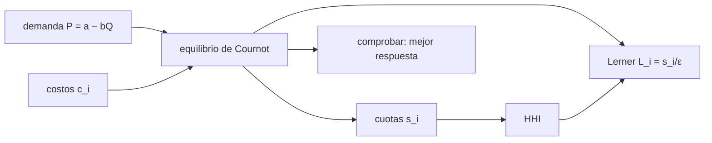

# B124-C03 — Mercados downstream y upstream

<!-- nav:top -->
[🏠 Programa](../../../../README.md) · [📚 Bloque B124](../../../tronco-comun/B124-industria-economia-etica-y-proyectos-espaciales.md) · [← Anterior: B124-C02 — Agencias científicas y empresas](../B124-C02-agencias-cientificas-y-empresas/CLASE.md) · [Siguiente: B124-C04 — Diseño de propuesta de valor →](../B124-C04-diseno-de-propuesta-de-valor/CLASE.md)
<!-- /nav -->

## 1. Ubicación, nivel y alcance

Clase 3 del bloque B124. Nivel N3. Dos mercados de la cadena de [C01](../B124-C01-cadena-de-valor-de-industria-espacial/CLASE.md) —uno de proveedores aguas arriba y otro de servicios aguas abajo— no se comportan igual: lo que cambia es cuántas empresas hay y qué cuota tiene cada una. Aquí mides esa concentración con el índice de Herfindahl–Hirschman (HHI) y la ligas al margen de precio con un modelo de Cournot. **Esta clase es educativa: no es asesoría financiera ni de libre competencia.** Los mercados son sintéticos.

## 2. Por qué esta clase existe

Hablar de «mercado upstream» o «downstream» sin medir su concentración deja la discusión en opinión. La decisión central: **¿qué tan concentrado está un mercado y qué margen de precio permite esa concentración?**

## 3. Lo que podrás hacer al terminar

1. Calcular cuotas de mercado y el HHI.
2. Resolver un equilibrio de Cournot con costos distintos.
3. Verificar el equilibrio con el método de mejor respuesta.
4. Relacionar el margen de Lerner con la cuota y la elasticidad.
5. Calcular el cambio de HHI por una fusión y comprobarlo.
6. Rotular que todos los mercados y números son sintéticos.

La evidencia es la **ficha de concentración y arrastre de un mercado sintético** del ejercicio 12 (sección 20).

## 4. Con qué llegas y cómo comprobarlo

1. ¿Qué es la cuota de mercado?
2. ¿Qué es un oligopolio?
3. ¿Qué es la elasticidad de la demanda?
4. ¿Qué es un costo marginal?
5. ¿Qué es una verificación por segunda vía?

<details>
<summary>Ver respuestas</summary>

1. La fracción de la cantidad total que vende una empresa. 2. Un mercado con pocas empresas cuyas decisiones se afectan entre sí. 3. Cuánto cambia la cantidad demandada, en proporción, cuando cambia el precio. 4. El costo de producir una unidad más. 5. Calcular lo mismo con otro método y comparar.
</details>

Con cuatro o cinco aciertos, sigue; si no, repasa los prerrequisitos.

## 5. Un caso de contexto y casos de referencia

La clase [C01](../B124-C01-cadena-de-valor-de-industria-espacial/CLASE.md) dejó dos extremos de la cadena sintética: proveedores y servicios. El **ejemplo conductor** compara un mercado aguas arriba de 3 empresas (HHI `4059`) con uno aguas abajo de 6 (HHI `1989`) con la misma demanda `P = 100 − Q`: el primero tiene precio `47,50` y el segundo `44,29`. No se consultó ninguna estadística de mercado real ni ninguna guía de autoridades de competencia; todo es **sintético**.

## 6. Vocabulario

La **cuota** `s_i` es `q_i/Q`. El **HHI** es la suma de cuotas al cuadrado (aquí en puntos, de 0 a 10 000). El **equilibrio de Cournot** es el punto en que cada empresa elige su cantidad dada la de las demás. El **índice de Lerner** `L = (P − c)/P` mide el margen de precio sobre costo. La **elasticidad** `ε` mide la sensibilidad de la demanda. Una **fusión** reúne dos empresas en una.

## 7. Modelo mental



*Descripción textual:* la demanda y los costos determinan el equilibrio de Cournot; de él salen las cuotas, el HHI y los márgenes, y el equilibrio se comprueba con mejores respuestas.

Analogía: pocos vendedores en una feria que fijan cuánto llevar mirando lo que llevan los demás. Límite: el modelo supone que todos eligen cantidades a la vez y venden un producto idéntico.

## 8. La explicación, paso a paso

### 8.1 Equilibrio de Cournot con demanda lineal

Con `P = a − bQ` y costos `c_i`, la condición de cada empresa da `q_i = (a − c_i)/b − Q` y, sumando, `Q = Σ(a − c_i)/((n + 1)b)`. Aguas arriba: `Q = 52,500` y `P = 47,500`; aguas abajo: `Q = 55,714` y `P = 44,286`.

### 8.2 HHI

Con cuotas `s_i`, `HHI = 10 000 Σ s_i²`. Aguas arriba la mayor cuota es `0,5238` y el HHI `4059`; aguas abajo, `1989`. Un HHI mayor indica mercado más concentrado; no hay un umbral universal y los umbrales de las autoridades de competencia no se consultaron.

### 8.3 Margen y concentración

La condición de equilibrio implica `L_i = s_i/ε` con `ε = P/(bQ)`. Aguas arriba `ε = 0,9048` y la empresa de menor costo tiene `L = 0,5789`. El promedio ponderado por cuota es `HHI/ε = 0,4486`, igual al calculado directamente `0,4486`.

### 8.4 Verificación y fusión

El método de mejor respuesta (2 000 iteraciones) coincide con la forma cerrada dentro de `0,0e+00`. Si las dos menores empresas aguas arriba se fusionan, el HHI sube `2 s₁ s₂ × 10 000 = 952,4` puntos (directo: `952,4`) hasta `5011`. El modelo no dice si la fusión es buena o mala: eso depende de eficiencias y de entrada de competidores que aquí no se modelan.

## 9. Magnitudes, símbolos y unidades

| Símbolo | Qué es | Unidad | Valor / nota |
|---|---|---|---|
| `a`, `b` | intercepto y pendiente de la demanda | um, um/unidad | 100 y 1 (sintéticos) |
| `c_i` | costo marginal de la empresa | um/unidad | 20 a 40 (sintético) |
| `s_i` | cuota de mercado | — | calculada |
| `HHI` | concentración | puntos (0–10 000) | calculado |
| `ε` | elasticidad de la demanda en el equilibrio | — | calculada |

## 10. Convenciones y referencias

Producto homogéneo, empresas que eligen cantidades simultáneamente, demanda lineal, sin entrada ni salida. Unidades monetarias sintéticas por unidad. Los mercados no representan ninguna industria ni empresa reales.

## 11. De dónde sale lo que afirmamos

| ID | Fuente | Localizador | Respalda | Estado |
|---|---|---|---|---|
| — | Equilibrio de Cournot, índice de Lerner y HHI | — | relaciones estándar verificadas por mejor respuesta e identidad | No consultadas en una fuente concreta |
| — | Umbrales de concentración de autoridades de competencia | — | no se usan | No consultados |
| — | `a`, `b`, `c_i` | — | todos los números | Sintético |

Límites: no se consultó ningún dato de mercado ni guía de autoridades de competencia; los mercados son inventados.

## 12. Cómo ver el resultado

| Magnitud | Valor |
|---|---|
| HHI aguas arriba | 4059 |
| HHI aguas abajo | 1989 |
| Precio aguas arriba | 47,500 um |
| Precio aguas abajo | 44,286 um |
| Cambio de HHI por fusión | 952,4 puntos |

Descripción larga: el mercado de pocas empresas tiene el HHI más alto y el precio más alto sobre el costo; la fusión de las dos menores sube el HHI en una cantidad que se calcula con una fórmula.

## 13. Ejemplo trabajado

**Paso 1 · Cuotas.** Tres empresas con cuotas `0,5`, `0,3` y `0,2`.

**Paso 2 · HHI.** `0,25 + 0,09 + 0,04 = 0,38`, es decir `3 800` puntos.

**Paso 3 · Fusión.** Si se fusionan las dos menores: cuotas `0,5` y `0,5`; HHI `5 000`.

**Paso 4 · Control.** `2 · 0,3 · 0,2 · 10 000 = 1 200` y `3 800 + 1 200 = 5 000`.

## 14. Distintas formas de describirlo

**Por cuotas:** `s_i`. **Por índice:** HHI. **Por precio:** `P` y márgenes `L_i`. **Por equilibrio:** `Q` y `q_i`. **Por fusión:** `ΔHHI = 2 s_i s_j`.

## 15. Práctica guiada

**Ejercicio 1 · con los pasos indicados.** Calcula el HHI de cuotas `0,6` y `0,4`. *Pasos:* suma de cuadrados × 10 000.

<details><summary>Solución comentada</summary>

`0,36 + 0,16 = 0,52`, es decir `5 200`.
</details>

**Ejercicio 2 · con una pista.** Calcula `Q` en un duopolio con `a = 100`, `b = 1`, `c = 20` ambos. *Pista:* `Σ(a − c)/((n+1)b)`.

<details><summary>Solución comentada</summary>

`160/3 = 53,33`.
</details>

**Ejercicio 3 · casi autónomo.** ¿Qué margen de Lerner tiene una empresa de cuota `0,5` con `ε = 0,9`?

<details><summary>Solución comentada</summary>

`0,5/0,9 = 0,556`.
</details>

## 16. Práctica autónoma, transferencia e integrador

**Ejercicio 4 · autónomo.** ¿Cuál es el HHI aguas arriba y aguas abajo?

<details><summary>Solución comentada</summary>

`4059` y `1989`.
</details>

**Ejercicio 5 · autónomo.** ¿Cuánto sube el HHI si se fusionan las dos menores empresas aguas arriba?

<details><summary>Solución comentada</summary>

`952,4` puntos hasta `5011`.
</details>

**Ejercicio 6 · autónomo.** ¿Cuál es el precio de equilibrio aguas abajo?

<details><summary>Solución comentada</summary>

`44,286` um.
</details>

**Ejercicio 7 · autónomo.** ¿Qué elasticidad hay aguas arriba?

<details><summary>Solución comentada</summary>

`0,9048`.
</details>

**Ejercicio 8 · autónomo.** ¿Cuál es el Lerner medio aguas abajo?

<details><summary>Solución comentada</summary>

`0,2502`.
</details>

**Ejercicio 9 · transferencia.** **Transferencia.** Una empresa propone fusionarse y dice que bajará su costo. ¿Qué cambiaría en el modelo?

<details><summary>Solución comentada</summary>

Su `c` bajaría y su cuota subiría; el efecto neto sobre el precio depende de cuánto baje el costo frente al aumento de concentración.
</details>

**Ejercicio 10 · transferencia.** **Transferencia.** Un informe dice que el mercado «está concentrado». ¿Qué le exiges?

<details><summary>Solución comentada</summary>

La medida (HHI u otra), el umbral y su fuente, el mercado relevante y el año; sin eso no es verificable.
</details>

**Ejercicio 11 · transferencia.** **Transferencia.** ¿Por qué el HHI sintético no puede aplicarse a un mercado real?

<details><summary>Solución comentada</summary>

Porque cuotas, costos y demanda son inventados y el mercado relevante real tiene más rasgos (diferenciación, entrada, regulación).
</details>

**Ejercicio 12 · integrador.** **Integrador.** Elabora tu *ficha de concentración y arrastre de un mercado sintético*: cuotas, HHI, precio y márgenes, verificación por mejor respuesta, efecto de una fusión y lista de qué es consultado y sintético, con el aviso de que es educativa.

<details><summary>Solución comentada</summary>

Secciones 8.1–8.4 y la salida del laboratorio.
</details>

## 17. Laboratorio: concentración y margen

El script [concentracion_de_mercado.py](concentracion_de_mercado.py) resuelve dos mercados de Cournot, calcula HHI, márgenes y el efecto de una fusión, y verifica con mejor respuesta e identidades (**comprueba** errores menores que 1e-9). Tarda menos de 10 s en un equipo común.

**Datos:** ningún dato consultado; demanda y costos **sintéticos**. **Predice antes de ejecutar:** ¿cuál de los dos mercados tendrá mayor HHI y mayor margen? (el de 3 empresas.) **Ejecución del 2026-11-11:**

```text
Python 3.12.9 (biblioteca estandar)
Mercados SINTETICOS (ilustrativos); Cournot con demanda P = 100 - Q; precio en um/unidad.
 aguas arriba (3 empresas, c = 20/30/40): Q = 52.500 ; P = 47.500 ; HHI = 4059 ; elasticidad = 0.9048
   Lerner medio ponderado = 0.4486 ; HHI/e = 0.4486 ; mayor cuota = 0.5238
 aguas abajo (6 empresas): Q = 55.714 ; P = 44.286 ; HHI = 1989 ; elasticidad = 0.7949
   Lerner medio ponderado = 0.2502 ; mayor cuota = 0.2564
Fusion de las dos menores empresas aguas arriba: dHHI formula 2 s1 s2 = 952.4 ; directo = 952.4 ; HHI nuevo = 5011
Errores: Lerner arriba 0.0e+00 ; abajo 2.8e-17 ; mejor respuesta arriba 0.0e+00 ; abajo 7.1e-15
Pruebas superadas.
```

```bash
python programa/clases/B124/B124-C03-mercados-downstream-y-upstream/concentracion_de_mercado.py
```

**Límites:** demanda lineal, producto homogéneo, sin entrada; no sirve para evaluar una fusión real ni sustituye a una autoridad de competencia.

## 18. Errores frecuentes y cómo corregirlos

**Medir concentración con el número de empresas.** Se corrige con 8.2: dos empresas con cuotas 0,95 y 0,05 son casi un monopolio.

**Interpretar un HHI con un umbral no consultado.** Se corrige con 8.2.

**Creer que una fusión siempre sube el precio.** Se corrige con 8.4.

**Tomar el mercado sintético como real.** Se corrige con la sección 10.

## 19. Cómo sabrás que vas bien

Tras la sección 8: ¿qué HHI esperabas y cuál obtuviste? Si dudas, repasa el ejemplo 13. Tras el laboratorio: ¿qué comprueba? (ver la sección 17).

## 20. Qué entregas y cómo se evalúa

El producto es tu **ficha de concentración y arrastre de un mercado sintético** (ejercicio 12).

| Criterio | Inicial | En desarrollo | Logrado | Destacado |
|---|---|---|---|---|
| Conceptos | Los confunde | Parciales | Calcula HHI y Lerner | Explica los límites |
| Cálculo | Sin unidades | Con errores | Tablas completas con unidades | Calcula casos nuevos |
| Numérico | Sin comprobar | Un caso | Contraste con una segunda vía | Interpreta las diferencias |
| Fuentes | Sin fuente | Sin fecha | Fuentes con fecha y estado | Declara lo ilustrativo y lo no consultado |
| Límites | No los nombra | Uno | Tres | Discute qué falta del modelo |

**Condiciones críticas (no se compensan con promedio):** rotular los datos como sintéticos o ilustrativos; no presentar el resultado como asesoría financiera, legal ni de inversión; citar solo lo consultado.

## 21. Ética, seguridad y límites

Clase educativa: **no es asesoría financiera, legal, tributaria ni de inversión** y no sustituye a un profesional habilitado ni a la normativa vigente; ningún resultado debe usarse para decidir una compra, un contrato, una inversión o un seguro reales. Un análisis de concentración sobre empresas reales puede afectarlas; esta clase no nombra ninguna. Los modelos son simplificados y sus datos son sintéticos o ilustrativos. Accesibilidad: tablas equivalentes a las gráficas, fórmulas en texto, ejercicios sin conexión.

## 22. Para cerrar y seguir

El mercado sintético de 3 empresas tiene HHI `4059` y precio `47,5`; el de 6, HHI `1989` y precio `44,3`; fusionar las dos menores del primero añade `952` puntos.

**Glosario español–inglés.** cuota de mercado · *market share*; índice de Herfindahl–Hirschman · *Herfindahl–Hirschman index*; índice de Lerner · *Lerner index*; fusión · *merger*; elasticidad · *elasticity*.

**Continuidad.** [B124-C04](../B124-C04-diseno-de-propuesta-de-valor/CLASE.md) pasa del mercado a la oferta: cómo se diseña y compara una propuesta de valor.

**Referencias:** ver sección 11.

<!-- nav:bottom -->
---

[← Anterior: B124-C02 — Agencias científicas y empresas](../B124-C02-agencias-cientificas-y-empresas/CLASE.md) · [📚 Bloque B124](../../../tronco-comun/B124-industria-economia-etica-y-proyectos-espaciales.md) · [Siguiente: B124-C04 — Diseño de propuesta de valor →](../B124-C04-diseno-de-propuesta-de-valor/CLASE.md)
<!-- /nav -->
