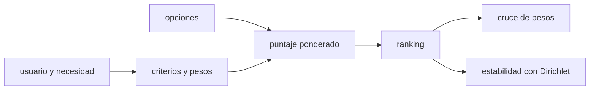

# B124-C04 — Diseño de propuesta de valor

<!-- nav:top -->
[🏠 Programa](../../../../README.md) · [📚 Bloque B124](../../../tronco-comun/B124-industria-economia-etica-y-proyectos-espaciales.md) · [← Anterior: B124-C03 — Mercados downstream y upstream](../B124-C03-mercados-downstream-y-upstream/CLASE.md) · [Siguiente: B124-C05 — Estimación de costos de misión →](../B124-C05-estimacion-de-costos-de-mision/CLASE.md)
<!-- /nav -->

## 1. Ubicación, nivel y alcance

Clase 4 del bloque B124. Nivel N3. Después de ver el mercado en [C03](../B124-C03-mercados-downstream-y-upstream/CLASE.md), diseñas la oferta: qué producto o servicio se propone a qué usuario y por qué sería mejor que las alternativas. Lo tratas como un problema de decisión multicriterio con requisitos medibles y con una comprobación de cuán estable es la elección. **Esta clase es educativa: no es asesoría de negocios ni financiera.** Todas las opciones son sintéticas.

## 2. Por qué esta clase existe

Una propuesta de valor sin criterios explícitos es una opinión; con criterios, pesos y sensibilidad es una decisión que se puede discutir. La decisión central: **¿qué opción ofrecer y cuánto cambia la elección si cambian los pesos?**

## 3. Lo que podrás hacer al terminar

1. Definir criterios medibles y una escala común de puntaje.
2. Calcular un puntaje ponderado y ordenar las opciones.
3. Calcular el peso en que dos opciones empatan, de forma analítica y con barrido.
4. Estimar la estabilidad del ranking con pesos aleatorios.
5. Interpretar qué dice y qué no dice un puntaje.
6. Rotular que opciones, pesos y puntajes son sintéticos.

La evidencia es la **matriz de propuesta de valor con sensibilidad** del ejercicio 12 (sección 20).

## 4. Con qué llegas y cómo comprobarlo

1. ¿Qué es una propuesta de valor?
2. ¿Qué es un criterio?
3. ¿Qué es un promedio ponderado?
4. ¿Qué es una distribución de Dirichlet?
5. ¿Qué es una verificación por segunda vía?

<details>
<summary>Ver respuestas</summary>

1. La descripción de qué beneficio recibe un usuario concreto y por qué elegiría esta oferta. 2. Un aspecto medible con el que se compara cada opción. 3. Un promedio en que cada dato cuenta según un peso y los pesos suman 1. 4. Una distribución sobre vectores positivos que suman 1; sirve para generar pesos aleatorios. 5. Calcular lo mismo con otro método y comparar.
</details>

Con cuatro o cinco aciertos, sigue; si no, repasa los prerrequisitos.

## 5. Un caso de contexto y casos de referencia

No se consultó ninguna encuesta ni mercado real. El **ejemplo conductor** compara 5 ofertas sintéticas de un servicio de observación de la Tierra con 5 criterios: gana «B alerta en 24 h» con `3,900` puntos y le sigue «C indice de cultivo» con `3,700`; con pesos aleatorios alrededor de los base, el primero gana el `73,9%` de las veces. Todo es **sintético**.

## 6. Vocabulario

Un **criterio** es un aspecto de comparación. Un **peso** `w_k` mide su importancia y los pesos suman 1. El **puntaje** `s_ik` califica la opción `i` en el criterio `k` de 1 a 5. El **puntaje ponderado** es `Σ w_k s_ik`. La **sensibilidad** es cuánto cambia el ranking al cambiar un peso. La **estabilidad** es la fracción de pesos aleatorios con que una opción gana.

## 7. Modelo mental



*Descripción textual:* el usuario y su necesidad fijan criterios y pesos; las opciones se puntúan, se ordenan y el ranking se somete a un cruce de pesos y a una simulación.

Analogía: elegir un teléfono con una lista de características a las que das importancia distinta. Límite: aquí el puntaje es una convención ordinal y sumarlo supone que 1 punto de calidad equivale a 1 punto de plazo, lo que no siempre es cierto.

## 8. La explicación, paso a paso

### 8.1 Del criterio al puntaje

El puntaje de la opción `i` es `Σ_k w_k s_ik`. Con los pesos base, `B alerta en 24 h` obtiene `3,900`, `C indice de cultivo` obtiene `3,700`. Calculado por filas o por columnas el resultado coincide dentro de `8,9e-16`.

### 8.2 Cruce de pesos

Al mover el peso del primer criterio a `t` y reescalar los demás, la diferencia entre dos opciones es lineal en `t`, así que el cruce se resuelve con dos evaluaciones: `t = d₀/(d₀ − d₁)`. El primero deja de liderar en `t = 0,1250` (peso base `0,30`); el barrido da `0,1251`, a `1,0e-04`.

### 8.3 Estabilidad

Con 20 000 vectores de pesos Dirichlet de concentración 20 alrededor de los pesos base, las frecuencias de victoria suman `1,000000`; la del líder es `0,7394` y la del segundo `0,0636`. Un líder que gana por poco y con frecuencia baja no es una decisión robusta.

### 8.4 Qué no dice

Un puntaje ordena, no mide valor monetario ni disposición a pagar. Los pesos reflejan una preferencia que debe ser acordada con el usuario; cambiarlos cambia el ranking. Por eso el producto de la clase incluye la sensibilidad.

## 9. Magnitudes, símbolos y unidades

| Símbolo | Qué es | Unidad | Valor / nota |
|---|---|---|---|
| `w_k` | peso del criterio `k` | — | 0,15 a 0,30 (sintético) |
| `s_ik` | puntaje de la opción `i` en `k` | puntos (1–5) | sintético |
| `t` | peso del criterio movido | — | 0 a 1 |
| `f_i` | frecuencia de victoria | — | calculada |

## 10. Convenciones y referencias

Escala de puntajes de 1 a 5 (5 = mejor; en «costo para el usuario», 5 = más barato). Pesos que suman 1. Sin incertidumbre en los puntajes. Opciones y puntajes inventados.

## 11. De dónde sale lo que afirmamos

| ID | Fuente | Localizador | Respalda | Estado |
|---|---|---|---|---|
| — | Suma ponderada, cruce lineal, Dirichlet | — | verificados por dos formas de cálculo y un barrido | No consultados en una fuente concreta |
| — | Opciones, criterios, pesos y puntajes | — | todos los números | Sintético |

Límites: no se consultó ninguna investigación de usuarios; ninguna opción corresponde a un producto real.

## 12. Cómo ver el resultado

| Magnitud | Valor |
|---|---|
| Líder | B alerta en 24 h (3,900 puntos) |
| Segundo | C indice de cultivo (3,700) |
| P(el líder gana) con pesos aleatorios | 73,9% |
| Peso en que cambia el líder | 0,1250 |

Descripción larga: el líder tiene ventaja sobre el segundo con los pesos base, pero esa ventaja desaparece si el peso de la necesidad del usuario cambia lo suficiente.

## 13. Ejemplo trabajado

**Paso 1 · Datos.** Opción X: puntajes `(4, 2)`; opción Y: `(2, 5)`; pesos `(0,6; 0,4)`.

**Paso 2 · Puntajes.** `X = 0,6·4 + 0,4·2 = 3,2`; `Y = 0,6·2 + 0,4·5 = 3,2`.

**Paso 3 · Empate.** Están empatadas con los pesos base, así que cualquier cambio de peso decide.

**Paso 4 · Cruce.** `X − Y = w(4−2) + (1−w)(2−5) = 5w − 3`, que se anula en `w = 0,6`.

## 14. Distintas formas de describirlo

**Por tabla:** puntajes por criterio. **Por suma:** puntaje ponderado. **Por cruce:** peso de empate. **Por simulación:** frecuencia de victoria. **Por ranking:** orden y diferencia entre opciones.

## 15. Práctica guiada

**Ejercicio 1 · con los pasos indicados.** Calcula el puntaje con pesos `(0,5; 0,5)` y puntajes `(4, 2)`. *Pasos:* suma ponderada.

<details><summary>Solución comentada</summary>

`3`.
</details>

**Ejercicio 2 · con una pista.** Si los puntajes son `(3, 5)` y los pesos `(0,7; 0,3)`. *Pista:* multiplica y suma.

<details><summary>Solución comentada</summary>

`0,7·3 + 0,3·5 = 3,6`.
</details>

**Ejercicio 3 · casi autónomo.** ¿A qué peso `w` empatan `(4, 2)` y `(2, 5)`?

<details><summary>Solución comentada</summary>

`5w − 3 = 0` ⇒ `w = 0,6`.
</details>

## 16. Práctica autónoma, transferencia e integrador

**Ejercicio 4 · autónomo.** ¿Cuál es el puntaje del líder en el laboratorio?

<details><summary>Solución comentada</summary>

`3,900`.
</details>

**Ejercicio 5 · autónomo.** ¿Y cuál es la diferencia con el segundo?

<details><summary>Solución comentada</summary>

`0,200` puntos.
</details>

**Ejercicio 6 · autónomo.** ¿En qué peso cambia el líder?

<details><summary>Solución comentada</summary>

En `t = 0,1250`.
</details>

**Ejercicio 7 · autónomo.** ¿Con qué frecuencia gana el líder con pesos aleatorios?

<details><summary>Solución comentada</summary>

`73,9%`.
</details>

**Ejercicio 8 · autónomo.** ¿Cuál es la frecuencia de victoria de la opción menos puntuada?

<details><summary>Solución comentada</summary>

`0,0002`.
</details>

**Ejercicio 9 · transferencia.** **Transferencia.** Un usuario insiste en que el costo pese el doble. ¿Cómo lo representas y qué haces con el ranking?

<details><summary>Solución comentada</summary>

Subes `w_costo`, reescalas el resto para sumar 1, recalculas y revisas si el líder cambia; documentas el cambio.
</details>

**Ejercicio 10 · transferencia.** **Transferencia.** Dos opciones empatan. ¿Qué criterio adicional usarías?

<details><summary>Solución comentada</summary>

Un criterio no incluido (riesgo, tiempo de aprendizaje) o una conversación con el usuario; el modelo no decide.
</details>

**Ejercicio 11 · transferencia.** **Transferencia.** Un colega suma puntajes de escalas distintas (1–5 y 1–10) sin normalizar. ¿Qué problema hay?

<details><summary>Solución comentada</summary>

El criterio de escala mayor pesa más de lo previsto; hay que normalizar a una escala común antes de ponderar.
</details>

**Ejercicio 12 · integrador.** **Integrador.** Elabora tu *matriz de propuesta de valor con sensibilidad*: criterios, pesos, puntajes, ranking, cruce de pesos con su verificación, estabilidad con pesos aleatorios y lista de qué es sintético, con el aviso de que es educativa.

<details><summary>Solución comentada</summary>

Secciones 8.1–8.4 y la salida del laboratorio.
</details>

## 17. Laboratorio: matriz de propuesta de valor

El script [propuesta_de_valor.py](propuesta_de_valor.py) puntúa 5 opciones sintéticas, calcula el cruce de pesos de forma analítica y por barrido, y mide la estabilidad con pesos Dirichlet (**comprueba** cruce a 2e-4 y frecuencias que suman 1). Tarda menos de 10 s en un equipo común.

**Datos:** ningún dato consultado; opciones, criterios, pesos y puntajes **sintéticos**. **Predice antes de ejecutar:** ¿gana la misma opción si cambian los pesos? (no siempre: mira el cruce.) **Ejecución del 2026-11-11:**

```text
Python 3.12.9 (biblioteca estandar)
Propuestas de valor SINTETICAS; puntajes 1-5; pesos base: necesidad del usuario=0.3, calidad de dato=0.25, plazo de entrega=0.15, costo para el usuario=0.15, diferenciacion=0.15
 opcion                    puntaje   P(gana) con pesos Dirichlet
 B alerta en 24 h            3.900   0.7394
 C indice de cultivo         3.700   0.0636
 D datos abiertos            3.500   0.1968
 A imagen mensual            3.250   0.0000
 E consultoria a medida      3.000   0.0002
Lider = B alerta en 24 h ; segundo = C indice de cultivo
El primero deja de liderar al subir/bajar el peso de 'necesidad del usuario' desde 0.3 hasta t = 0.1250 (analitico) ; barrido 0.1251 ; diferencia 1.0e-04
Puntaje por filas frente a por columnas (error) = 8.9e-16 ; suma de frecuencias = 1.000000
Pruebas superadas.
```

```bash
python programa/clases/B124/B124-C04-diseno-de-propuesta-de-valor/propuesta_de_valor.py
```

**Límites:** puntaje ordinal tratado como cardinal, criterios independientes, sin incertidumbre en los puntajes; los pesos son una preferencia, no un dato.

## 18. Errores frecuentes y cómo corregirlos

**Presentar el puntaje como un valor monetario.** Se corrige con 8.4.

**Fijar los pesos sin acordarlos con el usuario.** Se corrige con 8.2 y 8.4.

**Dar por robusta una elección sin sensibilidad.** Se corrige con 8.2–8.3.

**Sumar escalas distintas sin normalizar.** Se corrige con el ejercicio 11.

## 19. Cómo sabrás que vas bien

Tras la sección 8: ¿qué opción esperabas que liderara y cuál lideró? Si dudas, repasa el ejemplo 13. Tras el laboratorio: ¿qué comprueba? (ver la sección 17).

## 20. Qué entregas y cómo se evalúa

El producto es tu **matriz de propuesta de valor con sensibilidad** (ejercicio 12).

| Criterio | Inicial | En desarrollo | Logrado | Destacado |
|---|---|---|---|---|
| Conceptos | Los confunde | Parciales | Calcula puntajes y cruce | Explica los límites |
| Cálculo | Sin unidades | Con errores | Tablas completas con unidades | Calcula casos nuevos |
| Numérico | Sin comprobar | Un caso | Contraste con una segunda vía | Interpreta las diferencias |
| Fuentes | Sin fuente | Sin fecha | Fuentes con fecha y estado | Declara lo ilustrativo y lo no consultado |
| Límites | No los nombra | Uno | Tres | Discute qué falta del modelo |

**Condiciones críticas (no se compensan con promedio):** rotular los datos como sintéticos o ilustrativos; no presentar el resultado como asesoría financiera, legal ni de inversión; citar solo lo consultado.

## 21. Ética, seguridad y límites

Clase educativa: **no es asesoría financiera, legal, tributaria ni de inversión** y no sustituye a un profesional habilitado ni a la normativa vigente; ningún resultado debe usarse para decidir una compra, un contrato, una inversión o un seguro reales. Los pesos expresan valores de personas concretas; hay que decir de quién son y no presentarlos como neutros. Los modelos son simplificados y sus datos son sintéticos o ilustrativos. Accesibilidad: tablas equivalentes a las gráficas, fórmulas en texto, ejercicios sin conexión.

## 22. Para cerrar y seguir

La opción líder obtiene `3,900` puntos y gana el `73,9%` de las veces con pesos aleatorios; deja de liderar si el peso de la necesidad del usuario cambia a `0,125`.

**Glosario español–inglés.** propuesta de valor · *value proposition*; criterio · *criterion*; peso · *weight*; sensibilidad · *sensitivity*; ranking · *ranking*.

**Continuidad.** [B124-C05](../B124-C05-estimacion-de-costos-de-mision/CLASE.md) pone costo a la oferta: cómo se estima el costo de una misión.

**Referencias:** ver sección 11.

<!-- nav:bottom -->
---

[← Anterior: B124-C03 — Mercados downstream y upstream](../B124-C03-mercados-downstream-y-upstream/CLASE.md) · [📚 Bloque B124](../../../tronco-comun/B124-industria-economia-etica-y-proyectos-espaciales.md) · [Siguiente: B124-C05 — Estimación de costos de misión →](../B124-C05-estimacion-de-costos-de-mision/CLASE.md)
<!-- /nav -->
