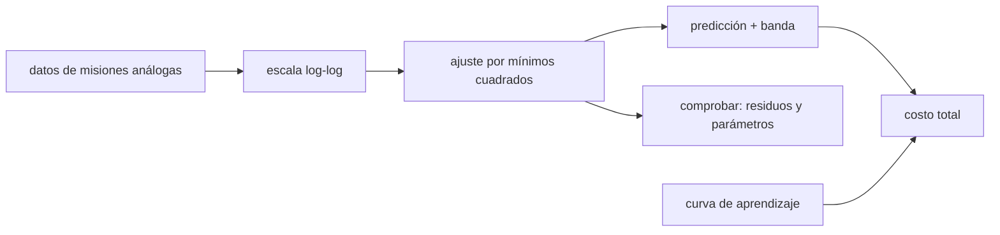

# B124-C05 — Estimación de costos de misión

<!-- nav:top -->
[🏠 Programa](../../../../README.md) · [📚 Bloque B124](../../../tronco-comun/B124-industria-economia-etica-y-proyectos-espaciales.md) · [← Anterior: B124-C04 — Diseño de propuesta de valor](../B124-C04-diseno-de-propuesta-de-valor/CLASE.md) · [Siguiente: B124-C06 — Financiamiento público →](../B124-C06-financiamiento-publico/CLASE.md)
<!-- /nav -->

## 1. Ubicación, nivel y alcance

Clase 5 del bloque B124. Nivel N3. Para saber cuánto cuesta una misión no basta sumar partidas: se estima con relaciones paramétricas entre el costo y atributos medibles (como la masa) y con curvas de aprendizaje si se fabrican varias unidades. Aquí ajustas una relación de costo en escala logarítmica, le pones una banda de incertidumbre y sumas el efecto del aprendizaje. Retomas la oferta de [C04](../B124-C04-diseno-de-propuesta-de-valor/CLASE.md). **Esta clase es educativa: no es asesoría financiera ni una estimación de una misión real.** Los datos son sintéticos.

## 2. Por qué esta clase existe

Un costo sin banda de incertidumbre parece más preciso de lo que es. La decisión central: **¿cuánto cuesta esta misión, con qué banda y cuánto baja el costo unitario si se fabrican varias unidades?**

## 3. Lo que podrás hacer al terminar

1. Ajustar una relación de costo `costo = a m^b` por mínimos cuadrados en escala log-log.
2. Calcular el error estándar del ajuste y un intervalo de predicción al 80 %.
3. Comprobar el ajuste con los residuos y con los parámetros verdaderos.
4. Aplicar una curva de aprendizaje de Wright y calcular el costo acumulado.
5. Verificar la suma directa con una aproximación integral.
6. Separar lo consultado (qué son los CER) de lo sintético (todos los números).

La evidencia es la **estimación de costo de una misión sintética con banda** del ejercicio 12 (sección 20).

## 4. Con qué llegas y cómo comprobarlo

1. ¿Qué es un logaritmo?
2. ¿Qué es una regresión por mínimos cuadrados?
3. ¿Qué es un intervalo de predicción?
4. ¿Qué es un residuo?
5. ¿Qué es una curva de aprendizaje?

<details>
<summary>Ver respuestas</summary>

1. El exponente al que hay que elevar una base para obtener un número. 2. El ajuste de una recta que minimiza la suma de los cuadrados de los errores. 3. Un rango en el que se espera que caiga un valor nuevo con cierta probabilidad. 4. La diferencia entre el dato y el valor ajustado. 5. La disminución del costo por unidad al duplicarse la cantidad producida.
</details>

Con cuatro o cinco aciertos, sigue; si no, repasa los prerrequisitos.

## 5. Un caso de contexto y casos de referencia

El NASA Cost Estimating Handbook v4.0 (febrero de 2015) es la guía de la agencia para estimar costos; su apéndice E menciona relaciones de estimación de costo (CER) y reportes de curvas de aprendizaje, y su glosario dice que, en la teoría de la curva de aprendizaje, la primera unidad es la más cara. Es todo lo que se **consultó**; ninguna cifra viene de ahí. El **ejemplo conductor** ajusta 14 misiones **sintéticas** de 80 a 3 000 kg: el exponente estimado es `0,563` (verdadero 0,55) y para 600 kg la mediana es `29,5` Mum con un intervalo al 80 % de `22,3` a `39,1`.

## 6. Vocabulario

Una **relación de estimación de costo (CER)** es una ecuación que da el costo en función de un atributo. La **escala log-log** convierte `a m^b` en una recta. El **SEE** es el error estándar de la estimación en escala logarítmica. El **intervalo de predicción** acota un valor nuevo. La **curva de aprendizaje** de Wright da `T_n = T₁ n^β` con `β = log₂(pendiente)`. La **pendiente** es la fracción del costo que queda al duplicar la cantidad.

## 7. Modelo mental



*Descripción textual:* los datos de misiones análogas se pasan a escala logarítmica y se ajustan; el ajuste da una predicción con banda que se comprueba con residuos, y se suma el costo de las unidades repetidas con aprendizaje.

Analogía: estimar el precio de una casa por su superficie, usando casas parecidas ya vendidas. Límite: una misión nueva puede no parecerse a las anteriores, y el ajuste solo vale dentro del rango de masas observadas.

## 8. La explicación, paso a paso

### 8.1 El ajuste

En escala logarítmica `ln(costo) = ln a + b ln m`. Con los 14 datos sintéticos (masas de `120` a `2672` kg) resultan `a = 0,806` y `b = 0,5629`, con error estándar de `b` de `0,0511`; el valor verdadero (0,55) queda a `0,25` errores estándar. El SEE es `0,2117`.

### 8.2 Comprobar el ajuste

Los residuos del método suman cero (`8,9e-16`) y son ortogonales a `ln m` (`6,8e-15`): es una propiedad algebraica del método, no un resultado empírico, y detecta errores de programación.

### 8.3 Predicción con banda

Para 600 kg, `ln costo = ln a + b ln 600`; la mediana es `29,50` Mum. La desviación de predicción incluye el SEE y la distancia al centro de los datos; con `z = 1,2816` el intervalo al 80 % es `[22,27, 39,07]` y contiene el valor verdadero `30,35`. La banda es multiplicativa: el costo puede ser mayor o menor en un factor, no en una cantidad fija.

### 8.4 Curva de aprendizaje

Con pendiente 0,85, `β = -0,2345`; la unidad 2 cuesta `0,85` de la primera y la 4, `0,7225`. Diez unidades cuestan `284,64` Mum en suma directa y `285,38` con la aproximación integral (error `0,26%`); el promedio es `28,46` Mum por unidad. Sumando el costo mediano del CER (`29,5`) y esas unidades, la misión sintética cuesta `314,1` Mum, con la banda del CER aplicada solo a la parte que estima.

## 9. Magnitudes, símbolos y unidades

| Símbolo | Qué es | Unidad | Valor / nota |
|---|---|---|---|
| `m` | masa del atributo | kg | 80 a 3 000 (sintético) |
| `a`, `b` | coeficiente y exponente del CER | — | 0,806; 0,563 |
| `SEE` | error estándar en escala logarítmica | — | 0,212 |
| `T₁`, `β` | primera unidad y exponente de aprendizaje | Mum; — | 40; -0,2345 |
| costo | costo de la misión | Mum (millones de um sintéticas) | sintético |

## 10. Convenciones y referencias

Masa en kg; costo en millones de unidades monetarias sintéticas (Mum) en precios constantes ilustrativos. Errores log-normales independientes, relación de potencia sin cambio de régimen, aprendizaje de Wright sin interrupciones. Los datos no representan ninguna misión real.

## 11. De dónde sale lo que afirmamos

| ID | Fuente | Localizador | Respalda | Estado |
|---|---|---|---|---|
| S1 | NASA, Cost Estimating Handbook v4.0, febrero de 2015 — https://www.nasa.gov/ocfo/ppc-corner/nasa-cost-estimating-handbook-ceh/ (consultada 2026-11-11) y apéndice E https://www.nasa.gov/wp-content/uploads/2020/11/ceh_appe.pdf (PDF leído con PyMuPDF) | página y apéndice E | existe una guía de estimación de costos de la NASA; el apéndice E menciona CER y reportes de curvas de aprendizaje; la versión 4.0 incorpora el análisis conjunto de costo y calendario (JCL) | Consultada |
| — | Mínimos cuadrados, intervalo de predicción, curva de Wright | — | verificados con residuos, parámetros verdaderos y suma directa | No consultados en una fuente concreta |
| — | 14 misiones, `a`, `b`, `s`, `T₁`, pendiente | — | todas las cifras | Sintético |

Límites: no se consultó ningún dato de costos reales de misiones ni los métodos detallados del Handbook; ningún valor numérico sale de la NASA.

## 12. Cómo ver el resultado

| Magnitud | Valor |
|---|---|
| Exponente `b` ajustado | 0,5629 (verdadero 0,55) |
| Costo mediano a 600 kg | 29,50 Mum |
| Intervalo al 80 % | [22,27, 39,07] Mum |
| 10 unidades con aprendizaje | 284,64 Mum |
| Costo promedio por unidad | 28,46 Mum |

Descripción larga: el costo crece con la masa con exponente cercano a 0,55, la banda de predicción es amplia y la repetición de unidades abarata cada unidad.

## 13. Ejemplo trabajado

**Paso 1 · Datos.** `costo = 2 m^0,5` (Mum, `m` en kg).

**Paso 2 · Cálculo.** Para `m = 400`: `2 · 20 = 40` Mum.

**Paso 3 · Escala.** Si la masa se cuadruplica a 1 600: `2 · 40 = 80`, solo el doble.

**Paso 4 · Aprendizaje.** Con pendiente 0,8 y `T₁ = 40`: la unidad 2 cuesta `32` y la 4 cuesta `25,6`.

## 14. Distintas formas de describirlo

**Por fórmula:** `a m^b`. **Por recta:** `ln costo` contra `ln m`. **Por banda:** mediana y factor multiplicativo. **Por unidad:** `T_n`. **Por acumulado:** `ΣT_n` y su aproximación integral.

## 15. Práctica guiada

**Ejercicio 1 · con los pasos indicados.** Calcula el costo de `2 m^0,5` para `m = 100`. *Pasos:* raíz de 100 por 2.

<details><summary>Solución comentada</summary>

`20` Mum.
</details>

**Ejercicio 2 · con una pista.** Si la masa se multiplica por 8 y `b = 0,5`, ¿por cuánto se multiplica el costo? *Pista:* `8^0,5`.

<details><summary>Solución comentada</summary>

`2,83`.
</details>

**Ejercicio 3 · casi autónomo.** Con pendiente 0,9, ¿cuánto cuesta la unidad 2 si `T₁ = 50`?

<details><summary>Solución comentada</summary>

`45`.
</details>

## 16. Práctica autónoma, transferencia e integrador

**Ejercicio 4 · autónomo.** ¿Qué exponente ajustó el laboratorio y a cuántos errores estándar queda del verdadero?

<details><summary>Solución comentada</summary>

`0,5629`; `0,25` errores estándar.
</details>

**Ejercicio 5 · autónomo.** ¿Cuál es la mediana del costo para 600 kg?

<details><summary>Solución comentada</summary>

`29,50` Mum.
</details>

**Ejercicio 6 · autónomo.** ¿Cuál es el ancho del intervalo al 80 %?

<details><summary>Solución comentada</summary>

`39,07 − 22,27` Mum (cociente `hi/lo`: factor multiplicativo).
</details>

**Ejercicio 7 · autónomo.** ¿Cuánto cuestan 10 unidades con aprendizaje?

<details><summary>Solución comentada</summary>

`284,64` Mum en suma directa.
</details>

**Ejercicio 8 · autónomo.** ¿Qué error tiene la aproximación integral?

<details><summary>Solución comentada</summary>

`0,26%`.
</details>

**Ejercicio 9 · transferencia.** **Transferencia.** Quieres estimar una misión de 20 000 kg con este ajuste. ¿Qué precaución tomas?

<details><summary>Solución comentada</summary>

Evitar extrapolar: el ajuste vale dentro de 80–3 000 kg; fuera de ese rango no hay datos y la banda real es mayor.
</details>

**Ejercicio 10 · transferencia.** **Transferencia.** Un proveedor promete una pendiente de 0,70. ¿Cómo lo contrastas?

<details><summary>Solución comentada</summary>

Con datos históricos de unidades repetidas de productos análogos; una pendiente más baja que la usual es una hipótesis a verificar.
</details>

**Ejercicio 11 · transferencia.** **Transferencia.** Dos misiones de la misma masa costaron muy distinto. ¿Qué dice el modelo?

<details><summary>Solución comentada</summary>

Que la masa explica solo parte del costo; el resto está en el SEE y en atributos no incluidos (complejidad, madurez tecnológica).
</details>

**Ejercicio 12 · integrador.** **Integrador.** Elabora tu *estimación de costo de una misión sintética con banda*: ajuste con parámetros y error, predicción con intervalo, efecto del aprendizaje, verificación por residuos y lista de qué es consultado y sintético, con el aviso de que es educativa.

<details><summary>Solución comentada</summary>

Secciones 8.1–8.4 y la salida del laboratorio.
</details>

## 17. Laboratorio: CER y curva de aprendizaje

El script [cer_y_curva_de_aprendizaje.py](cer_y_curva_de_aprendizaje.py) ajusta un CER a 14 misiones sintéticas, predice con banda al 80 % y calcula una curva de aprendizaje (**comprueba** residuos y parámetros verdaderos, la unidad 2 y 4 exactas y la suma frente a su aproximación a 2 %). Tarda menos de 10 s en un equipo común.

**Datos:** solo el concepto de CER y de curva de aprendizaje del Handbook (consultado 2026-11-11); las 14 misiones, `a`, `b`, `s`, `T₁` y la pendiente son **sintéticos**. **Predice antes de ejecutar:** ¿quedará el exponente ajustado cerca de 0,55? (sí, dentro de un par de errores estándar.) **Ejecución del 2026-11-11:**

```text
Python 3.12.9 (biblioteca estandar)
14 misiones SINTETICAS (masa en kg, costo en Mum sinteticos), a = 0.9, b = 0.55, s = 0.20, semilla 124
  m =    120.1 kg   costo =    7.53 Mum
  m =    133.7 kg   costo =   15.36 Mum
  m =    145.7 kg   costo =   13.27 Mum
  m =    233.3 kg   costo =   16.73 Mum
  m =    251.5 kg   costo =   20.62 Mum
  m =    291.2 kg   costo =   29.60 Mum
  m =    361.6 kg   costo =   23.25 Mum
  m =    374.1 kg   costo =   23.69 Mum
  m =    445.6 kg   costo =   24.80 Mum
  m =    513.6 kg   costo =   20.37 Mum
  m =   2088.8 kg   costo =   63.77 Mum
  m =   2602.5 kg   costo =   60.39 Mum
  m =   2647.3 kg   costo =   66.16 Mum
  m =   2671.9 kg   costo =   70.19 Mum
Ajuste: a = 0.806 ; b = 0.5629 (error estandar 0.0511; |b - 0.55| = 0.25 errores estandar) ; SEE = 0.2117
Prediccion para m = 600 kg: mediana = 29.50 Mum ; intervalo 80 % = [22.27, 39.07] ; verdadero = 30.35 ; dentro = True
Curva de aprendizaje: pendiente 0.85 ; beta = -0.2345 ; unidad 2/unidad 1 = 0.8500 ; unidad 4/unidad 1 = 0.7225
  unidad 10 = 23.313 Mum ; costo acumulado de 10 unidades = 284.643 ; aproximacion integral = 285.383 ; error = 0.26 %
  costo promedio por unidad = 28.464 Mum ; mision (CER mediano + 10 unidades) = 314.14 Mum
Residuos: |suma| = 8.9e-16 ; |ortogonalidad con ln m| = 6.8e-15
Pruebas superadas.
```

```bash
python programa/clases/B124/B124-C05-estimacion-de-costos-de-mision/cer_y_curva_de_aprendizaje.py
```

**Límites:** 14 datos sintéticos, un solo atributo, errores log-normales independientes y sin extrapolación; la banda al 80 % usa la aproximación normal; no estima ninguna misión real.

## 18. Errores frecuentes y cómo corregirlos

**Extrapolar el CER fuera del rango de los datos.** Se corrige con 8.3 y el ejercicio 9.

**Dar un costo sin banda.** Se corrige con 8.3.

**Creer que la curva de aprendizaje es una ley universal.** Se corrige con la sección 10 y el ejercicio 10.

**Tomar la estimación sintética como una cifra de misión.** Se corrige con la sección 10.

## 19. Cómo sabrás que vas bien

Tras la sección 8: ¿qué exponente esperabas y cuál obtuviste? Si dudas, repasa el ejemplo 13. Tras el laboratorio: ¿qué comprueba? (ver la sección 17).

## 20. Qué entregas y cómo se evalúa

El producto es tu **estimación de costo de una misión sintética con banda** (ejercicio 12).

| Criterio | Inicial | En desarrollo | Logrado | Destacado |
|---|---|---|---|---|
| Conceptos | Los confunde | Parciales | Ajusta y predice con banda | Explica los límites |
| Cálculo | Sin unidades | Con errores | Tablas completas con unidades | Calcula casos nuevos |
| Numérico | Sin comprobar | Un caso | Contraste con una segunda vía | Interpreta las diferencias |
| Fuentes | Sin fuente | Sin fecha | Fuentes con fecha y estado | Declara lo ilustrativo y lo no consultado |
| Límites | No los nombra | Uno | Tres | Discute qué falta del modelo |

**Condiciones críticas (no se compensan con promedio):** rotular los datos como sintéticos o ilustrativos; no presentar el resultado como asesoría financiera, legal ni de inversión; citar solo lo consultado.

## 21. Ética, seguridad y límites

Clase educativa: **no es asesoría financiera, legal, tributaria ni de inversión** y no sustituye a un profesional habilitado ni a la normativa vigente; ningún resultado debe usarse para decidir una compra, un contrato, una inversión o un seguro reales. Una estimación de costo influye en decisiones de financiamiento: hay que declarar su incertidumbre y no presentarla como un compromiso. Los modelos son simplificados y sus datos son sintéticos o ilustrativos. Accesibilidad: tablas equivalentes a las gráficas, fórmulas en texto, ejercicios sin conexión.

## 22. Para cerrar y seguir

El CER sintético ajusta `b = 0,563`; para 600 kg la mediana es `29,5 Mum` con un intervalo al 80 % de `22,3` a `39,1`, y diez unidades con aprendizaje de 0,85 cuestan `284,6` Mum.

**Glosario español–inglés.** relación de estimación de costo · *cost estimating relationship (CER)*; curva de aprendizaje · *learning curve*; intervalo de predicción · *prediction interval*; residuo · *residual*; primera unidad · *first unit*.

**Continuidad.** [B124-C06](../B124-C06-financiamiento-publico/CLASE.md) pasa del costo a quién lo paga: el financiamiento público.

**Referencias:** ver sección 11.

<!-- nav:bottom -->
---

[← Anterior: B124-C04 — Diseño de propuesta de valor](../B124-C04-diseno-de-propuesta-de-valor/CLASE.md) · [📚 Bloque B124](../../../tronco-comun/B124-industria-economia-etica-y-proyectos-espaciales.md) · [Siguiente: B124-C06 — Financiamiento público →](../B124-C06-financiamiento-publico/CLASE.md)
<!-- /nav -->
