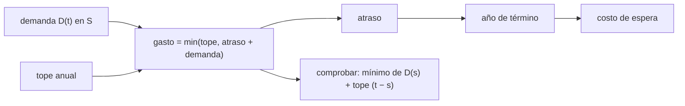

# B124-C06 — Financiamiento público

<!-- nav:top -->
[🏠 Programa](../../../../README.md) · [📚 Bloque B124](../../../tronco-comun/B124-industria-economia-etica-y-proyectos-espaciales.md) · [← Anterior: B124-C05 — Estimación de costos de misión](../B124-C05-estimacion-de-costos-de-mision/CLASE.md) · [Siguiente: B124-C07 — Financiamiento privado →](../B124-C07-financiamiento-privado/CLASE.md)
<!-- /nav -->

## 1. Ubicación, nivel y alcance

Clase 6 del bloque B124. Nivel N3. Un proyecto espacial financiado con fondos públicos recibe dinero año a año, con un tope fijado por el presupuesto; si el ritmo de gasto que necesita el proyecto supera ese tope, se acumula atraso. Aquí modelas esa brecha y calculas cuánto se retrasa el proyecto y cuánto cuesta esperar. Usas la estimación de [C05](../B124-C05-estimacion-de-costos-de-mision/CLASE.md) como el total a financiar. **Esta clase es educativa: no es asesoría financiera ni de política pública.** El perfil y el tope son sintéticos.

## 2. Por qué esta clase existe

Un proyecto puede estar bien estimado y aun así fallar porque el dinero no llega al ritmo que necesita. La decisión central: **¿qué tope anual evita el atraso y cuánto cuesta cada año de espera?**

## 3. Lo que podrás hacer al terminar

1. Describir el gasto de un proyecto con una demanda acumulada en forma de S.
2. Simular el gasto bajo un tope anual con una recursión de atraso.
3. Verificar la simulación con la fórmula del mínimo de la demanda acumulada.
4. Calcular el tope mínimo que permite terminar a tiempo, de forma analítica y por búsqueda.
5. Estimar el costo de espera de un atraso.
6. Separar lo consultado (una proporción de la OIG de la NASA) de lo sintético (el resto).

La evidencia es la **ficha de brecha de financiamiento anual** del ejercicio 12 (sección 20).

## 4. Con qué llegas y cómo comprobarlo

1. ¿Qué es un presupuesto anual?
2. ¿Qué es una curva en S?
3. ¿Qué es una recursión?
4. ¿Qué es un costo de espera?
5. ¿Qué es una verificación por segunda vía?

<details>
<summary>Ver respuestas</summary>

1. La cantidad que un financiador autoriza gastar en un año. 2. Un acumulado que crece lento, rápido y vuelve a ser lento. 3. Una regla que calcula cada paso a partir del anterior. 4. El gasto que se sigue pagando (equipos, personal) mientras el proyecto está detenido o demorado. 5. Calcular lo mismo con otro método y comparar.
</details>

Con cuatro o cinco aciertos, sigue; si no, repasa los prerrequisitos.

## 5. Un caso de contexto y casos de referencia

El informe IG-20-005 de la OIG de la NASA (14 de noviembre de 2019) cuenta que, en agosto de 2019, el programa de tripulación comercial había comprometido unos 5 500 millones de USD de los 8 500 millones adjudicados (`64,7%`) y llevaba años de retraso. Esa proporción es todo lo **consultado**. El **ejemplo conductor** es un proyecto **sintético** de 100 uc en 8 años con un pico de demanda de `18,36` uc/año: con un tope de `14` uc/año termina en el año `9`, con un costo de espera de `6` % del total.

## 6. Vocabulario

La **demanda acumulada** `D(t)` es lo que el proyecto necesita haber gastado al año `t`. El **tope** es el máximo que se puede gastar por año. El **atraso** (o *backlog*) es lo que se necesitó y no se pudo pagar. El **costo de espera** es el gasto adicional por cada año extra. El **comprometido** (*obligated*) es dinero ya asignado contractualmente.

## 7. Modelo mental



*Descripción textual:* cada año se gasta lo menor entre el tope y lo pendiente; lo que no se paga queda como atraso, que define el año de término y el costo de espera, y todo se comprueba con una fórmula del mínimo.

Analogía: llenar un estanque con una manguera de caudal máximo mientras el consumo sube y baja. Límite: el proyecto real puede reprogramar el trabajo y no siempre puede «ponerse al día» gastando el atraso.

## 8. La explicación, paso a paso

### 8.1 La demanda en S

Con `D(t) = TOTAL (3u² − 2u³)` y `u = t/8`, el gasto anual necesario sube hasta un pico de `18,359` uc/año hacia la mitad del plazo y baja al final. Con `TOTAL = 100`, el promedio sería 12,5; el pico es `1,47` veces mayor.

### 8.2 Gasto bajo un tope

Con tope `14` uc/año, cada año el gasto es `min(tope, atraso + demanda)`. El atraso máximo es `12,750` uc y el proyecto termina en el año `9`, es decir `1` año(s) tarde. Si cada año extra cuesta 6 % del total, el costo de espera es `6,0` uc (`6,0` % del total), un supuesto sintético.

### 8.3 Segunda vía

El gasto acumulado cumple `C_t = min_s (D_s + tope (t − s))`. La recursión y la fórmula coinciden dentro de `0,0e+00` en todos los años: son dos descripciones del mismo sistema.

### 8.4 Tope mínimo

Para terminar en 8 años hace falta `tope ≥ (TOTAL − D_s)/(8 − s)` para todo `s`; el máximo de esa razón es `14,0625` uc/año, y una búsqueda por bisección con la simulación da `14,0625` (diferencia `1,7e-10`). Ese tope es mayor que el promedio de 12,5 porque el proyecto no puede gastar al ritmo uniforme que su perfil real exige.

## 9. Magnitudes, símbolos y unidades

| Símbolo | Qué es | Unidad | Valor / nota |
|---|---|---|---|
| `TOTAL` | costo total del proyecto | uc (sintéticas) | 100 |
| `D(t)` | demanda acumulada | uc | curva en S |
| tope | máximo gasto anual | uc/año | 14 |
| atraso | demanda no pagada | uc | máx. 12,75 |
| espera | costo de cada año extra | fracción del total | 0,06 (sintético) |

## 10. Convenciones y referencias

Años enteros desde el inicio; unidades de costo sintéticas (uc) sin inflación ni descuento. El atraso se paga en cuanto el tope lo permite. El único dato real (5 500 y 8 500 millones de USD) se usa solo como proporción.

## 11. De dónde sale lo que afirmamos

| ID | Fuente | Localizador | Respalda | Estado |
|---|---|---|---|---|
| S1 | NASA OIG, «NASA's Management of Crew Transportation to the International Space Station», IG-20-005, 14 de noviembre de 2019 — https://oig.nasa.gov/wp-content/uploads/2024/02/IG-20-005.pdf (consultada 2026-11-11, PDF leído con PyMuPDF) | resumen | al agosto de 2019 el programa había comprometido unos 5 500 millones de USD de 8 500 millones adjudicados y estaba varios años retrasado respecto de su fecha operativa prevista | Consultada |
| — | Recursión de atraso, fórmula del mínimo, bisección | — | verificadas entre sí | No consultadas en una fuente concreta |
| — | Perfil en S, tope, costo de espera | — | todos los números del modelo | Sintético |

Límites: no se consultó ningún presupuesto real ni ley de apropiaciones; el modelo no representa ningún programa.

## 12. Cómo ver el resultado

| Magnitud | Valor |
|---|---|
| Pico de demanda | 18,359 uc/año |
| Año de término con tope 14 | 9 |
| Costo de espera | 6,0 % del total |
| Tope mínimo para 8 años | 14,0625 uc/año |

Descripción larga: un tope por debajo del pico de demanda retrasa el proyecto y encarece; el tope que evita el retraso es mayor que el gasto promedio.

## 13. Ejemplo trabajado

**Paso 1 · Datos.** `TOTAL = 60`, demanda por año `(10, 30, 20)` y tope 20.

**Paso 2 · Año 1.** Disponible `10`, gasto `10`, atraso `0`.

**Paso 3 · Año 2.** Disponible `30`, gasto `20`, atraso `10`.

**Paso 4 · Año 3 y 4.** Año 3: disponible `30`, gasto `20`, atraso `10`; año 4: gasto `10`. Acumulado `60` al año 4: un año tarde.

## 14. Distintas formas de describirlo

**Por tabla:** demanda, gasto y atraso por año. **Por curva:** demanda acumulada contra gasto acumulado. **Por mínimo:** `min(D_s + tope (t − s))`. **Por tope mínimo:** `max (TOTAL − D_s)/(T − s)`. **Por costo:** años de atraso × costo de espera.

## 15. Práctica guiada

**Ejercicio 1 · con los pasos indicados.** Con tope 15 y demanda `(10, 25)`, ¿cuánto atraso queda al fin del año 2? *Pasos:* año 1 sin atraso; año 2 disponible 25.

<details><summary>Solución comentada</summary>

Gasto `15`, atraso `10`.
</details>

**Ejercicio 2 · con una pista.** Si el proyecto necesita 40 en 4 años y el tope es 8, ¿cuántos años tarda? *Pista:* `40/8`.

<details><summary>Solución comentada</summary>

`5` años (uno de atraso).
</details>

**Ejercicio 3 · casi autónomo.** Calcula la proporción comprometida: 5 500 de 8 500.

<details><summary>Solución comentada</summary>

`64,7 %`.
</details>

## 16. Práctica autónoma, transferencia e integrador

**Ejercicio 4 · autónomo.** ¿Cuál es el pico de demanda del laboratorio?

<details><summary>Solución comentada</summary>

`18,359` uc/año.
</details>

**Ejercicio 5 · autónomo.** ¿En qué año termina con tope 14?

<details><summary>Solución comentada</summary>

Año `9`.
</details>

**Ejercicio 6 · autónomo.** ¿Cuál es el costo de espera?

<details><summary>Solución comentada</summary>

`6,0` uc.
</details>

**Ejercicio 7 · autónomo.** ¿Cuál es el atraso máximo?

<details><summary>Solución comentada</summary>

`12,750` uc.
</details>

**Ejercicio 8 · autónomo.** ¿Qué tope mínimo permite terminar en 8 años?

<details><summary>Solución comentada</summary>

`14,0625` uc/año.
</details>

**Ejercicio 9 · transferencia.** **Transferencia.** ¿Por qué el tope mínimo supera el gasto promedio de 12,5?

<details><summary>Solución comentada</summary>

Porque la demanda tiene un pico: un tope igual al promedio no alcanza a cubrir los años intermedios y el atraso nunca se recupera antes del año 8.
</details>

**Ejercicio 10 · transferencia.** **Transferencia.** Un comité propone «repartir el dinero parejo todos los años». ¿Qué le dices?

<details><summary>Solución comentada</summary>

Que con un perfil en S el reparto parejo genera atraso en el pico; conviene un perfil ajustado a la demanda o aceptar el costo de espera.
</details>

**Ejercicio 11 · transferencia.** **Transferencia.** Un dato dice que se comprometió el 65 % del dinero. ¿Basta para saber si hay atraso?

<details><summary>Solución comentada</summary>

No: hay que compararlo con el avance técnico y el calendario; comprometer dinero no es lo mismo que cumplir hitos.
</details>

**Ejercicio 12 · integrador.** **Integrador.** Elabora tu *ficha de brecha de financiamiento anual*: perfil, tope, tabla de gasto y atraso, año de término, costo de espera, tope mínimo con su verificación y lista de qué es consultado y sintético, con el aviso de que es educativa.

<details><summary>Solución comentada</summary>

Secciones 8.1–8.4 y la salida del laboratorio.
</details>

## 17. Laboratorio: brecha de financiamiento

El script [brecha_de_financiamiento.py](brecha_de_financiamiento.py) simula el gasto bajo un tope anual con una recursión, la verifica con la fórmula del mínimo y calcula el tope mínimo analítica y numéricamente (**comprueba** recursión a 1e-9 y tope a 1e-4). Tarda menos de 10 s en un equipo común.

**Datos:** solo la proporción comprometida/adjudicada de la OIG (consultada 2026-11-11); perfil, tope y costo de espera **sintéticos**. **Predice antes de ejecutar:** ¿terminará a tiempo con un tope de 14, por debajo del pico de 18,36? (no.) **Ejecución del 2026-11-11:**

```text
Python 3.12.9 (biblioteca estandar)
Proyecto SINTETICO: TOTAL = 100 uc, 8 anios, tope anual = 14 uc ; pico de demanda = 18.359 uc/anio
Dato consultado (NASA OIG IG-20-005, 2019): comprometido/adjudicado = 5500/8500 = 64.7 %
 anio  demanda  gasto  atraso  acumulado
    1    4.297  4.297   0.000      4.297
    2   11.328 11.328   0.000     15.625
    3   16.016 14.000   2.016     29.625
    4   18.359 14.000   6.375     43.625
    5   18.359 14.000  10.734     57.625
    6   16.016 14.000  12.750     71.625
    7   11.328 14.000  10.078     85.625
    8    4.297 14.000   0.375     99.625
    9    0.000  0.375   0.000    100.000
Termina en el anio 9 (atraso de 1 anio(s)) ; costo de espera = 6.0 uc = 6.0 % del total
Recursion frente a formula del minimo (error) = 0.0e+00
Tope minimo para terminar en 8 anios: analitico = 14.0625 ; busqueda = 14.0625 ; diferencia = 1.7e-10
Pruebas superadas.
```

```bash
python programa/clases/B124/B124-C06-financiamiento-publico/brecha_de_financiamiento.py
```

**Límites:** perfil fijo, tope constante, sin reprogramación, inflación ni descuento; el costo de espera es un supuesto; no modela ningún proceso presupuestario real.

## 18. Errores frecuentes y cómo corregirlos

**Confundir comprometer dinero con avanzar el proyecto.** Se corrige con el ejercicio 11.

**Usar el gasto promedio como tope suficiente.** Se corrige con 8.4.

**Ignorar el costo de esperar.** Se corrige con 8.2.

**Tomar el proyecto sintético como un programa real.** Se corrige con la sección 10.

## 19. Cómo sabrás que vas bien

Tras la sección 8: ¿en qué año esperabas que terminara y en cuál terminó? Si dudas, repasa el ejemplo 13. Tras el laboratorio: ¿qué comprueba? (ver la sección 17).

## 20. Qué entregas y cómo se evalúa

El producto es tu **ficha de brecha de financiamiento anual** (ejercicio 12).

| Criterio | Inicial | En desarrollo | Logrado | Destacado |
|---|---|---|---|---|
| Conceptos | Los confunde | Parciales | Simula el atraso y el tope mínimo | Explica los límites |
| Cálculo | Sin unidades | Con errores | Tablas completas con unidades | Calcula casos nuevos |
| Numérico | Sin comprobar | Un caso | Contraste con una segunda vía | Interpreta las diferencias |
| Fuentes | Sin fuente | Sin fecha | Fuentes con fecha y estado | Declara lo ilustrativo y lo no consultado |
| Límites | No los nombra | Uno | Tres | Discute qué falta del modelo |

**Condiciones críticas (no se compensan con promedio):** rotular los datos como sintéticos o ilustrativos; no presentar el resultado como asesoría financiera, legal ni de inversión; citar solo lo consultado.

## 21. Ética, seguridad y límites

Clase educativa: **no es asesoría financiera, legal, tributaria ni de inversión** y no sustituye a un profesional habilitado ni a la normativa vigente; ningún resultado debe usarse para decidir una compra, un contrato, una inversión o un seguro reales. Los retrasos presupuestarios tienen costos para personas y organizaciones; esta clase no atribuye responsabilidad a ningún programa real. Los modelos son simplificados y sus datos son sintéticos o ilustrativos. Accesibilidad: tablas equivalentes a las gráficas, fórmulas en texto, ejercicios sin conexión.

## 22. Para cerrar y seguir

Con un tope de `14` uc/año el proyecto sintético termina en el año `9` y paga `6` % extra por esperar; para terminar en 8 años haría falta un tope de `14,06` uc/año.

**Glosario español–inglés.** financiamiento público · *public funding*; tope · *cap*; atraso · *backlog*; comprometido · *obligated*; costo de espera · *standing-army cost*.

**Continuidad.** [B124-C07](../B124-C07-financiamiento-privado/CLASE.md) trata la otra fuente de dinero: el capital privado, con su retorno y su dilución.

**Referencias:** ver sección 11.

<!-- nav:bottom -->
---

[← Anterior: B124-C05 — Estimación de costos de misión](../B124-C05-estimacion-de-costos-de-mision/CLASE.md) · [📚 Bloque B124](../../../tronco-comun/B124-industria-economia-etica-y-proyectos-espaciales.md) · [Siguiente: B124-C07 — Financiamiento privado →](../B124-C07-financiamiento-privado/CLASE.md)
<!-- /nav -->
