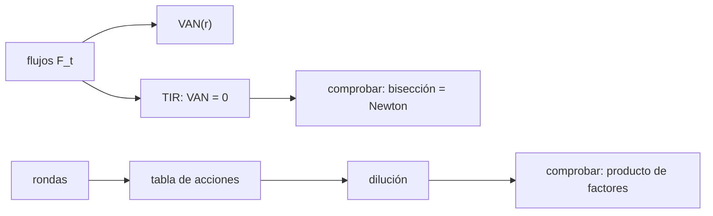

# B124-C07 — Financiamiento privado

<!-- nav:top -->
[🏠 Programa](../../../../README.md) · [📚 Bloque B124](../../../tronco-comun/B124-industria-economia-etica-y-proyectos-espaciales.md) · [← Anterior: B124-C06 — Financiamiento público](../B124-C06-financiamiento-publico/CLASE.md) · [Siguiente: B124-C08 — Seguros y riesgo espacial →](../B124-C08-seguros-y-riesgo-espacial/CLASE.md)
<!-- /nav -->

## 1. Ubicación, nivel y alcance

Clase 7 del bloque B124. Nivel N3. El capital privado paga un proyecto a cambio de un retorno y de una parte de la propiedad. Aquí calculas el valor actual neto y la tasa interna de retorno de un flujo de caja y sigues cómo se diluye la participación de los fundadores en dos rondas de inversión. Retomas la fuente pública de [C06](../B124-C06-financiamiento-publico/CLASE.md) para compararla. **Esta clase es educativa: no es asesoría financiera ni de inversión.** Ninguna cifra es de un mercado real.

## 2. Por qué esta clase existe

El dinero privado tiene un costo distinto del público: se paga con retorno y con propiedad. La decisión central: **¿qué retorno exige y qué parte del proyecto se cede a cambio?**

## 3. Lo que podrás hacer al terminar

1. Calcular el valor actual neto de un flujo de caja a una tasa dada.
2. Calcular la tasa interna de retorno por bisección y verificarla con Newton.
3. Calcular el múltiplo del capital invertido y la recuperación simple.
4. Construir una tabla de capitalización con acciones, precio y valoraciones.
5. Comprobar la dilución con el producto de factores.
6. Rotular que flujos, valoraciones y rondas son sintéticos.

La evidencia es la **ficha de flujo, retorno y dilución sintéticos** del ejercicio 12 (sección 20).

## 4. Con qué llegas y cómo comprobarlo

1. ¿Qué es el valor actual?
2. ¿Qué es una tasa interna de retorno?
3. ¿Qué es la valoración pre-money y post-money?
4. ¿Qué es la dilución?
5. ¿Qué es el método de bisección?

<details>
<summary>Ver respuestas</summary>

1. Lo que hoy vale un pago futuro descontado a una tasa. 2. La tasa de descuento con la que el valor actual neto es cero. 3. El valor de la empresa antes y después de recibir la inversión; post = pre + inversión. 4. La reducción del porcentaje de propiedad de un accionista cuando se emiten acciones nuevas. 5. Hallar una raíz acotándola entre dos valores y dividiendo el intervalo a la mitad.
</details>

Con cuatro o cinco aciertos, sigue; si no, repasa los prerrequisitos.

## 5. Un caso de contexto y casos de referencia

No se consultó ninguna base de datos de inversión ni mercado de capital de riesgo. El **ejemplo conductor** es un flujo **sintético** de 6 años con un VAN al 12 % de `57,640` Mum y una tasa interna de retorno de `23,88` %, y una empresa **sintética** cuyos fundadores pasan de 100 % a `56,0` % tras una semilla y una serie A con bolsa de opciones.

## 6. Vocabulario

El **VAN** es `Σ F_t/(1 + r)^t`. La **TIR** es la `r` con VAN igual a cero. El **MOIC** es el múltiplo de lo recibido sobre lo invertido. El **pre-money** y el **post-money** son las valoraciones antes y después de la ronda. La **tabla de capitalización** lista quién tiene cuántas acciones. La **bolsa de opciones** reserva acciones para el equipo.

## 7. Modelo mental



*Descripción textual:* los flujos dan el VAN y la TIR, que se comprueba con dos métodos; las rondas generan una tabla de acciones cuya dilución se comprueba con un producto de factores.

Analogía: vender porciones de una pizza para financiar un horno; cada porción vendida reduce tu parte. Límite: una empresa puede crecer y valer más aunque tu porcentaje baje.

## 8. La explicación, paso a paso

### 8.1 Valor actual y tasa interna

Con flujos `(−100, −40, 30, 70, 90, 110)` Mum, el VAN al 12 % es `57,6397` Mum. La TIR por bisección es `23,8799` %; por Newton, `23,8799` %; el error de `VAN(TIR)` es `8,2e-14`. Este flujo cambia de signo una sola vez, así que la TIR es única; con varios cambios de signo puede haber varias.

### 8.2 Múltiplo y recuperación

Se reciben `300` Mum y se invierten `140`: MOIC `2,143`. La recuperación simple (sin descuento) ocurre a los `3,444` años. El MOIC no dice cuánto tarda; la TIR sí.

### 8.3 Tabla de capitalización

Fundadores: 1 000 000 de acciones. Semilla: 2,0 Mum con pre-money 8,0 ⇒ `8,00` um por acción y 250 000 acciones nuevas (20 %). Serie A: 10,0 Mum con pre-money 40,0 ⇒ post-money 50,0; el inversionista recibe el 20 %, la bolsa de opciones el 10 % y los existentes quedan con el 70 %: `1785714,3` acciones posteriores y un precio de `28,0000` um por acción.

### 8.4 Dilución y comprobación

Participaciones: fundadores `56,00` %, semilla `14,00` %, serie A `20,00` %, bolsa `10,00` % (suma `1,000000`). Por factores: `(8/10)(1 − 0,2 − 0,1) = 56,00` %, igual dentro de `0,0e+00`. Como la bolsa se crea antes de la ronda, el pre-money efectivo para los existentes es `35,0` Mum, no 40.

## 9. Magnitudes, símbolos y unidades

| Símbolo | Qué es | Unidad | Valor / nota |
|---|---|---|---|
| `F_t` | flujo de caja en el año `t` | Mum (sintéticos) | −100 a 110 |
| `r` | tasa de descuento | — | 0,12 (ilustrativa) |
| TIR | tasa con VAN cero | — | 23,88 % |
| MOIC | múltiplo sobre capital invertido | — | 2,143 |
| pre/post | valoración antes/después | Mum | 8→10; 40→50 |

## 10. Convenciones y referencias

Flujos anuales vencidos, sin impuestos ni inflación; tasa de descuento ilustrativa, no una tasa de mercado. Acciones divisibles (se admiten fracciones). Sin derechos de preferencia ni cláusulas antidilución. Todo sintético.

## 11. De dónde sale lo que afirmamos

| ID | Fuente | Localizador | Respalda | Estado |
|---|---|---|---|---|
| — | VAN, TIR, bisección y Newton; tabla de capitalización | — | verificados entre sí y con productos de factores | No consultados en una fuente concreta |
| — | Datos de rondas de inversión en el sector espacial | — | no se usan | No consultados |
| — | Flujos, tasa y rondas | — | todos los números | Sintético |

Límites: no se consultó ningún dato de inversión ni contrato; las rondas son inventadas y no representan ninguna empresa ni oferta.

## 12. Cómo ver el resultado

| Magnitud | Valor |
|---|---|
| VAN al 12 % | 57,6397 Mum |
| TIR | 23,8799 % |
| MOIC | 2,143 |
| Participación final de los fundadores | 56,00 % |
| Precio por acción serie A | 28,0000 um |

Descripción larga: el proyecto tiene retorno superior a la tasa de descuento y los fundadores terminan con poco más de la mitad tras dos rondas.

## 13. Ejemplo trabajado

**Paso 1 · Flujos.** `(−100, 60, 60)`, `r = 10 %`.

**Paso 2 · VAN.** `−100 + 60/1,1 + 60/1,21 = −100 + 54,545 + 49,587 = 4,132`.

**Paso 3 · TIR.** Es la `r` con VAN cero; como el VAN es positivo al 10 %, la TIR supera el 10 % (≈ 13,07 %).

**Paso 4 · Dilución.** Una ronda de 5 con pre-money 20 deja a los fundadores con `20/25 = 80 %`.

## 14. Distintas formas de describirlo

**Por flujos:** `F_t`. **Por VAN:** `Σ F_t/(1+r)^t`. **Por TIR:** raíz de VAN. **Por múltiplo:** MOIC. **Por acciones:** tabla de capitalización. **Por factores:** producto de `pre/post`.

## 15. Práctica guiada

**Ejercicio 1 · con los pasos indicados.** Calcula el VAN al 10 % de `(−100, 110)`. *Pasos:* `110/1,1 − 100`.

<details><summary>Solución comentada</summary>

`0`.
</details>

**Ejercicio 2 · con una pista.** ¿Qué TIR tiene `(−100, 110)`? *Pista:* VAN cero.

<details><summary>Solución comentada</summary>

`10 %`.
</details>

**Ejercicio 3 · casi autónomo.** Una ronda de 3 con pre-money 12 ¿qué porcentaje compra? 

<details><summary>Solución comentada</summary>

`3/15 = 20 %`.
</details>

## 16. Práctica autónoma, transferencia e integrador

**Ejercicio 4 · autónomo.** ¿Cuál es el VAN al 12 % del laboratorio?

<details><summary>Solución comentada</summary>

`57,6397` Mum.
</details>

**Ejercicio 5 · autónomo.** ¿Cuál es la TIR?

<details><summary>Solución comentada</summary>

`23,8799` %.
</details>

**Ejercicio 6 · autónomo.** ¿Cuál es el MOIC?

<details><summary>Solución comentada</summary>

`2,143`.
</details>

**Ejercicio 7 · autónomo.** ¿Qué participación tienen los fundadores tras la serie A?

<details><summary>Solución comentada</summary>

`56,00` %.
</details>

**Ejercicio 8 · autónomo.** ¿Qué precio por acción tiene la serie A?

<details><summary>Solución comentada</summary>

`28,0000` um.
</details>

**Ejercicio 9 · transferencia.** **Transferencia.** Un inversionista pide una bolsa de opciones del 15 % antes de invertir. ¿Cómo cambia la dilución de los fundadores?

<details><summary>Solución comentada</summary>

Sube: la bolsa se resta de lo que queda a los existentes (`1 − 0,2 − 0,15`); el pre-money efectivo baja.
</details>

**Ejercicio 10 · transferencia.** **Transferencia.** Dos proyectos tienen la misma TIR y distinto MOIC. ¿Qué indica?

<details><summary>Solución comentada</summary>

Que difieren en duración o en tamaño del flujo; la TIR no mide cuánto se gana en total y el MOIC no mide cuándo.
</details>

**Ejercicio 11 · transferencia.** **Transferencia.** Un flujo cambia de signo tres veces. ¿Qué precaución tomas con la TIR?

<details><summary>Solución comentada</summary>

Puede tener varias raíces o ninguna real; se compara el VAN a tasas distintas y se evita reportar una sola TIR.
</details>

**Ejercicio 12 · integrador.** **Integrador.** Elabora tu *ficha de flujo, retorno y dilución sintéticos*: VAN, TIR con su verificación, MOIC, tabla de capitalización de dos rondas con su comprobación y lista de qué es sintético, con el aviso de que no es asesoría de inversión.

<details><summary>Solución comentada</summary>

Secciones 8.1–8.4 y la salida del laboratorio.
</details>

## 17. Laboratorio: retorno y dilución

El script [retorno_y_dilucion.py](retorno_y_dilucion.py) calcula VAN y TIR (bisección y Newton), el MOIC y una tabla de capitalización de dos rondas con su comprobación por factores (**comprueba** `|VAN(TIR)|` menor que 1e-9 y participaciones a 1e-12). Tarda menos de 10 s en un equipo común.

**Datos:** ningún dato consultado; flujos, tasa, valoraciones y rondas **sintéticos**. **Predice antes de ejecutar:** ¿quedarán los fundadores con más del 50 %? (sí: 56 %.) **Ejecución del 2026-11-11:**

```text
Python 3.12.9 (biblioteca estandar)
Parte 1 - flujos SINTETICOS (Mum) t = 0..5: [-100.0, -40.0, 30.0, 70.0, 90.0, 110.0]
  VAN al 12 % = 57.6397 Mum ; TIR (biseccion) = 23.8799 % ; TIR (Newton) = 23.8799 % ; diferencia = 1.4e-16
  |VAN(TIR)| = 8.2e-14 ; MOIC = 300/140 = 2.143 ; recuperacion simple = 3.444 anios
Parte 2 - tabla de capitalizacion SINTETICA
  precio semilla = 8.00 um/accion ; acciones tras semilla = 1250000
  serie A: acciones posteriores = 1785714.3 ; precio = 28.0000 um/accion ; pre-money efectivo para los existentes = 35.0 Mum
  participaciones: fundadores 56.00 % ; semilla 14.00 % ; serie A 20.00 % ; bolsa 10.00 % ; suma = 1.000000
  fundadores por producto de factores = 56.00 % ; diferencia = 0.0e+00 ; precio x acciones - valoracion posterior = 0.0e+00
Pruebas superadas.
```

```bash
python programa/clases/B124/B124-C07-financiamiento-privado/retorno_y_dilucion.py
```

**Límites:** sin impuestos, inflación, preferencias de liquidación ni antidilución; la tasa de descuento es ilustrativa; no es asesoría de inversión ni una oferta.

## 18. Errores frecuentes y cómo corregirlos

**Reportar la TIR sin el flujo.** Se corrige con 8.1.

**Olvidar que la bolsa de opciones diluye a los existentes.** Se corrige con 8.4.

**Comparar proyectos solo por TIR.** Se corrige con 8.2 y el ejercicio 10.

**Tomar la ronda sintética como una oferta real.** Se corrige con la sección 10.

## 19. Cómo sabrás que vas bien

Tras la sección 8: ¿qué participación esperabas para los fundadores y cuál obtuviste? Si dudas, repasa el ejemplo 13. Tras el laboratorio: ¿qué comprueba? (ver la sección 17).

## 20. Qué entregas y cómo se evalúa

El producto es tu **ficha de flujo, retorno y dilución sintéticos** (ejercicio 12).

| Criterio | Inicial | En desarrollo | Logrado | Destacado |
|---|---|---|---|---|
| Conceptos | Los confunde | Parciales | Calcula VAN, TIR y dilución | Explica los límites |
| Cálculo | Sin unidades | Con errores | Tablas completas con unidades | Calcula casos nuevos |
| Numérico | Sin comprobar | Un caso | Contraste con una segunda vía | Interpreta las diferencias |
| Fuentes | Sin fuente | Sin fecha | Fuentes con fecha y estado | Declara lo ilustrativo y lo no consultado |
| Límites | No los nombra | Uno | Tres | Discute qué falta del modelo |

**Condiciones críticas (no se compensan con promedio):** rotular los datos como sintéticos o ilustrativos; no presentar el resultado como asesoría financiera, legal ni de inversión; citar solo lo consultado.

## 21. Ética, seguridad y límites

Clase educativa: **no es asesoría financiera, legal, tributaria ni de inversión** y no sustituye a un profesional habilitado ni a la normativa vigente; ningún resultado debe usarse para decidir una compra, un contrato, una inversión o un seguro reales. Una oferta de inversión real tiene aspectos legales y tributarios que esta clase no cubre; consulta a un profesional habilitado. Los modelos son simplificados y sus datos son sintéticos o ilustrativos. Accesibilidad: tablas equivalentes a las gráficas, fórmulas en texto, ejercicios sin conexión.

## 22. Para cerrar y seguir

El flujo sintético tiene TIR `23,88` % y MOIC `2,14`; tras la semilla y la serie A con bolsa de opciones, los fundadores conservan `56,0` %.

**Glosario español–inglés.** valor actual neto · *net present value (NPV)*; tasa interna de retorno · *internal rate of return (IRR)*; dilución · *dilution*; tabla de capitalización · *cap table*; bolsa de opciones · *option pool*.

**Continuidad.** [B124-C08](../B124-C08-seguros-y-riesgo-espacial/CLASE.md) trata el riesgo que esos inversionistas y financiadores quieren cubrir: los seguros.

**Referencias:** ver sección 11.

<!-- nav:bottom -->
---

[← Anterior: B124-C06 — Financiamiento público](../B124-C06-financiamiento-publico/CLASE.md) · [📚 Bloque B124](../../../tronco-comun/B124-industria-economia-etica-y-proyectos-espaciales.md) · [Siguiente: B124-C08 — Seguros y riesgo espacial →](../B124-C08-seguros-y-riesgo-espacial/CLASE.md)
<!-- /nav -->
