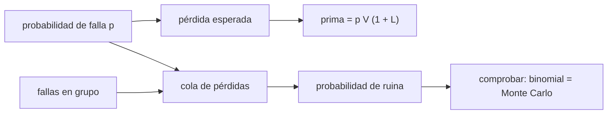

# B124-C08 — Seguros y riesgo espacial

<!-- nav:top -->
[🏠 Programa](../../../../README.md) · [📚 Bloque B124](../../../tronco-comun/B124-industria-economia-etica-y-proyectos-espaciales.md) · [← Anterior: B124-C07 — Financiamiento privado](../B124-C07-financiamiento-privado/CLASE.md) · [Siguiente: B124-C09 — Propiedad intelectual y licencias →](../B124-C09-propiedad-intelectual-y-licencias/CLASE.md)
<!-- /nav -->

## 1. Ubicación, nivel y alcance

Clase 8 del bloque B124. Nivel N3. Quien financia un satélite quiere cubrir el riesgo de perderlo. Aquí calculas la prima de un seguro como pérdida esperada más un recargo, y miras la cola de pérdidas de una cartera, que es lo que le importa al asegurador. Distingues fallas independientes de fallas en grupo (un cohete que lleva varios satélites). Ubicas el régimen de responsabilidad del [tratado de 1967 y el convenio de 1972](https://www.unoosa.org) solo como contexto. **Esta clase es educativa: no es asesoría de seguros, financiera ni legal.** Las probabilidades son sintéticas.

## 2. Por qué esta clase existe

El seguro no elimina el riesgo: lo traslada a quien puede juntarlo. La decisión central: **¿cuánto cobrar por cubrir un riesgo y con qué probabilidad el asegurador se queda sin capital?**

## 3. Lo que podrás hacer al terminar

1. Calcular la pérdida esperada y una prima con recargo.
2. Calcular la probabilidad de ruina del asegurador con una binomial exacta.
3. Verificarla con Monte Carlo.
4. Comparar fallas independientes con fallas en grupo con la misma pérdida esperada.
5. Calcular el VaR al 99 % de una cartera.
6. Ubicar el régimen de responsabilidad espacial de los tratados de la ONU y separar lo consultado de lo sintético.

La evidencia es la **ficha de prima y riesgo de una cobertura sintética** del ejercicio 12 (sección 20).

## 4. Con qué llegas y cómo comprobarlo

1. ¿Qué es una prima de seguro?
2. ¿Qué es una distribución binomial?
3. ¿Qué es el valor esperado?
4. ¿Qué es un cuantil de pérdida (VaR)?
5. ¿Qué es una simulación de Monte Carlo?

<details>
<summary>Ver respuestas</summary>

1. El precio que paga el asegurado por la cobertura. 2. La del número de éxitos (aquí, fallas) en `n` pruebas independientes con probabilidad `p`. 3. El promedio ponderado por probabilidad. 4. La pérdida que no se supera con cierta probabilidad, por ejemplo 99 %. 5. Estimar una probabilidad repitiendo un experimento aleatorio muchas veces.
</details>

Con cuatro o cinco aciertos, sigue; si no, repasa los prerrequisitos.

## 5. Un caso de contexto y casos de referencia

El texto de las Naciones Unidas sobre los tratados del espacio (UNOOSA, consultado el 2026-11-11) establece en el artículo VII del Tratado de 1967 que el Estado que lanza o hace lanzar un objeto espacial, o desde cuyo territorio se lanza, es internacionalmente responsable por el daño que cause, y en el Convenio de 1972 que esa responsabilidad es absoluta por daño en la superficie de la Tierra o a aeronaves en vuelo (art. II) y por culpa en otros lugares (art. III). Es todo lo **consultado**; no se consultó ninguna prima ni mercado de seguros. El **ejemplo conductor** es una cartera **sintética** de 20 satélites con prima total de `324,0` um y una probabilidad de ruina de `0,0439`; si los satélites vuelan de a 4 por cohete, esa probabilidad es `0,1846`.

## 6. Vocabulario

La **prima** es el precio del seguro. La **pérdida esperada** es `p V` por póliza. El **recargo** `L` cubre gastos y margen. El **capital** es el colchón del asegurador. La **ruina** es una pérdida mayor que primas más capital. El **VaR** al 99 % es la pérdida que no se supera con 99 % de probabilidad. Una **falla en grupo** afecta a varios satélites a la vez.

## 7. Modelo mental



*Descripción textual:* la probabilidad de falla da la pérdida esperada y la prima; la cola de pérdidas, agravada por las fallas en grupo, da la probabilidad de ruina, que se comprueba con una simulación.

Analogía: un fondo común donde muchos ponen una cuota pequeña para cubrir a pocos que sufren un daño grande. Límite: si todos los asegurados fallan a la vez, la cuota pequeña no alcanza.

## 8. La explicación, paso a paso

### 8.1 Prima y pérdida esperada

Por satélite, `p V = 0,04 · 300 = 12` um y la prima con recargo del 35 % es `16,20` um. Para 20 satélites la prima total es `324,0` um frente a una pérdida esperada de `240,0`: ganancia esperada `84,0` um.

### 8.2 Fallas independientes

La pérdida es `300 K` con `K ~ Binomial(20; 0,04)`. El asegurador se arruina si `300 K > 724,0` (primas más capital), es decir `K ≥ 3`: probabilidad exacta `0,0439`, Monte Carlo `0,0445` (diferencia `0,0007`). El VaR al 99 % es `900` um.

### 8.3 Fallas en grupo

Con 5 cohetes de 4 satélites cada uno, la pérdida esperada es la misma (`240,0` um) pero la pérdida llega en bloques de 1 200 um. Basta un cohete fallido para superar `724,0`: probabilidad `0,1846`, es decir `4,2` veces la independiente; Monte Carlo `0,1851`. El VaR al 99 % sube a `2400` um.

### 8.4 Lectura y límites

La misma prima esperada esconde colas muy distintas; por eso el asegurador mira la correlación y no solo el promedio. Los tratados de la ONU asignan la responsabilidad internacional a los Estados por el daño que causan los objetos espaciales; cómo se contrata, cuánto cuesta o qué cubre un seguro real no se consultó y no se modela aquí.

## 9. Magnitudes, símbolos y unidades

| Símbolo | Qué es | Unidad | Valor / nota |
|---|---|---|---|
| `V` | valor asegurado por satélite | um (sintéticas) | 300 |
| `p` | probabilidad de falla total | — | 0,04 (sintética) |
| `L` | recargo de la prima | — | 0,35 (sintético) |
| `K` | número de fallas | — | binomial |
| capital | colchón del asegurador | um | 400 |

## 10. Convenciones y referencias

Pérdida total o nada (sin pérdida parcial); un periodo; fallas independientes salvo en el caso en grupo; sin reaseguro, gastos ni inversión de las primas. Unidades monetarias sintéticas (um). Probabilidades ilustrativas, no históricas.

## 11. De dónde sale lo que afirmamos

| ID | Fuente | Localizador | Respalda | Estado |
|---|---|---|---|---|
| S1 | UNOOSA, «United Nations Treaties and Principles on Outer Space» (STSPACE11E) — https://www.unoosa.org/pdf/publications/STSPACE11E.pdf (consultado 2026-11-11, PDF leído con PyMuPDF) | Tratado de 1967 art. VII; Convenio de 1972 art. II y III | responsabilidad internacional del Estado de lanzamiento; responsabilidad absoluta en la superficie de la Tierra y a aeronaves; por culpa en otros casos | Consultada |
| — | Primas, tasas de falla y mercados de seguros espaciales | — | no se usan | No consultados |
| — | Binomial exacta y Monte Carlo | — | verificados entre sí | No consultados en una fuente concreta |
| — | `V`, `p`, `L`, capital, estructura de lanzamientos | — | todos los números | Sintético |

Límites: no se consultó ninguna póliza, prima ni tasa de falla real; no se analizó la legislación nacional ni el reaseguro; el texto de la ONU se usó solo como contexto de responsabilidad.

## 12. Cómo ver el resultado

| Magnitud | Valor |
|---|---|
| Prima total | 324,0 um |
| Pérdida esperada | 240,0 um |
| P(ruina), independientes | 0,0439 |
| P(ruina), en grupo | 0,1846 |
| VaR 99 % en grupo | 2400 um |

Descripción larga: con la misma pérdida esperada, las fallas en grupo multiplican la probabilidad de ruina y alargan la cola.

## 13. Ejemplo trabajado

**Paso 1 · Datos.** `V = 100`, `p = 0,05`, `L = 0,2`.

**Paso 2 · Pérdida esperada.** `0,05 · 100 = 5`.

**Paso 3 · Prima.** `5 · 1,2 = 6`.

**Paso 4 · Ganancia esperada.** `6 − 5 = 1` por póliza.

## 14. Distintas formas de describirlo

**Por promedio:** `p V`. **Por prima:** `p V (1 + L)`. **Por cola:** `P(pérdida > umbral)`. **Por cuantil:** VaR. **Por correlación:** independiente frente a en grupo.

## 15. Práctica guiada

**Ejercicio 1 · con los pasos indicados.** Calcula la prima de `V = 200`, `p = 0,03`, `L = 0,25`. *Pasos:* `p V (1 + L)`.

<details><summary>Solución comentada</summary>

`6 · 1,25 = 7,5`.
</details>

**Ejercicio 2 · con una pista.** Si `p = 0,1` y `n = 5`, ¿cuál es `P(K = 0)`? *Pista:* `0,9⁵`.

<details><summary>Solución comentada</summary>

`0,5905`.
</details>

**Ejercicio 3 · casi autónomo.** ¿Cuál es la pérdida esperada de 10 pólizas con `V = 50` y `p = 0,02`?

<details><summary>Solución comentada</summary>

`10 · 0,02 · 50 = 10`.
</details>

## 16. Práctica autónoma, transferencia e integrador

**Ejercicio 4 · autónomo.** ¿Cuál es la prima total del laboratorio?

<details><summary>Solución comentada</summary>

`324,0` um.
</details>

**Ejercicio 5 · autónomo.** ¿Cuál es la ganancia esperada?

<details><summary>Solución comentada</summary>

`84,0` um.
</details>

**Ejercicio 6 · autónomo.** ¿Con qué probabilidad se arruina con fallas independientes?

<details><summary>Solución comentada</summary>

`0,0439`.
</details>

**Ejercicio 7 · autónomo.** ¿Y con fallas en grupo?

<details><summary>Solución comentada</summary>

`0,1846`.
</details>

**Ejercicio 8 · autónomo.** ¿Cuántas veces mayor es la segunda?

<details><summary>Solución comentada</summary>

`4,2` veces.
</details>

**Ejercicio 9 · transferencia.** **Transferencia.** Un asegurador sube el capital a 1 000. ¿Qué cambia?

<details><summary>Solución comentada</summary>

El umbral de ruina sube; en el caso en grupo ya no basta un cohete fallido (1 200 contra `724` + 600), y la probabilidad baja.
</details>

**Ejercicio 10 · transferencia.** **Transferencia.** Un cliente pide una prima menor porque «su satélite es más confiable». ¿Qué datos pides?

<details><summary>Solución comentada</summary>

La evidencia de la confiabilidad (historial, pruebas) y su fuente; sin ella, la tasa de falla sigue siendo un supuesto.
</details>

**Ejercicio 11 · transferencia.** **Transferencia.** ¿Por qué el seguro no sustituye la responsabilidad del Estado de lanzamiento?

<details><summary>Solución comentada</summary>

Porque el seguro es un contrato privado entre partes; la responsabilidad internacional del artículo VII y del Convenio es del Estado, y su efecto sobre una póliza real no se consultó.
</details>

**Ejercicio 12 · integrador.** **Integrador.** Elabora tu *ficha de prima y riesgo de una cobertura sintética*: prima, pérdida esperada, probabilidad de ruina independiente y en grupo con su verificación, VaR y lista de qué es consultado y sintético, con el aviso de que no es asesoría de seguros.

<details><summary>Solución comentada</summary>

Secciones 8.1–8.4 y la salida del laboratorio.
</details>

## 17. Laboratorio: prima y riesgo de una cartera

El script [prima_y_riesgo.py](prima_y_riesgo.py) calcula prima, pérdida esperada, probabilidad de ruina y VaR de una cartera sintética con fallas independientes y en grupo, y compara la binomial exacta con un Monte Carlo (**comprueba** igual pérdida esperada y diferencias menores que 0,005). Tarda menos de 10 s en un equipo común.

**Datos:** solo el régimen de responsabilidad de los tratados de la ONU (consultado 2026-11-11) como contexto; todos los números **sintéticos**. **Predice antes de ejecutar:** ¿Tendrán igual probabilidad de ruina los dos casos si la pérdida esperada es la misma? (no: el grupo es mucho mayor.) **Ejecución del 2026-11-11:**

```text
Python 3.12.9 (biblioteca estandar)
Cartera SINTETICA: 20 satelites, V = 300 um, p = 0.04, recargo L = 0.35, capital = 400 um
Prima por satelite = 16.20 um ; primas totales = 324.0 ; perdida esperada = 240.0 ; ganancia esperada = 84.0
Ruina si perdida > primas + capital = 724.0 um
  fallas independientes: P(ruina) exacta = 0.0439 ; Monte Carlo = 0.0445 ; diferencia = 0.0007 ; VaR 99 % = 900 (MC 900)
  fallas en grupo (5 lanzamientos x 4): perdida esperada = 240.0 ; P(ruina) exacta = 0.1846 ; Monte Carlo = 0.1851 ; diferencia = 0.0004 ; VaR 99 % = 2400 (MC 2400)
  razon de ruina en grupo / independiente = 4.21
Pruebas superadas.
```

```bash
python programa/clases/B124/B124-C08-seguros-y-riesgo-espacial/prima_y_riesgo.py
```

**Límites:** pérdida total o nada, un periodo, sin reaseguro ni gastos; la probabilidad de falla es inventada; no es asesoría de seguros ni analiza ningún contrato real.

## 18. Errores frecuentes y cómo corregirlos

**Creer que la misma pérdida esperada implica el mismo riesgo.** Se corrige con 8.3.

**Ignorar la correlación entre satélites del mismo lanzamiento.** Se corrige con 8.3.

**Confundir el seguro con la responsabilidad del Estado.** Se corrige con 8.4.

**Tomar la tasa de falla sintética como real.** Se corrige con la sección 10.

## 19. Cómo sabrás que vas bien

Tras la sección 8: ¿qué probabilidad de ruina esperabas en cada caso y cuál obtuviste? Si dudas, repasa el ejemplo 13. Tras el laboratorio: ¿qué comprueba? (ver la sección 17).

## 20. Qué entregas y cómo se evalúa

El producto es tu **ficha de prima y riesgo de una cobertura sintética** (ejercicio 12).

| Criterio | Inicial | En desarrollo | Logrado | Destacado |
|---|---|---|---|---|
| Conceptos | Los confunde | Parciales | Calcula prima y probabilidad de ruina | Explica los límites |
| Cálculo | Sin unidades | Con errores | Tablas completas con unidades | Calcula casos nuevos |
| Numérico | Sin comprobar | Un caso | Contraste con una segunda vía | Interpreta las diferencias |
| Fuentes | Sin fuente | Sin fecha | Fuentes con fecha y estado | Declara lo ilustrativo y lo no consultado |
| Límites | No los nombra | Uno | Tres | Discute qué falta del modelo |

**Condiciones críticas (no se compensan con promedio):** rotular los datos como sintéticos o ilustrativos; no presentar el resultado como asesoría financiera, legal ni de inversión; citar solo lo consultado.

## 21. Ética, seguridad y límites

Clase educativa: **no es asesoría financiera, legal, tributaria ni de inversión** y no sustituye a un profesional habilitado ni a la normativa vigente; ningún resultado debe usarse para decidir una compra, un contrato, una inversión o un seguro reales. Los tratados de la ONU se citan solo como contexto; cualquier decisión sobre responsabilidad o cobertura real requiere asesoría legal y de seguros habilitada. Los modelos son simplificados y sus datos son sintéticos o ilustrativos. Accesibilidad: tablas equivalentes a las gráficas, fórmulas en texto, ejercicios sin conexión.

## 22. Para cerrar y seguir

La cartera sintética cobra `324,0` um para una pérdida esperada de `240,0`; con fallas independientes la ruina tiene probabilidad `0,0439` y en grupo, `0,1846`.

**Glosario español–inglés.** prima · *premium*; pérdida esperada · *expected loss*; recargo · *loading*; valor en riesgo · *value at risk (VaR)*; reaseguro · *reinsurance*.

**Continuidad.** [B124-C09](../B124-C09-propiedad-intelectual-y-licencias/CLASE.md) pasa a otro activo que se negocia: la propiedad intelectual y sus licencias.

**Referencias:** ver sección 11.

<!-- nav:bottom -->
---

[← Anterior: B124-C07 — Financiamiento privado](../B124-C07-financiamiento-privado/CLASE.md) · [📚 Bloque B124](../../../tronco-comun/B124-industria-economia-etica-y-proyectos-espaciales.md) · [Siguiente: B124-C09 — Propiedad intelectual y licencias →](../B124-C09-propiedad-intelectual-y-licencias/CLASE.md)
<!-- /nav -->
