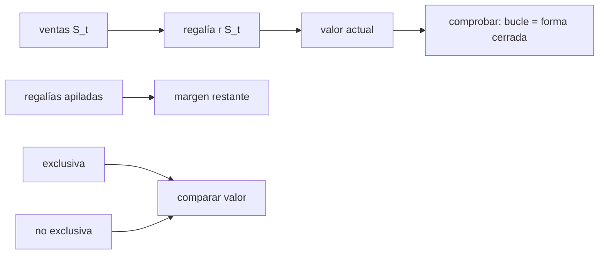

# B124-C09 — Propiedad intelectual y licencias

<!-- nav:top -->
[🏠 Programa](../../../../README.md) · [📚 Bloque B124](../../../tronco-comun/B124-industria-economia-etica-y-proyectos-espaciales.md) · [← Anterior: B124-C08 — Seguros y riesgo espacial](../B124-C08-seguros-y-riesgo-espacial/CLASE.md) · [Siguiente: B124-C10 — Contratos y compras espaciales →](../B124-C10-contratos-y-compras-espaciales/CLASE.md)
<!-- /nav -->

## 1. Ubicación, nivel y alcance

Clase 9 del bloque B124. Nivel N3. Una tecnología o un dato protegido se vuelve ingreso mediante una licencia: otro la usa a cambio de una cuota inicial y de regalías. Aquí valoras ese flujo, ves cómo se apilan las regalías cuando hay varias licencias y comparas una licencia exclusiva con varias no exclusivas. Retomas el cálculo de valor actual de [C07](../B124-C07-financiamiento-privado/CLASE.md). **Esta clase es educativa: no es asesoría legal, de propiedad intelectual ni financiera.** Ningún término de licencia es real.

## 2. Por qué esta clase existe

La propiedad intelectual es un activo, pero su valor depende de cuánto se vende con ella y de cuánto del margen se queda el que la usa. La decisión central: **¿qué licencia conviene ofrecer y cuántas regalías soporta el licenciatario?**

## 3. Lo que podrás hacer al terminar

1. Distinguir cuota inicial, regalía y valor actual de la licencia.
2. Calcular el valor actual de regalías por bucle y por forma cerrada.
3. Evaluar si varias regalías apiladas dejan margen al licenciatario.
4. Comparar una licencia exclusiva con varias no exclusivas.
5. Calcular el factor de ventas que iguala ambas y comprobarlo por sustitución.
6. Rotular que los términos son sintéticos y que la clase no es asesoría legal.

La evidencia es la **ficha de valoración de una licencia sintética** del ejercicio 12 (sección 20).

## 4. Con qué llegas y cómo comprobarlo

1. ¿Qué es una licencia?
2. ¿Qué es una regalía?
3. ¿Qué es el valor actual?
4. ¿Qué es una serie geométrica?
5. ¿Qué es exclusividad?

<details>
<summary>Ver respuestas</summary>

1. Un permiso para usar un activo protegido, con condiciones y a cambio de un pago. 2. Un pago proporcional a las ventas o al uso. 3. Lo que hoy vale un pago futuro descontado a una tasa. 4. Una suma en que cada término es el anterior por una razón constante. 5. Que el licenciante no concede la misma licencia a otros en el ámbito pactado.
</details>

Con cuatro o cinco aciertos, sigue; si no, repasa los prerrequisitos.

## 5. Un caso de contexto y casos de referencia

No se consultó ninguna ley de propiedad intelectual, contrato de licencia ni estadística de regalías. El **ejemplo conductor** es una licencia **sintética** con ventas de 50 Mum que crecen 15 % al año durante 8 años, regalía de 5 % y tasa de descuento de 10 %: vale `21,353` Mum para el licenciante. Tres regalías apiladas de 4, 6 y 5 % suman `15%` frente a un margen de 20 % del licenciatario.

## 6. Vocabulario

La **licencia** autoriza el uso. La **cuota inicial** `U` se paga al firmar. La **regalía** `r` es un porcentaje de las ventas. El **valor actual** descuenta los pagos futuros. El **apilamiento** es el efecto de pagar varias regalías por un mismo producto. La licencia **exclusiva** se da a un solo licenciatario; la **no exclusiva**, a varios.

## 7. Modelo mental



*Descripción textual:* las ventas generan regalías cuyo valor actual se comprueba de dos formas; las regalías apiladas reducen el margen y la exclusiva se compara con la no exclusiva.

Analogía: alquilar un local a cambio de una cuota y un porcentaje de las ventas. Límite: aquí las ventas son una proyección sintética que no depende del trato.

## 8. La explicación, paso a paso

### 8.1 Valor actual de regalías

Con ventas `S_t = 50 (1,15)^(t−1)` y regalía de 5 %, el valor actual de las regalías de 8 años es `21,352837` Mum sumando año a año y `21,352837` con la forma cerrada `r S₀/(1+d) (1 − q^T)/(1 − q)`, con `q = 1,15/1,10`; la diferencia es `1,1e-14`. Las ventas del año 8 llegan a `133,0` Mum.

### 8.2 Apilamiento

Si el producto necesita tres licencias con regalías de 4, 6 y 5 %, el licenciatario paga `15%` de las ventas. Con margen de 20 % antes de regalías, le queda `5%`. Si la suma llegara a 20 %, la licencia dejaría de ser viable aunque cada regalía parezca razonable por separado.

### 8.3 Exclusiva o no exclusiva

Exclusiva: un licenciatario con ventas 1,6 veces mayores, regalía de 6 % y cuota de 5 Mum, vale `45,997` Mum para el licenciante. No exclusiva: tres licenciatarios, regalía de 4 % y cuota de 1 Mum cada uno, valen `54,247` Mum. La no exclusiva gana con estos números.

### 8.4 Equilibrio

El factor de ventas que iguala ambas opciones es `f* = 1,9219`: la exclusiva solo conviene si el licenciatario, por tener exclusividad, vende más de `1,92` veces lo que vendería sin ella. Sustituyendo `f*` en el valor de la exclusiva se recupera el de la no exclusiva dentro de `7,1e-15`.

## 9. Magnitudes, símbolos y unidades

| Símbolo | Qué es | Unidad | Valor / nota |
|---|---|---|---|
| `S_t` | ventas del licenciatario | Mum/año | 50 creciendo 15 % |
| `r` | tasa de regalía | — | 0,04 a 0,06 (sintética) |
| `U` | cuota inicial | Mum | 1 a 5 (sintética) |
| `d` | tasa de descuento | — | 0,10 (ilustrativa) |
| `f` | factor de ventas con exclusividad | — | 1,6 (sintético) |

## 10. Convenciones y referencias

Pagos al final de cada año, 8 años, ventas conocidas, sin impuestos, sin probabilidad de litigio ni de invalidez de la patente. Mum sintéticas. Los términos no representan ninguna licencia real.

## 11. De dónde sale lo que afirmamos

| ID | Fuente | Localizador | Respalda | Estado |
|---|---|---|---|---|
| — | Leyes y tratados de propiedad intelectual | — | no se usan | No consultados |
| — | Valor actual de una serie geométrica | — | verificado por bucle y por sustitución | No consultado en una fuente concreta |
| — | Ventas, regalías, cuotas, factor de exclusividad | — | todos los números | Sintético |

Límites: no se consultó ninguna norma de propiedad intelectual ni contrato; la clase no describe derechos, plazos ni jurisdicciones.

## 12. Cómo ver el resultado

| Magnitud | Valor |
|---|---|
| VP de regalías (5 %) | 21,353 Mum |
| Regalías apiladas | 15% |
| Margen restante | 5% |
| Valor exclusiva | 45,997 Mum |
| Valor no exclusiva | 54,247 Mum |
| Factor de equilibrio | 1,922 |

Descripción larga: las regalías apiladas se comen la mayor parte del margen y la licencia no exclusiva vale más que la exclusiva salvo que la exclusividad multiplique las ventas.

## 13. Ejemplo trabajado

**Paso 1 · Datos.** Ventas de 10 Mum constantes, 3 años, regalía 5 %, `d = 10 %`.

**Paso 2 · Regalías.** `0,5` cada año.

**Paso 3 · Valor actual.** `0,5/1,1 + 0,5/1,21 + 0,5/1,331 = 0,4545 + 0,4132 + 0,3757 = 1,2434`.

**Paso 4 · Con cuota.** Con una cuota inicial de 1: valor total `2,2434` Mum.

## 14. Distintas formas de describirlo

**Por flujo:** regalía por año. **Por valor actual:** `Σ r S_t/(1+d)^t`. **Por forma cerrada:** serie geométrica. **Por margen:** `m − Σ r_i`. **Por comparación:** exclusiva frente a no exclusiva.

## 15. Práctica guiada

**Ejercicio 1 · con los pasos indicados.** Calcula la regalía de un año con ventas de 40 Mum y `r = 5 %`. *Pasos:* `r S`.

<details><summary>Solución comentada</summary>

`2` Mum.
</details>

**Ejercicio 2 · con una pista.** Si las regalías apiladas son 3 % y 7 % y el margen es 12 %, ¿cuánto margen queda? *Pista:* `m − Σ r`.

<details><summary>Solución comentada</summary>

`12 − 10 = 2 %`.
</details>

**Ejercicio 3 · casi autónomo.** ¿Cuál es el valor actual de 3 pagos de 2 a `d = 10 %`?

<details><summary>Solución comentada</summary>

`1,818 + 1,653 + 1,503 = 4,974`.
</details>

## 16. Práctica autónoma, transferencia e integrador

**Ejercicio 4 · autónomo.** ¿Cuál es el valor actual de regalías del laboratorio?

<details><summary>Solución comentada</summary>

`21,353` Mum.
</details>

**Ejercicio 5 · autónomo.** ¿Cuánto vale la regalía del año 1?

<details><summary>Solución comentada</summary>

`2,50` Mum.
</details>

**Ejercicio 6 · autónomo.** ¿Qué margen queda tras apilar las regalías?

<details><summary>Solución comentada</summary>

`5%`.
</details>

**Ejercicio 7 · autónomo.** ¿Cuál opción vale más para el licenciante, exclusiva o no exclusiva?

<details><summary>Solución comentada</summary>

La no exclusiva: `54,25` frente a `46,00` Mum.
</details>

**Ejercicio 8 · autónomo.** ¿Cuál es el factor `f*`?

<details><summary>Solución comentada</summary>

`1,9219`.
</details>

**Ejercicio 9 · transferencia.** **Transferencia.** Un cuarto licenciante pide una regalía de 5 % más. ¿Qué pasa con el licenciatario?

<details><summary>Solución comentada</summary>

Las regalías suman 20 % y el margen restante es 0: la licencia deja de ser viable; hay que renegociar o agrupar licencias (*patent pool*).
</details>

**Ejercicio 10 · transferencia.** **Transferencia.** ¿Por qué una exclusiva puede convenir aunque su valor calculado sea menor?

<details><summary>Solución comentada</summary>

Porque el modelo no incluye el incentivo a invertir, el riesgo de que un licenciatario falle ni los costos de gestionar varios contratos.
</details>

**Ejercicio 11 · transferencia.** **Transferencia.** Una cifra de regalías «típicas del sector» aparece en un informe sin fuente. ¿Qué haces?

<details><summary>Solución comentada</summary>

No la uso como dato: pido la fuente y el año; mientras tanto la rotulo como supuesto.
</details>

**Ejercicio 12 · integrador.** **Integrador.** Elabora tu *ficha de valoración de una licencia sintética*: flujo de regalías, valor actual con su verificación, apilamiento, comparación exclusiva/no exclusiva y lista de qué es sintético, con el aviso de que no es asesoría legal.

<details><summary>Solución comentada</summary>

Secciones 8.1–8.4 y la salida del laboratorio.
</details>

## 17. Laboratorio: valor de una licencia

El script [valor_de_licencia.py](valor_de_licencia.py) valora regalías por bucle y forma cerrada, evalúa el apilamiento y compara licencia exclusiva con no exclusiva (**comprueba** diferencia menor que 1e-9 y el factor de equilibrio por sustitución). Tarda menos de 10 s en un equipo común.

**Datos:** ningún dato consultado; ventas, tasas, cuotas y exclusividad **sintéticos**. **Predice antes de ejecutar:** ¿convendrá más la exclusiva o la no exclusiva con estos términos? (la no exclusiva.) **Ejecución del 2026-11-11:**

```text
Python 3.12.9 (biblioteca estandar)
Licencia SINTETICA: S0 = 50.0 Mum, g = 0.15, T = 8 anios, d = 0.1, regalia base = 0.05
VP de regalias: bucle = 21.352837 Mum ; forma cerrada = 21.352837 Mum ; diferencia = 1.1e-14
Ventas del anio 8 = 133.001 Mum ; regalia del anio 1 = 2.500 Mum
Apilamiento de regalias [0.04, 0.06, 0.05]: total = 0.15 ; margen del licenciatario = 0.20 ; margen restante = 0.05 ; viable = True
Valor para el licenciante: exclusiva (ventas x1.6) = 45.997 Mum ; no exclusiva (3 licenciatarios) = 54.247 Mum
Factor de ventas de equilibrio f* = 1.9219 ; comprobacion por sustitucion = 7.1e-15
Pruebas superadas.
```

```bash
python programa/clases/B124/B124-C09-propiedad-intelectual-y-licencias/valor_de_licencia.py
```

**Límites:** ventas conocidas y no afectadas por el trato, sin impuestos ni litigios; no describe derechos de propiedad intelectual reales ni ninguna jurisdicción.

## 18. Errores frecuentes y cómo corregirlos

**Evaluar cada regalía por separado.** Se corrige con 8.2.

**Suponer que la exclusiva siempre vale más.** Se corrige con 8.3–8.4.

**Usar regalías «típicas» sin fuente.** Se corrige con el ejercicio 11.

**Tomar este modelo como consejo sobre una licencia real.** Se corrige con la sección 21.

## 19. Cómo sabrás que vas bien

Tras la sección 8: ¿qué opción esperabas que valiera más y cuál valió? Si dudas, repasa el ejemplo 13. Tras el laboratorio: ¿qué comprueba? (ver la sección 17).

## 20. Qué entregas y cómo se evalúa

El producto es tu **ficha de valoración de una licencia sintética** (ejercicio 12).

| Criterio | Inicial | En desarrollo | Logrado | Destacado |
|---|---|---|---|---|
| Conceptos | Los confunde | Parciales | Calcula valor y apilamiento | Explica los límites |
| Cálculo | Sin unidades | Con errores | Tablas completas con unidades | Calcula casos nuevos |
| Numérico | Sin comprobar | Un caso | Contraste con una segunda vía | Interpreta las diferencias |
| Fuentes | Sin fuente | Sin fecha | Fuentes con fecha y estado | Declara lo ilustrativo y lo no consultado |
| Límites | No los nombra | Uno | Tres | Discute qué falta del modelo |

**Condiciones críticas (no se compensan con promedio):** rotular los datos como sintéticos o ilustrativos; no presentar el resultado como asesoría financiera, legal ni de inversión; citar solo lo consultado.

## 21. Ética, seguridad y límites

Clase educativa: **no es asesoría financiera, legal, tributaria ni de inversión** y no sustituye a un profesional habilitado ni a la normativa vigente; ningún resultado debe usarse para decidir una compra, un contrato, una inversión o un seguro reales. Las licencias reales tienen consecuencias legales para las partes; esta clase no sustituye a un abogado de propiedad intelectual. Los modelos son simplificados y sus datos son sintéticos o ilustrativos. Accesibilidad: tablas equivalentes a las gráficas, fórmulas en texto, ejercicios sin conexión.

## 22. Para cerrar y seguir

Las regalías sintéticas de 8 años valen `21,35` Mum, tres regalías apiladas dejan `5%` de margen y la exclusiva solo igualaría a la no exclusiva si multiplicara las ventas por `1,92`.

**Glosario español–inglés.** licencia · *license*; regalía · *royalty*; apilamiento de regalías · *royalty stacking*; cuota inicial · *upfront fee*; exclusiva · *exclusive license*.

**Continuidad.** [B124-C10](../B124-C10-contratos-y-compras-espaciales/CLASE.md) trata cómo se contrata y se compra: tipos de contrato y reparto del riesgo de costo.

**Referencias:** ver sección 11.

<!-- nav:bottom -->
---

[← Anterior: B124-C08 — Seguros y riesgo espacial](../B124-C08-seguros-y-riesgo-espacial/CLASE.md) · [📚 Bloque B124](../../../tronco-comun/B124-industria-economia-etica-y-proyectos-espaciales.md) · [Siguiente: B124-C10 — Contratos y compras espaciales →](../B124-C10-contratos-y-compras-espaciales/CLASE.md)
<!-- /nav -->
