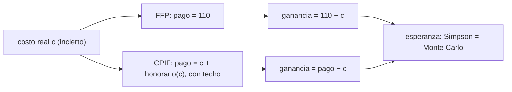

# B124-C10 — Contratos y compras espaciales

<!-- nav:top -->
[🏠 Programa](../../../../README.md) · [📚 Bloque B124](../../../tronco-comun/B124-industria-economia-etica-y-proyectos-espaciales.md) · [← Anterior: B124-C09 — Propiedad intelectual y licencias](../B124-C09-propiedad-intelectual-y-licencias/CLASE.md) · [Siguiente: B124-C11 — Sostenibilidad económica de constelaciones →](../B124-C11-sostenibilidad-economica-de-constelaciones/CLASE.md)
<!-- /nav -->

## 1. Ubicación, nivel y alcance

Clase 10 del bloque B124. Nivel N3. Comprar un bien o servicio espacial exige elegir el tipo de contrato: si el comprador paga un precio fijo, el contratista asume el riesgo de que el costo suba; si paga el costo más un honorario con incentivo, el riesgo se reparte. Aquí comparas ambos con un costo incierto y calculas pago esperado, dispersión y probabilidad de pérdida. Usas el contexto de [C02](../B124-C02-agencias-cientificas-y-empresas/CLASE.md). **Esta clase es educativa: no es asesoría legal ni de contratación pública.** Los contratos y costos son sintéticos.

## 2. Por qué esta clase existe

El tipo de contrato reparte el riesgo de sobrecosto entre quien compra y quien vende. La decisión central: **¿cuánto riesgo asume cada parte con cada tipo de contrato y cuánto cuesta ese reparto en promedio?**

## 3. Lo que podrás hacer al terminar

1. Describir un contrato de precio fijo y uno de costo más honorario con incentivo.
2. Calcular el pago esperado, su dispersión y la ganancia del contratista.
3. Calcular la probabilidad de que el contratista pierda dinero.
4. Calcular esperanzas por integración numérica (Simpson) y por Monte Carlo.
5. Interpretar quién carga con el sobrecosto en cada contrato.
6. Separar lo consultado (contratos de precio fijo en el informe de la OIG) de lo sintético.

La evidencia es la **ficha comparativa de tipos de contrato** del ejercicio 12 (sección 20).

## 4. Con qué llegas y cómo comprobarlo

1. ¿Qué es un costo objetivo?
2. ¿Qué es un honorario?
3. ¿Qué es una razón de reparto?
4. ¿Qué es una integración numérica?
5. ¿Qué es una verificación por segunda vía?

<details>
<summary>Ver respuestas</summary>

1. El costo que las partes esperan al firmar. 2. El pago al contratista por encima de sus costos. 3. La fracción de un sobrecosto o ahorro que asume cada parte. 4. Calcular una integral sumando valores de la función en puntos. 5. Calcular lo mismo con otro método y comparar.
</details>

Con cuatro o cinco aciertos, sigue; si no, repasa los prerrequisitos.

## 5. Un caso de contexto y casos de referencia

El informe IG-20-005 de la OIG de la NASA (2019) señala que la NASA pasó a un enfoque comercial en que paga un precio fijo por el servicio de transporte de tripulación, como ya hacía con la carga. El mismo informe documenta que la NASA acordó pagar 287,2 millones de USD adicionales sobre los precios fijos de Boeing para las misiones tercera a sexta, y que la OIG cuestionó 144 millones de ese pago como no razonables. Es todo lo **consultado**; no se consultó ninguna cláusula ni norma de contratación. El **ejemplo conductor** compara, con un costo **sintético** de mediana `105,1` um, un contrato de precio fijo de 110 um (el comprador paga siempre `110`; el contratista pierde con probabilidad `0,410`) con un CPIF (el comprador paga en promedio `110,78` con dispersión `12,53`; el contratista pierde con probabilidad `0,193`).

## 6. Vocabulario

**Precio fijo (FFP)**: el pago no depende del costo real. **Costo más incentivo (CPIF)**: se paga el costo real más un honorario que baja cuando el costo supera el objetivo. El **honorario objetivo** es el que se paga si el costo coincide con el objetivo. La **razón de reparto** es la parte del desvío que asume cada lado. El **techo** limita el pago total.

## 7. Modelo mental



*Descripción textual:* el costo real incierto entra en dos reglas de pago; cada una da una ganancia del contratista y un pago del comprador cuyas esperanzas se calculan con dos métodos.

Analogía: pactar un precio cerrado para una obra frente a pagar los materiales y un sueldo con premio por terminar bajo presupuesto. Límite: el contratista también puede influir en el costo, algo que aquí se trata como azar.

## 8. La explicación, paso a paso

### 8.1 Precio fijo

El comprador paga `110` um siempre: dispersión nula (la integración numérica da `0,005`, que es ruido de redondeo). El contratista gana `110 − c`: en promedio `2,749` um y pierde dinero si `c > 110`, con probabilidad `0,4103`. Todo el riesgo de costo es del contratista (y de ahí viene el interés de pedir un precio mayor).

### 8.2 Costo más incentivo

El pago es `min(c + honorario, 125)`, con `honorario = 8 + 0,2 (100 − c)` acotado entre 2 y 14. Con el costo mediano el honorario es `6,97` y el pago `112,10`. El comprador paga en promedio `110,78` con dispersión `12,53`; el contratista gana en promedio `3,53` y pierde solo si el techo se alcanza: `0,1933`.

### 8.3 Dos vías de cálculo

Las esperanzas por Simpson sobre la normal estándar y por Monte Carlo (200 000 muestras) coinciden: pago `0,019`, ganancia `0,042`, probabilidades `0,0020` de diferencia máxima. La probabilidad de que `c + honorario` pase del techo de 125 es `0,2378`.

### 8.4 Lectura

El precio fijo da certeza de gasto al comprador pero un precio mayor; el CPIF reparte el desvío (el contratista asume el 20 % hasta el techo) pero deja el gasto expuesto. Ninguno es mejor en sí: depende de qué tan bien se conoce el costo, y el modelo no incluye incentivos a ocultar costos ni renegociaciones.

## 9. Magnitudes, símbolos y unidades

| Símbolo | Qué es | Unidad | Valor / nota |
|---|---|---|---|
| `c` | costo real | um | mediana 105,1 |
| `P` | precio fijo | um | 110 |
| honorario | pago por encima del costo (CPIF) | um | 2 a 14 |
| techo | pago máximo (CPIF) | um | 125 |
| `σ` | dispersión logarítmica del costo | — | 0,20 |

## 10. Convenciones y referencias

Costo log-normal, un solo contrato, sin cambios de alcance ni renegociación; el contratista no influye en el costo. Unidades monetarias sintéticas (um). Los tipos de contrato son simplificaciones y no reproducen ninguna regulación de adquisiciones.

## 11. De dónde sale lo que afirmamos

| ID | Fuente | Localizador | Respalda | Estado |
|---|---|---|---|---|
| S1 | NASA OIG, IG-20-005, 14 de noviembre de 2019 — https://oig.nasa.gov/wp-content/uploads/2024/02/IG-20-005.pdf (consultada 2026-11-11, PDF leído con PyMuPDF) | resumen y sección sobre pagos a Boeing | el programa de tripulación comercial usa contratos de precio fijo con Boeing y SpaceX, como los servicios de carga; la NASA acordó pagar 287,2 millones de USD adicionales sobre los precios fijos de Boeing para las misiones tercera a sexta (71,8 millones por misión en promedio) y la OIG cuestionó como no razonables 144 millones de ese pago | Consultada |
| — | Reglas de adquisición públicas (por ejemplo FAR/ESA) | — | no se usan | No consultadas |
| — | Costo, precio, honorario y techo | — | todos los números | Sintético |

Límites: no se consultó ninguna cláusula, norma de contratación ni contrato real; el tipo CPIF está simplificado.

## 12. Cómo ver el resultado

| Magnitud | Valor |
|---|---|
| E[pago] FFP / CPIF | 110,00 / 110,78 um |
| DE[pago] FFP / CPIF | 0,00 / 12,53 um |
| E[ganancia] FFP / CPIF | 2,75 / 3,53 um |
| P(contratista pierde) FFP / CPIF | 0,4103 / 0,1933 |

Descripción larga: el precio fijo concentra el riesgo en el contratista; el CPIF lo reparte y deja al comprador con un gasto variable.

## 13. Ejemplo trabajado

**Paso 1 · Datos.** Costo objetivo 100, honorario objetivo 8, reparto 20 % al contratista.

**Paso 2 · Sobrecosto.** Si `c = 110`: `honorario = 8 + 0,2 (100 − 110) = 6`.

**Paso 3 · Pago.** `110 + 6 = 116`; ganancia `6`.

**Paso 4 · Ahorro.** Si `c = 90`: `honorario = 8 + 0,2 · 10 = 10`; pago `100`; ganancia `10`.

## 14. Distintas formas de describirlo

**Por regla:** pago en función de `c`. **Por riesgo:** dispersión del pago. **Por ganancia:** `pago − c`. **Por probabilidad:** `P(ganancia < 0)`. **Por reparto:** 80/20.

## 15. Práctica guiada

**Ejercicio 1 · con los pasos indicados.** Con precio fijo 110 y costo real 118, ¿cuánto gana el contratista? *Pasos:* `110 − 118`.

<details><summary>Solución comentada</summary>

`−8` um (pierde 8).
</details>

**Ejercicio 2 · con una pista.** Con el CPIF del ejemplo y `c = 105`, ¿cuánto vale el honorario? *Pista:* `8 + 0,2 (100 − c)`.

<details><summary>Solución comentada</summary>

`8 − 1 = 7`.
</details>

**Ejercicio 3 · casi autónomo.** ¿Cuánto paga el comprador en ese caso?

<details><summary>Solución comentada</summary>

`105 + 7 = 112`.
</details>

## 16. Práctica autónoma, transferencia e integrador

**Ejercicio 4 · autónomo.** ¿Cuál es el pago esperado del comprador con CPIF en el laboratorio?

<details><summary>Solución comentada</summary>

`110,78` um.
</details>

**Ejercicio 5 · autónomo.** ¿Y con precio fijo?

<details><summary>Solución comentada</summary>

`110,00` um.
</details>

**Ejercicio 6 · autónomo.** ¿Con qué probabilidad pierde el contratista bajo precio fijo?

<details><summary>Solución comentada</summary>

`0,4103`.
</details>

**Ejercicio 7 · autónomo.** ¿Cuál es la dispersión del pago bajo CPIF?

<details><summary>Solución comentada</summary>

`12,53` um.
</details>

**Ejercicio 8 · autónomo.** ¿Con qué probabilidad se alcanza el techo?

<details><summary>Solución comentada</summary>

`0,2378`.
</details>

**Ejercicio 9 · transferencia.** **Transferencia.** El comprador no conoce bien el costo de un desarrollo nuevo. ¿Qué tipo de contrato prefiere y por qué?

<details><summary>Solución comentada</summary>

Uno que reparta el riesgo (CPIF) o que se fije el precio por hitos, porque un precio fijo obliga al contratista a cubrir una incertidumbre con una prima alta o a no ofertar.
</details>

**Ejercicio 10 · transferencia.** **Transferencia.** Un contratista oferta un precio fijo muy bajo. ¿Qué riesgo ves?

<details><summary>Solución comentada</summary>

Que pierda dinero y reduzca alcance o calidad, o que pida cambios de contrato después; el precio bajo no garantiza el menor costo final.
</details>

**Ejercicio 11 · transferencia.** **Transferencia.** La OIG informa que la NASA acordó pagar 287,2 millones de USD sobre los precios fijos de Boeing para las misiones 3 a 6 (71,8 millones por misión en promedio). ¿Qué enseñanza hay para el modelo?

<details><summary>Solución comentada</summary>

Que un precio fijo puede dejar de serlo cuando el comprador necesita flexibilidad o la entrega se retrasa: el pago adicional rompe la regla `pago = precio` y traslada riesgo al comprador. El modelo no recoge esas modificaciones.
</details>

**Ejercicio 12 · integrador.** **Integrador.** Elabora tu *ficha comparativa de tipos de contrato*: reglas de pago, esperanzas y dispersión por dos métodos, probabilidad de pérdida del contratista, lectura del reparto de riesgo y lista de qué es consultado y sintético, con el aviso de que no es asesoría legal.

<details><summary>Solución comentada</summary>

Secciones 8.1–8.4 y la salida del laboratorio.
</details>

## 17. Laboratorio: precio fijo frente a CPIF

El script [contratos_precio_fijo_y_cpif.py](contratos_precio_fijo_y_cpif.py) calcula con Simpson y con Monte Carlo el pago esperado, su dispersión, la ganancia del contratista y la probabilidad de pérdida bajo dos tipos de contrato (**comprueba** esperanzas a 0,3 um y probabilidades a 0,005). Tarda menos de 10 s en un equipo común.

**Datos:** solo el hecho cualitativo de que el programa usó precio fijo (OIG IG-20-005, consultado 2026-11-11); costos, precio, honorario y techo **sintéticos**. **Predice antes de ejecutar:** ¿bajo qué contrato tiene el comprador un gasto sin dispersión? (precio fijo.) **Ejecución del 2026-11-11:**

```text
Python 3.12.9 (biblioteca estandar)
Contratos SINTETICOS (um): costo real c = 100 exp(N(0.05, 0.20^2)); mediana = 105.13
Dato consultado (NASA OIG IG-20-005, 2019): el programa de tripulacion comercial uso contratos de precio fijo (cualitativo)
 contrato  E[pago]  DE[pago]  E[ganancia contratista]  P(contratista pierde)   Monte Carlo: E[pago] E[gan] P(pierde)
 FFP      110.000     0.005           2.749               0.4103         110.000   2.707   0.4123
 CPIF     110.778    12.530           3.527               0.1933         110.797   3.492   0.1944
CPIF con costo mediano: honorario = 6.975 ; pago = 112.102 ; P(c + honorario > techo) = 0.2378
Diferencias Simpson - Monte Carlo: esperanza del pago 0.019 ; ganancia 0.042 ; probabilidades 0.0020
Pruebas superadas.
```

```bash
python programa/clases/B124/B124-C10-contratos-y-compras-espaciales/contratos_precio_fijo_y_cpif.py
```

**Límites:** costo log-normal exógeno, sin renegociación, cambios de alcance ni incentivos ocultos; los contratos están simplificados y no son una guía de contratación.

## 18. Errores frecuentes y cómo corregirlos

**Creer que el precio fijo es siempre el más barato.** Se corrige con 8.1 y 8.4.

**Ignorar que el desvío se reparte en el CPIF.** Se corrige con 8.2.

**Confundir el contrato sintético con una cláusula real.** Se corrige con la sección 10.

**Dar por buena una esperanza con un solo método.** Se corrige con 8.3.

## 19. Cómo sabrás que vas bien

Tras la sección 8: ¿qué contrato esperabas que diera menos pérdida al contratista y cuál dio? Si dudas, repasa el ejemplo 13. Tras el laboratorio: ¿qué comprueba? (ver la sección 17).

## 20. Qué entregas y cómo se evalúa

El producto es tu **ficha comparativa de tipos de contrato** (ejercicio 12).

| Criterio | Inicial | En desarrollo | Logrado | Destacado |
|---|---|---|---|---|
| Conceptos | Los confunde | Parciales | Calcula pago, ganancia y riesgo | Explica los límites |
| Cálculo | Sin unidades | Con errores | Tablas completas con unidades | Calcula casos nuevos |
| Numérico | Sin comprobar | Un caso | Contraste con una segunda vía | Interpreta las diferencias |
| Fuentes | Sin fuente | Sin fecha | Fuentes con fecha y estado | Declara lo ilustrativo y lo no consultado |
| Límites | No los nombra | Uno | Tres | Discute qué falta del modelo |

**Condiciones críticas (no se compensan con promedio):** rotular los datos como sintéticos o ilustrativos; no presentar el resultado como asesoría financiera, legal ni de inversión; citar solo lo consultado.

## 21. Ética, seguridad y límites

Clase educativa: **no es asesoría financiera, legal, tributaria ni de inversión** y no sustituye a un profesional habilitado ni a la normativa vigente; ningún resultado debe usarse para decidir una compra, un contrato, una inversión o un seguro reales. Los contratos públicos tienen reglas de probidad y transparencia; esta clase no las desarrolla ni acusa a ninguna parte. Los modelos son simplificados y sus datos son sintéticos o ilustrativos. Accesibilidad: tablas equivalentes a las gráficas, fórmulas en texto, ejercicios sin conexión.

## 22. Para cerrar y seguir

Con costo incierto, el precio fijo da un pago constante de `110` um y una probabilidad de pérdida del contratista de `0,410`; el CPIF paga en promedio `110,8` um con dispersión `12,5` y reparte el riesgo.

**Glosario español–inglés.** contrato de precio fijo · *firm fixed price (FFP)*; costo más honorario de incentivo · *cost plus incentive fee (CPIF)*; techo · *ceiling*; honorario · *fee*; razón de reparto · *share ratio*.

**Continuidad.** [B124-C11](../B124-C11-sostenibilidad-economica-de-constelaciones/CLASE.md) aplica estas ideas a un negocio recurrente: una constelación de satélites.

**Referencias:** ver sección 11.

<!-- nav:bottom -->
---

[← Anterior: B124-C09 — Propiedad intelectual y licencias](../B124-C09-propiedad-intelectual-y-licencias/CLASE.md) · [📚 Bloque B124](../../../tronco-comun/B124-industria-economia-etica-y-proyectos-espaciales.md) · [Siguiente: B124-C11 — Sostenibilidad económica de constelaciones →](../B124-C11-sostenibilidad-economica-de-constelaciones/CLASE.md)
<!-- /nav -->
