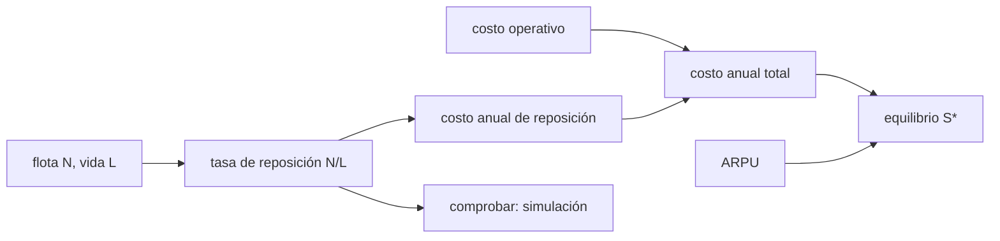

# B124-C11 — Sostenibilidad económica de constelaciones

<!-- nav:top -->
[🏠 Programa](../../../../README.md) · [📚 Bloque B124](../../../tronco-comun/B124-industria-economia-etica-y-proyectos-espaciales.md) · [← Anterior: B124-C10 — Contratos y compras espaciales](../B124-C10-contratos-y-compras-espaciales/CLASE.md) · [Siguiente: B124-C12 — Evaluación de retorno científico →](../B124-C12-evaluacion-de-retorno-cientifico/CLASE.md)
<!-- /nav -->

## 1. Ubicación, nivel y alcance

Clase 11 del bloque B124. Nivel N3–N4. Una constelación de satélites no se paga una vez: hay que reponer la flota todo el tiempo, y esa reposición es un costo que el servicio debe cubrir. Aquí calculas el costo anual de reponer una flota, el número de suscriptores de equilibrio y la sensibilidad a la vida útil y a la tarifa. Usas la lógica de valor actual y de costos de [C05](../B124-C05-estimacion-de-costos-de-mision/CLASE.md) y [C07](../B124-C07-financiamiento-privado/CLASE.md). **Esta clase es educativa: no es asesoría financiera ni de inversión.** La constelación es sintética.

## 2. Por qué esta clase existe

Una constelación puede ser técnicamente exitosa y económicamente inviable si la reposición se come el margen. La decisión central: **¿cuántos suscriptores se necesitan para cubrir la reposición y la operación, y qué tan sensible es eso a la vida útil?**

## 3. Lo que podrás hacer al terminar

1. Calcular la tasa de reposición de una flota en régimen (`N/L`).
2. Verificarla con una simulación de vidas aleatorias.
3. Calcular el costo anual de reposición con reserva de desorbitación.
4. Calcular el punto de equilibrio en suscriptores y el costo por suscriptor.
5. Medir la sensibilidad a la vida útil y a la tarifa.
6. Rotular que todos los números son sintéticos.

La evidencia es la **ficha de equilibrio de una constelación sintética** del ejercicio 12 (sección 20).

## 4. Con qué llegas y cómo comprobarlo

1. ¿Qué es la vida útil de un satélite?
2. ¿Qué es un ARPU?
3. ¿Qué es un costo fijo?
4. ¿Qué es la desorbitación?
5. ¿Qué es una simulación?

<details>
<summary>Ver respuestas</summary>

1. El tiempo que opera antes de fallar o ser retirado. 2. El ingreso medio por usuario en un periodo. 3. Uno que no depende del número de clientes. 4. El retiro controlado de un satélite al final de su vida. 5. Repetir un proceso aleatorio en el computador para estimar una cantidad.
</details>

Con cuatro o cinco aciertos, sigue; si no, repasa los prerrequisitos.

## 5. Un caso de contexto y casos de referencia

No se consultó ninguna constelación real ni sus tarifas. El **ejemplo conductor** es una flota **sintética** de 60 satélites de vida media 5 años y costo de 1,5 Mum cada uno (construcción y lanzamiento): hay que reponer `12` satélites al año, lo que cuesta `18,90` Mum/año; con 20 Mum de costos operativos, el equilibrio está en `64833` suscriptores a 50 um al mes.

## 6. Vocabulario

La **reposición** es lanzar un satélite nuevo cuando otro termina su vida. La **tasa de renovación** en régimen es `N/L`. La **reserva de desorbitación** `r` es un porcentaje del costo para retirar satélites al final. El **ARPU** es el ingreso por suscriptor y mes. El **punto de equilibrio** `S*` es el número de suscriptores con que los ingresos igualan los costos anuales. El **costo por suscriptor-mes** es el costo anual repartido en suscriptores y meses.

## 7. Modelo mental



*Descripción textual:* la flota y su vida dan la tasa de reposición, que se verifica por simulación; esta, más el costo operativo, da el costo anual y, con el ARPU, el equilibrio en suscriptores.

Analogía: una flota de taxis que se reemplaza por desgaste; el costo de renovar es constante aunque nunca compres la flota entera de una vez. Límite: la tarifa y los clientes no son independientes de la calidad ni del precio.

## 8. La explicación, paso a paso

### 8.1 Reposición en régimen

En régimen, la tasa media de reposición es `N/L = 12,000` satélites por año. Con vidas Uniforme(3; 7) años, 200 flotas simuladas durante 90 años (descartando los primeros 30 de calentamiento, porque todos los satélites parten con edad cero y sin ese descarte la cuenta sale un 4 % baja) dan `12,015`, un error de `0,13%`.

### 8.2 Costo anual

Reponer cuesta `(N/L) K (1 + r) = 18,900` Mum/año con `r = 5 %` de desorbitación; sumando 20 Mum de operación, el costo anual es `38,900` Mum. El despliegue inicial (`90` Mum) es un gasto aparte que no se repite.

### 8.3 Equilibrio

Cada suscriptor aporta `12 · 50 = 600` um al año, de modo que `S* = 38,900 × 10⁶ / 600 = 64833` suscriptores. Con 100 000 suscriptores el ingreso es `60,0` Mum/año, el margen `21,100` Mum/año y el costo por suscriptor-mes `32,42` um; el despliegue se recupera en `4,27` años (sin descuento).

### 8.4 Sensibilidad

Si la vida útil baja a 3,5 años el equilibrio sube a `78333` (`1,21` veces); si sube a 7, baja a `55833`; si el ARPU cae a 40 um/mes, sube a `81042`. La vida útil pesa tanto como la tarifa.

## 9. Magnitudes, símbolos y unidades

| Símbolo | Qué es | Unidad | Valor / nota |
|---|---|---|---|
| `N` | satélites de la flota | — | 60 |
| `L` | vida útil media | años | 5 |
| `K` | construcción y lanzamiento por satélite | Mum | 1,5 |
| `O` | costos operativos fijos | Mum/año | 20 |
| ARPU | ingreso por suscriptor y mes | um/mes | 50 |

## 10. Convenciones y referencias

Régimen estacionario (sin fase de despliegue en los costos anuales), reposición inmediata, vidas independientes, sin descuento ni impuestos, ARPU constante y sin pérdida de suscriptores. Mum y um sintéticas.

## 11. De dónde sale lo que afirmamos

| ID | Fuente | Localizador | Respalda | Estado |
|---|---|---|---|---|
| — | Teoría de renovación, punto de equilibrio | — | verificados por simulación y aritmética | No consultados en una fuente concreta |
| — | Datos de constelaciones y tarifas reales | — | no se usan | No consultados |
| — | `N`, `L`, `K`, `O`, ARPU | — | todos los números | Sintético |

Límites: no se consultó ninguna constelación real, su costo ni su demanda; la flota sintética no representa ningún operador.

## 12. Cómo ver el resultado

| Magnitud | Valor |
|---|---|
| Tasa de reposición | 12,0 sat/año |
| Costo anual total | 38,90 Mum |
| Suscriptores de equilibrio | 64833 |
| Margen con 100 000 suscriptores | 21,10 Mum/año |
| Recuperación simple | 4,27 años |

Descripción larga: la reposición es el mayor componente del costo anual y el equilibrio depende tanto de la vida útil como de la tarifa.

## 13. Ejemplo trabajado

**Paso 1 · Datos.** `N = 30`, `L = 6`, `K = 2` Mum, `r = 0`, `O = 10` Mum, ARPU 100 um/mes.

**Paso 2 · Reposición.** `30/6 = 5` satélites/año ⇒ `5 · 2 = 10` Mum.

**Paso 3 · Costo total.** `10 + 10 = 20` Mum/año.

**Paso 4 · Equilibrio.** `20 × 10⁶/(12 · 100) = 16 667` suscriptores.

## 14. Distintas formas de describirlo

**Por flota:** `N/L`. **Por dinero:** costo anual de reposición. **Por clientes:** `S*`. **Por tiempo:** recuperación del despliegue. **Por sensibilidad:** `S*` contra `L` y ARPU.

## 15. Práctica guiada

**Ejercicio 1 · con los pasos indicados.** ¿Cuántos satélites se reponen al año con `N = 40`, `L = 8`? *Pasos:* `N/L`.

<details><summary>Solución comentada</summary>

`5`.
</details>

**Ejercicio 2 · con una pista.** Calcula el costo de reposición si cada uno cuesta 3 Mum. *Pista:* `5 · 3`.

<details><summary>Solución comentada</summary>

`15` Mum/año.
</details>

**Ejercicio 3 · casi autónomo.** ¿Cuántos suscriptores de equilibrio hay con costo anual de 18 Mum y ARPU de 50 um/mes?

<details><summary>Solución comentada</summary>

`18 × 10⁶/600 = 30 000`.
</details>

## 16. Práctica autónoma, transferencia e integrador

**Ejercicio 4 · autónomo.** ¿Qué tasa de reposición da el laboratorio?

<details><summary>Solución comentada</summary>

`12,000` sat/año.
</details>

**Ejercicio 5 · autónomo.** ¿Cuál es el costo anual total?

<details><summary>Solución comentada</summary>

`38,900` Mum.
</details>

**Ejercicio 6 · autónomo.** ¿Cuál es `S*`?

<details><summary>Solución comentada</summary>

`64833`.
</details>

**Ejercicio 7 · autónomo.** ¿Cuánto es el costo por suscriptor-mes con 100 000 suscriptores?

<details><summary>Solución comentada</summary>

`32,42` um.
</details>

**Ejercicio 8 · autónomo.** ¿Qué pasa con `S*` si la vida útil baja a 3,5 años?

<details><summary>Solución comentada</summary>

Sube a `78333`.
</details>

**Ejercicio 9 · transferencia.** **Transferencia.** Un operador alarga la vida útil con mejor diseño pero cada satélite cuesta más. ¿Cómo lo evalúas?

<details><summary>Solución comentada</summary>

Compara `K/L`: si el costo anualizado por satélite baja, conviene; si no, el equilibrio no mejora.
</details>

**Ejercicio 10 · transferencia.** **Transferencia.** Muchos satélites vencen el mismo año por haberse lanzado juntos. ¿Qué cambia respecto del modelo?

<details><summary>Solución comentada</summary>

El gasto se concentra en picos; el promedio `N/L` se mantiene pero hace falta financiamiento para el pico.
</details>

**Ejercicio 11 · transferencia.** **Transferencia.** Un informe dice que la constelación «es rentable» sin dar su vida útil. ¿Qué falta?

<details><summary>Solución comentada</summary>

La vida útil, el costo de reposición y la tarifa; sin ellos no se puede reproducir el equilibrio.
</details>

**Ejercicio 12 · integrador.** **Integrador.** Elabora tu *ficha de equilibrio de una constelación sintética*: tasa de reposición con su verificación, costo anual, `S*`, sensibilidad a la vida útil y al ARPU y lista de qué es sintético, con el aviso de que no es asesoría de inversión.

<details><summary>Solución comentada</summary>

Secciones 8.1–8.4 y la salida del laboratorio.
</details>

## 17. Laboratorio: equilibrio de una constelación

El script [constelacion_sostenible.py](constelacion_sostenible.py) calcula la tasa de reposición, el costo anual, el punto de equilibrio y su sensibilidad, y verifica la tasa con 200 flotas simuladas (**comprueba** error de la simulación menor que 3 %). Tarda menos de 10 s en un equipo común.

**Datos:** ningún dato consultado; flota, vida útil, costos y ARPU **sintéticos**. **Predice antes de ejecutar:** ¿qué pesa más, la vida útil o la tarifa? (la vida útil pesa tanto como la tarifa.) **Ejecución del 2026-11-11:**

```text
Python 3.12.9 (biblioteca estandar)
Constelacion SINTETICA: N = 60, L = 5.0 anios, K = 1.5 Mum/satelite, desorbita 5 %, O = 20.0 Mum/anio, ARPU = 50.0 um/mes
Tasa de reposicion: teoria N/L = 12.000 sat/anio ; simulacion = 12.015 ; error relativo = 0.13 %
Costo de reposicion = 18.900 Mum/anio ; costo anual total = 38.900 Mum/anio
Punto de equilibrio S* = 64833 suscriptores ; con 100000 suscriptores: ingresos = 60.0 Mum/anio ; margen = 21.100 Mum/anio
Costo por suscriptor-mes = 32.42 um ; despliegue inicial = 90.0 Mum ; recuperacion simple = 4.27 anios
Sensibilidad de S*: vida 3.5 anios -> 78333 ; vida 7 anios -> 55833 ; ARPU 40 -> 81042
Pruebas superadas.
```

```bash
python programa/clases/B124/B124-C11-sostenibilidad-economica-de-constelaciones/constelacion_sostenible.py
```

**Límites:** régimen estacionario, reposición inmediata, ARPU constante y sin descuento ni impuestos; no representa ninguna constelación.

## 18. Errores frecuentes y cómo corregirlos

**Olvidar que la reposición es un costo recurrente.** Se corrige con 8.2.

**Calcular el equilibrio sin la reserva de desorbitación.** Se corrige con 8.2.

**Suponer una vida útil sin evidencia.** Se corrige con 8.4.

**Tomar la flota sintética como la de un operador.** Se corrige con la sección 10.

## 19. Cómo sabrás que vas bien

Tras la sección 8: ¿qué equilibrio esperabas y cuál obtuviste? Si dudas, repasa el ejemplo 13. Tras el laboratorio: ¿qué comprueba? (ver la sección 17).

## 20. Qué entregas y cómo se evalúa

El producto es tu **ficha de equilibrio de una constelación sintética** (ejercicio 12).

| Criterio | Inicial | En desarrollo | Logrado | Destacado |
|---|---|---|---|---|
| Conceptos | Los confunde | Parciales | Calcula reposición y equilibrio | Explica los límites |
| Cálculo | Sin unidades | Con errores | Tablas completas con unidades | Calcula casos nuevos |
| Numérico | Sin comprobar | Un caso | Contraste con una segunda vía | Interpreta las diferencias |
| Fuentes | Sin fuente | Sin fecha | Fuentes con fecha y estado | Declara lo ilustrativo y lo no consultado |
| Límites | No los nombra | Uno | Tres | Discute qué falta del modelo |

**Condiciones críticas (no se compensan con promedio):** rotular los datos como sintéticos o ilustrativos; no presentar el resultado como asesoría financiera, legal ni de inversión; citar solo lo consultado.

## 21. Ética, seguridad y límites

Clase educativa: **no es asesoría financiera, legal, tributaria ni de inversión** y no sustituye a un profesional habilitado ni a la normativa vigente; ningún resultado debe usarse para decidir una compra, un contrato, una inversión o un seguro reales. El costo de desorbitar y de no dejar basura en órbita es parte de la sostenibilidad, no un extra opcional. Los modelos son simplificados y sus datos son sintéticos o ilustrativos. Accesibilidad: tablas equivalentes a las gráficas, fórmulas en texto, ejercicios sin conexión.

## 22. Para cerrar y seguir

La flota sintética necesita reponer `12` satélites al año, cuesta `38,9` Mum al año y se equilibra con `64833` suscriptores; si la vida útil baja a 3,5 años, el equilibrio sube a `78333`.

**Glosario español–inglés.** constelación · *constellation*; reposición · *replenishment*; vida útil · *design life*; punto de equilibrio · *break-even*; desorbitación · *deorbit*.

**Continuidad.** [B124-C12](../B124-C12-evaluacion-de-retorno-cientifico/CLASE.md) cambia de objetivo: cuando no hay ingresos, ¿cómo se mide el retorno científico de una misión?

**Referencias:** ver sección 11.

<!-- nav:bottom -->
---

[← Anterior: B124-C10 — Contratos y compras espaciales](../B124-C10-contratos-y-compras-espaciales/CLASE.md) · [📚 Bloque B124](../../../tronco-comun/B124-industria-economia-etica-y-proyectos-espaciales.md) · [Siguiente: B124-C12 — Evaluación de retorno científico →](../B124-C12-evaluacion-de-retorno-cientifico/CLASE.md)
<!-- /nav -->
