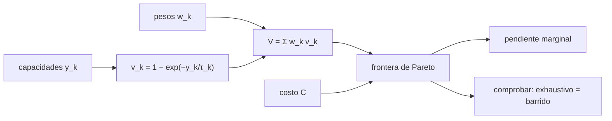

# B124-C12 — Evaluación de retorno científico

<!-- nav:top -->
[🏠 Programa](../../../../README.md) · [📚 Bloque B124](../../../tronco-comun/B124-industria-economia-etica-y-proyectos-espaciales.md) · [← Anterior: B124-C11 — Sostenibilidad económica de constelaciones](../B124-C11-sostenibilidad-economica-de-constelaciones/CLASE.md) · [Siguiente: B124-C13 — Ética de investigación y datos →](../../../tronco-comun/B124-industria-economia-etica-y-proyectos-espaciales.md#b124-c13)
<!-- /nav -->

## 1. Ubicación, nivel y alcance

Clase 12 del bloque B124. Nivel N3–N4. Una misión científica no genera ingresos: se justifica por lo que se aprende. Aun así se puede comparar opciones con un valor científico que crece con rendimientos decrecientes y con una frontera de Pareto costo-ciencia que descarta las opciones que otras superan. Retomas costos de [C05](../B124-C05-estimacion-de-costos-de-mision/CLASE.md) y la matriz multicriterio de [C04](../B124-C04-diseno-de-propuesta-de-valor/CLASE.md). **Esta clase es educativa: no es asesoría financiera ni una evaluación de misiones reales.** Las opciones son sintéticas.

## 2. Por qué esta clase existe

El retorno científico no tiene un precio de mercado, pero se puede razonar con una función de valor explícita y una frontera de eficiencia. La decisión central: **¿qué opciones valen la pena a su costo y cuáles están dominadas?**

## 3. Lo que podrás hacer al terminar

1. Definir un valor científico por objetivo con rendimientos decrecientes.
2. Combinar objetivos con pesos explícitos.
3. Calcular la frontera de Pareto de forma exhaustiva y por barrido.
4. Calcular la efectividad `V/C` y la pendiente marginal en la frontera.
5. Medir la robustez de la frontera ante cambios de pesos.
6. Rotular que el valor es una convención y los datos son sintéticos.

La evidencia es la **ficha de retorno científico y frontera de Pareto** del ejercicio 12 (sección 20).

## 4. Con qué llegas y cómo comprobarlo

1. ¿Qué es una función con rendimientos decrecientes?
2. ¿Qué es una opción dominada?
3. ¿Qué es una razón costo-efectividad?
4. ¿Qué es una pendiente marginal?
5. ¿Qué es un peso?

<details>
<summary>Ver respuestas</summary>

1. Una cuyo aumento por unidad extra es cada vez menor. 2. Una a la que otra supera en todo o iguala en todo y supera en algo. 3. El valor obtenido por unidad de costo. 4. El cambio de valor por unidad adicional de costo. 5. Un número que expresa la importancia de un objetivo; los pesos suman 1.
</details>

Con cuatro o cinco aciertos, sigue; si no, repasa los prerrequisitos.

## 5. Un caso de contexto y casos de referencia

No se consultó ninguna evaluación de retorno científico ni encuesta decenal. El **ejemplo conductor** compara 12 opciones **sintéticas** de misión con costos de 50 a 400 Mum y tres objetivos: `8` opciones están en la frontera, la mejor relación valor/costo es `M05` con `0,486` puntos de valor por 100 Mum, y la pendiente marginal pasa de `0,00145` valor por Mum entre la opción más barata y la intermedia de la frontera a `0,00065` entre la intermedia y la más cara.

## 6. Vocabulario

El **valor científico** `V` combina objetivos con pesos `w_k`. Los **rendimientos decrecientes** hacen que la capacidad extra aporte cada vez menos: `v = 1 − exp(−y/τ)`. Una opción **domina** a otra si cuesta menos o igual y vale más o igual con alguna desigualdad estricta. La **frontera de Pareto** reúne las no dominadas. La **efectividad** es `V/C`. La **pendiente marginal** es `ΔV/ΔC` entre puntos de la frontera.

## 7. Modelo mental



*Descripción textual:* las capacidades y los pesos dan un valor científico que, junto con el costo, define la frontera de Pareto; esta se comprueba con dos algoritmos y se mide su pendiente marginal.

Analogía: comparar excursiones por lo que ves y lo que cuestan, descartando las que otra supera en ambos. Límite: la «utilidad» de ver más depende de quién mira, y aquí está fijada por pesos que alguien eligió.

## 8. La explicación, paso a paso

### 8.1 Valor con rendimientos decrecientes

Para cada objetivo, `v_k = 1 − exp(−y_k/τ_k)`; la primera unidad aporta mucho y la décima casi nada. El valor total `V = Σ w_k v_k` queda entre `0,484` y `0,852` en las 12 opciones.

### 8.2 Frontera de Pareto

Una opción está en la frontera si ninguna otra es a la vez más barata (o igual) y mejor (o igual) con una desigualdad estricta. La comparación exhaustiva de todos los pares y el barrido ordenado por costo dan las mismas `8` opciones. Las demás están dominadas: no se eligen con estos pesos.

### 8.3 Efectividad y pendiente

La mejor relación `V/C` es `M05`, pero no es necesariamente la más científica: la efectividad favorece misiones pequeñas. Entre la opción más barata y la intermedia de la frontera la pendiente marginal es `0,00145` valor por Mum; entre la intermedia y la más cara, `0,00065`: pagar más compra menos ciencia por Mum, aunque tramo a tramo la pendiente fluctúa porque los costos sintéticos no están ordenados con la capacidad.

### 8.4 Robustez de los pesos

Con 5 000 vectores de pesos Dirichlet alrededor de `(0,5; 0,3; 0,2)`, `7` de las `8` opciones de la frontera están en la frontera en más del 90 % de los casos. La opción de mayor efectividad aparece en `100,0%`. Una opción que entra y sale de la frontera con pequeños cambios de peso es una decisión frágil.

## 9. Magnitudes, símbolos y unidades

| Símbolo | Qué es | Unidad | Valor / nota |
|---|---|---|---|
| `C` | costo de la opción | Mum | 50 a 400 (sintético) |
| `y_k` | capacidad en el objetivo `k` | unidades de capacidad | sintética |
| `τ_k` | escala de saturación | unidades | (4; 6; 3) |
| `w_k` | peso del objetivo | — | (0,5; 0,3; 0,2) |
| `V` | valor científico | — | 0 a 1 |

## 10. Convenciones y referencias

Valor adimensional entre 0 y 1, función de saturación exponencial elegida por conveniencia; objetivos independientes y aditivos; costos en Mum sintéticos. El valor científico no es una cantidad medida: es una convención declarada.

## 11. De dónde sale lo que afirmamos

| ID | Fuente | Localizador | Respalda | Estado |
|---|---|---|---|---|
| — | Valor con saturación, frontera de Pareto | — | verificados por dos algoritmos | No consultados en una fuente concreta |
| — | Evaluaciones de retorno científico (bibliometría, encuestas decenales) | — | no se usan | No consultadas |
| — | Opciones, costos, capacidades, pesos y `τ` | — | todos los números | Sintético |

Límites: no se consultó ninguna evaluación científica real; el valor es una convención y las 12 opciones son inventadas.

## 12. Cómo ver el resultado

| Magnitud | Valor |
|---|---|
| Opciones en la frontera | 8 de 12 |
| Mayor efectividad | M05 (0,486 por 100 Mum) |
| Pendiente barata→intermedia / intermedia→cara | 0,00145 / 0,00065 V por Mum |
| Frontera robusta (>90 %) | 7 de 8 |

Descripción larga: la frontera es corta, la pendiente marginal baja con el costo y solo parte de la frontera resiste los cambios de pesos.

## 13. Ejemplo trabajado

**Paso 1 · Datos.** Opciones A `(C = 100, V = 0,5)`, B `(150, 0,7)`, C `(120, 0,4)`.

**Paso 2 · Dominio.** C está dominada por A: cuesta más y vale menos.

**Paso 3 · Frontera.** A y B. Pendiente `ΔV/ΔC = 0,2/50 = 0,004` por Mum.

**Paso 4 · Efectividad.** `A: 0,005`; `B: 0,00467`; A es más eficiente, B es más científica.

## 14. Distintas formas de describirlo

**Por tabla:** costo, capacidades, `V`. **Por curva:** `v = 1 − exp(−y/τ)`. **Por frontera:** no dominadas. **Por razón:** `V/C`. **Por pendiente:** `ΔV/ΔC`.

## 15. Práctica guiada

**Ejercicio 1 · con los pasos indicados.** Calcula `v` con `y = 4` y `τ = 4`. *Pasos:* `1 − e^(−1)`.

<details><summary>Solución comentada</summary>

`0,632`.
</details>

**Ejercicio 2 · con una pista.** Calcula `V` con `v = (0,6; 0,4; 0,2)` y `w = (0,5; 0,3; 0,2)`. *Pista:* suma ponderada.

<details><summary>Solución comentada</summary>

`0,30 + 0,12 + 0,04 = 0,46`.
</details>

**Ejercicio 3 · casi autónomo.** ¿Está dominada una opción `(C = 200, V = 0,4)` por otra `(C = 150, V = 0,5)`?

<details><summary>Solución comentada</summary>

Sí: cuesta menos y vale más.
</details>

## 16. Práctica autónoma, transferencia e integrador

**Ejercicio 4 · autónomo.** ¿Cuántas opciones hay en la frontera del laboratorio?

<details><summary>Solución comentada</summary>

`8`.
</details>

**Ejercicio 5 · autónomo.** ¿Cuál tiene mayor efectividad?

<details><summary>Solución comentada</summary>

`M05`, `0,486` por 100 Mum.
</details>

**Ejercicio 6 · autónomo.** ¿Entre qué valores va `V`?

<details><summary>Solución comentada</summary>

Entre `0,484` y `0,852`.
</details>

**Ejercicio 7 · autónomo.** ¿Cuál es la pendiente marginal de la opción más barata a la intermedia de la frontera?

<details><summary>Solución comentada</summary>

`0,00145` V por Mum.
</details>

**Ejercicio 8 · autónomo.** ¿Y de la intermedia a la más cara?

<details><summary>Solución comentada</summary>

`0,00065` V por Mum.
</details>

**Ejercicio 9 · transferencia.** **Transferencia.** Una opción cara es la más científica pero con efectividad baja. ¿Cómo decides?

<details><summary>Solución comentada</summary>

Se compara con el presupuesto y con la pendiente marginal: si la ciencia extra cuesta mucho por unidad, se explicita ese costo y se decide con el financiador.
</details>

**Ejercicio 10 · transferencia.** **Transferencia.** Cambian los pesos y una opción sale de la frontera. ¿Qué indica?

<details><summary>Solución comentada</summary>

Que su lugar depende de la preferencia entre objetivos; la decisión no es robusta y conviene discutir los pesos.
</details>

**Ejercicio 11 · transferencia.** **Transferencia.** Alguien propone medir el retorno por número de artículos. ¿Qué advertencia haces?

<details><summary>Solución comentada</summary>

Que mide productividad editorial, no valor científico; la bibliometría no se consultó aquí y no sustituye la evaluación por pares.
</details>

**Ejercicio 12 · integrador.** **Integrador.** Elabora tu *ficha de retorno científico y frontera de Pareto*: función de valor, tabla de opciones, frontera con su verificación, efectividad y pendiente, robustez de pesos y lista de qué es una convención y qué es sintético, con el aviso de que es educativa.

<details><summary>Solución comentada</summary>

Secciones 8.1–8.4 y la salida del laboratorio.
</details>

## 17. Laboratorio: retorno científico y frontera de Pareto

El script [retorno_cientifico.py](retorno_cientifico.py) calcula el valor de 12 opciones sintéticas, su frontera de Pareto por comparación exhaustiva y por barrido, la efectividad y la robustez ante pesos Dirichlet (**comprueba** que ambas fronteras coinciden y que `V` está en [0, 1]). Tarda menos de 10 s en un equipo común.

**Datos:** ningún dato consultado; opciones, costos, capacidades, pesos y saturación **sintéticos**. **Predice antes de ejecutar:** ¿tendrá la frontera todas las opciones? (no: algunas están dominadas.) **Ejecución del 2026-11-11:**

```text
Python 3.12.9 (biblioteca estandar)
12 opciones de mision SINTETICAS; V = sum w_k (1 - exp(-y_k/tau_k)), w = (0.5, 0.3, 0.2), tau = (4, 6, 3)
 opcion  costo[Mum]  y1     y2     y3     V      V/C x100  en frontera  freq (pesos Dirichlet)
 M01      386.3   7.96   8.33   9.41  0.8481    0.220      si      0.977
 M02      325.6   6.96   7.69   7.27  0.8112    0.249      si      1.000
 M03      388.8   8.63   8.38   7.62  0.8522    0.219      si      0.817
 M04      130.2   3.02   3.50   3.33  0.5317    0.408      si      1.000
 M05       99.6   2.84   3.87   1.72  0.4841    0.486      si      1.000
 M06      189.5   4.76   5.69   5.36  0.6982    0.368      si      1.000
 M07      229.6   3.64   2.76   5.94  0.5817    0.253      no      0.000
 M08      217.7   5.54   4.93   3.57  0.6821    0.313      no      0.004
 M09      205.9   5.28   5.35   5.09  0.7068    0.343      si      0.921
 M10      209.3   2.49   2.99   4.48  0.5045    0.241      no      0.000
 M11      206.7   3.33   5.38   5.69  0.6301    0.305      no      0.000
 M12      375.7   7.23   8.78   9.25  0.8394    0.223      si      1.000
Frontera de Pareto: ['M05', 'M04', 'M06', 'M09', 'M02', 'M12', 'M01', 'M03'] ; exhaustiva = barrido: True
Mayor efectividad V/C: M05 (0.486 por 100 Mum) ; pendiente marginal (barata->intermedia / intermedia->cara) = 0.00145 / 0.00065 V por Mum
Opciones de la frontera presentes en mas del 90 % de las simulaciones de pesos: 7 de 8
Pruebas superadas.
```

```bash
python programa/clases/B124/B124-C12-evaluacion-de-retorno-cientifico/retorno_cientifico.py
```

**Límites:** valor aditivo y saturación exponencial por convención; costos sintéticos; la frontera depende de los pesos elegidos y no mide la ciencia real.

## 18. Errores frecuentes y cómo corregirlos

**Creer que el valor científico es una medición.** Se corrige con la sección 10.

**Elegir solo por efectividad.** Se corrige con 8.3.

**Ignorar que los pesos son una decisión.** Se corrige con 8.4.

**Presentar la frontera sin su robustez.** Se corrige con 8.4.

## 19. Cómo sabrás que vas bien

Tras la sección 8: ¿cuántas opciones esperabas en la frontera y cuántas hay? Si dudas, repasa el ejemplo 13. Tras el laboratorio: ¿qué comprueba? (ver la sección 17).

## 20. Qué entregas y cómo se evalúa

El producto es tu **ficha de retorno científico y frontera de Pareto** (ejercicio 12).

| Criterio | Inicial | En desarrollo | Logrado | Destacado |
|---|---|---|---|---|
| Conceptos | Los confunde | Parciales | Calcula valor y frontera | Explica los límites |
| Cálculo | Sin unidades | Con errores | Tablas completas con unidades | Calcula casos nuevos |
| Numérico | Sin comprobar | Un caso | Contraste con una segunda vía | Interpreta las diferencias |
| Fuentes | Sin fuente | Sin fecha | Fuentes con fecha y estado | Declara lo ilustrativo y lo no consultado |
| Límites | No los nombra | Uno | Tres | Discute qué falta del modelo |

**Condiciones críticas (no se compensan con promedio):** rotular los datos como sintéticos o ilustrativos; no presentar el resultado como asesoría financiera, legal ni de inversión; citar solo lo consultado.

## 21. Ética, seguridad y límites

Clase educativa: **no es asesoría financiera, legal, tributaria ni de inversión** y no sustituye a un profesional habilitado ni a la normativa vigente; ningún resultado debe usarse para decidir una compra, un contrato, una inversión o un seguro reales. Los pesos entre objetivos científicos expresan valores de una comunidad; deben acordarse y no imponerse como si fueran técnicos. Los modelos son simplificados y sus datos son sintéticos o ilustrativos. Accesibilidad: tablas equivalentes a las gráficas, fórmulas en texto, ejercicios sin conexión.

## 22. Para cerrar y seguir

De 12 opciones sintéticas, `8` están en la frontera de Pareto; la mejor efectividad es `M05` y la pendiente marginal pasa de `0,0014` a `0,0006` V por Mum entre tramos de la frontera.

**Glosario español–inglés.** retorno científico · *scientific return*; frontera de Pareto · *Pareto front*; rendimientos decrecientes · *diminishing returns*; dominancia · *dominance*; efectividad · *cost-effectiveness*.

**Continuidad.** [B124-C13](../B124-C13-etica-de-investigacion-y-datos/CLASE.md) pasa de la ciencia a su responsabilidad: la ética de investigación y de los datos.

**Referencias:** ver sección 11.

<!-- nav:bottom -->
---

[← Anterior: B124-C11 — Sostenibilidad económica de constelaciones](../B124-C11-sostenibilidad-economica-de-constelaciones/CLASE.md) · [📚 Bloque B124](../../../tronco-comun/B124-industria-economia-etica-y-proyectos-espaciales.md) · [Siguiente: B124-C13 — Ética de investigación y datos →](../../../tronco-comun/B124-industria-economia-etica-y-proyectos-espaciales.md#b124-c13)
<!-- /nav -->
