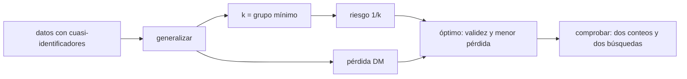

# B124-C13 — Ética de investigación y datos

<!-- nav:top -->
[🏠 Programa](../../../../README.md) · [📚 Bloque B124](../../../tronco-comun/B124-industria-economia-etica-y-proyectos-espaciales.md) · [← Anterior: B124-C12 — Evaluación de retorno científico](../B124-C12-evaluacion-de-retorno-cientifico/CLASE.md) · [Siguiente: B124-C14 — Ciencia abierta y reproducibilidad →](../B124-C14-ciencia-abierta-y-reproducibilidad/CLASE.md)
<!-- /nav -->

## 1. Ubicación, nivel y alcance

Clase 13 del bloque B124. Nivel N3–N4. La investigación que usa datos de personas (por ejemplo, participantes de un programa de observación) tiene obligaciones: pedir consentimiento, proteger la identidad y decidir qué se publica. Aquí mides un riesgo concreto, la reidentificación de un registro a partir de unos pocos atributos, con el k-anonimato, y ves el costo en información de reducir ese riesgo. Retomas la idea de proteger datos de [C14](../B124-C14-ciencia-abierta-y-reproducibilidad/CLASE.md) en sentido inverso: abrir sin dañar. **Esta clase es educativa: no es asesoría jurídica ni de protección de datos.** Los participantes son sintéticos.

## 2. Por qué esta clase existe

Abrir datos sin proteger a las personas es un daño, y proteger sin medir es una promesa vacía. La decisión central: **¿cuánto generalizar los datos para que ninguna persona sea identificable y cuánta información se pierde?**

## 3. Lo que podrás hacer al terminar

1. Definir cuasi-identificador, atributo sensible y k-anonimato.
2. Contar registros únicos y calcular el riesgo de reidentificación.
3. Explorar un reticulado de generalizaciones de forma exhaustiva.
4. Comparar la búsqueda exhaustiva con una voraz y medir la pérdida de información.
5. Ver el límite del k-anonimato con la diversidad del atributo sensible.
6. Rotular que los participantes son sintéticos y que la clase no es asesoría jurídica.

La evidencia es la **ficha de riesgo de reidentificación** del ejercicio 12 (sección 20).

## 4. Con qué llegas y cómo comprobarlo

1. ¿Qué es un cuasi-identificador?
2. ¿Qué es un atributo sensible?
3. ¿Qué es el consentimiento informado?
4. ¿Qué es generalizar un dato?
5. ¿Qué es una búsqueda exhaustiva?

<details>
<summary>Ver respuestas</summary>

1. Un atributo que no identifica por sí solo pero sí en combinación (edad, código postal). 2. Uno cuya revelación puede dañar a la persona. 3. La aceptación voluntaria de participar tras conocer cómo se usarán los datos. 4. Reemplazarlo por una categoría más amplia. 5. Probar todas las opciones posibles.
</details>

Con cuatro o cinco aciertos, sigue; si no, repasa los prerrequisitos.

## 5. Un caso de contexto y casos de referencia

Los valores de la UNESCO para la ciencia abierta (Recomendación de 2021, página consultada el 2026-11-11) incluyen la calidad y la integridad, el beneficio colectivo, la equidad y la diversidad, y piden transparencia con responsabilidad; este es el único marco **consultado**. El **ejemplo conductor** es un conjunto **sintético** de 300 participantes: sin generalizar, `300` registros (`100,0%`) son únicos y por tanto reidentificables; el mejor nodo del reticulado logra `k = 5` con `11` supresiones.

## 6. Vocabulario

El **k-anonimato** exige que cada combinación de cuasi-identificadores aparezca al menos `k` veces. La **generalización** reemplaza un valor por otro más amplio. La **supresión** elimina registros o valores. El **reticulado** es el conjunto de combinaciones de niveles de generalización. La **discernibilidad (DM)** mide la pérdida de información. La **diversidad** cuenta valores distintos del atributo sensible por grupo.

## 7. Modelo mental



*Descripción textual:* los datos se generalizan en niveles; cada nivel da un k y un riesgo, y una pérdida de información; se elige el nodo válido de menor pérdida y se comprueba con dos conteos y dos búsquedas.

Analogía: describir a alguien como «una persona de 40 a 49 años de la zona norte» en vez de dar su dirección. Límite: si todos los de ese grupo comparten el mismo dato sensible, igual se revela.

## 8. La explicación, paso a paso

### 8.1 El riesgo sin generalizar

Con los tres atributos exactos hay `300` grupos y el menor tiene `1` registro; `300` participantes son únicos. Un atacante que conozca edad, código postal y equipo de una persona la identifica con certeza.

### 8.2 El reticulado

Con 4 niveles para edad, 4 para postal y 2 para equipo hay 32 nodos. Con `K = 5` y hasta 5 % de supresión (15 registros), `12` nodos son válidos. Los dos conteos (Counter y orden con agrupación) coinciden en los 32.

### 8.3 Óptimo y voraz

El óptimo exhaustivo es edad nivel `1`, postal `2`, equipo `0`, con `k = 5`, `11` supresiones, `18` grupos y DM `9043`; el riesgo máximo es `1/k = 0,200` y el medio `0,0623`. El voraz llega a un nodo válido con DM `12333`, nunca menor que el óptimo.

### 8.4 Lo que k-anonimato no cubre

Dentro de un grupo de `k` personas puede haber un solo valor del atributo sensible: la diversidad mínima de ingresos es `2`. Si fuera 1, conocer el grupo bastaría para conocer el ingreso. Además, un atacante con datos externos nuevos puede reducir el grupo; por eso el k-anonimato reduce, no elimina, el riesgo, y no sustituye el consentimiento ni la evaluación ética.

## 9. Magnitudes, símbolos y unidades

| Símbolo | Qué es | Unidad | Valor / nota |
|---|---|---|---|
| `k` | tamaño del grupo mínimo | registros | 5 |
| `K` | objetivo de anonimato | registros | 5 |
| `1/k` | riesgo máximo de reidentificación | — | 0,200 |
| DM | pérdida por discernibilidad | registros² | 9043 |
| `l` | diversidad del atributo sensible | valores distintos | 2 |

## 10. Convenciones y referencias

Participantes sintéticos con atributos independientes; un ataque que conoce los tres cuasi-identificadores; supresión máxima del 5 %; sin datos externos adicionales. La generalización es jerárquica y fija. Nada del conjunto corresponde a personas reales.

## 11. De dónde sale lo que afirmamos

| ID | Fuente | Localizador | Respalda | Estado |
|---|---|---|---|---|
| S1 | UNESCO, Recomendación sobre Ciencia Abierta (2021), página de presentación — https://www.unesco.org/en/open-science/about (consultada 2026-11-11) | valores y principios | los valores de la Recomendación incluyen calidad e integridad, beneficio colectivo, equidad y justicia, y diversidad e inclusión; sus principios incluyen transparencia, responsabilidad y rendición de cuentas | Consultada |
| — | k-anonimato, discernibilidad, diversidad | — | verificados por dos conteos y dos búsquedas | No consultados en una fuente concreta |
| — | Leyes de protección de datos y comités de ética | — | no se usan | No consultados |
| — | 300 participantes | — | todas las cifras | Sintético |

Límites: no se consultó ninguna ley de protección de datos ni guía de comités de ética; los participantes son inventados y la página de la UNESCO se usó solo para los valores generales.

## 12. Cómo ver el resultado

| Magnitud | Valor |
|---|---|
| Registros únicos sin generalizar | 300 (100,0%) |
| k logrado | 5 |
| Supresiones | 11 |
| Riesgo máximo 1/k | 0,200 |
| Diversidad mínima | 2 |

Descripción larga: generalizar elimina los registros únicos a costa de información; el óptimo es válido, y el riesgo que queda depende de la diversidad del atributo sensible.

## 13. Ejemplo trabajado

**Paso 1 · Datos.** Seis registros con edades `(21, 24, 33, 35, 38, 52)`.

**Paso 2 · Sin generalizar.** Todos únicos: `k = 1`.

**Paso 3 · Bandas de 10.** `20–29: 2`; `30–39: 3`; `50–59: 1`: `k = 1`.

**Paso 4 · Supresión.** Suprimir el registro de 52 deja `k = 2` y riesgo máximo `1/2`.

## 14. Distintas formas de describirlo

**Por conteo:** tamaño de grupos. **Por riesgo:** `1/k`. **Por nodo:** niveles de generalización. **Por pérdida:** DM. **Por diversidad:** valores sensibles distintos por grupo.

## 15. Práctica guiada

**Ejercicio 1 · con los pasos indicados.** ¿Qué riesgo máximo tiene un conjunto con `k = 4`? *Pasos:* `1/k`.

<details><summary>Solución comentada</summary>

`0,25`.
</details>

**Ejercicio 2 · con una pista.** ¿Cuántos nodos tiene un reticulado de 3 y 2 niveles? *Pista:* producto.

<details><summary>Solución comentada</summary>

`6`.
</details>

**Ejercicio 3 · casi autónomo.** En grupos de tamaño `(3, 3, 4)`, ¿cuál es el k y la DM? 

<details><summary>Solución comentada</summary>

`k = 3`; `DM = 9 + 9 + 16 = 34`.
</details>

## 16. Práctica autónoma, transferencia e integrador

**Ejercicio 4 · autónomo.** ¿Cuántos registros únicos hay sin generalizar?

<details><summary>Solución comentada</summary>

`300`.
</details>

**Ejercicio 5 · autónomo.** ¿Qué `k` logra el óptimo?

<details><summary>Solución comentada</summary>

`5`.
</details>

**Ejercicio 6 · autónomo.** ¿Cuántas supresiones usa?

<details><summary>Solución comentada</summary>

`11`.
</details>

**Ejercicio 7 · autónomo.** ¿Cuál es el riesgo medio?

<details><summary>Solución comentada</summary>

`0,0623`.
</details>

**Ejercicio 8 · autónomo.** ¿Qué diversidad mínima de ingresos hay?

<details><summary>Solución comentada</summary>

`2`.
</details>

**Ejercicio 9 · transferencia.** **Transferencia.** Un grupo de 6 personas tiene todas el mismo ingreso «alto». ¿Qué ocurre con la privacidad?

<details><summary>Solución comentada</summary>

Se revela el ingreso de cualquiera que se sepa en ese grupo, aunque `k = 6`: hace falta diversidad, no solo `k`.
</details>

**Ejercicio 10 · transferencia.** **Transferencia.** Una investigadora quiere publicar fechas exactas de observación de cada participante. ¿Qué evalúas?

<details><summary>Solución comentada</summary>

Si las fechas funcionan como cuasi-identificadores en combinación con otros datos públicos; se generalizan o se retienen, y se revisa con el comité de ética.
</details>

**Ejercicio 11 · transferencia.** **Transferencia.** ¿Basta con aplicar k-anonimato para cumplir con la ética de un estudio?

<details><summary>Solución comentada</summary>

No: faltan el consentimiento, la minimización de datos, el propósito acotado y la revisión de un comité; el k-anonimato es solo una medida técnica.
</details>

**Ejercicio 12 · integrador.** **Integrador.** Elabora tu *ficha de riesgo de reidentificación*: registros únicos, nodo óptimo y su k, supresiones, pérdida DM, comparación con la búsqueda voraz, diversidad y lista de límites, con el aviso de que no es asesoría jurídica.

<details><summary>Solución comentada</summary>

Secciones 8.1–8.4 y la salida del laboratorio.
</details>

## 17. Laboratorio: k-anonimato

El script [k_anonimato.py](k_anonimato.py) busca la generalización óptima sobre 32 nodos de forma exhaustiva y voraz, con dos implementaciones de conteo (**comprueba** que ambos conteos coinciden, que el voraz es válido y que el óptimo no es peor). Tarda menos de 10 s en un equipo común.

**Datos:** solo los valores de la Recomendación de la UNESCO (consultados 2026-11-11); los 300 participantes y sus atributos son **sintéticos**. **Predice antes de ejecutar:** ¿tendrá algún registro único el conjunto sin generalizar? (sí, muchos.) **Ejecución del 2026-11-11:**

```text
Python 3.12.9 (biblioteca estandar)
300 participantes SINTETICOS; cuasi-identificadores: edad, codigo postal, equipo ; sensible: ingresos ; k objetivo = 5 ; supresion maxima = 5 %
Sin generalizar: 300 grupos ; k = 1 ; registros unicos = 300 (100.0 %) -> riesgo de reidentificacion 100 % para ellos
Nodos validos del reticulado (de 32): 12
Optimo exhaustivo: edad nivel 1, postal nivel 2, equipo nivel 0 ; k = 5 ; supresiones = 11 ; grupos = 18 ; DM = 9043
  riesgo maximo 1/k = 0.200 ; riesgo medio = 0.0623 ; diversidad minima de ingresos por grupo = 2
Voraz: edad 2, postal 2, equipo 0 ; DM = 12333 ; valido = True
Conteos Counter y por orden: iguales en los 32 nodos.
Pruebas superadas.
```

```bash
python programa/clases/B124/B124-C13-etica-de-investigacion-y-datos/k_anonimato.py
```

**Límites:** atributos independientes y un atacante con tres cuasi-identificadores; el k-anonimato no cubre ataques con datos externos ni la diversidad por sí solo; no es una evaluación de cumplimiento legal.

## 18. Errores frecuentes y cómo corregirlos

**Creer que quitar el nombre anonimiza.** Se corrige con 8.1.

**Medir solo `k` e ignorar el atributo sensible.** Se corrige con 8.4.

**Generalizar de más y destruir la utilidad.** Se corrige con 8.3.

**Tomar el k-anonimato como cumplimiento ético o legal.** Se corrige con el ejercicio 11.

## 19. Cómo sabrás que vas bien

Tras la sección 8: ¿cuántos registros únicos esperabas y cuántos hay? Si dudas, repasa el ejemplo 13. Tras el laboratorio: ¿qué comprueba? (ver la sección 17).

## 20. Qué entregas y cómo se evalúa

El producto es tu **ficha de riesgo de reidentificación** (ejercicio 12).

| Criterio | Inicial | En desarrollo | Logrado | Destacado |
|---|---|---|---|---|
| Conceptos | Los confunde | Parciales | Calcula k, riesgo y pérdida | Explica los límites |
| Cálculo | Sin unidades | Con errores | Tablas completas con unidades | Calcula casos nuevos |
| Numérico | Sin comprobar | Un caso | Contraste con una segunda vía | Interpreta las diferencias |
| Fuentes | Sin fuente | Sin fecha | Fuentes con fecha y estado | Declara lo ilustrativo y lo no consultado |
| Límites | No los nombra | Uno | Tres | Discute qué falta del modelo |

**Condiciones críticas (no se compensan con promedio):** rotular los datos como sintéticos o ilustrativos; no presentar el resultado como asesoría financiera, legal ni de inversión; citar solo lo consultado.

## 21. Ética, seguridad y límites

Clase educativa: **no es asesoría financiera, legal, tributaria ni de inversión** y no sustituye a un profesional habilitado ni a la normativa vigente; ningún resultado debe usarse para decidir una compra, un contrato, una inversión o un seguro reales. Los datos de personas requieren consentimiento, propósito acotado y revisión de un comité de ética; esta clase solo mide un riesgo técnico y no reemplaza esos pasos ni la ley aplicable. Los modelos son simplificados y sus datos son sintéticos o ilustrativos. Accesibilidad: tablas equivalentes a las gráficas, fórmulas en texto, ejercicios sin conexión.

## 22. Para cerrar y seguir

De 300 participantes sintéticos, `300` eran únicos; el mejor nodo del reticulado logra `k = 5` con `11` supresiones y riesgo máximo `0,20`, pero la diversidad mínima de ingresos es `2`.

**Glosario español–inglés.** k-anonimato · *k-anonymity*; cuasi-identificador · *quasi-identifier*; reidentificación · *re-identification*; generalización · *generalization*; atributo sensible · *sensitive attribute*.

**Continuidad.** [B124-C14](../B124-C14-ciencia-abierta-y-reproducibilidad/CLASE.md) trata la otra cara: abrir los datos y el código para que un análisis se pueda reproducir.

**Referencias:** ver sección 11.

<!-- nav:bottom -->
---

[← Anterior: B124-C12 — Evaluación de retorno científico](../B124-C12-evaluacion-de-retorno-cientifico/CLASE.md) · [📚 Bloque B124](../../../tronco-comun/B124-industria-economia-etica-y-proyectos-espaciales.md) · [Siguiente: B124-C14 — Ciencia abierta y reproducibilidad →](../B124-C14-ciencia-abierta-y-reproducibilidad/CLASE.md)
<!-- /nav -->
