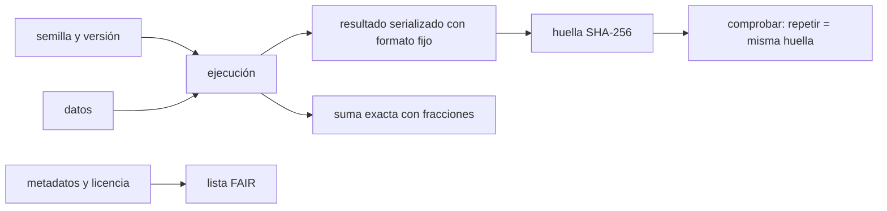

# B124-C14 — Ciencia abierta y reproducibilidad

<!-- nav:top -->
[🏠 Programa](../../../../README.md) · [📚 Bloque B124](../../../tronco-comun/B124-industria-economia-etica-y-proyectos-espaciales.md) · [← Anterior: B124-C13 — Ética de investigación y datos](../B124-C13-etica-de-investigacion-y-datos/CLASE.md) · [Siguiente: B124-C15 — Gestión de proyectos espaciales →](../B124-C15-gestion-de-proyectos-espaciales/CLASE.md)
<!-- /nav -->

## 1. Ubicación, nivel y alcance

Clase 14 del bloque B124. Nivel N3–N4. Un resultado científico solo vale si otra persona puede repetirlo. Aquí mides tres cosas concretas: cuánto cambia una suma en coma flotante según el orden de las operaciones, cómo una huella criptográfica comprueba que dos ejecuciones dieron lo mismo, y cuántos criterios de datos FAIR cumple un registro. Es el complemento de [C13](../B124-C13-etica-de-investigacion-y-datos/CLASE.md): abrir los datos sin dañar a las personas. **Esta clase es educativa: no es asesoría legal ni de licencias.** El registro de datos es sintético.

## 2. Por qué esta clase existe

«Es reproducible» suele afirmarse sin evidencia. La decisión central: **¿qué hay que fijar y registrar para que un análisis dé el mismo resultado y se pueda comprobar?**

## 3. Lo que podrás hacer al terminar

1. Explicar por qué el orden de las sumas cambia el resultado en coma flotante.
2. Calcular una referencia exacta con fracciones y comprobar `math.fsum`.
3. Calcular una huella SHA-256 de un resultado con formato fijo.
4. Comprobar que la misma semilla da la misma huella y otra semilla, otra.
5. Puntuar un registro con 12 criterios agrupados en F, A, I y R.
6. Separar lo consultado (los principios FAIR y la Recomendación de la UNESCO) de lo sintético.

La evidencia es el **manifiesto reproducible con huella y lista FAIR** del ejercicio 12 (sección 20).

## 4. Con qué llegas y cómo comprobarlo

1. ¿Qué es la coma flotante?
2. ¿Qué es una función hash?
3. ¿Qué es una semilla?
4. ¿Qué es un metadato?
5. ¿Qué es una licencia de datos?

<details>
<summary>Ver respuestas</summary>

1. La forma en que el computador representa números reales con un número finito de dígitos binarios. 2. Una función que convierte datos en una huella de tamaño fijo; un cambio mínimo en el dato cambia la huella. 3. El valor inicial de un generador pseudoaleatorio, que fija la secuencia. 4. Un dato que describe a otro dato (autor, fecha, unidades). 5. La declaración de qué se puede hacer con los datos.
</details>

Con cuatro o cinco aciertos, sigue; si no, repasa los prerrequisitos.

## 5. Un caso de contexto y casos de referencia

Wilkinson et al. (2016, *Scientific Data* 3:160018) proponen los principios FAIR: los datos deben ser localizables (identificadores estables y metadatos indexados), accesibles (por protocolos abiertos, con metadatos aunque el dato ya no esté), interoperables (vocabularios compartidos) y reutilizables (licencia clara y procedencia). La Recomendación de la UNESCO sobre Ciencia Abierta (2021) incluye entre sus principios la transparencia y la reproducibilidad. Es todo lo **consultado**. El **ejemplo conductor** es una suma de 100 000 números **sintéticos**: en cuatro órdenes distintos el resultado varía en `2,65e-05`, mientras `math.fsum` coincide con la referencia exacta; y un registro **sintético** cumple `8` de `12` criterios.

## 6. Vocabulario

La **reproducibilidad** es obtener el mismo resultado con los mismos datos y código. La **huella** (SHA-256) identifica un contenido. La **semilla** fija la secuencia aleatoria. **FAIR** son las cuatro propiedades de los datos (localizables, accesibles, interoperables, reutilizables). La **procedencia** es el origen y las transformaciones de un dato. La **referencia exacta** es el resultado con aritmética racional.

## 7. Modelo mental



*Descripción textual:* la semilla, los datos y la versión determinan una ejecución cuyo resultado se serializa y se resume en una huella que se compara; en paralelo, se puntúan los metadatos y se verifica la suma contra la aritmética exacta.

Analogía: una receta con cantidades exactas, horno y tiempo permite repetir el plato; «échale sal a gusto» no. Límite: en un cálculo, además hay diferencias invisibles, como el orden en que se suman los ingredientes.

## 8. La explicación, paso a paso

### 8.1 El orden de las sumas importa

Al sumar 100 000 números de magnitudes entre 10⁻⁶ y 10⁶, el resultado depende del orden: original, inverso, ordenado y ordenado por valor absoluto difieren en `2,65e-05`. Los errores respecto de la referencia exacta son `8,57e-08`, `2,89e-07`, `2,62e-05` y `4,84e-08`. Los números más grandes son del orden de `3,7e+06`.

### 8.2 Una suma que no depende del orden

`math.fsum` da `0,0e+00` de error respecto de la suma exacta con fracciones (`Fraction`), redondeada una sola vez. Cuando importa que dos máquinas o dos órdenes de cálculo den lo mismo, se usa una suma compensada o exacta, o se fija el orden.

### 8.3 Huella

El resultado se serializa con formato fijo (`repr` de cada número, claves ordenadas) y se resume con SHA-256: la misma semilla repite la huella `b67720d629581ddc…` y otra semilla la cambia. La huella no dice que el resultado sea correcto: dice que es el mismo.

### 8.4 Lista FAIR

El registro sintético cumple `8` de `12` criterios (`66,7%`): F `2`/3, A `2`/3, I `1`/3, R `3`/3. Faltan, por ejemplo, el índice en un repositorio, los vocabularios controlados y los enlaces; los criterios son un ejemplo propio de la clase, no la lista oficial de FAIR.

## 9. Magnitudes, símbolos y unidades

| Símbolo | Qué es | Unidad | Valor / nota |
|---|---|---|---|
| `N` | cantidad de números sumados | — | 100 000 |
| error | diferencia con la suma exacta | adimensional | 8,6e-08 a 2,9e-07 |
| huella | SHA-256 del resultado | 256 bits | b67720d629581ddc… |
| puntaje FAIR | criterios cumplidos / 12 | — | 66,7% |

## 10. Convenciones y referencias

Python 3.12.9 con flotantes de doble precisión (IEEE 754); números pseudoaleatorios con semilla fija; formato de serialización fijo. Los 12 criterios son de la clase y no equivalen a una evaluación FAIR oficial. Todos los datos son sintéticos.

## 11. De dónde sale lo que afirmamos

| ID | Fuente | Localizador | Respalda | Estado |
|---|---|---|---|---|
| S1 | Wilkinson M. D. et al., «The FAIR Guiding Principles for scientific data management and stewardship», Scientific Data 3:160018 (2016) — https://pmc.ncbi.nlm.nih.gov/articles/PMC4792175/ (consultado 2026-11-11) | resumen y principios | los principios FAIR: Findable, Accessible, Interoperable, Reusable, con identificadores estables, metadatos, protocolos abiertos, vocabularios compartidos, licencia y procedencia | Consultada |
| S2 | UNESCO, Recomendación sobre Ciencia Abierta (2021), página de presentación — https://www.unesco.org/en/open-science/about (consultada 2026-11-11) | principios rectores | la transparencia y la reproducibilidad figuran entre los principios rectores de la ciencia abierta | Consultada |
| — | Aritmética de coma flotante, SHA-256, `Fraction` | — | verificados en el laboratorio | No consultados en una fuente concreta |
| — | Registro de datos y 12 criterios | — | puntaje FAIR | Sintético |

Límites: no se consultó el texto completo de los 15 principios FAIR; los 12 criterios son un ejemplo de la clase; los errores de coma flotante dependen de la plataforma y de la versión de Python.

## 12. Cómo ver el resultado

| Magnitud | Valor |
|---|---|
| Dispersión entre órdenes de suma | 2,65e-05 |
| Error de `math.fsum` | 0,0e+00 |
| Misma semilla, misma huella | sí |
| Otra semilla, otra huella | sí |
| Puntaje de la lista | 8/12 (66,7%) |

Descripción larga: el orden de las sumas cambia el resultado, una suma exacta lo fija, la huella lo certifica y la lista FAIR señala qué falta documentar.

## 13. Ejemplo trabajado

**Paso 1 · Suma sencilla.** En binario `0,1 + 0,2 = 0,30000000000000004` en doble precisión.

**Paso 2 · Orden.** `(1e16 + 1) − 1e16 = 0` en doble precisión, mientras que `(1e16 − 1e16) + 1 = 1`: el resultado depende del orden.

**Paso 3 · Huella.** Cambiar un solo carácter del resultado serializado cambia por completo el SHA-256.

**Paso 4 · Lista.** 9 criterios de 12 cumplidos dan 75 %.

## 14. Distintas formas de describirlo

**Por error:** diferencia con la suma exacta. **Por huella:** igualdad de SHA-256. **Por semilla:** repetición. **Por lista:** criterios F, A, I, R. **Por manifiesto:** versión, semilla, datos y huella.

## 15. Práctica guiada

**Ejercicio 1 · con los pasos indicados.** Calcula el puntaje de 9 criterios cumplidos de 12. *Pasos:* `9/12`.

<details><summary>Solución comentada</summary>

`75 %`.
</details>

**Ejercicio 2 · con una pista.** Si un registro cumple F 3/3, A 2/3, I 1/3, R 3/3, ¿cuántos criterios son? *Pista:* suma.

<details><summary>Solución comentada</summary>

`9`.
</details>

**Ejercicio 3 · casi autónomo.** ¿Cambia la huella si cambia la semilla?

<details><summary>Solución comentada</summary>

Sí, aunque el resultado numérico se parezca, la serialización difiere.
</details>

## 16. Práctica autónoma, transferencia e integrador

**Ejercicio 4 · autónomo.** ¿Cuánto varían los cuatro órdenes de suma?

<details><summary>Solución comentada</summary>

`2,65e-05`.
</details>

**Ejercicio 5 · autónomo.** ¿Qué error tiene `math.fsum`?

<details><summary>Solución comentada</summary>

`0,0e+00`.
</details>

**Ejercicio 6 · autónomo.** ¿Cuál orden dio mayor error?

<details><summary>Solución comentada</summary>

El orden ascendente por valor (`ordenados`), con `2,62e-05`, frente a `8,57e-08` del orden original y `4,84e-08` del orden por valor absoluto.
</details>

**Ejercicio 7 · autónomo.** ¿Cuántos criterios cumple el registro?

<details><summary>Solución comentada</summary>

`8` de `12`.
</details>

**Ejercicio 8 · autónomo.** ¿Qué letra tiene menos criterios cumplidos?

<details><summary>Solución comentada</summary>

La de menor puntaje (I: `1`/3).
</details>

**Ejercicio 9 · transferencia.** **Transferencia.** Un colega comparte el código pero no la versión de las bibliotecas. ¿Qué falta?

<details><summary>Solución comentada</summary>

Un registro de versiones (por ejemplo de Python y de cada paquete) y de los datos; sin eso el resultado puede cambiar entre máquinas.
</details>

**Ejercicio 10 · transferencia.** **Transferencia.** Dos ejecuciones dan huellas distintas con la misma semilla. ¿Qué buscas?

<details><summary>Solución comentada</summary>

Entradas distintas, orden de operaciones o paralelismo no determinista, versión de biblioteca, formato de serialización.
</details>

**Ejercicio 11 · transferencia.** **Transferencia.** Un conjunto de datos «es abierto» pero no tiene licencia. ¿Es reutilizable?

<details><summary>Solución comentada</summary>

No claramente: sin licencia explícita no se sabe qué se puede hacer con él (criterio R1).
</details>

**Ejercicio 12 · integrador.** **Integrador.** Elabora tu *manifiesto reproducible con huella y lista FAIR*: semilla, versión de Python, orden de operaciones, huella, suma comprobada con aritmética exacta, lista de 12 criterios puntuada y límites, con el aviso de que es educativa.

<details><summary>Solución comentada</summary>

Secciones 8.1–8.4 y la salida del laboratorio.
</details>

## 17. Laboratorio: reproducibilidad y lista FAIR

El script [reproducibilidad.py](reproducibilidad.py) compara cuatro órdenes de suma con la referencia exacta, comprueba `math.fsum`, calcula huellas SHA-256 con dos semillas y puntúa 12 criterios (**comprueba** que `math.fsum` iguala la suma exacta, que la misma semilla repite la huella y que otra la cambia). Tarda menos de 10 s en un equipo común.

**Datos:** solo los principios FAIR y la Recomendación de la UNESCO (consultados 2026-11-11); números, registro y criterios **sintéticos**. **Predice antes de ejecutar:** ¿darán la misma suma los cuatro órdenes? (no.) **Ejecución del 2026-11-11:**

```text
Python 3.12.9 (biblioteca estandar)
Parte 1: suma de 100000 numeros SINTETICOS (semilla 124, escala maxima 3.710e+06)
  referencia exacta (Fraction) redondeada = 8546940.773507783
  orden original     suma = 8546940.773507869        error absoluto = 8.568e-08
  orden inverso      suma = 8546940.773508072        error absoluto = 2.887e-07
  ordenados          suma = 8546940.773481607        error absoluto = 2.618e-05
  ordenados por |x|  suma = 8546940.773507735        error absoluto = 4.843e-08
  math.fsum          suma = 8546940.773507783        error absoluto = 0.000e+00
  dispersion entre ordenes = 2.646e-05
Parte 2: huella SHA-256 semilla 124 = b67720d629581ddc... ; repetida igual: True ; semilla 125 = bf24708d3f8a9749... distinta: True
Parte 3: lista FAIR sintetica: 8/12 criterios = 66.7 % (F 2/3, A 2/3, I 1/3, R 3/3)
   [x] F1 identificador persistente
   [x] F2 metadatos descriptivos
   [ ] F3 indexado en un repositorio
   [x] A1 recuperable por protocolo estandar
   [ ] A2 metadatos disponibles aunque el dato no
   [x] A3 condiciones de acceso declaradas
   [x] I1 formato abierto
   [ ] I2 vocabulario controlado
   [ ] I3 enlaces a otros conjuntos
   [x] R1 licencia explicita
   [x] R2 procedencia documentada
   [x] R3 version y fecha
Pruebas superadas.
```

```bash
python programa/clases/B124/B124-C14-ciencia-abierta-y-reproducibilidad/reproducibilidad.py
```

**Límites:** resultados de coma flotante propios de CPython 3.12.9 en esta máquina; los 12 criterios no son la evaluación FAIR oficial; la huella certifica identidad, no corrección.

## 18. Errores frecuentes y cómo corregirlos

**Decir «es reproducible» sin semilla ni versión.** Se corrige con 8.3.

**Creer que la suma no depende del orden.** Se corrige con 8.1.

**Confundir huella igual con resultado correcto.** Se corrige con 8.3.

**Tomar los 12 criterios como la norma FAIR.** Se corrige con 8.4.

## 19. Cómo sabrás que vas bien

Tras la sección 8: ¿qué orden esperabas más exacto y cuál lo fue? Si dudas, repasa el ejemplo 13. Tras el laboratorio: ¿qué comprueba? (ver la sección 17).

## 20. Qué entregas y cómo se evalúa

El producto es tu **manifiesto reproducible con huella y lista FAIR** (ejercicio 12).

| Criterio | Inicial | En desarrollo | Logrado | Destacado |
|---|---|---|---|---|
| Conceptos | Los confunde | Parciales | Explica orden, huella y FAIR | Explica los límites |
| Cálculo | Sin unidades | Con errores | Tablas completas con unidades | Calcula casos nuevos |
| Numérico | Sin comprobar | Un caso | Contraste con una segunda vía | Interpreta las diferencias |
| Fuentes | Sin fuente | Sin fecha | Fuentes con fecha y estado | Declara lo ilustrativo y lo no consultado |
| Límites | No los nombra | Uno | Tres | Discute qué falta del modelo |

**Condiciones críticas (no se compensan con promedio):** rotular los datos como sintéticos o ilustrativos; no presentar el resultado como asesoría financiera, legal ni de inversión; citar solo lo consultado.

## 21. Ética, seguridad y límites

Clase educativa: **no es asesoría financiera, legal, tributaria ni de inversión** y no sustituye a un profesional habilitado ni a la normativa vigente; ningún resultado debe usarse para decidir una compra, un contrato, una inversión o un seguro reales. Abrir datos exige antes revisar el consentimiento y el riesgo de reidentificación (clase C13); la licencia elegida debe ser decidida por quien tiene los derechos. Los modelos son simplificados y sus datos son sintéticos o ilustrativos. Accesibilidad: tablas equivalentes a las gráficas, fórmulas en texto, ejercicios sin conexión.

## 22. Para cerrar y seguir

Cuatro órdenes de suma de 100 000 números sintéticos difieren en `2,65e-05`; `math.fsum` coincide con la suma exacta, la huella repite con la misma semilla, y el registro sintético cumple `8` de `12` criterios.

**Glosario español–inglés.** reproducibilidad · *reproducibility*; huella criptográfica · *cryptographic hash*; semilla · *seed*; procedencia · *provenance*; ciencia abierta · *open science*.

**Continuidad.** [B124-C15](../B124-C15-gestion-de-proyectos-espaciales/CLASE.md) pasa a la gestión del proyecto que produce esos resultados.

**Referencias:** ver sección 11.

<!-- nav:bottom -->
---

[← Anterior: B124-C13 — Ética de investigación y datos](../B124-C13-etica-de-investigacion-y-datos/CLASE.md) · [📚 Bloque B124](../../../tronco-comun/B124-industria-economia-etica-y-proyectos-espaciales.md) · [Siguiente: B124-C15 — Gestión de proyectos espaciales →](../B124-C15-gestion-de-proyectos-espaciales/CLASE.md)
<!-- /nav -->
