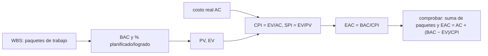

# B124-C15 — Gestión de proyectos espaciales

<!-- nav:top -->
[🏠 Programa](../../../../README.md) · [📚 Bloque B124](../../../tronco-comun/B124-industria-economia-etica-y-proyectos-espaciales.md) · [← Anterior: B124-C14 — Ciencia abierta y reproducibilidad](../B124-C14-ciencia-abierta-y-reproducibilidad/CLASE.md) · [Siguiente: B124-C16 — Planificación de cronograma y entregables →](../B124-C16-planificacion-de-cronograma-y-entregables/CLASE.md)
<!-- /nav -->

## 1. Ubicación, nivel y alcance

Clase 15 del bloque B124. Nivel N3–N4. Gestionar un proyecto espacial es saber qué hay que hacer (estructura de desglose del trabajo), cuánto cuesta y cuánto se ha avanzado. Aquí descompones un proyecto en paquetes de trabajo y calculas con el método del valor ganado dos índices —de costo y de plazo— y una estimación del costo final. Retomas el costo de [C05](../B124-C05-estimacion-de-costos-de-mision/CLASE.md) y la brecha de [C06](../B124-C06-financiamiento-publico/CLASE.md). **Esta clase es educativa: no es asesoría de gestión ni financiera.** El proyecto es sintético.

## 2. Por qué esta clase existe

Un proyecto se descontrola de a poco; el valor ganado convierte «vamos bien» en números comparables. La decisión central: **¿cuánto va a costar el proyecto al terminar si el rendimiento actual se mantiene y qué paquete es el problema?**

## 3. Lo que podrás hacer al terminar

1. Descomponer un proyecto en una estructura de desglose del trabajo (WBS) con la regla del 100 %.
2. Calcular valor planificado, valor ganado y costo real.
3. Calcular los índices CPI y SPI y las variaciones de costo y de plazo.
4. Estimar el costo al término (EAC) con tres supuestos y comprobar una identidad.
5. Localizar el paquete de trabajo con peor rendimiento.
6. Rotular lo consultado (la WBS y el ciclo de vida del Handbook) y lo sintético (todas las cifras).

La evidencia es el **tablero de valor ganado de un proyecto sintético** del ejercicio 12 (sección 20).

## 4. Con qué llegas y cómo comprobarlo

1. ¿Qué es un presupuesto al término (BAC)?
2. ¿Qué es una estructura de desglose del trabajo?
3. ¿Qué es un índice?
4. ¿Qué es el porcentaje de avance?
5. ¿Qué es una variación?

<details>
<summary>Ver respuestas</summary>

1. El costo total planificado de todo el trabajo. 2. Una descomposición jerárquica del trabajo en partes manejables. 3. Un cociente que compara dos magnitudes; 1 significa igualdad. 4. La fracción del trabajo de un paquete que ya está hecha. 5. La diferencia entre lo logrado y lo planificado o gastado.
</details>

Con cuatro o cinco aciertos, sigue; si no, repasa los prerrequisitos.

## 5. Un caso de contexto y casos de referencia

El NASA Systems Engineering Handbook (SP-6105, Rev 2; página y PDF consultados el 2026-11-11) organiza un proyecto en fases (Pre-Fase A a Fase F) y usa la estructura de desglose del trabajo para definir y comunicar qué hay que hacer. Es todo lo **consultado**; el método del valor ganado se desarrolla con fórmulas estándar que verifica el laboratorio. El **ejemplo conductor** es un proyecto **sintético** con BAC de `80` Mum: tras el mes 6 se ha gastado `60,0`, se ha ganado `47,7` y se había planificado `57,0`; el CPI es `0,795`, el SPI `0,837` y el costo final estimado, `100,6` Mum.

## 6. Vocabulario

El **BAC** es el presupuesto total. El **PV** es el valor del trabajo planificado a la fecha; el **EV**, el valor del trabajo logrado; el **AC**, el costo real. El **CPI** es `EV/AC`; el **SPI**, `EV/PV`. El **EAC** es la estimación del costo final; el **ETC**, lo que falta gastar; el **VAC**, `BAC − EAC`. El **TCPI** es el rendimiento de costo que se necesita para terminar en el BAC.

## 7. Modelo mental



*Descripción textual:* la WBS da paquetes con presupuesto y avance; de ellos salen PV y EV, con el costo real se calculan los índices y la estimación final, y se comprueba con la suma jerárquica y una identidad.

Analogía: un viaje en que comparas los kilómetros recorridos con el combustible gastado y con el plan de horarios. Límite: el trabajo logrado se estima por porcentaje de avance, que puede ser optimista.

## 8. La explicación, paso a paso

### 8.1 La estructura y la regla del 100 %

La WBS del laboratorio tiene tres elementos (plataforma, carga útil, segmento terrestre) y seis paquetes. La suma de los paquetes coincide con la de los elementos y con el proyecto para BAC, PV, EV y AC (error `0,0e+00`): lo que está en los hijos es todo lo que está en el padre.

### 8.2 Índices

Con `PV = 57,00`, `EV = 47,70` y `AC = 60,00`: `CV = EV − AC = -12,30` y `SV = EV − PV = -9,30` Mum; `CPI = 0,7950` (se gasta más de lo que se gana) y `SPI = 0,8368` (hay atraso). Gastado: `75,0%` del BAC; logrado: `59,6%`.

### 8.3 Estimación al término

Si el rendimiento de costo se mantiene, `EAC = BAC/CPI = 100,63` Mum (ETC `40,63`, VAC `-20,63`), idéntico a `AC + (BAC − EV)/CPI` (error `0,0e+00`). Si el resto se hace según lo presupuestado, `EAC = AC + (BAC − EV) = 92,30`; si el costo depende de CPI y SPI juntos, `108,55`. El TCPI necesario para terminar en el BAC es `1,615`, mucho más que el rendimiento actual.

### 8.4 Dónde está el problema

El peor CPI es el de «operaciones» (`0,333`). Por elemento: plataforma `0,875`, carga útil `0,758`, segmento terrestre `0,708`. El CPI acumulado por mes va de `0,800` en el mes 1 a `0,795` en el mes 6, con un mínimo de `0,763`: nunca se acerca a 1, una tendencia que un valor puntual no muestra.

## 9. Magnitudes, símbolos y unidades

| Símbolo | Qué es | Unidad | Valor / nota |
|---|---|---|---|
| BAC | presupuesto al término | Mum | 80 |
| PV, EV, AC | planificado, ganado, real | Mum | 57,0; 47,7; 60,0 |
| CPI, SPI | índices de costo y de plazo | — | 0,795; 0,837 |
| EAC, ETC, VAC | costo final, por gastar, variación final | Mum | 100,6; 40,6; -20,6 |
| TCPI | rendimiento necesario | — | 1,615 |

## 10. Convenciones y referencias

Fecha de corte al fin del mes 6; porcentajes de avance estimados por el responsable del paquete; Mum sintéticas; sin reservas de contingencia en el BAC. Los índices acumulados (no mensuales). Todas las cifras son sintéticas.

## 11. De dónde sale lo que afirmamos

| ID | Fuente | Localizador | Respalda | Estado |
|---|---|---|---|---|
| S1 | NASA, Systems Engineering Handbook (SP-6105, Rev 2) — https://www.nasa.gov/reference/systems-engineering-handbook/ y PDF https://www.nasa.gov/wp-content/uploads/2018/09/nasa_systems_engineering_handbook_0.pdf (consultados 2026-11-11, PDF leído con PyMuPDF) | capítulo 2 (ciclo de vida) y gestión de calendario | el ciclo de vida de un proyecto va de Pre-Fase A a Fase F; la WBS sirve para definir y comunicar qué hay que hacer y cómo se relaciona con el calendario | Consultada |
| — | Fórmulas del valor ganado (CPI, SPI, EAC, TCPI) | — | verificadas con sumas jerárquicas e identidad algebraica | No consultadas en una fuente concreta |
| — | Paquetes, BAC, avances y costos | — | todas las cifras | Sintético |

Límites: no se consultó el estándar de gestión de proyectos de pago ni la guía de valor ganado de ninguna agencia; las fórmulas son las habituales y no se contrastaron con una fuente concreta.

## 12. Cómo ver el resultado

| Magnitud | Valor |
|---|---|
| CPI / SPI | 0,795 / 0,837 |
| EAC | 100,6 Mum (BAC 80) |
| VAC | -20,6 Mum |
| TCPI | 1,615 |
| Paquete con peor CPI | operaciones (0,333) |

Descripción larga: el proyecto gasta más de lo que gana y va atrasado; si el rendimiento no mejora, costará bastante más que el presupuesto.

## 13. Ejemplo trabajado

**Paso 1 · Datos.** `BAC = 100`, `PV = 40`, `EV = 30`, `AC = 45`.

**Paso 2 · Índices.** `CPI = 30/45 = 0,667`; `SPI = 30/40 = 0,75`.

**Paso 3 · Estimación.** `EAC = 100/0,667 = 150`; `VAC = −50`.

**Paso 4 · TCPI.** `(100 − 30)/(100 − 45) = 1,273`.

## 14. Distintas formas de describirlo

**Por paquete:** BAC, PV, EV, AC. **Por índice:** CPI y SPI. **Por estimación:** EAC con distintos supuestos. **Por jerarquía:** paquetes, elementos, proyecto. **Por tendencia:** CPI mensual.

## 15. Práctica guiada

**Ejercicio 1 · con los pasos indicados.** Calcula el CPI con `EV = 30` y `AC = 40`. *Pasos:* `EV/AC`.

<details><summary>Solución comentada</summary>

`0,75`.
</details>

**Ejercicio 2 · con una pista.** Calcula el EAC con `BAC = 90` y `CPI = 0,9`. *Pista:* `BAC/CPI`.

<details><summary>Solución comentada</summary>

`100`.
</details>

**Ejercicio 3 · casi autónomo.** Calcula el SPI con `EV = 20` y `PV = 25`.

<details><summary>Solución comentada</summary>

`0,8`.
</details>

## 16. Práctica autónoma, transferencia e integrador

**Ejercicio 4 · autónomo.** ¿Cuál es el CPI del proyecto del laboratorio?

<details><summary>Solución comentada</summary>

`0,7950`.
</details>

**Ejercicio 5 · autónomo.** ¿Cuál es el SPI?

<details><summary>Solución comentada</summary>

`0,8368`.
</details>

**Ejercicio 6 · autónomo.** ¿Cuál es el EAC?

<details><summary>Solución comentada</summary>

`100,63` Mum.
</details>

**Ejercicio 7 · autónomo.** ¿Cuánto es la variación de costo?

<details><summary>Solución comentada</summary>

`-12,30` Mum.
</details>

**Ejercicio 8 · autónomo.** ¿Qué paquete tiene peor rendimiento?

<details><summary>Solución comentada</summary>

«operaciones» con CPI `0,333`.
</details>

**Ejercicio 9 · transferencia.** **Transferencia.** Un responsable dice «el instrumento va al 60 %» sin evidencia. ¿Qué haces?

<details><summary>Solución comentada</summary>

Pido criterios de avance medibles (hitos completados, pruebas pasadas) en vez de un porcentaje estimado; el EV depende de ese dato.
</details>

**Ejercicio 10 · transferencia.** **Transferencia.** El CPI baja cada mes. ¿Qué decisión tomas aunque el valor acumulado parezca aceptable?

<details><summary>Solución comentada</summary>

Investigar la causa y revisar el EAC con la tendencia; esperar a que sea evidente cuesta más.
</details>

**Ejercicio 11 · transferencia.** **Transferencia.** El TCPI es 1,6. ¿Qué significa para el plan?

<details><summary>Solución comentada</summary>

Que para terminar en el BAC habría que gastar con una eficiencia 60 % mayor que la presupuestada, algo poco realista: conviene replanificar.
</details>

**Ejercicio 12 · integrador.** **Integrador.** Elabora tu *tablero de valor ganado de un proyecto sintético*: WBS, BAC, PV, EV, AC, CPI, SPI, EAC con sus supuestos, paquete problemático, tendencia mensual y lista de qué es consultado y sintético, con el aviso de que es educativa.

<details><summary>Solución comentada</summary>

Secciones 8.1–8.4 y la salida del laboratorio.
</details>

## 17. Laboratorio: valor ganado

El script [valor_ganado.py](valor_ganado.py) calcula PV, EV, AC, CPI, SPI y tres estimaciones al término para una WBS de seis paquetes, y comprueba la regla del 100 % y una identidad (**comprueba** errores menores que 1e-9). Tarda menos de 10 s en un equipo común.

**Datos:** solo la WBS y el ciclo de vida del Handbook (consultado 2026-11-11); todas las cifras **sintéticas**. **Predice antes de ejecutar:** ¿será el SPI mayor o menor que 1? (menor: hay atraso.) **Ejecución del 2026-11-11:**

```text
Python 3.12.9 (biblioteca estandar)
Proyecto SINTETICO (Mum); WBS de 3 elementos y 6 paquetes de trabajo
 paquete  nombre               BAC     PV      EV      AC     CPI    SPI
 1.1.1   estructura          12.00   12.00   12.00   13.00  0.923  1.000
 1.1.2   potencia            10.00   10.00    9.00   11.00  0.818  0.900
 1.2.1   instrumento         25.00   20.00   15.00   20.00  0.750  0.750
 1.2.2   calibracion          8.00    4.00    3.20    4.00  0.800  0.800
 1.3.1   software de tierra  15.00    9.00    7.50    9.00  0.833  0.833
 1.3.2   operaciones         10.00    2.00    1.00    3.00  0.333  0.500
Proyecto: BAC = 80.0 ; PV = 57.00 ; EV = 47.70 ; AC = 60.00 ; CV = -12.30 ; SV = -9.30
  CPI = 0.7950 ; SPI = 0.8368 ; EAC = BAC/CPI = 100.63 ; ETC = 40.63 ; VAC = -20.63 ; TCPI = 1.6150
  otras EAC: AC + (BAC - EV) = 92.30 ; AC + (BAC - EV)/(CPI SPI) = 108.55
  elemento 1.1 plataforma           CPI = 0.875 ; SPI = 0.955 ; EAC = 25.14
  elemento 1.2 carga util           CPI = 0.758 ; SPI = 0.758 ; EAC = 43.52
  elemento 1.3 segmento terrestre   CPI = 0.708 ; SPI = 0.773 ; EAC = 35.29
  CPI acumulado por mes: 0.800 0.833 0.783 0.763 0.780 0.795
Regla del 100 % (paquetes = elementos = proyecto), error = 0.0e+00 ; identidad EAC, error = 0.0e+00
Pruebas superadas.
```

```bash
python programa/clases/B124/B124-C15-gestion-de-proyectos-espaciales/valor_ganado.py
```

**Límites:** porcentajes de avance declarados, sin riesgos ni contingencia, índices acumulados; el EAC supone que el rendimiento se mantiene.

## 18. Errores frecuentes y cómo corregirlos

**Confundir gastar con avanzar.** Se corrige con 8.2: el CPI compara lo ganado con lo gastado.

**Usar un solo EAC sin explicar su supuesto.** Se corrige con 8.3.

**Mirar solo el valor acumulado y no la tendencia.** Se corrige con 8.4.

**Estimar el avance sin criterios.** Se corrige con el ejercicio 9.

## 19. Cómo sabrás que vas bien

Tras la sección 8: ¿qué CPI esperabas y cuál obtuviste? Si dudas, repasa el ejemplo 13. Tras el laboratorio: ¿qué comprueba? (ver la sección 17).

## 20. Qué entregas y cómo se evalúa

El producto es tu **tablero de valor ganado de un proyecto sintético** (ejercicio 12).

| Criterio | Inicial | En desarrollo | Logrado | Destacado |
|---|---|---|---|---|
| Conceptos | Los confunde | Parciales | Calcula CPI, SPI y EAC | Explica los límites |
| Cálculo | Sin unidades | Con errores | Tablas completas con unidades | Calcula casos nuevos |
| Numérico | Sin comprobar | Un caso | Contraste con una segunda vía | Interpreta las diferencias |
| Fuentes | Sin fuente | Sin fecha | Fuentes con fecha y estado | Declara lo ilustrativo y lo no consultado |
| Límites | No los nombra | Uno | Tres | Discute qué falta del modelo |

**Condiciones críticas (no se compensan con promedio):** rotular los datos como sintéticos o ilustrativos; no presentar el resultado como asesoría financiera, legal ni de inversión; citar solo lo consultado.

## 21. Ética, seguridad y límites

Clase educativa: **no es asesoría financiera, legal, tributaria ni de inversión** y no sustituye a un profesional habilitado ni a la normativa vigente; ningún resultado debe usarse para decidir una compra, un contrato, una inversión o un seguro reales. Reportar avances inflados daña a las personas que dependen del proyecto; los criterios de avance deben ser verificables. Los modelos son simplificados y sus datos son sintéticos o ilustrativos. Accesibilidad: tablas equivalentes a las gráficas, fórmulas en texto, ejercicios sin conexión.

## 22. Para cerrar y seguir

El proyecto sintético de `80` Mum lleva CPI `0,795` y SPI `0,837`; si no mejora, costará `100,6` Mum, y el paquete «operaciones» es el más rezagado.

**Glosario español–inglés.** valor ganado · *earned value*; presupuesto al término · *budget at completion (BAC)*; índice de desempeño de costo · *cost performance index (CPI)*; estructura de desglose del trabajo · *work breakdown structure (WBS)*; estimación al término · *estimate at completion (EAC)*.

**Continuidad.** [B124-C16](../B124-C16-planificacion-de-cronograma-y-entregables/CLASE.md) detalla el plazo: la ruta crítica y la probabilidad de cumplirlo.

**Referencias:** ver sección 11.

<!-- nav:bottom -->
---

[← Anterior: B124-C14 — Ciencia abierta y reproducibilidad](../B124-C14-ciencia-abierta-y-reproducibilidad/CLASE.md) · [📚 Bloque B124](../../../tronco-comun/B124-industria-economia-etica-y-proyectos-espaciales.md) · [Siguiente: B124-C16 — Planificación de cronograma y entregables →](../B124-C16-planificacion-de-cronograma-y-entregables/CLASE.md)
<!-- /nav -->
