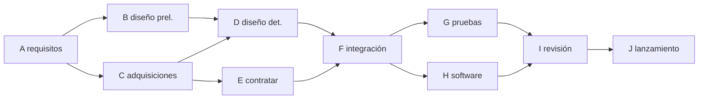

# B124-C16 — Planificación de cronograma y entregables

<!-- nav:top -->
[🏠 Programa](../../../../README.md) · [📚 Bloque B124](../../../tronco-comun/B124-industria-economia-etica-y-proyectos-espaciales.md) · [← Anterior: B124-C15 — Gestión de proyectos espaciales](../B124-C15-gestion-de-proyectos-espaciales/CLASE.md) · [Siguiente: B124-C17 — Gestión de equipos multidisciplinarios →](../B124-C17-gestion-de-equipos-multidisciplinarios/CLASE.md)
<!-- /nav -->

## 1. Ubicación, nivel y alcance

Clase 16 del bloque B124. Nivel N3–N4. Un cronograma es una red de actividades con dependencias; la duración del proyecto la fija la secuencia más larga, la ruta crítica, y el resto de las actividades tiene holgura. Aquí calculas la ruta crítica de una red sintética, la compruebas enumerando todos los caminos y estimas la probabilidad de cumplir el plazo cuando las duraciones son inciertas. Retomas el plazo del valor ganado de [C15](../B124-C15-gestion-de-proyectos-espaciales/CLASE.md). **Esta clase es educativa: no es asesoría de gestión de proyectos.** Las actividades son sintéticas.

## 2. Por qué esta clase existe

Un plazo prometido sin ruta crítica ni incertidumbre es una apuesta. La decisión central: **¿qué actividades controlan el plazo y con qué probabilidad se cumple?**

## 3. Lo que podrás hacer al terminar

1. Calcular fechas tempranas y tardías de una red de actividades.
2. Calcular holguras e identificar la ruta crítica.
3. Verificar la duración con una enumeración de todos los caminos.
4. Simular duraciones triangulares y obtener percentiles del plazo.
5. Explicar por qué el plazo medio simulado supera al calculado con duraciones medias.
6. Separar lo consultado (qué es la ruta crítica) de lo sintético.

La evidencia es el **cronograma con ruta crítica y probabilidad de plazo** del ejercicio 12 (sección 20).

## 4. Con qué llegas y cómo comprobarlo

1. ¿Qué es una dependencia entre actividades?
2. ¿Qué es una holgura?
3. ¿Qué es una distribución triangular?
4. ¿Qué es un percentil?
5. ¿Qué es una enumeración de caminos?

<details>
<summary>Ver respuestas</summary>

1. Que una no puede empezar hasta que termine otra. 2. El tiempo que una actividad puede retrasarse sin retrasar el proyecto. 3. Una con mínimo, moda y máximo, usada para estimar duraciones inciertas. 4. El valor bajo el cual cae un porcentaje dado de los resultados. 5. Listar todos los recorridos posibles de una red de inicio a fin.
</details>

Con cuatro o cinco aciertos, sigue; si no, repasa los prerrequisitos.

## 5. Un caso de contexto y casos de referencia

El NASA Systems Engineering Handbook (SP-6105, Rev 2; consultado el 2026-11-11) define la ruta crítica como la secuencia de tareas dependientes que determina la duración más larga del proyecto, señala que esas tareas gobiernan el cronograma y que la ruta cambia con el avance, y que las demás tareas tienen holgura. Es todo lo **consultado**. El **ejemplo conductor** es una red **sintética** de 10 actividades con una ruta crítica de `31` semanas por `7` actividades; con duraciones inciertas, la probabilidad de terminar en esas `31` semanas es solo `1,0%`.

## 6. Vocabulario

La **ruta crítica** es el camino más largo de la red. Las fechas **tempranas** (ES, EF) salen del paso hacia adelante; las **tardías** (LS, LF), del paso hacia atrás. La **holgura** es `LS − ES`. Una duración **triangular** tiene mínimo, moda y máximo. El **percentil** P80 es la duración que se cumple con 80 % de probabilidad.

## 7. Modelo mental



*Descripción textual:* los requisitos alimentan el diseño y las adquisiciones, que convergen en la integración; esta se bifurca en pruebas y software, que convergen en la revisión previa al lanzamiento.

Analogía: preparar una cena con platos que se cocinan en paralelo; la cena no está lista hasta que termina el plato más lento. Límite: si el plato lento se acelera, otro plato pasa a ser el más lento.

## 8. La explicación, paso a paso

### 8.1 Paso hacia adelante y hacia atrás

Con las duraciones del laboratorio, el proyecto dura `31` semanas. La holgura máxima de una actividad es `2` semanas; las actividades con holgura 0 forman la ruta crítica. La suma de las duraciones es `46` semanas, es decir `1,48` veces la duración del proyecto: ese es el paralelismo de la red.

### 8.2 Verificación por enumeración

El camino más largo hallado recorriendo todos los caminos de la red vale `31` semanas, igual al CPM. La ruta es A > B > D > F > H > I > J. Dos métodos independientes coinciden.

### 8.3 Incertidumbre

Con duraciones triangulares (mínimo 0,8 d, moda d, máximo 1,6 d) y 20 000 simulaciones, el plazo medio es `35,43` semanas; P50 `35,36`, P80 `37,17` y P95 `38,99`. Terminar en `31` semanas tiene probabilidad `1,0%`: el plazo «determinista» es optimista porque las duraciones tienden a alargarse.

### 8.4 Convergencia de caminos

Usando las duraciones medias (`35,13` semanas) se subestima el plazo simulado en `0,30` semanas, porque el máximo de varios caminos inciertos es mayor que el máximo de sus medias (desigualdad de Jensen). Incluso con duraciones medias, terminar en `35,1` semanas tiene solo `45,7%` de probabilidad.

## 9. Magnitudes, símbolos y unidades

| Símbolo | Qué es | Unidad | Valor / nota |
|---|---|---|---|
| `d` | duración de una actividad | semanas | 2 a 8 |
| ES, EF | inicio y fin tempranos | semanas | calculados |
| LS, LF | inicio y fin tardíos | semanas | calculados |
| holgura | `LS − ES` | semanas | 0 a 2 |
| P80 | plazo con 80 % de probabilidad | semanas | 37,17 |

## 10. Convenciones y referencias

Dependencias de fin a inicio sin retardos; duraciones en semanas; recursos ilimitados; duraciones independientes. Las 10 actividades y sus duraciones son sintéticas y no representan un proyecto real.

## 11. De dónde sale lo que afirmamos

| ID | Fuente | Localizador | Respalda | Estado |
|---|---|---|---|---|
| S1 | NASA, Systems Engineering Handbook (SP-6105, Rev 2), PDF — https://www.nasa.gov/wp-content/uploads/2018/09/nasa_systems_engineering_handbook_0.pdf (consultado 2026-11-11, PDF leído con PyMuPDF) | gestión técnica: planificación del calendario | la ruta crítica es la secuencia de tareas dependientes que determina la duración más larga; la ruta cambia con el avance; las otras tareas tienen holgura | Consultada |
| — | CPM, enumeración de caminos, distribución triangular | — | verificados entre sí | No consultados en una fuente concreta |
| — | Actividades, duraciones y dependencias | — | todas las cifras | Sintético |

Límites: no se consultó la guía de planificación de calendario de ninguna agencia; la red y las duraciones son inventadas.

## 12. Cómo ver el resultado

| Magnitud | Valor |
|---|---|
| Duración CPM | 31 semanas |
| Actividades críticas | 7 de 10 |
| Plazo medio simulado | 35,43 semanas |
| P80 / P95 | 37,17 / 38,99 semanas |
| P(cumplir 31 semanas) | 1,0% |

Descripción larga: el plazo determinista se cumple con probabilidad baja; para tener 80 % de confianza hay que prometer unas semanas más.

## 13. Ejemplo trabajado

**Paso 1 · Red.** A (3) → B (4) y A → C (2); B y C → D (1).

**Paso 2 · Pasos.** Camino A-B-D: `3 + 4 + 1 = 8`; camino A-C-D: `3 + 2 + 1 = 6`.

**Paso 3 · Ruta crítica.** A-B-D, `8` semanas.

**Paso 4 · Holgura.** C puede retrasarse `4 − 2 = 2` semanas sin cambiar el plazo.

## 14. Distintas formas de describirlo

**Por tabla:** ES, EF, LS, LF, holgura. **Por grafo:** red de dependencias. **Por camino:** enumeración. **Por distribución:** percentiles. **Por probabilidad:** `P(plazo ≤ T)`.

## 15. Práctica guiada

**Ejercicio 1 · con los pasos indicados.** Calcula la duración del camino de actividades `(4, 6, 8)` en serie. *Pasos:* suma.

<details><summary>Solución comentada</summary>

`18`.
</details>

**Ejercicio 2 · con una pista.** Una actividad paralela dura 5 y su rival 7. ¿Cuál es la holgura? *Pista:* diferencia.

<details><summary>Solución comentada</summary>

`2`.
</details>

**Ejercicio 3 · casi autónomo.** ¿Cuántos caminos tiene una red donde A va a B o C y ambos a D?

<details><summary>Solución comentada</summary>

`2`.
</details>

## 16. Práctica autónoma, transferencia e integrador

**Ejercicio 4 · autónomo.** ¿Cuál es la duración CPM del laboratorio?

<details><summary>Solución comentada</summary>

`31` semanas.
</details>

**Ejercicio 5 · autónomo.** ¿Cuántas actividades son críticas?

<details><summary>Solución comentada</summary>

`7`.
</details>

**Ejercicio 6 · autónomo.** ¿Cuál es el P80 del plazo?

<details><summary>Solución comentada</summary>

`37,17` semanas.
</details>

**Ejercicio 7 · autónomo.** ¿Con qué probabilidad se cumple el plazo determinista?

<details><summary>Solución comentada</summary>

`1,0%`.
</details>

**Ejercicio 8 · autónomo.** ¿Cuánto subestima el plazo usar duraciones medias?

<details><summary>Solución comentada</summary>

`0,30` semanas.
</details>

**Ejercicio 9 · transferencia.** **Transferencia.** Se acorta una actividad crítica en 2 semanas. ¿Se acorta el proyecto en 2 semanas?

<details><summary>Solución comentada</summary>

No necesariamente: otra ruta puede pasar a ser crítica; el ahorro está limitado por la holgura de las rutas cercanas.
</details>

**Ejercicio 10 · transferencia.** **Transferencia.** Un contratista pide extender la holgura de una actividad con holgura 2 en 5 semanas. ¿Qué pasa?

<details><summary>Solución comentada</summary>

La actividad pasa a ser crítica con retraso de 3 semanas sobre el plazo.
</details>

**Ejercicio 11 · transferencia.** **Transferencia.** ¿Por qué comprometer el plazo determinista es riesgoso?

<details><summary>Solución comentada</summary>

Porque con duraciones inciertas su probabilidad de cumplimiento es baja; conviene comprometer un percentil (por ejemplo P80) y declarar la probabilidad.
</details>

**Ejercicio 12 · integrador.** **Integrador.** Elabora tu *cronograma con ruta crítica y probabilidad de plazo*: tabla de fechas y holguras, ruta crítica con su verificación, percentiles del plazo, sesgo de convergencia y lista de qué es consultado y sintético, con el aviso de que es educativa.

<details><summary>Solución comentada</summary>

Secciones 8.1–8.4 y la salida del laboratorio.
</details>

## 17. Laboratorio: ruta crítica y plazo probable

El script [ruta_critica.py](ruta_critica.py) calcula el CPM de 10 actividades, lo verifica enumerando todos los caminos y simula 20 000 plazos con duraciones triangulares (**comprueba** CPM igual al camino más largo y media simulada mayor o igual que la de duraciones medias). Tarda menos de 10 s en un equipo común.

**Datos:** solo la definición de ruta crítica del Handbook (consultado 2026-11-11); actividades, duraciones y dependencias **sintéticas**. **Predice antes de ejecutar:** ¿se cumplirá el plazo determinista con probabilidad alta? (no, es baja.) **Ejecución del 2026-11-11:**

```text
Python 3.12.9 (biblioteca estandar)
Proyecto SINTETICO de 10 actividades (semanas)
 actividad                    dur  ES  EF  LS  LF  holgura
 A requisitos                  4   0   4   0   4      0  critica
 B diseno preliminar           6   4  10   4  10      0  critica
 C plan de adquisiciones       5   4   9   5  10      1
 D diseno detallado            8  10  18  10  18      0  critica
 E contratar instrumento       7   9  16  11  18      2
 F integracion                 5  18  23  18  23      0  critica
 G pruebas ambientales         3  23  26  24  27      1
 H software de tierra          4  23  27  23  27      0  critica
 I revision de preparacion     2  27  29  27  29      0  critica
 J lanzamiento                 2  29  31  29  31      0  critica
Duracion CPM = 31 semanas ; camino mas largo por enumeracion = 31 ; ruta: A > B > D > F > H > I > J
Duraciones triangulares (0.8 d, d, 1.6 d), 20000 simulaciones: media = 35.43 ; P50 = 35.36 ; P80 = 37.17 ; P95 = 38.99
  duracion CPM con duraciones medias = 35.13 ; sesgo por convergencia de caminos = 0.30 semanas
  P(terminar en 31 semanas) = 0.0100 ; P(terminar en 35.1) = 0.4572
Pruebas superadas.
```

```bash
python programa/clases/B124/B124-C16-planificacion-de-cronograma-y-entregables/ruta_critica.py
```

**Límites:** dependencias fin-inicio, duraciones independientes, recursos ilimitados y distribución triangular supuesta; no es una programación de proyecto real.

## 18. Errores frecuentes y cómo corregirlos

**Prometer el plazo determinista.** Se corrige con 8.3.

**Pensar que acortar una actividad crítica acorta el proyecto sin límite.** Se corrige con el ejercicio 9.

**Ignorar las rutas casi críticas.** Se corrige con 8.4.

**Usar duraciones medias para el plazo.** Se corrige con 8.4.

## 19. Cómo sabrás que vas bien

Tras la sección 8: ¿qué probabilidad esperabas de cumplir el plazo y cuál obtuviste? Si dudas, repasa el ejemplo 13. Tras el laboratorio: ¿qué comprueba? (ver la sección 17).

## 20. Qué entregas y cómo se evalúa

El producto es tu **cronograma con ruta crítica y probabilidad de plazo** (ejercicio 12).

| Criterio | Inicial | En desarrollo | Logrado | Destacado |
|---|---|---|---|---|
| Conceptos | Los confunde | Parciales | Calcula ruta crítica y percentiles | Explica los límites |
| Cálculo | Sin unidades | Con errores | Tablas completas con unidades | Calcula casos nuevos |
| Numérico | Sin comprobar | Un caso | Contraste con una segunda vía | Interpreta las diferencias |
| Fuentes | Sin fuente | Sin fecha | Fuentes con fecha y estado | Declara lo ilustrativo y lo no consultado |
| Límites | No los nombra | Uno | Tres | Discute qué falta del modelo |

**Condiciones críticas (no se compensan con promedio):** rotular los datos como sintéticos o ilustrativos; no presentar el resultado como asesoría financiera, legal ni de inversión; citar solo lo consultado.

## 21. Ética, seguridad y límites

Clase educativa: **no es asesoría financiera, legal, tributaria ni de inversión** y no sustituye a un profesional habilitado ni a la normativa vigente; ningún resultado debe usarse para decidir una compra, un contrato, una inversión o un seguro reales. Prometer plazos que se saben improbables traslada el costo del retraso a otras personas; hay que declarar la probabilidad. Los modelos son simplificados y sus datos son sintéticos o ilustrativos. Accesibilidad: tablas equivalentes a las gráficas, fórmulas en texto, ejercicios sin conexión.

## 22. Para cerrar y seguir

La red sintética dura `31` semanas por su ruta crítica de `7` actividades, pero con duraciones inciertas el plazo medio es `35,4` y el P80 es `37,2` semanas.

**Glosario español–inglés.** ruta crítica · *critical path*; holgura · *float (slack)*; entregable · *deliverable*; percentil · *percentile*; red de actividades · *activity network*.

**Continuidad.** [B124-C17](../B124-C17-gestion-de-equipos-multidisciplinarios/CLASE.md) trata a las personas que ejecutan esas actividades: equipos multidisciplinarios.

**Referencias:** ver sección 11.

<!-- nav:bottom -->
---

[← Anterior: B124-C15 — Gestión de proyectos espaciales](../B124-C15-gestion-de-proyectos-espaciales/CLASE.md) · [📚 Bloque B124](../../../tronco-comun/B124-industria-economia-etica-y-proyectos-espaciales.md) · [Siguiente: B124-C17 — Gestión de equipos multidisciplinarios →](../B124-C17-gestion-de-equipos-multidisciplinarios/CLASE.md)
<!-- /nav -->
