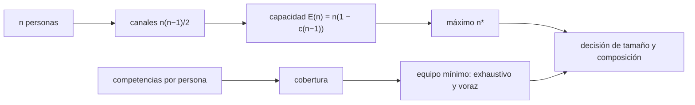

# B124-C17 — Gestión de equipos multidisciplinarios

<!-- nav:top -->
[🏠 Programa](../../../../README.md) · [📚 Bloque B124](../../../tronco-comun/B124-industria-economia-etica-y-proyectos-espaciales.md) · [← Anterior: B124-C16 — Planificación de cronograma y entregables](../B124-C16-planificacion-de-cronograma-y-entregables/CLASE.md) · [Siguiente: B124-C18 — Comunicación y divulgación →](../B124-C18-comunicacion-y-divulgacion/CLASE.md)
<!-- /nav -->

## 1. Ubicación, nivel y alcance

Clase 17 del bloque B124. Nivel N3–N4. Un proyecto espacial necesita a la vez dinámica orbital, térmica, software, operaciones, adquisiciones y ciencia, y ninguna persona domina todo. Aquí modelas dos decisiones de armado de equipo: cuántas personas conviene tener cuando coordinarse cuesta tiempo, y cuál es el equipo más pequeño que cubre todas las competencias. Usas las tareas de [C16](../B124-C16-planificacion-de-cronograma-y-entregables/CLASE.md). **Esta clase es educativa: no es asesoría de recursos humanos ni de gestión de personas.** Las personas son sintéticas.

## 2. Por qué esta clase existe

Agregar gente no siempre acelera: cada persona nueva añade canales de coordinación. La decisión central: **¿cuántas personas y con qué competencias forman un equipo viable?**

## 3. Lo que podrás hacer al terminar

1. Calcular los canales de comunicación `n(n−1)/2` y comprobarlos por conteo de pares.
2. Modelar la capacidad efectiva con una sobrecarga por persona.
3. Hallar el tamaño de equipo que maximiza la capacidad, de forma analítica y por barrido.
4. Encontrar el equipo mínimo que cubre todas las competencias por búsqueda exhaustiva.
5. Comparar el resultado exhaustivo con un algoritmo voraz.
6. Rotular que las personas y la sobrecarga son sintéticas.

La evidencia es la **ficha de composición de un equipo sintético** del ejercicio 12 (sección 20).

## 4. Con qué llegas y cómo comprobarlo

1. ¿Qué es un equipo multidisciplinario?
2. ¿Qué es una combinación?
3. ¿Qué es un máximo de una función?
4. ¿Qué es un algoritmo voraz?
5. ¿Qué es la coordinación?

<details>
<summary>Ver respuestas</summary>

1. Uno cuyos miembros aportan competencias de disciplinas distintas. 2. Una selección de elementos sin importar el orden. 3. El mayor valor que toma; en una parábola, en su vértice. 4. Uno que elige en cada paso la mejor opción local, sin garantía de optimalidad. 5. El trabajo necesario para que las partes se alineen entre sí.
</details>

Con cuatro o cinco aciertos, sigue; si no, repasa los prerrequisitos.

## 5. Un caso de contexto y casos de referencia

No se consultó ninguna investigación sobre equipos ni guía de recursos humanos. El **ejemplo conductor** es un modelo **sintético**: con una pérdida de 4 % del tiempo por cada otra persona, la capacidad efectiva se maximiza en `n* = 13,0` personas (`13` por barrido) y cada persona rinde menos a medida que el equipo crece; de 8 candidatos con 6 competencias, el equipo mínimo que cubre todo tiene `3` personas (`P1,P4,P5`).

## 6. Vocabulario

Los **canales de comunicación** de `n` personas son los pares posibles, `n(n−1)/2`. La **sobrecarga** `c` es la fracción de tiempo que cada persona pierde por coordinarse con cada otra. La **capacidad efectiva** `E(n)` es el trabajo útil del equipo. La **cobertura** es el conjunto de competencias que el equipo reúne. Un algoritmo **voraz** elige paso a paso lo que más cubre.

## 7. Modelo mental



*Descripción textual:* el tamaño del equipo genera canales y sobrecarga, que limitan la capacidad efectiva; la composición se decide por cobertura de competencias con dos algoritmos; ambas dan la decisión.

Analogía: una reunión donde cada persona extra obliga a todos a escuchar a una más. Límite: no todas las parejas necesitan coordinarse; una buena estructura reduce los canales.

## 8. La explicación, paso a paso

### 8.1 Canales

`n(n−1)/2`: 5 personas tienen `10` canales, 10 tienen `45` y 15 tienen `105`. El conteo de pares coincide con la fórmula (diferencia `0`). Los canales crecen con el cuadrado de `n`.

### 8.2 Capacidad efectiva

Si cada persona pierde `c = 4 %` por cada otra, `E(n) = n (1 − 0,04 (n − 1))`: 5 personas rinden `4,20`, 10 rinden `6,40`, 20 rinden `4,80` y 26 rinden `0,00` (el modelo ya no es válido más allá de `1 + 1/c`). El máximo está en `n* = (1 + 1/c)/2 = 13,0`, con barrido en `13` y `E = 6,76`. Pero por persona se rinde `0,520` frente a `0,840` con 5: más gente rinde más en total, pero menos por cabeza.

### 8.3 Equipo mínimo

De 8 candidatos, `105` de los 255 equipos posibles cubren las seis competencias, y el mínimo es de `3` personas (`P1,P4,P5`). El algoritmo voraz elige `P1,P4,P5` (`3` personas), el mismo tamaño que el óptimo en este caso; en general nunca usa menos personas que el exhaustivo, aunque puede usar más.

### 8.4 Lectura y límites

El tamaño que maximiza la capacidad no es el que conviene si se valora el rendimiento por persona o el costo. Cubrir competencias no es lo mismo que formar un equipo: faltan la confianza, los roles y la comunicación, que el modelo no representa. La sobrecarga de 4 % es un supuesto, no una medición.

## 9. Magnitudes, símbolos y unidades

| Símbolo | Qué es | Unidad | Valor / nota |
|---|---|---|---|
| `n` | personas del equipo | — | 1 a 26 |
| `c` | sobrecarga por cada otra persona | — | 0,04 (sintética) |
| `E(n)` | capacidad efectiva | personas equivalentes | calculada |
| `n*` | tamaño que maximiza `E` | personas | 13,0 |
| cobertura | competencias reunidas | de 6 | 6 |

## 10. Convenciones y referencias

Sobrecarga lineal por persona, equipos sin estructura (todos coordinan con todos), competencias binarias (se tienen o no), sin costo de contratar. Las 8 personas, la tasa de 4 % y las seis competencias son sintéticas.

## 11. De dónde sale lo que afirmamos

| ID | Fuente | Localizador | Respalda | Estado |
|---|---|---|---|---|
| — | Canales de comunicación, capacidad efectiva, cobertura mínima | — | verificados por conteo, barrido y búsqueda exhaustiva | No consultados en una fuente concreta |
| — | Investigación sobre equipos y sobre gestión de personas | — | no se usa | No consultada |
| — | Personas, competencias y `c` | — | todas las cifras | Sintético |

Límites: no se consultó ninguna investigación de equipos; la sobrecarga y las personas son inventadas y el modelo no mide el rendimiento real.

## 12. Cómo ver el resultado

| Magnitud | Valor |
|---|---|
| Canales de 10 personas | 45 |
| Tamaño que maximiza la capacidad | 13 (n* = 13,0) |
| Capacidad máxima | 6,76 |
| Equipo mínimo que cubre | 3 personas |
| Voraz | 3 personas |

Descripción larga: la capacidad total sube y luego baja con el tamaño; el equipo mínimo que cubre las competencias es de pocas personas.

## 13. Ejemplo trabajado

**Paso 1 · Canales.** 6 personas: `6 · 5/2 = 15`.

**Paso 2 · Capacidad.** Con `c = 0,1`: `E(6) = 6 (1 − 0,5) = 3`.

**Paso 3 · Máximo.** `n* = (1 + 10)/2 = 5,5`, entre 5 y 6 personas.

**Paso 4 · Cobertura.** Si A cubre `{x, y}`, B `{y, z}` y C `{z}`, el mínimo es A y B (dos personas).

## 14. Distintas formas de describirlo

**Por pares:** `n(n−1)/2`. **Por capacidad:** `E(n)`. **Por máximo:** `n*`. **Por conjunto:** competencias cubiertas. **Por algoritmo:** exhaustivo frente a voraz.

## 15. Práctica guiada

**Ejercicio 1 · con los pasos indicados.** ¿Cuántos canales tiene un equipo de 8? *Pasos:* `8 · 7/2`.

<details><summary>Solución comentada</summary>

`28`.
</details>

**Ejercicio 2 · con una pista.** Con `c = 0,05`, ¿cuál es `n*`? *Pista:* `(1 + 1/c)/2`.

<details><summary>Solución comentada</summary>

`(1 + 20)/2 = 10,5`.
</details>

**Ejercicio 3 · casi autónomo.** Calcula `E(4)` con `c = 0,1`.

<details><summary>Solución comentada</summary>

`4 (1 − 0,3) = 2,8`.
</details>

## 16. Práctica autónoma, transferencia e integrador

**Ejercicio 4 · autónomo.** ¿Cuántos canales tiene el equipo de 15 del laboratorio?

<details><summary>Solución comentada</summary>

`105`.
</details>

**Ejercicio 5 · autónomo.** ¿En qué `n` se maximiza la capacidad efectiva?

<details><summary>Solución comentada</summary>

En `13` personas, con `E = 6,76`.
</details>

**Ejercicio 6 · autónomo.** ¿Cuánto rinde cada persona en el óptimo?

<details><summary>Solución comentada</summary>

`0,520`.
</details>

**Ejercicio 7 · autónomo.** ¿Cuál es el tamaño mínimo de equipo que cubre todo?

<details><summary>Solución comentada</summary>

`3`.
</details>

**Ejercicio 8 · autónomo.** ¿Cuántos equipos de los 255 cubren todas las competencias?

<details><summary>Solución comentada</summary>

`105`.
</details>

**Ejercicio 9 · transferencia.** **Transferencia.** Una jefa añade 5 personas a un equipo de 10 retrasado. ¿Qué anticipa el modelo?

<details><summary>Solución comentada</summary>

Más canales (de 45 a 105) y más sobrecarga: la capacidad efectiva puede subir poco o bajar, y las nuevas personas tardan en rendir.
</details>

**Ejercicio 10 · transferencia.** **Transferencia.** Una persona del equipo mínimo se va. ¿Qué haces?

<details><summary>Solución comentada</summary>

Revisar qué competencias pierdes y si otra persona o una capacitación las cubre; el modelo muestra cuáles quedan descubiertas.
</details>

**Ejercicio 11 · transferencia.** **Transferencia.** El algoritmo voraz propone un equipo mayor que el óptimo. ¿Lo descartas?

<details><summary>Solución comentada</summary>

No siempre: el exhaustivo puede ser costoso con muchos candidatos; se acepta el voraz con su holgura o se usa un método mejor.
</details>

**Ejercicio 12 · integrador.** **Integrador.** Elabora tu *ficha de composición de un equipo sintético*: canales, capacidad efectiva y tamaño óptimo, equipo mínimo con su verificación, comparación con el algoritmo voraz y lista de límites, con el aviso de que no es asesoría de recursos humanos.

<details><summary>Solución comentada</summary>

Secciones 8.1–8.4 y la salida del laboratorio.
</details>

## 17. Laboratorio: tamaño y cobertura de un equipo

El script [equipo_y_competencias.py](equipo_y_competencias.py) calcula canales y capacidad efectiva, halla el tamaño óptimo por fórmula y barrido, y busca el equipo mínimo que cubre las competencias de forma exhaustiva y voraz (**comprueba** canales por dos vías, óptimo redondeado y que el voraz cubre todo sin usar menos personas). Tarda menos de 10 s en un equipo común.

**Datos:** ningún dato consultado; sobrecarga, personas y competencias **sintéticas**. **Predice antes de ejecutar:** ¿rinde más cada persona en un equipo de 5 o en uno de 13? (en uno de 5.) **Ejecución del 2026-11-11:**

```text
Python 3.12.9 (biblioteca estandar)
Modelo 1: sobrecarga c = 0.04 por cada otra persona (SINTETICA)
  canales n(n-1)/2: n=5 -> 10 ; n=10 -> 45 ; n=15 -> 105 ; formula = conteo de pares (diferencia 0)
  capacidad efectiva E(n): n=5 4.20 ; n=10 6.40 ; n=20 4.80 ; n=26 0.00
  maximo analitico n* = 13.0 ; maximo por barrido n = 13 con E = 6.76 (0.520 por persona; con 5 personas 0.840)
Modelo 2: cobertura de 6 competencias con 8 candidatos
  equipos que cubren todo: 105 de 255 ; tamano minimo = 3 (P1,P4,P5)
  voraz: P1,P4,P5 (3 personas) ; cubre todo: True
Pruebas superadas.
```

```bash
python programa/clases/B124/B124-C17-gestion-de-equipos-multidisciplinarios/equipo_y_competencias.py
```

**Límites:** sobrecarga lineal, competencias binarias, sin estructura ni costos; no evalúa personas ni mide el rendimiento real.

## 18. Errores frecuentes y cómo corregirlos

**Creer que más personas siempre acelera.** Se corrige con 8.2.

**Elegir el equipo solo por competencias.** Se corrige con 8.4.

**Tomar la sobrecarga sintética como real.** Se corrige con la sección 10.

**Usar el voraz sin saber cuánto se aleja del óptimo.** Se corrige con 8.3.

## 19. Cómo sabrás que vas bien

Tras la sección 8: ¿qué tamaño esperabas y cuál salió? Si dudas, repasa el ejemplo 13. Tras el laboratorio: ¿qué comprueba? (ver la sección 17).

## 20. Qué entregas y cómo se evalúa

El producto es tu **ficha de composición de un equipo sintético** (ejercicio 12).

| Criterio | Inicial | En desarrollo | Logrado | Destacado |
|---|---|---|---|---|
| Conceptos | Los confunde | Parciales | Calcula canales y cobertura | Explica los límites |
| Cálculo | Sin unidades | Con errores | Tablas completas con unidades | Calcula casos nuevos |
| Numérico | Sin comprobar | Un caso | Contraste con una segunda vía | Interpreta las diferencias |
| Fuentes | Sin fuente | Sin fecha | Fuentes con fecha y estado | Declara lo ilustrativo y lo no consultado |
| Límites | No los nombra | Uno | Tres | Discute qué falta del modelo |

**Condiciones críticas (no se compensan con promedio):** rotular los datos como sintéticos o ilustrativos; no presentar el resultado como asesoría financiera, legal ni de inversión; citar solo lo consultado.

## 21. Ética, seguridad y límites

Clase educativa: **no es asesoría financiera, legal, tributaria ni de inversión** y no sustituye a un profesional habilitado ni a la normativa vigente; ningún resultado debe usarse para decidir una compra, un contrato, una inversión o un seguro reales. Un modelo de equipos no evalúa a las personas ni sirve para decidir despidos o contrataciones; las decisiones sobre personas requieren criterios y garantías propias. Los modelos son simplificados y sus datos son sintéticos o ilustrativos. Accesibilidad: tablas equivalentes a las gráficas, fórmulas en texto, ejercicios sin conexión.

## 22. Para cerrar y seguir

Con 4 % de sobrecarga por persona, la capacidad del equipo se maximiza en `13` personas con `E = 6,8`, pero cada una rinde menos; de 8 candidatos, `3` personas cubren las seis competencias.

**Glosario español–inglés.** equipo multidisciplinario · *cross-functional team*; canales de comunicación · *communication channels*; cobertura · *coverage*; algoritmo voraz · *greedy algorithm*; sobrecarga · *overhead*.

**Continuidad.** [B124-C18](../B124-C18-comunicacion-y-divulgacion/CLASE.md) sale del equipo hacia el público: la comunicación y la divulgación.

**Referencias:** ver sección 11.

<!-- nav:bottom -->
---

[← Anterior: B124-C16 — Planificación de cronograma y entregables](../B124-C16-planificacion-de-cronograma-y-entregables/CLASE.md) · [📚 Bloque B124](../../../tronco-comun/B124-industria-economia-etica-y-proyectos-espaciales.md) · [Siguiente: B124-C18 — Comunicación y divulgación →](../B124-C18-comunicacion-y-divulgacion/CLASE.md)
<!-- /nav -->
