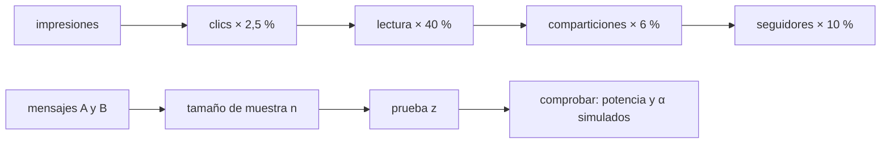

# B124-C18 — Comunicación y divulgación

<!-- nav:top -->
[🏠 Programa](../../../../README.md) · [📚 Bloque B124](../../../tronco-comun/B124-industria-economia-etica-y-proyectos-espaciales.md) · [← Anterior: B124-C17 — Gestión de equipos multidisciplinarios](../B124-C17-gestion-de-equipos-multidisciplinarios/CLASE.md) · [Siguiente: B124-C19 — Redacción de propuesta de misión →](../B124-C19-redaccion-de-propuesta-de-mision/CLASE.md)
<!-- /nav -->

## 1. Ubicación, nivel y alcance

Clase 18 del bloque B124. Nivel N3. Comunicar ciencia al público también es un problema de diseño medible: cuántas personas ven un mensaje, cuántas lo leen y cuántas lo comparten, y si un mensaje funciona mejor que otro. Aquí calculas un embudo de alcance y diseñas una prueba A/B con el tamaño de muestra necesario, verificado con simulación. Retomas el producto de [C04](../B124-C04-diseno-de-propuesta-de-valor/CLASE.md) como mensaje a comunicar. **Esta clase es educativa: no es asesoría de marketing ni de comunicación institucional.** La campaña es sintética.

## 2. Por qué esta clase existe

Sin medir, la divulgación se evalúa por impresión. La decisión central: **¿cuántas personas hay que observar para saber si un mensaje funciona mejor que otro, y cuánto alcance real tiene una campaña?**

## 3. Lo que podrás hacer al terminar

1. Calcular un embudo de alcance multiplicando tasas por etapa.
2. Calcular cuantiles normales por bisección.
3. Calcular el tamaño de muestra de una prueba de dos proporciones.
4. Aplicar la prueba z con varianza agrupada.
5. Comprobar potencia y nivel de significación con una simulación.
6. Rotular que audiencias y tasas son sintéticas.

La evidencia es el **plan de divulgación con prueba A/B sintética** del ejercicio 12 (sección 20).

## 4. Con qué llegas y cómo comprobarlo

1. ¿Qué es una tasa de conversión?
2. ¿Qué es un nivel de significación?
3. ¿Qué es la potencia?
4. ¿Qué es una distribución binomial?
5. ¿Qué es una prueba A/B?

<details>
<summary>Ver respuestas</summary>

1. La fracción de personas que pasan de una etapa a la siguiente. 2. La probabilidad de rechazar una hipótesis cierta (falso positivo); se fija antes de la prueba. 3. La probabilidad de detectar un efecto que existe. 4. La del número de éxitos en `n` pruebas independientes con probabilidad `p`. 5. Un experimento que compara dos versiones asignando personas al azar a cada una.
</details>

Con cuatro o cinco aciertos, sigue; si no, repasa los prerrequisitos.

## 5. Un caso de contexto y casos de referencia

No se consultó ninguna plataforma ni estudio de comunicación científica. El **ejemplo conductor** es una campaña **sintética** de 200 000 impresiones: con tasas ilustrativas llegan `12` seguidores nuevos (`0,006%`); para detectar con 80 % de potencia que un mensaje mejora la interacción de 4,0 % a 4,6 % (`15%` relativo) hacen falta `17943` personas por brazo, y con la cuarta parte la potencia cae a `28,8%`.

## 6. Vocabulario

El **embudo** es la secuencia de etapas con tasas de paso. La **prueba A/B** compara dos mensajes. El **nivel de significación** `α` es la tasa de falsos positivos aceptada. La **potencia** `1 − β` es la probabilidad de detectar el efecto. El **tamaño de muestra** `n` es el número de personas por brazo. La **prueba z de dos proporciones** compara `p_A` y `p_B` con una varianza agrupada.

## 7. Modelo mental



*Descripción textual:* las impresiones se reducen etapa a etapa hasta los seguidores; por separado, dos mensajes se comparan con una prueba cuyo tamaño de muestra se verifica por simulación.

Analogía: lanzar una moneda para saber si está cargada; una pequeña diferencia solo se nota con muchos lanzamientos. Límite: los públicos reales no son homogéneos y la asignación al azar no siempre es posible.

## 8. La explicación, paso a paso

### 8.1 El embudo

Con 200 000 impresiones y tasas de 2,5 % (clic), 40 % (lectura), 6 % (compartir) y 10 % (seguir) resultan `5000` clics, `2000` lecturas completas, `120` comparticiones y `12` seguidores: una retención de `0,006%`. Optimizar una etapa multiplica el resultado final por la misma proporción.

### 8.2 Cuantiles y tamaño de muestra

Por bisección sobre la función de error, `z_{α/2} = 1,9600` y `z_{potencia} = 0,8416`. Con `p_A = 0,040`, `p_B = 0,046`, la fórmula `n = (z_α √(2pq) + z_β √(p_A q_A + p_B q_B))² / (p_B − p_A)²` da `n = 17943` por brazo.

### 8.3 Verificación por simulación

Con 4 000 experimentos simulados con ese `n`, la fracción que rechaza `H₀` cuando `p_B = 0,046` es `0,8037` (potencia objetivo 0,80); cuando `p_A = p_B = 0,040`, es `0,0467` (nivel 0,05). Con la cuarta parte de la muestra (`4485` por brazo) la potencia baja a `0,2885`: se pasaría por alto un efecto real la mayoría de las veces.

### 8.4 Leer una prueba

En el ejemplo `400/10 000` frente a `460/10 000`, `z = 2,091` y `p ≈ 0,0365`. Un p-valor pequeño indica que la diferencia es improbable bajo `H₀`; no mide su importancia práctica ni la calidad de la divulgación.

## 9. Magnitudes, símbolos y unidades

| Símbolo | Qué es | Unidad | Valor / nota |
|---|---|---|---|
| `p_A`, `p_B` | tasas verdaderas de interacción | — | 0,040 y 0,046 (sintéticas) |
| `α` | nivel de significación | — | 0,05 |
| `1 − β` | potencia | — | 0,80 |
| `n` | personas por brazo | — | 17943 |
| `z` | estadístico de la prueba | — | calculado |

## 10. Convenciones y referencias

Asignación aleatoria, observaciones independientes, tasas verdaderas conocidas solo para diseñar la prueba, prueba de dos colas. Los cuantiles se calculan sin tablas. Todos los datos y las tasas son sintéticos.

## 11. De dónde sale lo que afirmamos

| ID | Fuente | Localizador | Respalda | Estado |
|---|---|---|---|---|
| — | Prueba z de dos proporciones, tamaño de muestra, binomial | — | verificados con una simulación de 4 000 experimentos | No consultados en una fuente concreta |
| — | Tasas de plataformas reales de divulgación | — | no se usan | No consultadas |
| — | Audiencia, tasas y mensajes | — | todas las cifras | Sintético |

Límites: no se consultó ninguna plataforma ni estudio de comunicación científica; las tasas son inventadas.

## 12. Cómo ver el resultado

| Magnitud | Valor |
|---|---|
| Seguidores nuevos | 12 (0,006%) |
| Tamaño de muestra por brazo | 17943 |
| Potencia simulada | 0,8037 |
| Nivel simulado | 0,0467 |
| Potencia con 1/4 de muestra | 0,2885 |

Descripción larga: el embudo pierde casi todo el alcance antes de convertir en seguidores y la prueba solo es confiable con una muestra suficiente.

## 13. Ejemplo trabajado

**Paso 1 · Embudo.** 10 000 impresiones, clic 2 %, lectura 50 %: `10 000 · 0,02 · 0,5 = 100` lecturas.

**Paso 2 · Prueba.** `p_A = 0,10`, `p_B = 0,12`, `n = 3 000` por brazo.

**Paso 3 · Agrupada.** `p = (300 + 360)/6 000 = 0,11`.

**Paso 4 · Estadístico.** `SE = √(2 · 0,11 · 0,89/3 000) = 0,00808`; `z = 0,02/0,00808 = 2,48`.

## 14. Distintas formas de describirlo

**Por multiplicación:** embudo. **Por fórmula:** `n`. **Por estadístico:** `z`. **Por simulación:** potencia y nivel. **Por intervalo:** diferencia de proporciones.

## 15. Práctica guiada

**Ejercicio 1 · con los pasos indicados.** ¿Cuántas lecturas salen de 5 000 impresiones con clic 4 % y lectura 50 %? *Pasos:* producto.

<details><summary>Solución comentada</summary>

`5 000 · 0,04 · 0,5 = 100`.
</details>

**Ejercicio 2 · con una pista.** Calcula `p` agrupada con 50/1 000 y 70/1 000. *Pista:* suma de éxitos sobre `2n`.

<details><summary>Solución comentada</summary>

`120/2 000 = 0,06`.
</details>

**Ejercicio 3 · casi autónomo.** Si `z = 1,96`, ¿se rechaza `H₀` a `α = 0,05` de dos colas?

<details><summary>Solución comentada</summary>

En el límite: `1,96 ≈ z_{α/2}`; con `z` algo mayor, sí.
</details>

## 16. Práctica autónoma, transferencia e integrador

**Ejercicio 4 · autónomo.** ¿Cuántos seguidores da el embudo del laboratorio?

<details><summary>Solución comentada</summary>

`12`.
</details>

**Ejercicio 5 · autónomo.** ¿Qué tamaño de muestra por brazo se necesita?

<details><summary>Solución comentada</summary>

`17943`.
</details>

**Ejercicio 6 · autónomo.** ¿Cuál es la potencia simulada?

<details><summary>Solución comentada</summary>

`0,8037`.
</details>

**Ejercicio 7 · autónomo.** ¿Y el nivel de significación simulado?

<details><summary>Solución comentada</summary>

`0,0467`.
</details>

**Ejercicio 8 · autónomo.** ¿Qué potencia tiene la prueba con la cuarta parte de la muestra?

<details><summary>Solución comentada</summary>

`0,2885`.
</details>

**Ejercicio 9 · transferencia.** **Transferencia.** Un equipo mira los resultados cada día y detiene la prueba cuando `p < 0,05`. ¿Qué problema hay?

<details><summary>Solución comentada</summary>

Mirar repetidamente y parar al primer resultado favorable infla los falsos positivos por encima de `α`; hay que fijar `n` antes o usar métodos secuenciales.
</details>

**Ejercicio 10 · transferencia.** **Transferencia.** Un mensaje gana por 0,1 punto con `p = 0,03`. ¿Lo adoptas sin más?

<details><summary>Solución comentada</summary>

Evalúo si la diferencia importa en la práctica y si el costo de cambiar se justifica; significativo no es lo mismo que relevante.
</details>

**Ejercicio 11 · transferencia.** **Transferencia.** Una campaña mide solo impresiones. ¿Qué propones?

<details><summary>Solución comentada</summary>

Añadir al menos una métrica de comprensión o de acción (lectura completa, preguntas recibidas, asistencia) y reportar el embudo completo.
</details>

**Ejercicio 12 · integrador.** **Integrador.** Elabora tu *plan de divulgación con prueba A/B sintética*: embudo, tamaño de muestra con su derivación, potencia y nivel simulados, interpretación de un resultado y lista de límites, con el aviso de que es educativa.

<details><summary>Solución comentada</summary>

Secciones 8.1–8.4 y la salida del laboratorio.
</details>

## 17. Laboratorio: embudo y prueba A/B

El script [embudo_y_prueba_ab.py](embudo_y_prueba_ab.py) calcula un embudo, los cuantiles normales por bisección, el tamaño de muestra de una prueba de dos proporciones y verifica potencia y nivel con 4 000 experimentos (**comprueba** cuantiles a 1e-5, potencia a 0,03 y nivel a 0,015). Tarda menos de 10 s en un equipo común.

**Datos:** ningún dato consultado; audiencia, tasas y mensajes **sintéticos**. **Predice antes de ejecutar:** ¿detectará la prueba el efecto con la cuarta parte de la muestra? (casi nunca: la potencia cae a unos 0,3.) **Ejecución del 2026-11-11:**

```text
Python 3.12.9 (biblioteca estandar; random.binomialvariate requiere 3.12 o superior)
Campana SINTETICA de divulgacion (embudo):
  impresiones              200000.0
  clics                      5000.0
  lectura completa           2000.0
  comparticiones              120.0
  seguidores nuevos            12.0
  retencion total impresiones -> seguidores = 0.0060 %
Prueba A/B: pA = 0.04, pB = 0.046 (efecto relativo 15.0 %) ; z_alfa/2 = 1.9600 ; z_potencia = 0.8416 ; n por brazo = 17943
  potencia empirica (4000 experimentos) = 0.8037 ; alfa empirico con pA = pB = 0.04 -> 0.0467
  con la cuarta parte de la muestra (4485 por brazo): potencia empirica = 0.2885
  ejemplo: 400/10000 frente a 460/10000 -> z = 2.091 ; p-valor aprox. = 0.0365
Pruebas superadas.
```

```bash
python programa/clases/B124/B124-C18-comunicacion-y-divulgacion/embudo_y_prueba_ab.py
```

**Límites:** población homogénea, asignación al azar y observaciones independientes; sin fatiga, estacionalidad ni efectos entre brazos; usa `random.binomialvariate` (Python 3.12 o superior).

## 18. Errores frecuentes y cómo corregirlos

**Medir la divulgación solo por impresiones.** Se corrige con 8.1 y el ejercicio 11.

**Detener la prueba al primer p-valor favorable.** Se corrige con el ejercicio 9.

**Confundir significativo con relevante.** Se corrige con 8.4.

**Usar una muestra pequeña y concluir que no hay efecto.** Se corrige con 8.3.

## 19. Cómo sabrás que vas bien

Tras la sección 8: ¿qué tamaño de muestra esperabas y cuál salió? Si dudas, repasa el ejemplo 13. Tras el laboratorio: ¿qué comprueba? (ver la sección 17).

## 20. Qué entregas y cómo se evalúa

El producto es tu **plan de divulgación con prueba A/B sintética** (ejercicio 12).

| Criterio | Inicial | En desarrollo | Logrado | Destacado |
|---|---|---|---|---|
| Conceptos | Los confunde | Parciales | Calcula embudo y tamaño de muestra | Explica los límites |
| Cálculo | Sin unidades | Con errores | Tablas completas con unidades | Calcula casos nuevos |
| Numérico | Sin comprobar | Un caso | Contraste con una segunda vía | Interpreta las diferencias |
| Fuentes | Sin fuente | Sin fecha | Fuentes con fecha y estado | Declara lo ilustrativo y lo no consultado |
| Límites | No los nombra | Uno | Tres | Discute qué falta del modelo |

**Condiciones críticas (no se compensan con promedio):** rotular los datos como sintéticos o ilustrativos; no presentar el resultado como asesoría financiera, legal ni de inversión; citar solo lo consultado.

## 21. Ética, seguridad y límites

Clase educativa: **no es asesoría financiera, legal, tributaria ni de inversión** y no sustituye a un profesional habilitado ni a la normativa vigente; ningún resultado debe usarse para decidir una compra, un contrato, una inversión o un seguro reales. Experimentar con mensajes sobre el público exige transparencia y no manipular; los datos de personas se tratan con el cuidado de la clase C13. Los modelos son simplificados y sus datos son sintéticos o ilustrativos. Accesibilidad: tablas equivalentes a las gráficas, fórmulas en texto, ejercicios sin conexión.

## 22. Para cerrar y seguir

El embudo sintético convierte 200 000 impresiones en `12` seguidores, y comparar dos mensajes con 80 % de potencia exige `17943` personas por brazo; con un cuarto de esa muestra, la potencia baja a `0,29`.

**Glosario español–inglés.** embudo · *funnel*; prueba A/B · *A/B test*; potencia · *power*; nivel de significación · *significance level*; divulgación · *outreach*.

**Continuidad.** [B124-C19](../B124-C19-redaccion-de-propuesta-de-mision/CLASE.md) pone todo por escrito: la redacción de una propuesta de misión.

**Referencias:** ver sección 11.

<!-- nav:bottom -->
---

[← Anterior: B124-C17 — Gestión de equipos multidisciplinarios](../B124-C17-gestion-de-equipos-multidisciplinarios/CLASE.md) · [📚 Bloque B124](../../../tronco-comun/B124-industria-economia-etica-y-proyectos-espaciales.md) · [Siguiente: B124-C19 — Redacción de propuesta de misión →](../B124-C19-redaccion-de-propuesta-de-mision/CLASE.md)
<!-- /nav -->
