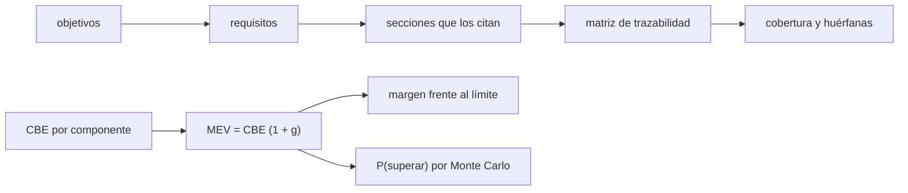

# B124-C19 — Redacción de propuesta de misión

<!-- nav:top -->
[🏠 Programa](../../../../README.md) · [📚 Bloque B124](../../../tronco-comun/B124-industria-economia-etica-y-proyectos-espaciales.md) · [← Anterior: B124-C18 — Comunicación y divulgación](../B124-C18-comunicacion-y-divulgacion/CLASE.md) · [Siguiente: B124-C20 — Proyecto integrador y portafolio profesional →](../B124-C20-proyecto-integrador-y-portafolio-profesional/CLASE.md)
<!-- /nav -->

## 1. Ubicación, nivel y alcance

Clase 19 del bloque B124. Nivel N4. Una propuesta de misión es un documento que convence a un evaluador de que el proyecto responde a objetivos científicos con un diseño factible y un presupuesto creíble. Aquí aprendes dos controles cuantitativos de ese documento: la matriz de trazabilidad (cada objetivo, requisito y sección se corresponden) y el presupuesto de recursos con reservas por madurez. Retomas el costo de [C05](../B124-C05-estimacion-de-costos-de-mision/CLASE.md) y el cronograma de [C16](../B124-C16-planificacion-de-cronograma-y-entregables/CLASE.md). **Esta clase es educativa: no es asesoría de redacción de propuestas ni de ingeniería de sistemas.** Los números son sintéticos.

## 2. Por qué esta clase existe

Una propuesta pierde puntos cuando algo prometido no tiene sección que lo sostenga o cuando el presupuesto no tiene margen. La decisión central: **¿está todo lo prometido cubierto y cuánta reserva necesita el diseño para ser creíble?**

## 3. Lo que podrás hacer al terminar

1. Construir una matriz de trazabilidad de objetivos, requisitos y secciones.
2. Detectar requisitos sin cubrir y secciones sin requisito.
3. Calcular un presupuesto de masa con crecimiento por madurez.
4. Calcular el margen frente a un límite y la probabilidad de superarlo.
5. Comprobar el presupuesto con Monte Carlo y con una aproximación normal.
6. Rotular que los porcentajes de crecimiento son ilustrativos.

La evidencia es el **esqueleto de propuesta con trazabilidad y reservas** del ejercicio 12 (sección 20).

## 4. Con qué llegas y cómo comprobarlo

1. ¿Qué es un requisito?
2. ¿Qué es la trazabilidad?
3. ¿Qué es la mejor estimación actual (CBE)?
4. ¿Qué es una reserva de contingencia?
5. ¿Qué es una distribución triangular?

<details>
<summary>Ver respuestas</summary>

1. Una condición que el sistema debe cumplir, redactada de modo que se pueda verificar. 2. La relación comprobable entre un objetivo, los requisitos que lo cumplen y lo que los verifica. 3. La masa o el valor estimado hoy, sin reserva. 4. Un margen añadido a una estimación para cubrir el crecimiento esperado. 5. Una con mínimo, moda y máximo.
</details>

Con cuatro o cinco aciertos, sigue; si no, repasa los prerrequisitos.

## 5. Un caso de contexto y casos de referencia

No se consultó ninguna guía de propuestas ni norma de reservas de ninguna agencia, así que los porcentajes de crecimiento por madurez (5, 10, 20 y 30 %) son **ilustrativos**. El **ejemplo conductor** es una propuesta **sintética** con 3 objetivos, 8 requisitos y 6 secciones: la cobertura de requisitos es `87,5%` (queda sin cubrir `R7`) y hay `1` sección huérfana; en el presupuesto, la masa de `355` kg crece a `402` kg con las reservas, un margen de `4,3%` bajo un límite de `420` kg, con probabilidad de superarlo de `1,3%`.

## 6. Vocabulario

La **trazabilidad** liga objetivo, requisito y sección. La **cobertura** es la fracción de requisitos citados. Una **sección huérfana** no cita ningún requisito. La **CBE** es la mejor estimación actual; la **MEV**, la masa máxima esperada, que añade el crecimiento por madurez. El **margen** es `(límite − MEV)/límite`. La **madurez** (heredado, modificado, nuevo diseño, nueva tecnología) fija el crecimiento esperado.

## 7. Modelo mental



*Descripción textual:* los objetivos se descomponen en requisitos que las secciones deben citar, y la matriz revela cobertura y huérfanas; por otro lado, las estimaciones de masa se inflan por madurez, se comparan con el límite y se prueban con simulación.

Analogía: un índice que remite cada pregunta del examen a la página donde se responde, y una maleta con holgura según lo seguro que estés de lo que llevas. Límite: la cobertura cuenta citas, no calidad de la respuesta.

## 8. La explicación, paso a paso

### 8.1 Trazabilidad

Los 8 requisitos se reparten en tres objetivos (G1: `3`; G2: `3`; G3: `2`). Las secciones citan los requisitos; calculada por filas y por columnas, la cobertura es `87,5%` en ambos casos. Sin cubrir: `R7` (un requisito prometido sin sección que lo sostenga). Sección huérfana: `S6 anexo de CVs`. Ambos hallazgos son defectos de la propuesta.

### 8.2 Presupuesto con reservas

La CBE total es `355,0` kg y cada componente se infla según su madurez: 5 % heredado, 10 % modificado, 20 % nuevo diseño, 30 % nueva tecnología (ilustrativos). La MEV es `402,00` kg, una reserva de `47,00` kg (`13,2%`), y el margen frente a `420` kg es `4,29%`.

### 8.3 Incertidumbre del crecimiento

Si el crecimiento real de cada componente es triangular de media `g`, la masa total tiene media `402,00` y desviación `8,160` (analítica). Con 40 000 simulaciones: media `402,04` (`0,01%` de diferencia) y desviación `8,199` (`0,48%`).

### 8.4 Probabilidad de superar el límite

`P(masa > límite)` es `0,0131` por Monte Carlo y `0,0137` con la aproximación normal (diferencia `0,0006`). Un margen de `4,3%` parece pequeño, pero la probabilidad de superar el límite es mucho menor que 50 % porque las reservas por componente ya cubren el crecimiento esperado. La dispersión se combina en cuadratura (`√Σσ²`), no sumando las de cada componente.

## 9. Magnitudes, símbolos y unidades

| Símbolo | Qué es | Unidad | Valor / nota |
|---|---|---|---|
| CBE | mejor estimación actual | kg | 355,0 |
| `g` | crecimiento por madurez | — | 0,05 a 0,30 (ilustrativo) |
| MEV | masa máxima esperada | kg | 402,00 |
| límite | masa asignada | kg | 420 |
| cobertura | requisitos citados / total | — | 87,5% |

## 10. Convenciones y referencias

Masa en kg; crecimiento por madurez ilustrativo; crecimientos independientes y triangulares de media `g`; límite fijo. La matriz cuenta citas, no calidad. Todos los datos son sintéticos.

## 11. De dónde sale lo que afirmamos

| ID | Fuente | Localizador | Respalda | Estado |
|---|---|---|---|---|
| — | Guías de propuestas y normas de reservas de agencias | — | no se usan | No consultadas |
| — | Trazabilidad, suma de masas, triangular y aproximación normal | — | verificadas entre sí | No consultadas en una fuente concreta |
| — | Objetivos, requisitos, secciones, masas y porcentajes `g` | — | todas las cifras | Sintético / ilustrativo |

Límites: no se consultó ninguna convocatoria, guía de propuesta ni norma de reservas de ninguna agencia; los porcentajes de reserva son ilustrativos y no equivalen a los de ninguna.

## 12. Cómo ver el resultado

| Magnitud | Valor |
|---|---|
| Cobertura de requisitos | 87,5% |
| Sin cubrir / huérfanas | R7 / S6 anexo de CVs |
| MEV frente al límite | 402,0 / 420 kg |
| Margen | 4,29% |
| P(superar el límite) | 0,0131 |

Descripción larga: la propuesta tiene un requisito sin cubrir y una sección huérfana; el presupuesto cabe en el límite con poco margen y una probabilidad de superarlo moderada.

## 13. Ejemplo trabajado

**Paso 1 · Matriz.** Requisitos R1, R2, R3; secciones S1 (R1, R2) y S2 (R2).

**Paso 2 · Cobertura.** R3 no está citado: cobertura `2/3 = 66,7 %`.

**Paso 3 · Masa.** Componente de 40 kg con madurez nueva tecnología (30 %): `40 · 1,3 = 52`.

**Paso 4 · Margen.** Con MEV = 400 y límite 420: `20/420 = 4,8 %`.

## 14. Distintas formas de describirlo

**Por matriz:** requisitos × secciones. **Por cobertura:** citados/total. **Por componente:** CBE y MEV. **Por margen:** `(límite − MEV)/límite`. **Por probabilidad:** simulación y normal.

## 15. Práctica guiada

**Ejercicio 1 · con los pasos indicados.** Calcula la MEV de 50 kg con madurez «modificado» (10 %). *Pasos:* `50 · 1,1`.

<details><summary>Solución comentada</summary>

`55` kg.
</details>

**Ejercicio 2 · con una pista.** Calcula el margen con MEV 380 y límite 400. *Pista:* `(L − MEV)/L`.

<details><summary>Solución comentada</summary>

`5 %`.
</details>

**Ejercicio 3 · casi autónomo.** Si 6 de 8 requisitos están citados, ¿cuál es la cobertura?

<details><summary>Solución comentada</summary>

`75 %`.
</details>

## 16. Práctica autónoma, transferencia e integrador

**Ejercicio 4 · autónomo.** ¿Qué requisitos quedaron sin cubrir y qué sección es huérfana?

<details><summary>Solución comentada</summary>

`R7` y `S6 anexo de CVs`.
</details>

**Ejercicio 5 · autónomo.** ¿Cuál es la MEV del laboratorio?

<details><summary>Solución comentada</summary>

`402,00` kg.
</details>

**Ejercicio 6 · autónomo.** ¿Cuál es el margen?

<details><summary>Solución comentada</summary>

`4,29%`.
</details>

**Ejercicio 7 · autónomo.** ¿Cuál es la probabilidad de superar el límite?

<details><summary>Solución comentada</summary>

`0,0131` (Monte Carlo) y `0,0137` (normal).
</details>

**Ejercicio 8 · autónomo.** ¿Cuánto es la reserva total?

<details><summary>Solución comentada</summary>

`47,00` kg, `13,2%` de la CBE.
</details>

**Ejercicio 9 · transferencia.** **Transferencia.** Un evaluador pregunta por qué un componente nuevo tiene la misma reserva que uno heredado. ¿Qué respondes?

<details><summary>Solución comentada</summary>

Que la reserva debe subir con la inmadurez; igualarlas subestima el riesgo del nuevo.
</details>

**Ejercicio 10 · transferencia.** **Transferencia.** La sección de CVs no cita requisitos. ¿Es un defecto?

<details><summary>Solución comentada</summary>

Puede ser un anexo legítimo, pero conviene que los requisitos de capacidad del equipo (si existen) la citen; una sección sin función se revisa o se justifica.
</details>

**Ejercicio 11 · transferencia.** **Transferencia.** Se pasa de 400 a 430 kg por un cambio de diseño. ¿Qué haces con el presupuesto?

<details><summary>Solución comentada</summary>

Recalcular MEV, margen y probabilidad; negociar el límite, reducir masa o aceptar el riesgo declarándolo; no esconder el exceso en una reserva global.
</details>

**Ejercicio 12 · integrador.** **Integrador.** Elabora tu *esqueleto de propuesta con trazabilidad y reservas*: matriz objetivo–requisito–sección con cobertura y huérfanas, presupuesto de masa con reservas por madurez, margen y probabilidad con su verificación, y lista de qué es sintético o ilustrativo, con el aviso de que es educativa.

<details><summary>Solución comentada</summary>

Secciones 8.1–8.4 y la salida del laboratorio.
</details>

## 17. Laboratorio: trazabilidad y reservas

El script [trazabilidad_y_reservas.py](trazabilidad_y_reservas.py) calcula cobertura y huérfanas de una matriz de trazabilidad, un presupuesto de masa con reservas por madurez y su riesgo por Monte Carlo y aproximación normal (**comprueba** cobertura por dos vías, media a 0,5 %, desviación a 3 % y probabilidad a 0,02). Tarda menos de 10 s en un equipo común.

**Datos:** ningún dato consultado; objetivos, requisitos, secciones, masas y porcentajes de crecimiento **sintéticos o ilustrativos**. **Predice antes de ejecutar:** ¿cabrá la MEV en el límite? (sí, con poco margen.) **Ejecución del 2026-11-11:**

```text
Python 3.12.9 (biblioteca estandar)
Parte 1 - trazabilidad SINTETICA: 3 objetivos, 8 requisitos, 6 secciones
  S1 resumen                 cita: R1, R3, R6
  S2 objetivos cientificos   cita: R1, R2, R8
  S3 implementacion tecnica  cita: R3, R4, R5
  S4 plan de gestion         cita: R6
  S5 presupuesto             cita: R4, R5
  S6 anexo de CVs            cita: (ninguno)
  cobertura de requisitos = 87.5 % (por columnas 87.5 %) ; sin cubrir: R7 ; secciones huerfanas: S6 anexo de CVs
Parte 2 - presupuesto de masa (kg); crecimiento por madurez ILUSTRATIVO
  estructura       CBE =   90.0  modificado        g =   10 %  MEV =   99.00
  potencia         CBE =   70.0  heredado          g =    5 %  MEV =   73.50
  computadora      CBE =   20.0  heredado          g =    5 %  MEV =   21.00
  comunicaciones   CBE =   25.0  modificado        g =   10 %  MEV =   27.50
  termica          CBE =   30.0  modificado        g =   10 %  MEV =   33.00
  propulsion       CBE =   55.0  nuevo diseno      g =   20 %  MEV =   66.00
  instrumento A    CBE =   40.0  nueva tecnologia  g =   30 %  MEV =   52.00
  instrumento B    CBE =   25.0  nuevo diseno      g =   20 %  MEV =   30.00
  CBE total = 355.0 ; MEV = 402.00 ; reserva total = 47.00 (13.2 %) ; limite = 420 ; margen = 4.29 %
  desviacion analitica = 8.160 ; Monte Carlo: media = 402.04 (dif 0.01 %), desviacion = 8.199 (dif 0.48 %)
  P(masa > limite): Monte Carlo = 0.0131 ; aproximacion normal = 0.0137 ; diferencia = 0.0006
Pruebas superadas.
```

```bash
python programa/clases/B124/B124-C19-redaccion-de-propuesta-de-mision/trazabilidad_y_reservas.py
```

**Límites:** crecimientos independientes y triangulares, un solo recurso (masa) y un límite fijo; la cobertura cuenta citas y no calidad; las reservas no son las de ninguna agencia.

## 18. Errores frecuentes y cómo corregirlos

**Prometer un objetivo sin sección que lo sostenga.** Se corrige con 8.1.

**Usar la misma reserva para todo.** Se corrige con 8.2.

**Sumar linealmente las incertidumbres.** Se corrige con 8.4.

**Tomar los porcentajes ilustrativos como norma.** Se corrige con la sección 10.

## 19. Cómo sabrás que vas bien

Tras la sección 8: ¿qué cobertura esperabas y cuál obtuviste? Si dudas, repasa el ejemplo 13. Tras el laboratorio: ¿qué comprueba? (ver la sección 17).

## 20. Qué entregas y cómo se evalúa

El producto es tu **esqueleto de propuesta con trazabilidad y reservas** (ejercicio 12).

| Criterio | Inicial | En desarrollo | Logrado | Destacado |
|---|---|---|---|---|
| Conceptos | Los confunde | Parciales | Calcula cobertura y margen | Explica los límites |
| Cálculo | Sin unidades | Con errores | Tablas completas con unidades | Calcula casos nuevos |
| Numérico | Sin comprobar | Un caso | Contraste con una segunda vía | Interpreta las diferencias |
| Fuentes | Sin fuente | Sin fecha | Fuentes con fecha y estado | Declara lo ilustrativo y lo no consultado |
| Límites | No los nombra | Uno | Tres | Discute qué falta del modelo |

**Condiciones críticas (no se compensan con promedio):** rotular los datos como sintéticos o ilustrativos; no presentar el resultado como asesoría financiera, legal ni de inversión; citar solo lo consultado.

## 21. Ética, seguridad y límites

Clase educativa: **no es asesoría financiera, legal, tributaria ni de inversión** y no sustituye a un profesional habilitado ni a la normativa vigente; ningún resultado debe usarse para decidir una compra, un contrato, una inversión o un seguro reales. Una propuesta no debe prometer más de lo que el diseño y la evidencia sostienen; ocultar riesgos para ganar puntos es una falta de integridad científica. Los modelos son simplificados y sus datos son sintéticos o ilustrativos. Accesibilidad: tablas equivalentes a las gráficas, fórmulas en texto, ejercicios sin conexión.

## 22. Para cerrar y seguir

La propuesta sintética cubre `87,5%` de los requisitos y tiene `1` sección huérfana; su masa de `355` kg crece a `402` kg con reservas, con margen de `4,3%` y `1,3%` de probabilidad de superar el límite.

**Glosario español–inglés.** propuesta de misión · *mission proposal*; trazabilidad · *traceability*; mejor estimación actual · *current best estimate (CBE)*; reserva · *contingency / reserve*; margen · *margin*.

**Continuidad.** [B124-C20](../B124-C20-proyecto-integrador-y-portafolio-profesional/CLASE.md) reúne todo lo anterior en un portafolio con una rúbrica de evaluación.

**Referencias:** ver sección 11.

<!-- nav:bottom -->
---

[← Anterior: B124-C18 — Comunicación y divulgación](../B124-C18-comunicacion-y-divulgacion/CLASE.md) · [📚 Bloque B124](../../../tronco-comun/B124-industria-economia-etica-y-proyectos-espaciales.md) · [Siguiente: B124-C20 — Proyecto integrador y portafolio profesional →](../B124-C20-proyecto-integrador-y-portafolio-profesional/CLASE.md)
<!-- /nav -->
