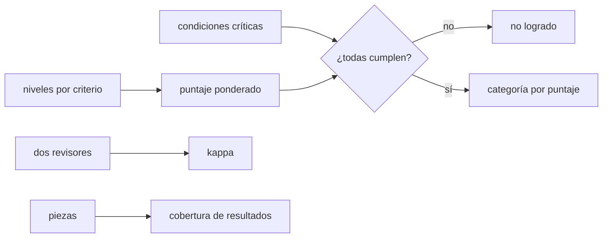

# B124-C20 — Proyecto integrador y portafolio profesional

<!-- nav:top -->
[🏠 Programa](../../../../README.md) · [📚 Bloque B124](../../../tronco-comun/B124-industria-economia-etica-y-proyectos-espaciales.md) · [← Anterior: B124-C19 — Redacción de propuesta de misión](../B124-C19-redaccion-de-propuesta-de-mision/CLASE.md) · [Siguiente: B124-C21 — Acuerdos de nivel de servicio para productos de datos →](../B124-C21-acuerdos-de-nivel-de-servicio-para-productos-de-datos/CLASE.md)
<!-- /nav -->

## 1. Ubicación, nivel y alcance

Clase 20 del bloque B124. Nivel N4. El proyecto integrador reúne lo del bloque en un portafolio profesional: una propuesta con costo, riesgo, cronograma, ética y comunicación. Aquí aprendes a evaluarlo con una rúbrica ponderada que tiene condiciones críticas que no se compensan con el promedio, a medir cuánto coinciden dos revisores y a comprobar que el portafolio cubre los resultados de aprendizaje. Reúne [C19](../B124-C19-redaccion-de-propuesta-de-mision/CLASE.md) con las clases anteriores. **Esta clase es educativa: no evalúa a personas reales ni es asesoría laboral.** Los portafolios son sintéticos.

## 2. Por qué esta clase existe

Un portafolio con una nota promedio alta puede ocultar una falta grave, como presentar datos inventados como reales. La decisión central: **¿qué hace falta para declarar logrado un portafolio y cómo se sabe que dos revisores miden lo mismo?**

## 3. Lo que podrás hacer al terminar

1. Calcular un puntaje ponderado de rúbrica en escala 0–100.
2. Aplicar condiciones críticas que anulan el promedio.
3. Calcular el kappa de Cohen con la fórmula y con una segunda implementación.
4. Calcular un kappa ponderado lineal.
5. Comprobar la cobertura de resultados de aprendizaje por las piezas del portafolio.
6. Rotular que portafolios, puntajes y umbrales son sintéticos o ilustrativos.

La evidencia es el **portafolio profesional con rúbrica autoaplicada** del ejercicio 12 (sección 20).

## 4. Con qué llegas y cómo comprobarlo

1. ¿Qué es una rúbrica?
2. ¿Qué es un promedio ponderado?
3. ¿Qué es una condición no compensable?
4. ¿Qué es la concordancia entre revisores?
5. ¿Qué es un resultado de aprendizaje?

<details>
<summary>Ver respuestas</summary>

1. Una tabla que describe niveles de desempeño por criterio. 2. Un promedio en que cada dato cuenta según un peso y los pesos suman 1. 3. Una que debe cumplirse siempre, aunque el resto sea excelente. 4. Cuánto coinciden dos personas al calificar lo mismo. 5. Lo que una persona debe poder hacer al terminar.
</details>

Con cuatro o cinco aciertos, sigue; si no, repasa los prerrequisitos.

## 5. Un caso de contexto y casos de referencia

No se consultó ninguna norma de evaluación. El **ejemplo conductor** compara 5 portafolios **sintéticos**: P2 tiene el mayor puntaje (`100,0`), pero incumple una condición crítica y queda «no logrado»; P1 llega a `85,0` («destacado»). Dos revisores sintéticos coinciden en `48,3%` de 60 criterios, con kappa `0,300`, y las 8 piezas cubren `3` de `7` resultados de aprendizaje.

## 6. Vocabulario

La **rúbrica** define niveles 1 a 4 por criterio. El **puntaje** pondera esos niveles en una escala 0–100. Las **condiciones críticas** (rotular lo sintético, no dar asesoría, citar solo lo consultado) no se compensan. El **kappa de Cohen** mide la concordancia descontando el azar: `κ = (p_o − p_e)/(1 − p_e)`. El **kappa ponderado** penaliza más los desacuerdos grandes. La **cobertura** es la fracción de resultados con alguna pieza que los evidencie.

## 7. Modelo mental



*Descripción textual:* los niveles dan un puntaje; si alguna condición crítica falla, el portafolio queda «no logrado», y si no, se categoriza por puntaje; la fiabilidad se mide con kappa y la suficiencia con la cobertura.

Analogía: un examen de conducir en que no importa cuán bien manejes si te pasas una luz roja. Límite: demasiadas condiciones críticas convierten la evaluación en una lista de verificación y esconden la calidad.

## 8. La explicación, paso a paso

### 8.1 Puntaje ponderado

Con pesos (0,15; 0,20; 0,20; 0,20; 0,15; 0,10) y niveles de 1 a 4, `puntaje = 100 Σ w (nivel − 1)/3`. P1 obtiene `85,0`, P3 `60,0`, P4 `36,7` y P5 `15,0`; con umbrales ilustrativos 85, 65 y 40 resultan «destacado», «en desarrollo», «inicial» y «inicial».

### 8.2 Condiciones críticas

P2 tiene todos los criterios en nivel 4 (`100,0`) pero no cumple la segunda condición crítica; su categoría es «no logrado». La diferencia con P1 en puntaje es `15,0`, y aun así P1 está por delante. Esto es lo que significa que las condiciones críticas no se compensan con el promedio.

### 8.3 Concordancia entre revisores

Dos revisores califican los mismos 60 criterios: acuerdo `48,3%`, `κ = 0,3002` por la matriz de confusión y `0,3002` por la segunda implementación (diferencia `0,0e+00`); el kappa lineal es `0,5082`. Un kappa de ese orden es bajo e indica que la rúbrica o su entrenamiento necesitan afinarse; no hay umbral universal.

### 8.4 Cobertura de resultados

Las piezas del portafolio evidencian `3` de `7` resultados de aprendizaje (`42,9%`); quedan sin evidencia: RA4, RA5, RA6, RA7. Un portafolio puede ser excelente en lo que muestra y aun así no cubrir lo que el bloque exige.

## 9. Magnitudes, símbolos y unidades

| Símbolo | Qué es | Unidad | Valor / nota |
|---|---|---|---|
| `w` | peso del criterio | — | 0,10 a 0,20 |
| nivel | desempeño por criterio | 1–4 | inicial a destacado |
| puntaje | ponderado en 0–100 | puntos | 15,0 a 100,0 |
| `κ` | kappa de Cohen | — | 0,300 |
| cobertura | resultados con evidencia | — | 42,9% |

## 10. Convenciones y referencias

Niveles discretos de 1 a 4, pesos que suman 1, umbrales ilustrativos (85, 65, 40), tres condiciones críticas, dos revisores con ruido simulado sobre un nivel verdadero. Los 5 portafolios, los puntajes y las piezas son sintéticos.

## 11. De dónde sale lo que afirmamos

| ID | Fuente | Localizador | Respalda | Estado |
|---|---|---|---|---|
| — | Rúbricas, kappa de Cohen, kappa ponderado | — | verificados por dos implementaciones | No consultados en una fuente concreta |
| — | Normas de evaluación de portafolios | — | no se usan | No consultadas |
| — | Portafolios, niveles, umbrales y revisores | — | todas las cifras | Sintético / ilustrativo |

Límites: no se consultó ninguna norma de evaluación; los umbrales y los portafolios son inventados y los revisores son simulados.

## 12. Cómo ver el resultado

| Magnitud | Valor |
|---|---|
| Puntaje P1 / P2 | 85,0 / 100,0 |
| Categoría P1 / P2 | destacado / no logrado |
| Acuerdo y kappa | 48,3% y 0,300 |
| Cobertura de resultados | 3 de 7 |

Descripción larga: el mayor puntaje no gana si falla una condición crítica; el acuerdo entre revisores es mejorable y falta evidencia de un resultado.

## 13. Ejemplo trabajado

**Paso 1 · Niveles.** Niveles `(4, 3)` con pesos `(0,6; 0,4)`.

**Paso 2 · Puntaje.** `100 (0,6·3 + 0,4·2)/3 = 100 · 2,6/3 = 86,7`.

**Paso 3 · Categoría.** `86,7 ≥ 85`: «destacado» si todas las condiciones críticas se cumplen.

**Paso 4 · Crítica.** Si falla una, «no logrado» aunque el puntaje sea 86,7.

## 14. Distintas formas de describirlo

**Por tabla:** niveles y pesos. **Por regla:** críticas y umbrales. **Por kappa:** concordancia. **Por cobertura:** resultado × pieza. **Por categoría:** destacado, logrado, en desarrollo, inicial, no logrado.

## 15. Práctica guiada

**Ejercicio 1 · con los pasos indicados.** Calcula el puntaje con niveles `(2, 4)` y pesos `(0,5; 0,5)`. *Pasos:* `100 Σ w (n−1)/3`.

<details><summary>Solución comentada</summary>

`100 (0,5 + 1,5)/3 = 66,7`.
</details>

**Ejercicio 2 · con una pista.** ¿Qué categoría tiene 66,7 con críticas cumplidas? *Pista:* umbrales 85/65/40.

<details><summary>Solución comentada</summary>

«logrado».
</details>

**Ejercicio 3 · casi autónomo.** Con acuerdo observado 0,8 y esperado 0,5, ¿cuánto es `κ`?

<details><summary>Solución comentada</summary>

`(0,8 − 0,5)/(1 − 0,5) = 0,6`.
</details>

## 16. Práctica autónoma, transferencia e integrador

**Ejercicio 4 · autónomo.** ¿Qué puntaje obtiene P1?

<details><summary>Solución comentada</summary>

`85,0`.
</details>

**Ejercicio 5 · autónomo.** ¿Qué categoría tiene P2 y por qué?

<details><summary>Solución comentada</summary>

«no logrado»: falla una condición crítica pese a `100,0` puntos.
</details>

**Ejercicio 6 · autónomo.** ¿Cuánto vale `κ` en el laboratorio?

<details><summary>Solución comentada</summary>

`0,3002`.
</details>

**Ejercicio 7 · autónomo.** ¿Cuál es la cobertura de resultados?

<details><summary>Solución comentada</summary>

`3` de `7` (`42,9%`).
</details>

**Ejercicio 8 · autónomo.** ¿Qué resultados no tienen evidencia?

<details><summary>Solución comentada</summary>

RA4, RA5, RA6, RA7.
</details>

**Ejercicio 9 · transferencia.** **Transferencia.** Una persona entrega un portafolio brillante con datos reales de un cliente sin permiso. ¿Cómo lo calificas?

<details><summary>Solución comentada</summary>

No logrado: se vulnera una condición crítica de ética de datos, aunque el trabajo técnico sea excelente.
</details>

**Ejercicio 10 · transferencia.** **Transferencia.** Dos revisores discrepan en un criterio por 2 niveles. ¿Qué haces?

<details><summary>Solución comentada</summary>

Reviso la rúbrica y sus ejemplos, discuto con ambos y recalifico con evidencia; si persiste, un tercer revisor.
</details>

**Ejercicio 11 · transferencia.** **Transferencia.** Quieres añadir 10 condiciones críticas. ¿Qué riesgo hay?

<details><summary>Solución comentada</summary>

Que la evaluación se vuelva una lista de verificación y pierda la graduación de calidad; conviene dejar críticas solo las faltas que invalidan el trabajo.
</details>

**Ejercicio 12 · integrador.** **Integrador.** Elabora tu *portafolio profesional con rúbrica autoaplicada*: piezas del portafolio con el resultado que evidencian, autoevaluación con puntaje y condiciones críticas, comparación con la de un segundo revisor (kappa) y lista de qué es sintético, con el aviso de que es educativa.

<details><summary>Solución comentada</summary>

Secciones 8.1–8.4 y la salida del laboratorio.
</details>

## 17. Laboratorio: rúbrica, kappa y cobertura

El script [rubrica_y_portafolio.py](rubrica_y_portafolio.py) calcula puntajes y categorías con condiciones críticas, el kappa de Cohen por dos implementaciones y la cobertura de resultados (**comprueba** kappa iguales a 1e-12, puntajes entre 0 y 100 y P2 «no logrado»). Tarda menos de 10 s en un equipo común.

**Datos:** ningún dato consultado; portafolios, niveles, umbrales y revisores **sintéticos o ilustrativos**. **Predice antes de ejecutar:** ¿tendrá P2, con todo en nivel 4, la categoría «destacado»? (no: falla una crítica.) **Ejecución del 2026-11-11:**

```text
Python 3.12.9 (biblioteca estandar)
Rubrica SINTETICA (6 criterios, niveles 1-4); umbrales ILUSTRATIVOS 85 / 65 / 40
  P1: niveles [4, 4, 3, 4, 3, 3] ; criticas (1, 1, 1) ; puntaje =  85.0 ; categoria = destacado
  P2: niveles [4, 4, 4, 4, 4, 4] ; criticas (1, 0, 1) ; puntaje = 100.0 ; categoria = no logrado
  P3: niveles [3, 3, 3, 2, 3, 3] ; criticas (1, 1, 1) ; puntaje =  60.0 ; categoria = en desarrollo
  P4: niveles [2, 2, 2, 2, 2, 3] ; criticas (1, 1, 1) ; puntaje =  36.7 ; categoria = inicial
  P5: niveles [1, 2, 1, 1, 2, 2] ; criticas (1, 1, 1) ; puntaje =  15.0 ; categoria = inicial
P2 tiene el mayor puntaje (100.0) pero falla una condicion critica: categoria no logrado (no se compensa con promedio).
Concordancia de dos revisores (60 criterios): acuerdo = 48.3 % ; kappa (matriz) = 0.3002 ; kappa (Counter) = 0.3002 ; diferencia = 0.0e+00 ; kappa lineal = 0.5082
Cobertura de resultados del bloque por las piezas del portafolio: 3 de 7 (42.9 %) ; sin evidencia: RA4, RA5, RA6, RA7
Pruebas superadas.
```

```bash
python programa/clases/B124/B124-C20-proyecto-integrador-y-portafolio-profesional/rubrica_y_portafolio.py
```

**Límites:** revisores simulados, rúbrica y umbrales inventados, pesos fijos; no evalúa a nadie real.

## 18. Errores frecuentes y cómo corregirlos

**Compensar una falta crítica con un promedio alto.** Se corrige con 8.2.

**Tomar un acuerdo porcentual como fiabilidad.** Se corrige con 8.3: el kappa descuenta el azar.

**Entregar un portafolio excelente que no cubre los resultados.** Se corrige con 8.4.

**Presentar los umbrales ilustrativos como norma.** Se corrige con la sección 10.

## 19. Cómo sabrás que vas bien

Tras la sección 8: ¿qué categoría esperabas para P2 y cuál salió? Si dudas, repasa el ejemplo 13. Tras el laboratorio: ¿qué comprueba? (ver la sección 17).

## 20. Qué entregas y cómo se evalúa

El producto es tu **portafolio profesional con rúbrica autoaplicada** (ejercicio 12).

| Criterio | Inicial | En desarrollo | Logrado | Destacado |
|---|---|---|---|---|
| Conceptos | Los confunde | Parciales | Aplica la rúbrica y las críticas | Explica los límites |
| Cálculo | Sin unidades | Con errores | Tablas completas con unidades | Calcula casos nuevos |
| Numérico | Sin comprobar | Un caso | Contraste con una segunda vía | Interpreta las diferencias |
| Fuentes | Sin fuente | Sin fecha | Fuentes con fecha y estado | Declara lo ilustrativo y lo no consultado |
| Límites | No los nombra | Uno | Tres | Discute qué falta del modelo |

**Condiciones críticas (no se compensan con promedio):** rotular los datos como sintéticos o ilustrativos; no presentar el resultado como asesoría financiera, legal ni de inversión; citar solo lo consultado.

## 21. Ética, seguridad y límites

Clase educativa: **no es asesoría financiera, legal, tributaria ni de inversión** y no sustituye a un profesional habilitado ni a la normativa vigente; ningún resultado debe usarse para decidir una compra, un contrato, una inversión o un seguro reales. Evaluar a personas tiene consecuencias; esta clase usa portafolios sintéticos y no debe usarse para calificar a nadie sin criterios y revisión humana acordados. Los modelos son simplificados y sus datos son sintéticos o ilustrativos. Accesibilidad: tablas equivalentes a las gráficas, fórmulas en texto, ejercicios sin conexión.

## 22. Para cerrar y seguir

El mayor puntaje sintético (`100`) queda «no logrado» por una condición crítica; dos revisores coinciden con kappa `0,30`, y las piezas cubren `3` de `7` resultados de aprendizaje. Con esto el bloque cierra su secuencia de gestión.

**Glosario español–inglés.** portafolio · *portfolio*; rúbrica · *rubric*; kappa de Cohen · *Cohen's kappa*; condición crítica · *critical condition*; concordancia entre revisores · *inter-rater agreement*.

**Continuidad.** Las clases programadas [B124-C21](../B124-C21-acuerdos-de-nivel-de-servicio-para-productos-de-datos/CLASE.md) a [B124-C24](../B124-C24-capex-y-opex-de-una-instalacion-extraterrestre/CLASE.md) completan el bloque con servicios de datos, costos de transporte e instalaciones.

**Referencias:** ver sección 11.

<!-- nav:bottom -->
---

[← Anterior: B124-C19 — Redacción de propuesta de misión](../B124-C19-redaccion-de-propuesta-de-mision/CLASE.md) · [📚 Bloque B124](../../../tronco-comun/B124-industria-economia-etica-y-proyectos-espaciales.md) · [Siguiente: B124-C21 — Acuerdos de nivel de servicio para productos de datos →](../B124-C21-acuerdos-de-nivel-de-servicio-para-productos-de-datos/CLASE.md)
<!-- /nav -->
