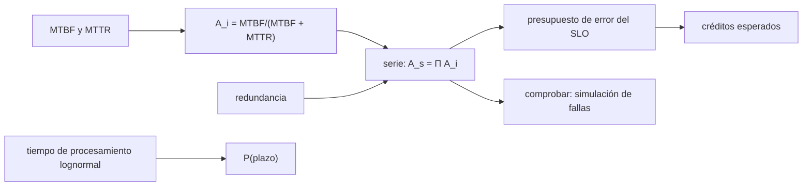

# B124-C21 — Acuerdos de nivel de servicio para productos de datos

<!-- nav:top -->
[🏠 Programa](../../../../README.md) · [📚 Bloque B124](../../../tronco-comun/B124-industria-economia-etica-y-proyectos-espaciales.md) · [← Anterior: B124-C20 — Proyecto integrador y portafolio profesional](../B124-C20-proyecto-integrador-y-portafolio-profesional/CLASE.md) · [Siguiente: B124-C22 — Modelo de costo de un servicio de datos →](../B124-C22-modelo-de-costo-de-un-servicio-de-datos/CLASE.md)
<!-- /nav -->

## 1. Ubicación, nivel y alcance

Clase 21 del bloque B124 (clase programada por la ampliación `0.2.0`). Nivel N3–N4. Un servicio de observación no solo vende datos: se compromete con plazos y calidad en un acuerdo de nivel de servicio (SLA). Aquí calculas la disponibilidad de un producto de datos a partir del tiempo medio entre fallas y de reparación, el presupuesto de error que deja un objetivo de disponibilidad y la probabilidad de entregar a tiempo, y ves cuánto cuesta incumplir. Retomas la propuesta de valor de [C04](../B124-C04-diseno-de-propuesta-de-valor/CLASE.md). **Esta clase es educativa: no es un contrato ni asesoría legal.** Los números son sintéticos.

## 2. Por qué esta clase existe

B124 trata propuestas de valor, pero un servicio de observación se compromete con plazos y calidad, y esos compromisos tienen una aritmética precisa. La decisión central: **¿qué disponibilidad y qué plazo puede prometer un servicio sin incumplir seguido y cuánto cuesta cada incumplimiento?**

## 3. Lo que podrás hacer al terminar

1. Calcular la disponibilidad de un componente como `MTBF/(MTBF + MTTR)`.
2. Combinar componentes en serie y con redundancia.
3. Calcular el presupuesto de error de un objetivo de nivel de servicio.
4. Verificar la disponibilidad con una simulación de fallas y reparaciones.
5. Calcular la probabilidad de cumplir un plazo y los créditos esperados por incumplimiento.
6. Rotular que los tiempos y los créditos son sintéticos y que no se redacta un contrato.

La evidencia es la **ficha de acuerdo de nivel de servicio de un producto de datos** del ejercicio 12 (sección 20).

## 4. Con qué llegas y cómo comprobarlo

1. ¿Qué es el MTBF?
2. ¿Qué es el MTTR?
3. ¿Qué es un componente en serie?
4. ¿Qué es una distribución lognormal?
5. ¿Qué es un crédito de servicio?

<details>
<summary>Ver respuestas</summary>

1. El tiempo medio entre fallas de un componente. 2. El tiempo medio de reparación. 3. Uno cuya falla detiene todo el sistema. 4. La de una variable positiva cuyo logaritmo es normal; modela tiempos de procesamiento. 5. Un descuento en la cuota que el proveedor concede por incumplir el acuerdo.
</details>

Con cuatro o cinco aciertos, sigue; si no, repasa los prerrequisitos.

## 5. Un caso de contexto y casos de referencia

No se consultó ningún acuerdo de servicio real ni norma; la clase es una programación nueva del bloque. El **ejemplo conductor** es un producto de datos **sintético** con tres componentes en serie: la disponibilidad esperada es `0,98072`, es decir una caída de `13,88` h al mes frente a un presupuesto de `3,60` h para un objetivo de 99,5 %; el mes cae por debajo del objetivo con probabilidad `81,7%` y duplicar el procesamiento lleva la disponibilidad a `0,99235`.

## 6. Vocabulario

La **disponibilidad** `A` es la fracción del tiempo en que el servicio funciona. El **SLO** es el objetivo de nivel de servicio; el **SLA**, el acuerdo que fija consecuencias si no se cumple. El **presupuesto de error** es el tiempo de caída que el SLO tolera. La **redundancia** pone dos instancias en paralelo. El **crédito de servicio** compensa al cliente. El **plazo** (*latency*) es el tiempo entre la captura y la entrega del producto.

## 7. Modelo mental



*Descripción textual:* los tiempos medios dan la disponibilidad de cada componente, que se combina en serie o con redundancia, se compara con el presupuesto de error y se verifica por simulación; el plazo se trata por separado.

Analogía: una cadena de tres eslabones, en que basta que se rompa uno para que no funcione. Límite: aquí las fallas se suponen independientes y reparables, y en la práctica comparten causas.

## 8. La explicación, paso a paso

### 8.1 Disponibilidad por componente y en serie

La ingesta (MTBF 720 h, MTTR 4 h) tiene `A = 0,99448`, el procesamiento (500 h, 6 h) `0,98814` y la distribución (1 000 h, 2 h) `0,99800`. En serie, `A_s = 0,98072`: la cadena es menos disponible que cada eslabón.

### 8.2 Presupuesto de error

Un SLO de 99,5 % en un mes de 720 h tolera `3,60` h de caída; la caída esperada es `13,88` h. En promedio no se cumple (`A_s` está bajo 0,995). Y no es cuestión del procesamiento: aun si fuera perfecto, `A_ing · A_dis = 0,99249` ya queda bajo 0,995, así que el objetivo es inalcanzable con esos componentes; prometerlo sería firmar un incumplimiento. Incluso con promedio cumplido, algunos meses fallarían.

### 8.3 Redundancia y verificación

Con dos instancias independientes del procesamiento, `A_p' = 1 − (1 − A_p)² = 0,999859` y el sistema sube a `0,99235` (caída esperada `5,51` h). La simulación de 2 000 meses con fallas y reparaciones exponenciales y unión de intervalos da `0,98018`, a `0,00055` de la analítica (ruido estadístico de la simulación). Aun así `0,99235` sigue bajo 0,995.

### 8.4 Plazo y créditos

Con tiempo de procesamiento lognormal de mediana 3 h y `σ = 0,4`, `P(≤ 6 h) = Φ(ln 2/0,4) = 0,9584` (Monte Carlo `0,9584`). Con créditos de 10 % entre 99,0 y 99,5 % y de 25 % bajo 99,0 %, el crédito esperado es `18,14%` de la cuota mensual (`15,2%` de los meses al 10 % y `66,5%` al 25 %). Prometer un SLO por encima de lo que el diseño sostiene convierte el crédito en un costo recurrente.

## 9. Magnitudes, símbolos y unidades

| Símbolo | Qué es | Unidad | Valor / nota |
|---|---|---|---|
| MTBF, MTTR | tiempos medios entre fallas y de reparación | h | 500 a 1 000; 2 a 6 (sintéticos) |
| `A` | disponibilidad | — | 0,98072 en serie |
| SLO | objetivo de disponibilidad | — | 0,995 |
| presupuesto | caída tolerada por mes | h | 3,60 |
| plazo | tiempo de procesamiento | h | mediana 3; P(≤ 6 h) = 0,9584 |

## 10. Convenciones y referencias

Mes de 720 h; fallas y reparaciones exponenciales independientes por componente; disponibilidad estacionaria; créditos y tiempos ilustrativos. Los componentes y cifras son sintéticos y no describen ningún servicio real.

## 11. De dónde sale lo que afirmamos

| ID | Fuente | Localizador | Respalda | Estado |
|---|---|---|---|---|
| — | Disponibilidad estacionaria, serie y paralelo, lognormal | — | verificadas por simulación y Monte Carlo | No consultadas en una fuente concreta |
| — | Acuerdos de nivel de servicio reales | — | no se usan | No consultados |
| — | MTBF, MTTR, SLO, plazos y créditos | — | todas las cifras | Sintético / ilustrativo |

Límites: no se consultó ningún acuerdo, norma de servicio ni ley de consumo; los créditos son ilustrativos y el modelo no redacta cláusulas.

## 12. Cómo ver el resultado

| Magnitud | Valor |
|---|---|
| Disponibilidad en serie | 0,98072 |
| Caída esperada / presupuesto | 13,88 / 3,60 h |
| Con redundancia | 0,99235 |
| P(mes bajo el SLO) | 81,7% |
| P(plazo ≤ 6 h) | 0,9584 |

Descripción larga: la cadena en serie no cumple el SLO en promedio; la redundancia del eslabón más débil lo acerca y el plazo se cumple en la mayoría de los casos.

## 13. Ejemplo trabajado

**Paso 1 · Componente.** MTBF 400 h y MTTR 4 h: `A = 400/404 = 0,990`.

**Paso 2 · Serie.** Dos componentes de `0,99`: `0,99² = 0,9801`.

**Paso 3 · Paralelo.** Dos instancias de `0,99`: `1 − 0,01² = 0,9999`.

**Paso 4 · Presupuesto.** SLO 99,9 % en 720 h: `0,001 · 720 = 0,72` h = 43,2 min.

## 14. Distintas formas de describirlo

**Por tiempos:** MTBF y MTTR. **Por fracción:** `A`. **Por minutos:** presupuesto de error. **Por probabilidad:** `P(plazo)`. **Por dinero:** crédito esperado.

## 15. Práctica guiada

**Ejercicio 1 · con los pasos indicados.** Calcula `A` con MTBF 200 h y MTTR 2 h. *Pasos:* `200/202`.

<details><summary>Solución comentada</summary>

`0,990`.
</details>

**Ejercicio 2 · con una pista.** ¿Cuántas horas tolera un SLO de 99 % en 720 h? *Pista:* `0,01 · 720`.

<details><summary>Solución comentada</summary>

`7,2` h.
</details>

**Ejercicio 3 · casi autónomo.** Dos componentes en serie con `A = 0,98` y `0,97`. ¿Cuál es `A_s`?

<details><summary>Solución comentada</summary>

`0,9506`.
</details>

## 16. Práctica autónoma, transferencia e integrador

**Ejercicio 4 · autónomo.** ¿Cuál es la disponibilidad en serie del laboratorio?

<details><summary>Solución comentada</summary>

`0,98072`.
</details>

**Ejercicio 5 · autónomo.** ¿Cuántas horas de caída esperadas al mes?

<details><summary>Solución comentada</summary>

`13,88` h.
</details>

**Ejercicio 6 · autónomo.** ¿Cuál es la disponibilidad con procesamiento redundante?

<details><summary>Solución comentada</summary>

`0,99235`.
</details>

**Ejercicio 7 · autónomo.** ¿Con qué probabilidad un mes cae bajo el SLO?

<details><summary>Solución comentada</summary>

`81,7%`.
</details>

**Ejercicio 8 · autónomo.** ¿Cuál es el crédito esperado como porcentaje de la cuota?

<details><summary>Solución comentada</summary>

`18,14%`.
</details>

**Ejercicio 9 · transferencia.** **Transferencia.** El cliente pide 99,99 %. ¿Qué presupuesto de error implica y qué opinas?

<details><summary>Solución comentada</summary>

`0,0001 · 720 = 0,072 h` (4,3 min) al mes; con estos componentes no se alcanza ni con redundancia simple, así que habría que rediseñar o negociar.
</details>

**Ejercicio 10 · transferencia.** **Transferencia.** Un acuerdo mide la disponibilidad solo con la caída total, no con la degradación. ¿Qué problema hay?

<details><summary>Solución comentada</summary>

Que el servicio puede estar «arriba» pero entregando datos lentos o incompletos; el SLA debería incluir el plazo y la calidad del producto.
</details>

**Ejercicio 11 · transferencia.** **Transferencia.** ¿Por qué conviene un SLO interno más estricto que el SLA?

<details><summary>Solución comentada</summary>

Para que el equipo reaccione antes de incumplir el acuerdo y pagar créditos.
</details>

**Ejercicio 12 · integrador.** **Integrador.** Elabora tu *ficha de acuerdo de nivel de servicio de un producto de datos*: componentes con MTBF y MTTR, disponibilidad en serie y con redundancia, presupuesto de error, simulación, plazo, créditos esperados y lista de qué es sintético, con el aviso de que no es un contrato.

<details><summary>Solución comentada</summary>

Secciones 8.1–8.4 y la salida del laboratorio.
</details>

## 17. Laboratorio: acuerdo de nivel de servicio de un producto de datos

El script [sla_producto_de_datos.py](sla_producto_de_datos.py) calcula la disponibilidad en serie y con redundancia, simula 2 000 meses con fallas y reparaciones y calcula la probabilidad de cumplir un plazo (**comprueba** disponibilidad simulada a 0,002 y plazo a 0,005). Tarda menos de 10 s en un equipo común.

**Datos:** ningún dato consultado; componentes, tiempos, plazos y créditos **sintéticos**. **Predice antes de ejecutar:** ¿cumple el SLO de 99,5 % una cadena de tres componentes que individualmente superan 98,8 %? (no: el producto de disponibilidades baja.) **Ejecución del 2026-11-11:**

```text
Python 3.12.9 (biblioteca estandar)
Producto de datos SINTETICO: 3 componentes en serie; SLO de disponibilidad mensual = 99.5 % (mes de 720 h)
  ingesta        MTBF =    720 h ; MTTR =  4.0 h ; A = 0.99448
  procesamiento  MTBF =    500 h ; MTTR =  6.0 h ; A = 0.98814
  distribucion   MTBF =   1000 h ; MTTR =  2.0 h ; A = 0.99800
Disponibilidad en serie = 0.98072 ; presupuesto de error = 3.60 h/mes ; caida esperada = 13.88 h/mes ; cumple el SLO en promedio: False
Aun con procesamiento perfecto, ingesta x distribucion = 0.99249 (< 0.995): el SLO no se alcanza con esos componentes
Con procesamiento redundante (2 instancias): A = 0.99235 ; caida esperada = 5.51 h/mes ; cumple: False
Simulacion de 2000 meses: disponibilidad = 0.98018 ; diferencia con la analitica = 0.00055
  P(mes bajo 99.5 %) = 0.8165 ; credito 10 %: 0.1515 ; credito 25 %: 0.6650 ; credito esperado = 18.14 % de la cuota ; mejor/peor mes = 1.00000 / 0.89838
Plazo de procesamiento <= 6 h: analitico = 0.9584 ; Monte Carlo = 0.9584 ; diferencia = 0.0000
Pruebas superadas.
```

```bash
python programa/clases/B124/B124-C21-acuerdos-de-nivel-de-servicio-para-productos-de-datos/sla_producto_de_datos.py
```

**Límites:** fallas independientes y exponenciales, sin degradaciones parciales, mantención programada ni causas comunes; los créditos son ilustrativos; no es un contrato.

## 18. Errores frecuentes y cómo corregirlos

**Prometer el SLO de un componente para todo el sistema.** Se corrige con 8.1.

**Ignorar que el SLO deja un presupuesto de error finito.** Se corrige con 8.2.

**Suponer fallas independientes sin comprobarlo.** Se corrige con 8.3 y los límites.

**Tomar este modelo como un contrato.** Se corrige con la sección 21.

## 19. Cómo sabrás que vas bien

Tras la sección 8: ¿qué disponibilidad esperabas y cuál obtuviste? Si dudas, repasa el ejemplo 13. Tras el laboratorio: ¿qué comprueba? (ver la sección 17).

## 20. Qué entregas y cómo se evalúa

El producto es tu **ficha de acuerdo de nivel de servicio de un producto de datos** (ejercicio 12).

| Criterio | Inicial | En desarrollo | Logrado | Destacado |
|---|---|---|---|---|
| Conceptos | Los confunde | Parciales | Calcula disponibilidad y plazo | Explica los límites |
| Cálculo | Sin unidades | Con errores | Tablas completas con unidades | Calcula casos nuevos |
| Numérico | Sin comprobar | Un caso | Contraste con una segunda vía | Interpreta las diferencias |
| Fuentes | Sin fuente | Sin fecha | Fuentes con fecha y estado | Declara lo ilustrativo y lo no consultado |
| Límites | No los nombra | Uno | Tres | Discute qué falta del modelo |

**Condiciones críticas (no se compensan con promedio):** rotular los datos como sintéticos o ilustrativos; no presentar el resultado como asesoría financiera, legal ni de inversión; citar solo lo consultado.

## 21. Ética, seguridad y límites

Clase educativa: **no es asesoría financiera, legal, tributaria ni de inversión** y no sustituye a un profesional habilitado ni a la normativa vigente; ningún resultado debe usarse para decidir una compra, un contrato, una inversión o un seguro reales. Prometer una disponibilidad que no se puede sostener traslada el riesgo al cliente; el acuerdo debe ser honesto sobre lo que cubre y lo que no. Los modelos son simplificados y sus datos son sintéticos o ilustrativos. Accesibilidad: tablas equivalentes a las gráficas, fórmulas en texto, ejercicios sin conexión.

## 22. Para cerrar y seguir

El producto de datos sintético tiene disponibilidad `0,9807` frente a un SLO de 0,995, cae bajo el objetivo en `81,7%` de los meses y entrega a tiempo con probabilidad `0,958`; duplicar el procesamiento sube la disponibilidad a `0,9924`.

**Glosario español–inglés.** acuerdo de nivel de servicio · *service level agreement (SLA)*; objetivo de nivel de servicio · *service level objective (SLO)*; disponibilidad · *availability*; presupuesto de error · *error budget*; redundancia · *redundancy*.

**Continuidad.** [B124-C22](../B124-C22-modelo-de-costo-de-un-servicio-de-datos/CLASE.md) pone costo al servicio: cuánto cuesta producir cada producto y a qué precio se vende.

**Referencias:** ver sección 11.

<!-- nav:bottom -->
---

[← Anterior: B124-C20 — Proyecto integrador y portafolio profesional](../B124-C20-proyecto-integrador-y-portafolio-profesional/CLASE.md) · [📚 Bloque B124](../../../tronco-comun/B124-industria-economia-etica-y-proyectos-espaciales.md) · [Siguiente: B124-C22 — Modelo de costo de un servicio de datos →](../B124-C22-modelo-de-costo-de-un-servicio-de-datos/CLASE.md)
<!-- /nav -->
