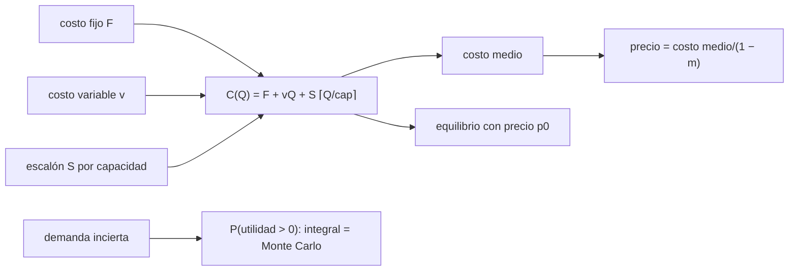

# B124-C22 — Modelo de costo de un servicio de datos

<!-- nav:top -->
[🏠 Programa](../../../../README.md) · [📚 Bloque B124](../../../tronco-comun/B124-industria-economia-etica-y-proyectos-espaciales.md) · [← Anterior: B124-C21 — Acuerdos de nivel de servicio para productos de datos](../B124-C21-acuerdos-de-nivel-de-servicio-para-productos-de-datos/CLASE.md) · [Siguiente: B124-C23 — Costos de transporte por kilogramo a superficie →](../B124-C23-costos-de-transporte-por-kilogramo-a-superficie/CLASE.md)
<!-- /nav -->

## 1. Ubicación, nivel y alcance

Clase 22 del bloque B124 (clase programada por la ampliación). Nivel N3–N4. Fijar el precio o el presupuesto de un servicio de datos exige un modelo de su costo: lo que se paga aunque no se venda nada, lo que cuesta cada producto entregado y los escalones de capacidad que se agregan al crecer. Aquí construyes ese modelo, calculas el costo medio, el punto de equilibrio y el precio con un margen, y la probabilidad de utilidad cuando la demanda es incierta. Sigues a [C21](../B124-C21-acuerdos-de-nivel-de-servicio-para-productos-de-datos/CLASE.md), que fija los compromisos de servicio. **Esta clase es educativa: no es asesoría financiera ni de precios.** Los costos son sintéticos.

## 2. Por qué esta clase existe

B124 trata financiamiento, pero un servicio sostenible depende de un modelo de costo que explique cómo cambia el costo medio con el volumen. La decisión central: **¿a qué precio y con qué volumen el servicio cubre sus costos, y cuánto riesgo tiene si la demanda varía?**

## 3. Lo que podrás hacer al terminar

1. Separar costos fijos, variables y escalonados.
2. Calcular el costo medio y el precio con un margen sobre precio.
3. Calcular el punto de equilibrio exacto y compararlo con una forma suave.
4. Calcular la probabilidad de utilidad con demanda incierta, por integración y por Monte Carlo.
5. Interpretar el efecto de los escalones de capacidad en el costo medio.
6. Rotular que todos los costos, volúmenes y márgenes son sintéticos.

La evidencia es el **modelo de costo y precio de un servicio de datos** del ejercicio 12 (sección 20).

## 4. Con qué llegas y cómo comprobarlo

1. ¿Qué es un costo fijo?
2. ¿Qué es un costo variable?
3. ¿Qué es un costo escalonado?
4. ¿Qué es un margen sobre precio?
5. ¿Qué es una función de masa de probabilidad?

<details>
<summary>Ver respuestas</summary>

1. Uno que no depende del volumen. 2. Uno que crece con cada unidad entregada. 3. Uno que sube de golpe al superar cierta capacidad. 4. La fracción del precio que queda como utilidad: `(p − c)/p`. 5. La probabilidad de cada valor posible de una variable discreta.
</details>

Con cuatro o cinco aciertos, sigue; si no, repasa los prerrequisitos.

## 5. Un caso de contexto y casos de referencia

No se consultó ninguna estructura de costos de un servicio real. El **ejemplo conductor** es un servicio **sintético** de datos: con 50 000 um de costos fijos al mes, 5 um por producto y un servidor de 4 000 um por cada 2 000 productos, el costo medio a 2 500 productos es `28,20` um y el precio con 25 % de margen sobre precio es `37,60` um; a un precio de 40 um el equilibrio está en `1543` productos al mes, y la probabilidad de utilidad con demanda Normal(2 500; 600) es `94,5%`.

## 6. Vocabulario

El **costo fijo** `F` se paga siempre; el **variable** `v`, por producto; el **escalonado** `S` se suma por cada tramo de capacidad `cap`. El **costo medio** es `C(Q)/Q`. El **margen sobre precio** `m` fija `p = costo medio/(1 − m)`. El **punto de equilibrio** es el menor volumen con utilidad no negativa. La **forma suave** reparte el escalón en el costo variable.

## 7. Modelo mental



*Descripción textual:* los costos fijo, variable y escalonado forman el costo total, del que salen el costo medio, el precio con margen y el equilibrio; la incertidumbre de la demanda se evalúa con dos métodos.

Analogía: una panadería con arriendo fijo, harina por pan y un horno extra por cada cierto volumen. Límite: el modelo supone que el volumen se vende al mismo precio, sin descuentos ni cambios de calidad.

## 8. La explicación, paso a paso

### 8.1 El costo y su estructura

`C(Q) = F + vQ + S⌈Q/cap⌉`. El costo medio es `59,00` um a 1 000 productos, `28,20` a 2 500 y `17,40` a 5 000: baja con el volumen porque se reparte el costo fijo. Al pasar de 2 000 a 2 001 productos el costo salta `4005` um (el servidor adicional más el variable). A 2 500 productos, el costo fijo es el `70,9%` del total.

### 8.2 Precio con margen

Con margen sobre precio de 25 %, `p = costo medio/0,75`: `78,67` um a 1 000, `37,60` a 2 500 y `23,20` a 5 000 productos. El precio «correcto» depende del volumen esperado: con volumen bajo el precio debe ser mayor o el margen menor. Fijar un precio con el volumen equivocado es el error más común.

### 8.3 Punto de equilibrio

Con precio fijo de 40 um, el menor volumen con utilidad no negativa es `1543` productos al mes (cálculo exacto con escalones). La forma suave `F/(p₀ − v − S/cap) = 1515,2` difiere en `27,8`, menos que un tramo de capacidad: sirve como aproximación, no reemplaza el cálculo exacto. A 2 500 productos la utilidad es `29500` um/mes (`29,5%` del ingreso).

### 8.4 Demanda incierta

Si la demanda es Normal(2 500; 600), la probabilidad de utilidad positiva es `0,9448` por integración de la función de masa y `0,9437` por Monte Carlo (diferencia `0,0011`). Un servicio con equilibrio en `1543` productos y demanda media de 2 500 no tiene la utilidad asegurada: hay una probabilidad de pérdida de `5,5%`.

## 9. Magnitudes, símbolos y unidades

| Símbolo | Qué es | Unidad | Valor / nota |
|---|---|---|---|
| `F` | costos fijos | um/mes | 50 000 (sintético) |
| `v` | costo variable por producto | um | 5 |
| `S`, `cap` | escalón y capacidad | um; productos/mes | 4 000; 2 000 |
| `m` | margen sobre precio | — | 0,25 |
| `p₀` | precio fijo del ejemplo | um | 40 |

## 10. Convenciones y referencias

Un mes, productos homogéneos, costos conocidos, demanda normal discretizada y truncada en cero, precio constante. Las um son unidades monetarias sintéticas sin relación con una moneda. Todos los parámetros son inventados.

## 11. De dónde sale lo que afirmamos

| ID | Fuente | Localizador | Respalda | Estado |
|---|---|---|---|---|
| — | Costos fijos, variables y escalonados; punto de equilibrio; precio con margen | — | verificados con una forma suave y con integración y Monte Carlo | No consultados en una fuente concreta |
| — | Estructuras de costo y precios de servicios de datos reales | — | no se usan | No consultados |
| — | `F`, `v`, `S`, `cap`, `m`, demanda | — | todas las cifras | Sintético |

Límites: no se consultó ningún precio ni costo de servicios de datos; los parámetros son inventados y no se modelan descuentos, impuestos ni competencia.

## 12. Cómo ver el resultado

| Magnitud | Valor |
|---|---|
| Costo medio a 2 500 | 28,20 um |
| Precio con margen a 2 500 | 37,60 um |
| Equilibrio con p0 = 40 | 1543 productos/mes |
| P(utilidad > 0) | 94,5% |
| Salto de costo en 2 000→2 001 | 4005 um |

Descripción larga: el costo medio baja con el volumen, el precio con margen depende del volumen esperado y el equilibrio no asegura utilidad si la demanda es incierta.

## 13. Ejemplo trabajado

**Paso 1 · Datos.** `F = 1 000`, `v = 2`, sin escalones, `Q = 500`.

**Paso 2 · Costo.** `1 000 + 2 · 500 = 2 000`; costo medio `4`.

**Paso 3 · Precio.** Con margen sobre precio de 20 %: `4/0,8 = 5`.

**Paso 4 · Equilibrio.** Con `p = 5`: `Q* = 1 000/(5 − 2) = 333,3`, es decir 334 productos.

## 14. Distintas formas de describirlo

**Por tabla:** costo, costo medio y precio por volumen. **Por fórmula:** `C(Q)`. **Por equilibrio:** menor `Q` con utilidad ≥ 0. **Por probabilidad:** `P(utilidad > 0)`. **Por forma suave:** costo variable efectivo `v + S/cap`.

## 15. Práctica guiada

**Ejercicio 1 · con los pasos indicados.** Calcula el costo medio con `F = 600`, `v = 3`, `Q = 200`. *Pasos:* `(600 + 600)/200`.

<details><summary>Solución comentada</summary>

`6`.
</details>

**Ejercicio 2 · con una pista.** Con margen sobre precio de 25 %, ¿qué precio da un costo medio de 6? *Pista:* `6/0,75`.

<details><summary>Solución comentada</summary>

`8`.
</details>

**Ejercicio 3 · casi autónomo.** ¿Cuál es el equilibrio con `F = 600`, `v = 3` y `p = 6`?

<details><summary>Solución comentada</summary>

`600/(6 − 3) = 200`.
</details>

## 16. Práctica autónoma, transferencia e integrador

**Ejercicio 4 · autónomo.** ¿Cuál es el costo total a 2 500 productos?

<details><summary>Solución comentada</summary>

`70500` um.
</details>

**Ejercicio 5 · autónomo.** ¿Y el precio con margen a ese volumen?

<details><summary>Solución comentada</summary>

`37,60` um.
</details>

**Ejercicio 6 · autónomo.** ¿Cuántos productos al mes hacen falta para equilibrar a 40 um?

<details><summary>Solución comentada</summary>

`1543`.
</details>

**Ejercicio 7 · autónomo.** ¿Cuál es la utilidad mensual con 2 500 productos a 40 um?

<details><summary>Solución comentada</summary>

`29500` um.
</details>

**Ejercicio 8 · autónomo.** ¿Con qué probabilidad hay utilidad?

<details><summary>Solución comentada</summary>

`0,9448`.
</details>

**Ejercicio 9 · transferencia.** **Transferencia.** El precio se fijó con el costo medio a 5 000 productos pero se venden 1 000. ¿Qué pasa?

<details><summary>Solución comentada</summary>

El precio queda por debajo del costo medio real: a 1 000 productos el costo medio es mayor y el servicio pierde dinero.
</details>

**Ejercicio 10 · transferencia.** **Transferencia.** Un cliente grande pide un descuento del 30 % por volumen. ¿Cómo evalúas?

<details><summary>Solución comentada</summary>

Recalcula el costo medio con su volumen y verifica que el precio con descuento supere `v + S/cap`; si no, cada producto adicional vendido pierde.
</details>

**Ejercicio 11 · transferencia.** **Transferencia.** El equilibrio exacto es 1 530 y la forma suave da 1 515. ¿Cuál usas para decidir?

<details><summary>Solución comentada</summary>

El exacto, porque los escalones importan; la forma suave sirve para orientar.
</details>

**Ejercicio 12 · integrador.** **Integrador.** Elabora tu *modelo de costo y precio de un servicio de datos*: estructura de costos, tabla de costo medio y precio por volumen, equilibrio exacto y suave, probabilidad de utilidad con sus dos métodos y lista de qué es sintético, con el aviso de que es educativa.

<details><summary>Solución comentada</summary>

Secciones 8.1–8.4 y la salida del laboratorio.
</details>

## 17. Laboratorio: costo y precio de un servicio de datos

El script [costo_de_servicio_de_datos.py](costo_de_servicio_de_datos.py) calcula el costo con escalones, el costo medio, el precio con margen, el punto de equilibrio exacto y suave y la probabilidad de utilidad por integración y por Monte Carlo (**comprueba** equilibrio dentro de un tramo y probabilidad a 0,005). Tarda menos de 10 s en un equipo común.

**Datos:** ningún dato consultado; costos, volúmenes y márgenes **sintéticos**. **Predice antes de ejecutar:** ¿bajará el costo medio al aumentar el volumen? (sí, con pequeños saltos en cada escalón.) **Ejecución del 2026-11-11:**

```text
Python 3.12.9 (biblioteca estandar)
Servicio de datos SINTETICO: F = 50000 um/mes, v = 5.0 um/producto, escalon S = 4000 um por cada 2000 productos, margen sobre precio = 25 %, p0 = 40.0 um
 Q (productos/mes)   costo total     costo medio   precio con margen
             500          56500        113.00        150.67
            1000          59000         59.00         78.67
            1999          63995         32.01         42.68
            2001          68005         33.99         45.31
            2500          70500         28.20         37.60
            5000          87000         17.40         23.20
Salto de costo al pasar de 2000 a 2001 productos = 4005 um
Equilibrio con p0 = 40.0: exacto = 1543 productos/mes ; forma suave F/(p0 - v - S/cap) = 1515.2 ; diferencia = 27.8
Q = 2500: costo medio = 28.20 ; utilidad con p0 = 29500 um/mes (29.5 % del ingreso) ; fraccion de costo fijo = 70.9 %
P(utilidad > 0) con demanda Normal(2500, 600): integral = 0.9448 ; Monte Carlo = 0.9437 ; diferencia = 0.0011
Pruebas superadas.
```

```bash
python programa/clases/B124/B124-C22-modelo-de-costo-de-un-servicio-de-datos/costo_de_servicio_de_datos.py
```

**Límites:** un periodo, costos conocidos, demanda normal truncada, precio único; sin competencia, impuestos ni descuentos.

## 18. Errores frecuentes y cómo corregirlos

**Fijar el precio con el volumen equivocado.** Se corrige con 8.2.

**Ignorar los escalones de capacidad.** Se corrige con 8.1 y 8.3.

**Creer que el equilibrio asegura utilidad.** Se corrige con 8.4.

**Confundir margen sobre precio con margen sobre costo.** Se corrige con 8.2: aquí `p = costo/(1 − m)`.

## 19. Cómo sabrás que vas bien

Tras la sección 8: ¿qué equilibrio esperabas y cuál obtuviste? Si dudas, repasa el ejemplo 13. Tras el laboratorio: ¿qué comprueba? (ver la sección 17).

## 20. Qué entregas y cómo se evalúa

El producto es tu **modelo de costo y precio de un servicio de datos** (ejercicio 12).

| Criterio | Inicial | En desarrollo | Logrado | Destacado |
|---|---|---|---|---|
| Conceptos | Los confunde | Parciales | Calcula costo medio y equilibrio | Explica los límites |
| Cálculo | Sin unidades | Con errores | Tablas completas con unidades | Calcula casos nuevos |
| Numérico | Sin comprobar | Un caso | Contraste con una segunda vía | Interpreta las diferencias |
| Fuentes | Sin fuente | Sin fecha | Fuentes con fecha y estado | Declara lo ilustrativo y lo no consultado |
| Límites | No los nombra | Uno | Tres | Discute qué falta del modelo |

**Condiciones críticas (no se compensan con promedio):** rotular los datos como sintéticos o ilustrativos; no presentar el resultado como asesoría financiera, legal ni de inversión; citar solo lo consultado.

## 21. Ética, seguridad y límites

Clase educativa: **no es asesoría financiera, legal, tributaria ni de inversión** y no sustituye a un profesional habilitado ni a la normativa vigente; ningún resultado debe usarse para decidir una compra, un contrato, una inversión o un seguro reales. Un precio que no cubre el costo compromete la continuidad del servicio y a quienes dependen de él; los costos deben declararse completos. Los modelos son simplificados y sus datos son sintéticos o ilustrativos. Accesibilidad: tablas equivalentes a las gráficas, fórmulas en texto, ejercicios sin conexión.

## 22. Para cerrar y seguir

El servicio sintético cuesta `70500` um al mes a 2 500 productos (`28,20` um cada uno), exige `37,60` um por producto para un 25 % de margen y se equilibra en `1543` productos a 40 um, con `94,5%` de probabilidad de utilidad.

**Glosario español–inglés.** costo fijo · *fixed cost*; costo variable · *variable cost*; costo escalonado · *step cost*; punto de equilibrio · *break-even*; margen · *margin*.

**Continuidad.** [B124-C23](../B124-C23-costos-de-transporte-por-kilogramo-a-superficie/CLASE.md) estudia un costo que alimenta a muchos de estos modelos: el transporte por kilogramo a órbita y a superficie.

**Referencias:** ver sección 11.

<!-- nav:bottom -->
---

[← Anterior: B124-C21 — Acuerdos de nivel de servicio para productos de datos](../B124-C21-acuerdos-de-nivel-de-servicio-para-productos-de-datos/CLASE.md) · [📚 Bloque B124](../../../tronco-comun/B124-industria-economia-etica-y-proyectos-espaciales.md) · [Siguiente: B124-C23 — Costos de transporte por kilogramo a superficie →](../B124-C23-costos-de-transporte-por-kilogramo-a-superficie/CLASE.md)
<!-- /nav -->
