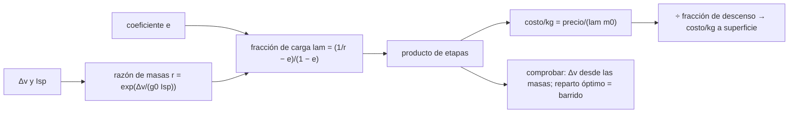

# B124-C23 — Costos de transporte por kilogramo a superficie

<!-- nav:top -->
[🏠 Programa](../../../../README.md) · [📚 Bloque B124](../../../tronco-comun/B124-industria-economia-etica-y-proyectos-espaciales.md) · [← Anterior: B124-C22 — Modelo de costo de un servicio de datos](../B124-C22-modelo-de-costo-de-un-servicio-de-datos/CLASE.md) · [Siguiente: B124-C24 — CapEx y OpEx de una instalación extraterrestre →](../B124-C24-capex-y-opex-de-una-instalacion-extraterrestre/CLASE.md)
<!-- /nav -->

## 1. Ubicación, nivel y alcance

Clase 23 del bloque B124 (clase programada por la ampliación). Nivel N3–N4. [C05](../B124-C05-estimacion-de-costos-de-mision/CLASE.md) estima el costo de una misión; aquí te detienes en un costo que atraviesa casi todos los modelos del bloque: el costo de llevar un kilogramo a órbita y a una superficie. Lo derivas con la ecuación del cohete, que da la fracción de carga útil, y con el precio de un lanzamiento, y mides su sensibilidad a la eficiencia, a la estructura y a la velocidad requerida. **Esta clase es educativa: no es una cotización ni asesoría financiera.** Los valores son ilustrativos.

## 2. Por qué esta clase existe

El costo por kilogramo a superficie no se puede leer en una lista de precios: depende de una cadena de fracciones de masa que se multiplican. La decisión central: **¿cuánto cuesta llevar un kilogramo a la superficie, de qué depende ese costo y qué lo hace más sensible?**

## 3. Lo que podrás hacer al terminar

1. Aplicar la ecuación del cohete para obtener la razón de masas de una etapa.
2. Calcular la fracción de carga útil con un coeficiente estructural.
3. Repartir la velocidad entre etapas de modo óptimo y comprobarlo con un barrido.
4. Calcular el costo por kilogramo a órbita baja y a superficie.
5. Medir la sensibilidad del costo a `Isp`, a la masa estructural y a `Δv`.
6. Rotular que todos los números son ilustrativos y que no se consultó ningún precio real.

La evidencia es la **tabla de costo por kilogramo con sensibilidad** del ejercicio 12 (sección 20).

## 4. Con qué llegas y cómo comprobarlo

1. ¿Qué es el impulso específico?
2. ¿Qué es el `Δv`?
3. ¿Qué es la razón de masas?
4. ¿Qué es una fracción estructural?
5. ¿Qué es un logaritmo natural?

<details>
<summary>Ver respuestas</summary>

1. Una medida de la eficiencia de un motor: el empuje por unidad de peso de propelente consumido por segundo. 2. El cambio de velocidad que una maniobra o un trayecto exige. 3. El cociente entre la masa inicial y la final de una etapa. 4. La parte de la masa de una etapa (sin carga) que es estructura y no propelente. 5. El logaritmo con base `e`.
</details>

Con cuatro o cinco aciertos, sigue; si no, repasa los prerrequisitos.

## 5. Un caso de contexto y casos de referencia

No se consultó ningún vehículo ni precio de lanzamiento real; la masa del lanzador, su precio, los impulsos específicos y los coeficientes estructurales son **ilustrativos**, y la constante `g₀ = 9,80665 m/s²` se usa como valor convencional sin haberse consultado en esta clase. El **ejemplo conductor** es un lanzador **ilustrativo** de dos etapas de 550 t y 60 Mum que lleva `13346` kg a órbita baja, a `4496` um/kg; llevar un kilogramo a una superficie con un descenso de 6 000 m/s cuesta `87176` um/kg, `19,4` veces más.

## 6. Vocabulario

La **ecuación del cohete** es `Δv = g₀ Isp ln(m₀/m_f)`. La **razón de masas** `r = m₀/m_f`. El **coeficiente estructural** `e` es la masa de estructura sobre estructura más propelente. La **fracción de carga útil** de una etapa es `(1/r − e)/(1 − e)`. El **reparto óptimo** distribuye `Δv` entre etapas para maximizar la carga. El **costo por kilogramo** es el precio dividido por la carga útil. La **reutilización** reduce el precio efectivo.

## 7. Modelo mental



*Descripción textual:* el Δv y la eficiencia dan la razón de masas de cada etapa y, con el coeficiente estructural, la fracción de carga; el producto de fracciones y el precio dan el costo por kilogramo a órbita, que se divide por la fracción de descenso para llegar a superficie.

Analogía: cada etapa es un viaje en que el combustible que llevas pesa y obliga a llevar más combustible; solo una pequeña fracción llega útil. Límite: aquí cada etapa se trata con coeficientes constantes y sin pérdidas gravitacionales ni aerodinámicas separadas.

## 8. La explicación, paso a paso

### 8.1 La ecuación del cohete y la carga útil

Para una etapa, `r = exp(Δv/(g₀ Isp))` y `λ = (1/r − e)/(1 − e)`. Con `Δv = 9 400 m/s` repartido por igual entre dos etapas (`Isp` 300 y 340 s; `e` 0,07 y 0,09) la fracción de carga útil es `0,02413`: de cada 100 kg en la plataforma, menos de `2,4` llegan como carga.

### 8.2 Reparto óptimo

Maximizando sobre la fracción del `Δv` asignada a la primera etapa, la búsqueda ternaria da `0,4730` y el barrido de 0,001 da `0,473` (diferencia `0,0000`). La fracción óptima es `0,02427`, `0,57%` más que el reparto igual. Recalculado hacia adelante desde las masas, el `Δv` coincide con el de diseño dentro de `0,0e+00` m/s.

### 8.3 Costo por kilogramo a órbita

Con 550 000 kg de masa inicial, la carga útil es `13346` kg; a 60 Mum el costo es `4496` um/kg, y si la reutilización ahorra el 30 % del precio, `3147` um/kg. El costo por kilogramo es el precio dividido por una fracción pequeña: cualquier mejora de la fracción mejora el costo en la misma proporción.

### 8.4 Del orbital a la superficie

El descenso desde órbita baja (`Δv = 6 000 m/s`, `Isp` 340 s, `e = 0,12`) deja una fracción de `0,05157`, así que cada kilogramo en superficie exige `1/0,05157` kg en órbita: el costo sube a `87176` um/kg (`19,4` veces); con reutilización, `61024`. Sensibilidades: `Isp` +10 s en todas las etapas cambia el costo `-27,1` %; `e` +0,01, `+43,4` %; `Δv` +300 m/s a órbita baja, `+16,3` %. La estructura y el `Δv` pesan más de lo que parece.

## 9. Magnitudes, símbolos y unidades

| Símbolo | Qué es | Unidad | Valor / nota |
|---|---|---|---|
| `g₀` | aceleración estándar | m/s² | 9,80665 (convencional, no consultada aquí) |
| `Isp` | impulso específico | s | 300; 340 (ilustrativos) |
| `e` | coeficiente estructural | — | 0,07; 0,09; 0,12 (ilustrativos) |
| `λ` | fracción de carga útil | — | 0,02427 (órbita) |
| costo/kg | precio sobre carga útil | um/kg | 4496 (órbita); 87176 (superficie) |

## 10. Convenciones y referencias

Δv total incluye pérdidas y es ilustrativo; dos etapas con parámetros constantes; el descenso es una etapa única; el precio es de un lanzamiento completo; la reutilización es un porcentaje de ahorro del precio. um por kg son unidades sintéticas. Ningún parámetro corresponde a un vehículo real.

## 11. De dónde sale lo que afirmamos

| ID | Fuente | Localizador | Respalda | Estado |
|---|---|---|---|---|
| — | Ecuación del cohete de Tsiolkovsky y fracciones de carga útil | — | verificadas hacia adelante desde las masas y con un barrido | No consultadas en una fuente concreta |
| — | Precios y capacidades de lanzadores reales | — | no se usan | No consultados |
| — | `Δv`, `Isp`, `e`, masa y precio del lanzador, ahorro por reutilización | — | todas las cifras | Ilustrativo |

Límites: no se consultó ningún precio, masa ni capacidad de lanzadores reales ni el valor de `g₀`; los resultados describen un lanzador inventado.

## 12. Cómo ver el resultado

| Magnitud | Valor |
|---|---|
| Fracción de carga a órbita (óptima) | 0,02427 |
| Carga a órbita baja | 13346 kg |
| Costo por kg a órbita | 4496 um |
| Costo por kg a superficie | 87176 um |
| Sensibilidad a Δv +300 m/s | +16,3 % |

Descripción larga: solo una pequeña fracción de la masa llega como carga a órbita y el descenso a superficie multiplica el costo varias veces.

## 13. Ejemplo trabajado

**Paso 1 · Etapa.** `Δv = 3 000 m/s`, `Isp = 300 s`, `e = 0,1`: `Δv/(g₀ Isp) = 1,0196`, `r = 2,772`.

**Paso 2 · Fracción.** `λ = (1/2,772 − 0,1)/0,9 = 0,2896`.

**Paso 3 · Carga.** Con `m₀ = 100 000 kg`: `28 960 kg`.

**Paso 4 · Costo.** A 20 Mum: `20 · 10⁶ / 28 960 = 691` um/kg.

## 14. Distintas formas de describirlo

**Por velocidad:** `Δv`. **Por masas:** `r`. **Por fracción:** `λ`. **Por costo:** precio/carga. **Por cadena:** costo a superficie = costo a órbita / fracción de descenso.

## 15. Práctica guiada

**Ejercicio 1 · con los pasos indicados.** Calcula `r` con `Δv/(g₀ Isp) = 1`. *Pasos:* `e¹`.

<details><summary>Solución comentada</summary>

`2,718`.
</details>

**Ejercicio 2 · con una pista.** Calcula `λ` con `r = 3` y `e = 0,1`. *Pista:* `(1/r − e)/(1 − e)`.

<details><summary>Solución comentada</summary>

`(0,3333 − 0,1)/0,9 = 0,2593`.
</details>

**Ejercicio 3 · casi autónomo.** Si una carga de 5 000 kg cuesta 25 Mum, ¿cuánto cuesta el kilogramo?

<details><summary>Solución comentada</summary>

`25 · 10⁶/5 000 = 5 000` um/kg.
</details>

## 16. Práctica autónoma, transferencia e integrador

**Ejercicio 4 · autónomo.** ¿Cuál es la fracción de carga óptima a órbita baja?

<details><summary>Solución comentada</summary>

`0,02427`.
</details>

**Ejercicio 5 · autónomo.** ¿Cuál es el costo por kg a órbita?

<details><summary>Solución comentada</summary>

`4496` um.
</details>

**Ejercicio 6 · autónomo.** ¿Y a superficie?

<details><summary>Solución comentada</summary>

`87176` um.
</details>

**Ejercicio 7 · autónomo.** ¿Cuánto baja el costo por kg a órbita con 30 % de ahorro?

<details><summary>Solución comentada</summary>

A `3147` um.
</details>

**Ejercicio 8 · autónomo.** ¿Cuánto sube el costo a superficie si el `Δv` a órbita sube 300 m/s?

<details><summary>Solución comentada</summary>

`+16,3` %.
</details>

**Ejercicio 9 · transferencia.** **Transferencia.** Un proveedor promete bajar el costo a superficie a la mitad solo reutilizando. ¿Basta?

<details><summary>Solución comentada</summary>

La reutilización del lanzador ahorra el 30 % del precio en este modelo; para la mitad habría que mejorar también la fracción del descenso o la estructura.
</details>

**Ejercicio 10 · transferencia.** **Transferencia.** ¿Por qué una mejora de 10 s en Isp tiene tanto efecto?

<details><summary>Solución comentada</summary>

Porque `Isp` está en el exponente de la razón de masas; un pequeño aumento reduce la razón y, con ello, la masa de propelente necesaria.
</details>

**Ejercicio 11 · transferencia.** **Transferencia.** Una agencia anuncia «el costo por kilogramo a la Luna es X». ¿Qué preguntas?

<details><summary>Solución comentada</summary>

Qué incluye (descenso, estructura, reutilización), el año, la moneda, el vehículo y la fuente; sin eso la cifra no es comparable.
</details>

**Ejercicio 12 · integrador.** **Integrador.** Elabora tu *tabla de costo por kilogramo con sensibilidad*: fracciones de carga, reparto de `Δv`, costo a órbita y a superficie con y sin reutilización, sensibilidades a `Isp`, `e` y `Δv` y lista de qué es ilustrativo, con el aviso de que no es una cotización.

<details><summary>Solución comentada</summary>

Secciones 8.1–8.4 y la salida del laboratorio.
</details>

## 17. Laboratorio: costo por kilogramo

El script [costo_por_kilogramo.py](costo_por_kilogramo.py) calcula la fracción de carga útil con la ecuación del cohete, reparte el `Δv` de modo óptimo (ternario frente a barrido), recalcula el `Δv` desde las masas y obtiene el costo por kilogramo a órbita y a superficie con tres sensibilidades (**comprueba** `Δv` a 1e-6 m/s y el reparto a 0,002). Tarda menos de 10 s en un equipo común.

**Datos:** ningún dato consultado; todos los parámetros del lanzador, del descenso y del precio son **ilustrativos**. **Predice antes de ejecutar:** ¿Cuánto más cuesta un kilogramo en superficie que en órbita baja? (unas `19` veces.) **Ejecución del 2026-11-11:**

```text
Python 3.12.9 (biblioteca estandar)
Parametros ILUSTRATIVOS: dv a orbita baja = 9400 m/s ; etapas Isp 300/340 s, e = 0.07/0.09 ; lanzador de 550000 kg a 60.0 Mum
Fraccion de carga util con reparto igual de dv: 0.02413
Reparto optimo de dv a la etapa 1: ternario = 0.4730 ; barrido = 0.473 ; diferencia = 0.0000 ; fraccion optima = 0.02427 (+0.57 %)
  fracciones por etapa: 0.16195 y 0.14983 ; dv recalculado desde masas - dv de diseno (error) = 0.00e+00 m/s
Carga util a orbita baja = 13346 kg ; costo = 4496 um/kg ; con reutilizacion (-30 % del precio) = 3147 um/kg
Superficie (descenso dv = 6000 m/s, Isp 340 s, e = 0.12): fraccion = 0.05157 ; costo = 87176 um/kg (19.4 veces el de orbita) ; con reutilizacion = 61024
Sensibilidades del costo a superficie: Isp +10 s en todas las etapas -> -27.1 % ; e +0.01 -> +43.4 % ; dv +300 m/s a orbita baja -> +16.3 %
Pruebas superadas.
```

```bash
python programa/clases/B124/B124-C23-costos-de-transporte-por-kilogramo-a-superficie/costo_por_kilogramo.py
```

**Límites:** dos etapas de coeficientes constantes, sin pérdidas separadas ni márgenes, sin costo de la carga ni de la operación; la reutilización se toma como un porcentaje del precio.

## 18. Errores frecuentes y cómo corregirlos

**Tomar un costo por kilogramo como un dato universal.** Se corrige con la sección 10 y el ejercicio 11.

**Ignorar que la fracción de carga se multiplica por etapa.** Se corrige con 8.1.

**Olvidar que el costo a superficie incluye el descenso.** Se corrige con 8.4.

**Creer que la reutilización resuelve todo el costo.** Se corrige con el ejercicio 9.

## 19. Cómo sabrás que vas bien

Tras la sección 8: ¿qué costo esperabas a superficie y cuál obtuviste? Si dudas, repasa el ejemplo 13. Tras el laboratorio: ¿qué comprueba? (ver la sección 17).

## 20. Qué entregas y cómo se evalúa

El producto es tu **tabla de costo por kilogramo con sensibilidad** (ejercicio 12).

| Criterio | Inicial | En desarrollo | Logrado | Destacado |
|---|---|---|---|---|
| Conceptos | Los confunde | Parciales | Calcula fracción y costo por kg | Explica los límites |
| Cálculo | Sin unidades | Con errores | Tablas completas con unidades | Calcula casos nuevos |
| Numérico | Sin comprobar | Un caso | Contraste con una segunda vía | Interpreta las diferencias |
| Fuentes | Sin fuente | Sin fecha | Fuentes con fecha y estado | Declara lo ilustrativo y lo no consultado |
| Límites | No los nombra | Uno | Tres | Discute qué falta del modelo |

**Condiciones críticas (no se compensan con promedio):** rotular los datos como sintéticos o ilustrativos; no presentar el resultado como asesoría financiera, legal ni de inversión; citar solo lo consultado.

## 21. Ética, seguridad y límites

Clase educativa: **no es asesoría financiera, legal, tributaria ni de inversión** y no sustituye a un profesional habilitado ni a la normativa vigente; ningún resultado debe usarse para decidir una compra, un contrato, una inversión o un seguro reales. Cifras de costo de lanzamiento mal comparadas pueden orientar mal decisiones públicas; hay que declarar vehículo, año, moneda y alcance. Los modelos son simplificados y sus datos son sintéticos o ilustrativos. Accesibilidad: tablas equivalentes a las gráficas, fórmulas en texto, ejercicios sin conexión.

## 22. Para cerrar y seguir

El lanzador ilustrativo lleva el `2,4%` de su masa a órbita baja (`4496` um/kg) y el descenso a superficie multiplica el costo por `19,4` (`87176` um/kg); subir el `Δv` en 300 m/s lo encarece `16,3` %.

**Glosario español–inglés.** ecuación del cohete · *rocket equation*; impulso específico · *specific impulse*; fracción de carga útil · *payload fraction*; coeficiente estructural · *structural coefficient*; reutilización · *reuse*.

**Continuidad.** [B124-C24](../B124-C24-capex-y-opex-de-una-instalacion-extraterrestre/CLASE.md) usa este costo por kilogramo para valorar el capital y la operación de una instalación en superficie.

**Referencias:** ver sección 11.

<!-- nav:bottom -->
---

[← Anterior: B124-C22 — Modelo de costo de un servicio de datos](../B124-C22-modelo-de-costo-de-un-servicio-de-datos/CLASE.md) · [📚 Bloque B124](../../../tronco-comun/B124-industria-economia-etica-y-proyectos-espaciales.md) · [Siguiente: B124-C24 — CapEx y OpEx de una instalación extraterrestre →](../B124-C24-capex-y-opex-de-una-instalacion-extraterrestre/CLASE.md)
<!-- /nav -->
