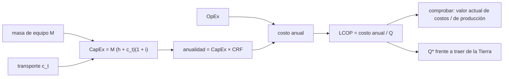

# B124-C24 — CapEx y OpEx de una instalación extraterrestre

<!-- nav:top -->
[🏠 Programa](../../../../README.md) · [📚 Bloque B124](../../../tronco-comun/B124-industria-economia-etica-y-proyectos-espaciales.md) · [← Anterior: B124-C23 — Costos de transporte por kilogramo a superficie](../B124-C23-costos-de-transporte-por-kilogramo-a-superficie/CLASE.md) · [Siguiente: B125-C01 — Mercado de datos espaciales →](../../../tronco-comun/B125-creacion-y-operacion-de-empresas-espaciales.md#b125-c01)
<!-- /nav -->

## 1. Ubicación, nivel y alcance

Clase 24 del bloque B124 (clase programada por la ampliación `0.2.0`) y última del bloque. Nivel N4. Una planta en la superficie de otro cuerpo se paga con capital (lo que cuesta fabricarla, transportarla e instalarla) y con operación (repuestos, transporte de repuestos y personal remoto). Aquí valoras ambas partes con el factor de recuperación de capital, calculas el costo nivelado de lo que produce y lo comparas con traerlo de la Tierra, usando el costo de transporte por kilogramo de [C23](../B124-C23-costos-de-transporte-por-kilogramo-a-superficie/CLASE.md). **Esta clase es educativa: no es asesoría financiera ni de inversión.** La instalación es sintética.

## 2. Por qué esta clase existe

B124 estima costos de misión, pero una instalación que opera años necesita separar el capital de la operación y ponerlos en una misma unidad. La decisión central: **¿a qué costo por kilogramo produce la instalación y desde qué producción conviene frente a traer el producto?**

## 3. Lo que podrás hacer al terminar

1. Separar CapEx y OpEx de una instalación extraterrestre.
2. Calcular el factor de recuperación de capital y la anualidad del CapEx.
3. Calcular el costo nivelado del producto por dos vías (CRF y valor actual).
4. Calcular la producción de equilibrio frente a traer el producto de la Tierra.
5. Medir la sensibilidad al costo de transporte, la producción, la tasa y la vida.
6. Rotular que todos los valores son sintéticos o ilustrativos.

La evidencia es el **costo nivelado de una instalación sintética** del ejercicio 12 (sección 20).

## 4. Con qué llegas y cómo comprobarlo

1. ¿Qué es el CapEx?
2. ¿Qué es el OpEx?
3. ¿Qué es una anualidad?
4. ¿Qué es el valor actual?
5. ¿Qué es un costo nivelado?

<details>
<summary>Ver respuestas</summary>

1. El gasto de capital: lo que cuesta construir y poner en marcha. 2. El gasto operativo anual. 3. Un pago constante anual equivalente a un monto inicial, dada una tasa y un plazo. 4. Lo que hoy vale un pago futuro descontado a una tasa. 5. El costo por unidad producida, con capital y operación expresados en la misma base anual.
</details>

Con cuatro o cinco aciertos, sigue; si no, repasa los prerrequisitos.

## 5. Un caso de contexto y casos de referencia

No se consultó ninguna instalación real ni su costo. El **ejemplo conductor** es una planta **sintética** de 10 000 kg de equipo que produce 50 000 kg al año durante 15 años a una tasa de 8 %: su CapEx es `998,8` Mum, de las cuales el `99,1` % es transporte; su OpEx, `39,24` Mum al año; el costo nivelado resulta `3119` um/kg frente a 90 000 um/kg de traer el producto de la Tierra (ilustrativo, del orden de la clase C23), y la producción de equilibrio es `1733` kg/año.

## 6. Vocabulario

El **CapEx** es el costo inicial; el **OpEx**, el anual. El **factor de recuperación de capital** `CRF = r(1+r)ⁿ/((1+r)ⁿ − 1)` convierte un monto inicial en pago anual. El **costo nivelado (LCOP)** es `(CapEx·CRF + OpEx)/Q`. El **valor actual** descuenta los flujos. La **producción de equilibrio** `Q*` iguala el costo de producir con el de traer el producto.

## 7. Modelo mental



*Descripción textual:* el equipo y su transporte forman el CapEx, que se convierte en anualidad y se suma al OpEx para dar el costo anual y el costo nivelado, que se verifica con valor actual y se compara con traer el producto.

Analogía: pagar una hipoteca más los gastos de una casa y dividir por los meses vividos en ella. Límite: la instalación puede fallar antes, producir menos o no poder repararse a distancia, y el modelo supone producción constante.

## 8. La explicación, paso a paso

### 8.1 CapEx y OpEx

`CapEx = M (h + c_t)(1 + i) = 998,800` Mum con `M = 10 000 kg`, `h = 800 um/kg`, `c_t = 90 000 um/kg` y 10 % de instalación: el transporte es el `99,1` % del CapEx. El OpEx es `39,240` Mum al año: repuestos (3 % del costo de fabricación), 300 kg de repuestos transportados (`68,8` % del OpEx) y 12 Mum de operación remota.

### 8.2 Anualidad

Con `r = 8 %` y `n = 15`, `CRF = 0,11683`: el CapEx equivale a `116,689` Mum al año, y el costo anual total a `155,929` Mum.

### 8.3 Costo nivelado

Con 50 000 kg al año, `LCOP = 3118,5870` um/kg por CRF y `3118,5870` por valor actual de costos sobre valor actual de la producción (diferencia `1,8e-12`): son la misma cantidad calculada de dos maneras. Traer el kilogramo de la Tierra cuesta 90 000 um; la instalación lo produce al `3,47` % de ese costo, un ahorro de `86881` um/kg.

### 8.4 Equilibrio y sensibilidad

La producción que iguala el costo es `Q* = 1733` kg/año (comprobada por sustitución). Sensibilidad (um/kg): transporte −50 %: `1692`; +50 %: `4545`; producción dividida por 4: `12474`; tasa 12 %: `3718`; vida 10 años: `3762` y 20 años: `2819`. La producción y el transporte pesan más que la tasa o la vida. El valor actual de la instalación a 15 años es `1334,7` Mum y el de traer todo de la Tierra, `38517,7` Mum.

## 9. Magnitudes, símbolos y unidades

| Símbolo | Qué es | Unidad | Valor / nota |
|---|---|---|---|
| `M` | masa de equipo | kg | 10 000 |
| `h`, `c_t` | fabricar y transportar un kg | um/kg | 800; 90 000 (ilustrativos) |
| `i` | recargo de instalación | — | 0,10 |
| `r`, `n` | tasa y vida útil | —; años | 0,08; 15 |
| `Q` | producción anual | kg/año | 50 000 |
| LCOP | costo nivelado del producto | um/kg | 3119 |

## 10. Convenciones y referencias

Capital en el año 0, operación y producción constantes en los años 1 a 15, sin valor residual, sin impuestos ni inflación, sin fallas ni paradas. Los costos son ilustrativos y el costo de transporte es del orden del de la clase C23 pero no está calculado con ella. Todo es sintético.

## 11. De dónde sale lo que afirmamos

| ID | Fuente | Localizador | Respalda | Estado |
|---|---|---|---|---|
| — | Factor de recuperación de capital, costo nivelado, valor actual | — | verificados entre sí y por sustitución | No consultados en una fuente concreta |
| — | Costos de instalaciones o plantas extraterrestres reales | — | no se usan | No consultados |
| — | `M`, `h`, `c_t`, `i`, repuestos, operación, `r`, `n`, `Q` | — | todas las cifras | Sintético / ilustrativo |

Límites: no se consultó ningún costo real de instalaciones, de transporte ni de producción; la instalación es inventada y no representa ningún proyecto.

## 12. Cómo ver el resultado

| Magnitud | Valor |
|---|---|
| CapEx | 998,80 Mum |
| OpEx | 39,24 Mum/año |
| Costo nivelado | 3119 um/kg |
| Traer de la Tierra | 90 000 um/kg |
| Producción de equilibrio | 1733 kg/año |

Descripción larga: el transporte domina el capital y la operación, y el costo nivelado es una pequeña fracción del de traer el producto, siempre que la producción llegue a lo planificado.

## 13. Ejemplo trabajado

**Paso 1 · Datos.** CapEx 100 Mum, OpEx 5 Mum/año, `r = 10 %`, `n = 10`, `Q = 1 000 000` kg.

**Paso 2 · CRF.** `0,1 · 1,1¹⁰/(1,1¹⁰ − 1) = 0,16275`.

**Paso 3 · Costo anual.** `100 · 0,16275 + 5 = 21,275` Mum.

**Paso 4 · Nivelado.** `21,275 × 10⁶ / 10⁶ = 21,3` um/kg.

## 14. Distintas formas de describirlo

**Por capital:** CapEx. **Por operación:** OpEx. **Por anualidad:** CapEx × CRF. **Por unidad:** LCOP. **Por equilibrio:** `Q*`. **Por valor actual:** costos sobre producción descontada.

## 15. Práctica guiada

**Ejercicio 1 · con los pasos indicados.** Calcula la anualidad de 120 Mum con CRF 0,12. *Pasos:* producto.

<details><summary>Solución comentada</summary>

`14,4` Mum.
</details>

**Ejercicio 2 · con una pista.** Calcula el costo nivelado con costo anual 30 Mum y 100 000 kg. *Pista:* `30 × 10⁶/10⁵`.

<details><summary>Solución comentada</summary>

`300` um/kg.
</details>

**Ejercicio 3 · casi autónomo.** ¿Cuál es el CRF para `r = 0,1`, `n = 1`?

<details><summary>Solución comentada</summary>

`0,1 · 1,1/(1,1 − 1) = 1,1`.
</details>

## 16. Práctica autónoma, transferencia e integrador

**Ejercicio 4 · autónomo.** ¿Cuánto es el CapEx del ejemplo conductor?

<details><summary>Solución comentada</summary>

`998,800` Mum.
</details>

**Ejercicio 5 · autónomo.** ¿Y el costo anual total?

<details><summary>Solución comentada</summary>

`155,929` Mum.
</details>

**Ejercicio 6 · autónomo.** ¿Cuál es el costo nivelado?

<details><summary>Solución comentada</summary>

`3118,5870` um/kg.
</details>

**Ejercicio 7 · autónomo.** ¿Cuál es la producción de equilibrio?

<details><summary>Solución comentada</summary>

`1733` kg/año.
</details>

**Ejercicio 8 · autónomo.** ¿Cuánto cuesta producir si la producción baja a la cuarta parte?

<details><summary>Solución comentada</summary>

`12474` um/kg.
</details>

**Ejercicio 9 · transferencia.** **Transferencia.** La producción real es la mitad de la prevista. ¿Sigue conviniendo?

<details><summary>Solución comentada</summary>

Sí si sigue sobre `Q*` (`1733` kg/año): la mitad de 50 000 son 25 000 kg, muy por encima; pero el costo nivelado sube casi al doble.
</details>

**Ejercicio 10 · transferencia.** **Transferencia.** El costo de transporte sube 50 %. ¿Cuál es el efecto y qué parte del costo lo explica?

<details><summary>Solución comentada</summary>

El costo nivelado pasa a `4545` um/kg; el transporte es la mayor parte del CapEx, por eso es el factor dominante.
</details>

**Ejercicio 11 · transferencia.** **Transferencia.** Un informe afirma que producir en el lugar es «siempre más barato». ¿Qué condiciones faltan?

<details><summary>Solución comentada</summary>

Producción mínima (`Q*`), costo de transporte, tasa y vida, y las fallas y paradas; el resultado depende de ellas y puede invertirse.
</details>

**Ejercicio 12 · integrador.** **Integrador.** Elabora tu *costo nivelado de una instalación sintética*: CapEx y OpEx, anualidad, costo nivelado con sus dos vías de cálculo, producción de equilibrio, sensibilidades y lista de qué es sintético o ilustrativo, con el aviso de que no es asesoría de inversión.

<details><summary>Solución comentada</summary>

Secciones 8.1–8.4 y la salida del laboratorio.
</details>

## 17. Laboratorio: CapEx, OpEx y costo nivelado

El script [capex_opex_instalacion.py](capex_opex_instalacion.py) calcula CapEx, OpEx, el factor de recuperación de capital, el costo nivelado por CRF y por valor actual, la producción de equilibrio y cinco sensibilidades (**comprueba** igualdad de ambas vías a 1e-9 y el equilibrio por sustitución). Tarda menos de 10 s en un equipo común.

**Datos:** ningún dato consultado; masa, costos, repuestos, operación, tasa, vida y producción **sintéticos o ilustrativos**. **Predice antes de ejecutar:** ¿qué parte del CapEx es transporte? (más del 99 %.) **Ejecución del 2026-11-11:**

```text
Python 3.12.9 (biblioteca estandar)
Instalacion ILUSTRATIVA: equipo 10000 kg ; fabricar 800 um/kg ; transporte a superficie 90000 um/kg ; recargo de instalacion 10 % ; vida 15 anios ; tasa 8 % ; produccion 50000 kg/anio
CapEx = 998.800 Mum (transporte = 99.1 % del CapEx) ; OpEx = 39.240 Mum/anio (transporte de repuestos = 68.8 %)
CRF = 0.11683 ; anualidad del CapEx = 116.689 Mum/anio ; costo anual total = 155.929 Mum/anio
Costo nivelado del producto: por CRF = 3118.5870 um/kg ; por valor actual = 3118.5870 um/kg ; diferencia = 1.8e-12
Traerlo de la Tierra cuesta 90000 um/kg: ahorro = 86881 um/kg ; razon = 3.47 % ; produccion de equilibrio = 1733 kg/anio (control por sustitucion 0.0e+00)
Sensibilidad del costo nivelado: transporte -50 % -> 1692 ; +50 % -> 4545 ; produccion /4 -> 12474 ; tasa 12 % -> 3718 ; vida 10 anios -> 3762 ; 20 anios -> 2819 (um/kg)
Valor actual (15 anios): instalacion = 1334.7 Mum ; traer todo de la Tierra = 38517.7 Mum
Pruebas superadas.
```

```bash
python programa/clases/B124/B124-C24-capex-y-opex-de-una-instalacion-extraterrestre/capex_opex_instalacion.py
```

**Límites:** producción constante sin fallas, sin valor residual ni impuestos; el transporte se fija en 90 000 um/kg por conveniencia; la instalación no existe.

## 18. Errores frecuentes y cómo corregirlos

**Comparar CapEx con OpEx sin pasarlos a la misma base anual.** Se corrige con 8.2.

**Ignorar que el transporte domina el capital.** Se corrige con 8.1 y 8.4.

**Suponer producción plena desde el primer año.** Se corrige con el ejercicio 9.

**Tomar el ahorro sintético como una promesa.** Se corrige con la sección 10.

## 19. Cómo sabrás que vas bien

Tras la sección 8: ¿qué costo nivelado esperabas y cuál obtuviste? Si dudas, repasa el ejemplo 13. Tras el laboratorio: ¿qué comprueba? (ver la sección 17).

## 20. Qué entregas y cómo se evalúa

El producto es tu **costo nivelado de una instalación sintética** (ejercicio 12).

| Criterio | Inicial | En desarrollo | Logrado | Destacado |
|---|---|---|---|---|
| Conceptos | Los confunde | Parciales | Calcula CRF y costo nivelado | Explica los límites |
| Cálculo | Sin unidades | Con errores | Tablas completas con unidades | Calcula casos nuevos |
| Numérico | Sin comprobar | Un caso | Contraste con una segunda vía | Interpreta las diferencias |
| Fuentes | Sin fuente | Sin fecha | Fuentes con fecha y estado | Declara lo ilustrativo y lo no consultado |
| Límites | No los nombra | Uno | Tres | Discute qué falta del modelo |

**Condiciones críticas (no se compensan con promedio):** rotular los datos como sintéticos o ilustrativos; no presentar el resultado como asesoría financiera, legal ni de inversión; citar solo lo consultado.

## 21. Ética, seguridad y límites

Clase educativa: **no es asesoría financiera, legal, tributaria ni de inversión** y no sustituye a un profesional habilitado ni a la normativa vigente; ningún resultado debe usarse para decidir una compra, un contrato, una inversión o un seguro reales. Una instalación extraterrestre involucra a otros actores y bienes comunes; su valoración económica no sustituye las obligaciones legales y ambientales que la clase no trata. Los modelos son simplificados y sus datos son sintéticos o ilustrativos. Accesibilidad: tablas equivalentes a las gráficas, fórmulas en texto, ejercicios sin conexión.

## 22. Para cerrar y seguir

La instalación sintética cuesta `999` Mum de capital y `39,2` Mum al año, produce a `3119` um/kg frente a 90 000 de traerlo y se equilibra con `1733` kg/año. Con esta clase termina el bloque B124 y el área A11 de economía y gestión de proyectos espaciales.

**Glosario español–inglés.** gasto de capital · *capital expenditure (CapEx)*; gasto operativo · *operating expenditure (OpEx)*; factor de recuperación de capital · *capital recovery factor*; costo nivelado · *levelized cost*; valor actual · *present value*.

**Continuidad.** [B125](../../../tronco-comun/B125-creacion-y-operacion-de-empresas-espaciales.md) es el bloque siguiente del programa, sobre la creación y operación de empresas espaciales.

**Referencias:** ver sección 11.

<!-- nav:bottom -->
---

[← Anterior: B124-C23 — Costos de transporte por kilogramo a superficie](../B124-C23-costos-de-transporte-por-kilogramo-a-superficie/CLASE.md) · [📚 Bloque B124](../../../tronco-comun/B124-industria-economia-etica-y-proyectos-espaciales.md) · [Siguiente: B125-C01 — Mercado de datos espaciales →](../../../tronco-comun/B125-creacion-y-operacion-de-empresas-espaciales.md#b125-c01)
<!-- /nav -->
