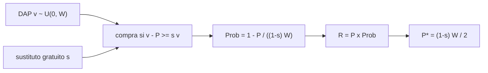

# B125-C01 — Mercado de datos espaciales

<!-- nav:top -->
[🏠 Programa](../../../../README.md) · [📚 Bloque B125](../../../tronco-comun/B125-creacion-y-operacion-de-empresas-espaciales.md) · [← Anterior: B124-C24 — CapEx y OpEx de una instalación extraterrestre](../../../tronco-comun/B124-industria-economia-etica-y-proyectos-espaciales.md#b124-c24) · [Siguiente: B125-C02 — Modelos de ingresos: suscripción y servicio →](../B125-C02-modelos-de-ingresos-suscripcion-y-servicio/CLASE.md)
<!-- /nav -->

## 1. Ubicación, nivel y alcance

Clase 1 del bloque B125. Nivel N4. Los datos espaciales (imágenes, mediciones, series) son un producto con mercado propio, pero parte de ellos se distribuye gratis y de forma abierta. Aquí modelas qué precio maximiza el ingreso por un dato de pago cuando existe un sustituto gratuito, y por qué el negocio se desplaza hacia el producto elaborado. Retomas los segmentos de mercado de [B124](../../../tronco-comun/B124-industria-economia-etica-y-proyectos-espaciales.md) solo como contexto. **Esta clase es educativa: no es asesoría financiera, legal ni de inversión y no sustituye a un profesional.**

## 2. Por qué esta clase existe

[B124](../../../tronco-comun/B124-industria-economia-etica-y-proyectos-espaciales.md) trata los segmentos de la industria en general; ninguna clase explica por qué un dato crudo puede valer cero y aun así sostener empresas. La decisión central: **¿qué cobrar, y por qué, cuando una parte del valor de tu producto ya la ofrece gratis un programa público?**

## 3. Lo que podrás hacer al terminar

1. Modelar la disposición a pagar (DAP) de una población de clientes con una distribución uniforme.
2. Calcular el ingreso `R(P) = P · Prob(compra)` y el precio que lo maximiza.
3. Incorporar un sustituto gratuito que cubre una fracción `s` del valor y deducir `P* = (1 − s) W / 2`.
4. Verificar la fórmula con una simulación de 10 000 clientes sintéticos.
5. Explicar la cadena de valor del dato (crudo, procesado, analítico) y por qué el producto elaborado conserva el precio.
6. Separar lo consultado (políticas de datos abiertos) de lo sintético (todas las cifras del modelo).

La evidencia es la **ficha de mercado de un dato sintético** del ejercicio 12 (sección 20).

## 4. Con qué llegas y cómo comprobarlo

1. ¿Qué es una distribución uniforme en `[0, W]`?
2. ¿Qué es el ingreso de un vendedor con precio fijo?
3. ¿Qué es un máximo de una parábola?
4. ¿Qué es un dato abierto?
5. ¿Qué es una verificación por segunda vía?

<details>
<summary>Ver respuestas</summary>

1. Una en la que todos los valores del intervalo son igual de probables; la probabilidad de superar `x` es `1 − x/W`. 2. El precio por el número de compradores. 3. El vértice: en `a P − b P²` está en `P = a/(2b)`. 4. Uno que cualquiera puede usar, compartir y reutilizar, con condiciones mínimas. 5. Calcular lo mismo con otro método (aquí, simulación) y comparar.
</details>

Con cuatro o cinco aciertos, sigue; si no, repasa los prerrequisitos.

## 5. Un caso de contexto y casos de referencia

El Reglamento (UE) n.º 377/2014 (art. 23) fijó para Copernicus un acceso **gratuito y abierto** a los datos y la información, sujeto a límites (licencias de terceros, formatos y entrega, seguridad e intereses exteriores de la UE, riesgo para el sistema y acceso fiable para usuarios europeos); la página consultada lo muestra derogado desde 2020-12-31 por el Reglamento (UE) 2021/696, cuyo texto **no** se leyó. El USGS ofrece los productos Landsat sin cargo (su página fecha el acceso sin costo en 2008). Ninguna de las dos fuentes da precios ni cuotas de mercado: son el **contexto** de que existe un sustituto gratuito. El **ejemplo conductor** es sintético: 10 000 clientes con DAP uniforme en `[0, 100]` u.m. por mes; sin sustituto el precio óptimo es `50` y el ingreso por cliente `25`; con un sustituto que cubre el 80 % del valor, `10` y `5`.

## 6. Vocabulario

La **disposición a pagar** (DAP) `v` es lo máximo que un cliente pagaría. El **sustituto gratuito** es un producto sin precio que cubre parte del valor. La fracción `s` es la parte del valor que cubre. El **ingreso por cliente** `R(P)` es el precio por la probabilidad de compra. Una **cadena de valor** ordena el dato crudo, el procesado y el análisis. Un **dato abierto** es de uso libre con condiciones mínimas; **gratuito** no implica abierto ni al revés.

## 7. Modelo mental: una demanda que se aplana cuando hay un sustituto



*Descripción textual:* la DAP y el valor que ya da el sustituto fijan quién compra; eso da la probabilidad de compra, el ingreso y el precio que lo maximiza.

Analogía: vender agua embotellada junto a una fuente pública; quien la paga busca algo que la fuente no da. Límite: el modelo supone una DAP uniforme, un solo producto y costo marginal cero; en la realidad el valor del sustituto no es la misma fracción para todos.

## 8. La explicación, paso a paso

### 8.1 Disposición a pagar y compra

Un cliente con DAP `v` compra a precio `P` si el excedente de comprar es al menos el de no comprar: `v − P ≥ s v`, es decir `P ≤ (1 − s) v`. Con `v ~ U(0, W)` la probabilidad de compra es `1 − P / ((1 − s) W)` para `P ≤ (1 − s) W`.

### 8.2 Ingreso y precio óptimo

`R(P) = P (1 − P / ((1 − s) W))`, una parábola con vértice en `P* = (1 − s) W / 2` y valor `R* = (1 − s) W / 4`. El precio óptimo y el ingreso **bajan en proporción a `(1 − s)`**; la mitad de los clientes (los de `v ≥ P*/(1 − s) = W/2`) compra siempre.

### 8.3 Resultados sintéticos

| `s` | `P*` analítico | `R*` analítico | `P*` de la rejilla | `R*` simulado |
|---|---|---|---|---|
| 0,0 | 50,00 | 25,00 | 48,5 | 24,81 |
| 0,3 | 35,00 | 17,50 | 34,0 | 17,36 |
| 0,6 | 20,00 | 10,00 | 19,5 | 9,92 |
| 0,8 | 10,00 | 5,00 | 9,5 | 4,96 |

La rejilla se desvía hasta 1,5 u.m. del óptimo porque el ingreso es casi plano cerca del máximo y la muestra tiene ruido: por eso la tolerancia del laboratorio es de 3 u.m. en el precio y de 2 % en el ingreso.

### 8.4 Cadena de valor

El dato crudo gratuito empuja el ingreso del crudo de pago a `5,00`. Un **producto elaborado** que ahorra al cliente un costo de procesamiento con DAP `U(0, 40)` rinde `40/4 = 10,00` con precio `20`: el valor está en lo que el sustituto **no** ofrece. Es un ejemplo sintético, no una cifra de mercado.

## 9. Magnitudes, símbolos y unidades

| Símbolo | Qué es | Unidad | Valor / nota |
|---|---|---|---|
| `v` | disposición a pagar | u.m./mes | `U(0, 100)` (sintético) |
| `W` | DAP máxima | u.m./mes | 100 |
| `P` | precio | u.m./mes | variable |
| `s` | fracción de valor del sustituto | — | 0; 0,3; 0,6; 0,8 |
| `R(P)` | ingreso por cliente | u.m./mes | `P (1 − P/((1−s)W))` |
| `N` | clientes simulados | clientes | 10 000 |

## 10. Convenciones y referencias

u.m. = unidades monetarias ficticias; los precios son por cliente y por mes. Costo marginal de servir igual a cero. Semilla `125`. Las políticas de datos se citan por artículo o página; ninguna cifra de ellas entra al cálculo.

## 11. De dónde sale lo que afirmamos

| ID | Fuente | Localizador | Respalda | Estado |
|---|---|---|---|---|
| S1 | Reglamento (UE) n.º 377/2014, art. 23 — https://eur-lex.europa.eu/legal-content/EN/TXT/?uri=CELEX:32014R0377 (consultada 2026-11-11; se leyeron los primeros 100 000 caracteres) | art. 23(1)–(2), cdo. 36 | acceso gratuito y abierto a datos de Copernicus con cinco límites; la página lo muestra derogado el 2020-12-31 | Consultada |
| S2 | USGS, «Landsat Data Access» — https://www.usgs.gov/landsat-missions/landsat-data-access (consultada 2026-11-11) | página | los productos Landsat se descargan sin cargo; la página fecha el acceso sin costo en 2008 | Consultada |
| S3 | OCDE, *The Space Economy in Figures: Responding to Global Challenges* (2023) | — | la edición existe y trata el presupuesto público y la actividad comercial | Solo por resumen de búsqueda; texto **no consultado**; sin cifras usadas |
| — | Modelo de demanda uniforme, óptimo del monopolista y cadena de valor | — | todo el modelo; verificado con simulación | No consultado en una fuente concreta |
| — | DAP, `s`, `W`, 10 000 clientes, costos | — | todos los números | Sintético |

Límites: no se consultó ninguna cifra de mercado ni de precios; el Reglamento 2021/696 vigente no se leyó; que el dato abierto exista no dice cuánto cubre del valor de ningún cliente real.

## 12. Cómo ver el mercado

| Magnitud | Valor |
|---|---|
| `P*` sin sustituto | 50,00 u.m. |
| `P*` con `s = 0,8` | 10,00 u.m. |
| `R*` con `s = 0,8` | 5,00 u.m. |
| `R*` del producto elaborado | 10,00 u.m. |

Descripción larga: el precio y el ingreso óptimos bajan linealmente con `(1 − s)`: de `25,00` a `5,00` cuando el sustituto cubre el 80 %; el producto elaborado recupera `10,00` porque ofrece algo que el sustituto no cubre.

## 13. Ejemplo trabajado: el dato con un sustituto del 60 %

**Paso 1 · Condición de compra.** `P ≤ 0,4 v`.

**Paso 2 · Probabilidad.** `1 − P/(0,4 × 100) = 1 − P/40`.

**Paso 3 · Ingreso.** `R = P (1 − P/40)`, máximo en `P* = 20`.

**Paso 4 · Valor.** `R* = 20 × 0,5 = 10,00` u.m. por cliente y mes; compra la mitad de los clientes.

## 14. Distintas formas de describir un mercado de datos

**Por precio:** `P*`. **Por ingreso:** `R*`. **Por cuota:** fracción que compra (`0,51`). **Por cadena de valor:** crudo, procesado, analítico. **Por política:** gratuito frente a abierto.

## 15. Práctica guiada

**Ejercicio 1 · con los pasos indicados.** Calcula `P*` y `R*` si `s = 0` y `W = 100`. *Pasos:* escribe `R(P)`, deriva y evalúa.

<details><summary>Solución comentada</summary>

`R = P(1 − P/100)`; `R' = 1 − P/50 = 0` da `P* = 50`; `R* = 50 × 0,5 = 25` u.m.
</details>

**Ejercicio 2 · con una pista.** Calcula la fracción de clientes que compra a `P*` si `s = 0,3`. *Pista:* `1 − P*/((1−s)W)`.

<details><summary>Solución comentada</summary>

`P* = 35`; `1 − 35/70 = 0,5`: compra la mitad.
</details>

**Ejercicio 3 · casi autónomo.** Con `s = 0,8` calcula `P*` y `R*`; compáralos con `s = 0`.

<details><summary>Solución comentada</summary>

`P* = 0,2 × 100/2 = 10`; `R* = 5`: el 20 % del caso sin sustituto.
</details>

## 16. Práctica autónoma, transferencia e integrador

**Ejercicio 4 · autónomo.** Con `W = 200` y `s = 0,5`, halla `P*` y `R*`.

<details><summary>Solución comentada</summary>

`P* = 0,5 × 200/2 = 50`; `R* = 0,5 × 200/4 = 25`.
</details>

**Ejercicio 5 · autónomo.** ¿Para qué `s` el ingreso óptimo cae a la mitad del caso sin sustituto?

<details><summary>Solución comentada</summary>

`R* ∝ (1 − s)`: `s = 0,5`.
</details>

**Ejercicio 6 · autónomo.** Un producto elaborado tiene DAP `U(0, 60)`. ¿Cuál es su `P*` y `R*`?

<details><summary>Solución comentada</summary>

`P* = 30`; `R* = 60/4 = 15`.
</details>

**Ejercicio 7 · autónomo.** Si el precio fijado es `P = 40` con `s = 0,3` y `W = 100`, ¿qué fracción compra y cuál es el ingreso?

<details><summary>Solución comentada</summary>

Umbral `P/(1−s) = 57,14`; compra `1 − 0,5714 = 0,4286`; `R = 40 × 0,4286 = 17,14`, algo menos que `R* = 17,5`.
</details>

**Ejercicio 8 · autónomo.** En el laboratorio la rejilla dio `P* = 48,5` frente a `50`. ¿Es un error?

<details><summary>Solución comentada</summary>

No: la curva es plana cerca del óptimo y la muestra de 10 000 tiene ruido; el ingreso simulado (24,81) está al 0,8 % del analítico (25,00).
</details>

**Ejercicio 9 · transferencia.** **Transferencia.** Una agencia pública pasa de cobrar a distribuir gratis sus imágenes. ¿Qué predice el modelo para una empresa que vendía esas mismas imágenes?

<details><summary>Solución comentada</summary>

Que su precio óptimo y su ingreso caen con `(1 − s)`; le conviene vender lo que el dato abierto no da (procesamiento, frecuencia, garantías), como el producto elaborado.
</details>

**Ejercicio 10 · transferencia.** **Transferencia.** ¿Por qué «gratuito» no equivale a «abierto»? Da un ejemplo de lo que cambia para un cliente comercial.

<details><summary>Solución comentada</summary>

Gratuito es precio cero; abierto es además poder reutilizar y redistribuir. El Reglamento 377/2014 art. 23 pone límites (licencias de terceros, seguridad) a pesar de ser gratuito y abierto; un cliente necesita saber si puede revender el producto derivado.
</details>

**Ejercicio 11 · transferencia.** **Transferencia.** El modelo supone que `s` es igual para todos. ¿Qué pasaría si la mitad de los clientes tuviera `s = 0` y la otra `s = 0,8`?

<details><summary>Solución comentada</summary>

Habría dos segmentos con precios óptimos distintos (50 y 10); un único precio compromete el ingreso y conviene segmentar la oferta (versiones o niveles de servicio).
</details>

**Ejercicio 12 · integrador.** **Integrador.** Elabora tu *ficha de mercado de un dato sintético*: parámetros, tabla de `P*` y `R*` para cuatro valores de `s`, comparación con la simulación, cadena de valor y lista de lo consultado, lo sintético y lo no consultado, con el aviso de que es educativa.

<details><summary>Solución comentada</summary>

Secciones 8.1–8.4 y la salida del laboratorio.
</details>

## 17. Laboratorio: un dato de pago frente a un sustituto gratuito

El script [mercado.py](mercado.py) simula 10 000 clientes sintéticos, busca en una rejilla de 0,5 u.m. el precio que maximiza el ingreso para cuatro valores de `s`, lo compara con la fórmula y calcula el ejemplo de producto elaborado (**comprueba** el precio a 3 u.m., el ingreso al 2 % y los dos ingresos de la cadena de valor).

**Datos:** ninguna cifra consultada entra al cálculo; todo es **sintético**. **Predice antes de ejecutar:** ¿cuánto valdrá `R*` con `s = 0,8`? (un quinto de `25`.) **Ejecución del 2026-11-11 (Python 3.12.9):**

```text
Python 3.12.9 (biblioteca estandar)
Mercado SINTETICO; DAP ~ U(0, 100) u.m./mes; s = fraccion de valor cubierta por el sustituto gratuito; sin cifras de mercado consultadas.
  s     P* analit  R* analit  P* rejilla  R* simulado  compradores a P*
 0.0      50.00      25.00        48.5        24.81     0.511
 0.3      35.00      17.50        34.0        17.36     0.511
 0.6      20.00      10.00        19.5         9.92     0.508
 0.8      10.00       5.00         9.5         4.96     0.522
Cadena de valor SINTETICA (por cliente y mes, u.m.): crudo gratuito (s = 0.8) frente a producto elaborado
  ingreso optimo del dato crudo de pago      = 5.00
  ingreso optimo del producto elaborado      = 10.00   (DAP ~ U(0, 40); precio 20.0)
Pruebas superadas.
```

```bash
python programa/clases/B125/B125-C01-mercado-de-datos-espaciales/mercado.py
```

**Límites:** demanda uniforme, un solo producto, costo marginal cero, `s` común a todos los clientes; no es un estudio de mercado ni una recomendación de precio.

## 18. Errores frecuentes y cómo corregirlos

**Confundir gratuito con abierto.** Se corrige con el ejercicio 10.

**Creer que el precio óptimo no depende del sustituto.** Se corrige con 8.2 y el ejercicio 5.

**Exigir que la rejilla coincida exactamente con la fórmula.** Se corrige con el ejercicio 8.

**Tomar el modelo como una cifra de mercado.** Se corrige con la sección 11.

## 19. Cómo sabrás que vas bien

Tras la sección 8: ¿qué `R*` esperabas con `s = 0,6` y cuál obtuviste? Si dudas, repasa el ejemplo 13. Tras el laboratorio: ¿qué comprueba? (ver la sección 17).

## 20. Qué entregas y cómo se evalúa

El producto es tu **ficha de mercado de un dato sintético** (ejercicio 12).

| Criterio | Inicial | En desarrollo | Logrado | Destacado |
|---|---|---|---|---|
| Conceptos | Los confunde | Parciales | Calcula `P*` y `R*` con un sustituto | Explica por qué el valor se desplaza al producto elaborado |
| Cálculo | Sin unidades | Con errores | Tablas completas con unidades | Calcula casos nuevos |
| Numérico | Sin comprobar | Un caso | Contraste con una segunda vía | Interpreta las diferencias |
| Fuentes | Sin fuente | Sin fecha | Fuentes con fecha y estado | Declara lo sintético y lo no consultado |
| Límites | No los nombra | Uno | Tres | Discute qué falta del modelo |

**Condiciones críticas (no se compensan con promedio):** rotular todos los datos de empresas como sintéticos o citados con su fuente; no presentar un resultado como asesoría financiera, legal o de inversión; citar solo lo consultado. No presentar `P*` como un precio recomendado.

## 21. Ética, seguridad y límites

Clase educativa: **no es asesoría financiera, legal, tributaria ni de inversión** y no sustituye a un abogado, un contador, un especialista en cumplimiento ni un asesor financiero; ningún resultado debe usarse para decidir una operación, una constitución societaria, una exportación o una inversión reales. Los datos abiertos tienen condiciones de uso: revisa siempre la licencia vigente antes de reutilizar un producto. Los modelos son simplificados y sus datos son sintéticos o ilustrativos. Accesibilidad: tablas equivalentes a las gráficas, fórmulas en texto, ejercicios sin conexión.

## 22. Para cerrar y seguir

Con un sustituto gratuito que cubre el 80 % del valor, el ingreso óptimo del dato crudo cae de `25` a `5` u.m. por cliente y mes; el producto elaborado rinde `10`. Queda una pregunta: ¿cómo se cobra ese producto para sostener una empresa?

**Glosario español–inglés.** disposición a pagar · *willingness to pay*; dato abierto · *open data*; cadena de valor · *value chain*; precio óptimo · *revenue-maximizing price*; sustituto · *substitute*.

**Continuidad.** [B125-C02](../B125-C02-modelos-de-ingresos-suscripcion-y-servicio/CLASE.md) trata los modelos de ingresos por suscripción y por servicio.

**Referencias:** ver sección 11.

<!-- nav:bottom -->
---

[← Anterior: B124-C24 — CapEx y OpEx de una instalación extraterrestre](../../../tronco-comun/B124-industria-economia-etica-y-proyectos-espaciales.md#b124-c24) · [📚 Bloque B125](../../../tronco-comun/B125-creacion-y-operacion-de-empresas-espaciales.md) · [Siguiente: B125-C02 — Modelos de ingresos: suscripción y servicio →](../B125-C02-modelos-de-ingresos-suscripcion-y-servicio/CLASE.md)
<!-- /nav -->
