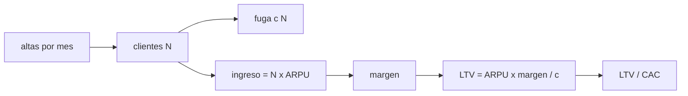

# B125-C02 — Modelos de ingresos: suscripción y servicio

<!-- nav:top -->
[🏠 Programa](../../../../README.md) · [📚 Bloque B125](../../../tronco-comun/B125-creacion-y-operacion-de-empresas-espaciales.md) · [← Anterior: B125-C01 — Mercado de datos espaciales](../B125-C01-mercado-de-datos-espaciales/CLASE.md) · [Siguiente: B125-C03 — Gobierno corporativo de una empresa espacial →](../B125-C03-gobierno-corporativo-de-una-empresa-espacial/CLASE.md)
<!-- /nav -->

## 1. Ubicación, nivel y alcance

Clase 2 del bloque B125. Nivel N4. Una empresa espacial puede cobrar por **suscripción** (acceso a datos durante un plazo) o por **servicio** (un contrato por hitos, como construir y operar un satélite para otro). Aquí comparas cómo se reconoce el ingreso en cada modelo, calculas el valor de vida de un cliente con abandono y el tiempo en que recupera su costo de adquisición. Parte del precio de un dato de [B125-C01](../B125-C01-mercado-de-datos-espaciales/CLASE.md). **Esta clase es educativa: no es asesoría financiera, legal ni de inversión y no sustituye a un profesional.**

## 2. Por qué esta clase existe

El modelo de ingresos define cuándo entra el dinero y cuánto vale un cliente; ninguna clase anterior lo trata. La decisión central: **¿cuánto vale un cliente de suscripción, cuándo se reconoce su ingreso y cuánto abandono puede tolerar el negocio?**

## 3. Lo que podrás hacer al terminar

1. Reconocer el ingreso de una suscripción anual prepagada de forma ratable y calcular el ingreso diferido mes a mes.
2. Reconocer el ingreso de un contrato de servicio por hitos y comparar su calendario con el de la caja.
3. Calcular el valor de vida `LTV = ARPU · margen / c` y comprobarlo con una serie simulada.
4. Calcular la recuperación del costo de adquisición y la relación `LTV/CAC`.
5. Calcular los clientes en estado estable `altas / c` y la sensibilidad al abandono.
6. Separar lo consultado (descripción de los modelos de una empresa real) de lo sintético (todas las cifras).

La evidencia es la **ficha de modelo de ingresos con su calendario** del ejercicio 12 (sección 20).

## 4. Con qué llegas y cómo comprobarlo

1. ¿Qué es el ingreso reconocido frente a la caja cobrada?
2. ¿Qué es una serie geométrica?
3. ¿Qué es el margen bruto?
4. ¿Qué es el abandono mensual?
5. ¿Qué es una verificación por segunda vía?

<details>
<summary>Ver respuestas</summary>

1. El ingreso se reconoce cuando se presta el servicio; la caja es cuando entra el dinero; pueden diferir. 2. Una suma `a + a r + a r² + …` que converge a `a/(1 − r)` si `|r| < 1`. 3. La fracción del ingreso que queda tras los costos directos de servir. 4. La fracción de clientes que se va cada mes. 5. Calcular lo mismo con otro método y comparar.
</details>

Con cuatro o cinco aciertos, sigue; si no, repasa los prerrequisitos.

## 5. Un caso de contexto y casos de referencia

El Formulario 10-K de Planet Labs PBC (ejercicio cerrado el 2026-01-31, consultado el 2026-11-11 en la SEC) describe que los servicios de imágenes se venden en general como **suscripciones de precio fijo**, que el ingreso se reconoce linealmente en el plazo del contrato —o según uso, y en menor medida de una vez al transferir el acceso—, y que los **servicios satelitales** son contratos de largo plazo por hitos; añade que dos clientes sumaron 13 % y 12 % de los ingresos. No se usa ninguna cifra de ese informe en el cálculo. El **ejemplo conductor** es sintético: una suscripción anual de `120 000` u.m. pagada por adelantado se reconoce a `10 000` u.m. por mes; un cliente con `ARPU = 1 000`, margen `70 %` y abandono `2 %` mensual vale `35 000` u.m.

## 6. Vocabulario

La **suscripción** es acceso por un plazo a un precio fijo. El **ingreso diferido** es lo cobrado y aún no reconocido. El **reconocimiento ratable** reparte el ingreso en partes iguales en el plazo. Un **hito** es un logro que da derecho a cobrar. El **ARPU** es el ingreso mensual medio por cliente. El **abandono** `c` es la fracción de clientes que se va por mes. El **LTV** es el margen total que deja un cliente. El **CAC** es el costo de conseguirlo.

## 7. Modelo mental: un cubo con altas y fugas



*Descripción textual:* las altas llenan el cubo de clientes, el abandono lo vacía; el ingreso y el margen por cliente dan el valor de vida, que se compara con el costo de adquirirlo.

Analogía: un cubo con un grifo y un agujero: el nivel se estabiliza en `altas/c`. Límite: el modelo supone `c` constante, `ARPU` constante y sin descuento; los clientes reales no abandonan al mismo ritmo todo el tiempo.

## 8. La explicación, paso a paso

### 8.1 Suscripción anual prepagada

Se cobran `120 000` u.m. en el mes 1; el ingreso reconocido es `10 000` por mes y el **ingreso diferido** al final del mes `m` es `120 000 − 10 000 m`: `110 000` en el mes 1 y `0` en el 12. La suma reconocida es igual al valor del contrato (`120 000`).

### 8.2 Servicio por hitos

Un contrato de `600 000` u.m. con hitos del 30 %, 20 %, 30 % y 20 % en los meses 3, 6, 9 y 12 se reconoce `180 000`, `120 000`, `180 000` y `120 000` en esos meses. **Simplificación:** aquí el ingreso se reconoce en el hito; las normas contables reales pueden exigir reconocerlo a lo largo del avance, y eso no se consultó.

### 8.3 Valor de vida

Con abandono `c`, la fracción viva tras `k` meses es `(1 − c)^k` y `LTV = Σ ARPU · margen · (1 − c)^k = ARPU · margen / c`. Con `ARPU = 1 000`, margen `0,70`, `c = 0,02`: `LTV = 35 000` (la serie simulada da `35 000`). Con `CAC = 6 000`: `LTV/CAC = 5,83` y el CAC se recupera en `6 000/700 = 8,6` meses.

### 8.4 Sensibilidad

| `c` | vida media (meses) | LTV (u.m.) | LTV/CAC |
|---|---|---|---|
| 0,01 | 100,0 | 70 000 | 11,67 |
| 0,02 | 50,0 | 35 000 | 5,83 |
| 0,04 | 25,0 | 17 500 | 2,92 |
| 0,08 | 12,5 | 8 750 | 1,46 |

Duplicar el abandono **divide** el valor por dos. Con 100 altas por mes y `c = 0,02` los clientes tienden a `100/0,02 = 5 000` (ingreso mensual `5 000 000` u.m.).

## 9. Magnitudes, símbolos y unidades

| Símbolo | Qué es | Unidad | Valor / nota |
|---|---|---|---|
| `ARPU` | ingreso mensual por cliente | u.m./mes | 1 000 (sintético) |
| `margen` | margen bruto | — | 0,70 |
| `c` | abandono mensual | 1/mes | 0,02 |
| `LTV` | valor de vida | u.m. | `ARPU·margen/c` = 35 000 |
| `CAC` | costo de adquisición | u.m. | 6 000 |
| `altas` | clientes nuevos por mes | clientes/mes | 100 |

## 10. Convenciones y referencias

u.m. ficticias, meses. Sin descuento ni impuestos. El mes 1 es el de la firma. Ninguna cifra de empresa real entra al cálculo.

## 11. De dónde sale lo que afirmamos

| ID | Fuente | Localizador | Respalda | Estado |
|---|---|---|---|---|
| S1 | Planet Labs PBC, Formulario 10-K, ejercicio cerrado el 2026-01-31, SEC — https://www.sec.gov/Archives/edgar/data/1836833/000119312526119957/pl-20260131.htm (consultada 2026-11-11; se leyeron los primeros 300 000 de 340 791 caracteres) | negocio y factores de riesgo | suscripciones de precio fijo; reconocimiento lineal en el plazo; servicios satelitales por hitos; dos clientes con 13 % y 12 % de los ingresos | Consultada; los estados financieros y las notas de ingresos **no** se leyeron |
| — | Valor de vida, serie geométrica, estado estable | — | todo el modelo; verificado con simulación | No consultado en una fuente concreta |
| — | Contratos, ARPU, abandono, margen, CAC | — | todos los números | Sintético |

Límites: no se consultó ninguna cifra de ingresos ni la nota contable de ingresos; el reconocimiento por hitos es una simplificación; el modelo no incluye descuento, impuestos ni cambios de precio.

## 12. Cómo ver el calendario de ingresos

| Magnitud | Valor |
|---|---|
| ingreso mensual de la suscripción | 10 000 u.m. |
| ingreso diferido al mes 6 | 60 000 u.m. |
| `LTV` | 35 000 u.m. |
| recuperación del CAC | 8,6 meses |

Descripción larga: la suscripción reparte el ingreso en 12 partes iguales aunque se cobre al inicio; el servicio concentra el ingreso en cuatro hitos; el valor de vida cae a la mitad cuando el abandono se duplica.

## 13. Ejemplo trabajado: el cliente de suscripción

**Paso 1 · Margen mensual.** `1 000 × 0,70 = 700` u.m.

**Paso 2 · Valor de vida.** `700/0,02 = 35 000` u.m.

**Paso 3 · Relación.** `35 000/6 000 = 5,83`.

**Paso 4 · Recuperación.** `6 000/700 = 8,6` meses.

## 14. Distintas formas de describir un modelo de ingresos

**Por calendario:** ratable o por hitos. **Por cliente:** `ARPU`, `LTV`, `CAC`. **Por flujo:** altas y fugas. **Por riesgo:** concentración de clientes (13 % y 12 % en el caso consultado).

## 15. Práctica guiada

**Ejercicio 1 · con los pasos indicados.** Calcula el ingreso diferido al fin del mes 4 de la suscripción de `120 000`. *Pasos:* ingreso mensual por meses transcurridos.

<details><summary>Solución comentada</summary>

`120 000 − 4 × 10 000 = 80 000` u.m.
</details>

**Ejercicio 2 · con una pista.** Calcula el `LTV` con `ARPU = 500`, margen `0,6` y `c = 0,03`. *Pista:* `ARPU·margen/c`.

<details><summary>Solución comentada</summary>

`500 × 0,6/0,03 = 10 000` u.m.
</details>

**Ejercicio 3 · casi autónomo.** Calcula en cuántos meses se recupera un `CAC = 3 000` con ese cliente.

<details><summary>Solución comentada</summary>

`3 000/(500 × 0,6) = 10` meses.
</details>

## 16. Práctica autónoma, transferencia e integrador

**Ejercicio 4 · autónomo.** ¿Qué ingreso se reconoce en el mes 9 del contrato por hitos?

<details><summary>Solución comentada</summary>

`180 000` u.m. (30 % de `600 000`).
</details>

**Ejercicio 5 · autónomo.** Con 250 altas por mes y `c = 0,05`, ¿cuántos clientes hay en estado estable?

<details><summary>Solución comentada</summary>

`250/0,05 = 5 000`.
</details>

**Ejercicio 6 · autónomo.** ¿Cuál es el `LTV/CAC` si `c` sube de `0,02` a `0,04` con `CAC = 6 000`?

<details><summary>Solución comentada</summary>

De `5,83` a `2,92`.
</details>

**Ejercicio 7 · autónomo.** Una suscripción de `36 000` u.m. a 24 meses, ¿cuánto se reconoce por mes y cuánto queda diferido al mes 10?

<details><summary>Solución comentada</summary>

`1 500` por mes; diferido `36 000 − 15 000 = 21 000`.
</details>

**Ejercicio 8 · autónomo.** ¿Qué `c` hace que el `LTV` sea igual al `CAC = 6 000` con `ARPU·margen = 700`?

<details><summary>Solución comentada</summary>

`c = 700/6 000 = 0,117`: algo más de 11,7 % mensual.
</details>

**Ejercicio 9 · transferencia.** **Transferencia.** Una empresa cobra el año completo al inicio y su caja sube en el mes 1. ¿Qué dice eso de su ingreso y por qué importa distinguir?

<details><summary>Solución comentada</summary>

Que la caja ya entró pero el ingreso se reconoce en 12 meses; un diferido alto indica obligaciones por cumplir y no ganancia ya obtenida.
</details>

**Ejercicio 10 · transferencia.** **Transferencia.** En el caso consultado dos clientes suman el 25 % de los ingresos. ¿Qué riesgo añade al modelo de `LTV`?

<details><summary>Solución comentada</summary>

Que el abandono de uno solo cambiaría mucho el ingreso; el modelo supone clientes iguales e independientes y no captura la concentración.
</details>

**Ejercicio 11 · transferencia.** **Transferencia.** ¿Por qué un contrato de servicio por hitos tiene un riesgo distinto al de una suscripción, aunque ambos sumen el mismo valor?

<details><summary>Solución comentada</summary>

El cobro depende de cumplir hitos (retrasos aplazan ingreso y caja) y el contrato es único y de gran tamaño; la suscripción reparte el riesgo entre muchos clientes.
</details>

**Ejercicio 12 · integrador.** **Integrador.** Elabora tu *ficha de modelo de ingresos con su calendario*: calendario de la suscripción y del servicio, `LTV`, `CAC`, sensibilidad al abandono y lista de lo consultado, lo sintético y lo no consultado, con el aviso de que es educativa.

<details><summary>Solución comentada</summary>

Secciones 8.1–8.4 y la salida del laboratorio.
</details>

## 17. Laboratorio: suscripción, hitos y valor de vida

El script [ingresos.py](ingresos.py) calcula el calendario de una suscripción anual y de un contrato por hitos, el valor de vida analítico y simulado, la recuperación del CAC, la sensibilidad al abandono y los clientes en estado estable (**comprueba** que lo reconocido iguala al contrato, el `LTV` al 0,5 % y el estado estable a 1e-6).

**Datos:** ninguna cifra consultada entra al cálculo; todo es **sintético**. **Predice antes de ejecutar:** ¿cuánto valdrá el `LTV` si el abandono se duplica a `0,04`? (la mitad.) **Ejecución del 2026-11-11 (Python 3.12.9):**

```text
Python 3.12.9 (biblioteca estandar)
Modelo SINTETICO; ninguna cifra de ingresos de empresa real entra al calculo.
Mes  ingreso suscripcion  caja suscripcion  deferido(fin de mes)  ingreso servicio(hitos)
  1               10000            120000                110000                       0
  2               10000                 0                100000                       0
  3               10000                 0                 90000                  180000
  4               10000                 0                 80000                       0
  5               10000                 0                 70000                       0
  6               10000                 0                 60000                  120000
  7               10000                 0                 50000                       0
  8               10000                 0                 40000                       0
  9               10000                 0                 30000                  180000
 10               10000                 0                 20000                       0
 11               10000                 0                 10000                       0
 12               10000                 0                     0                  120000
Suma reconocida suscripcion = 120000 ; servicio = 600000 (igual al valor del contrato)
LTV analitico = 35000 u.m. ; simulado = 35000 u.m. ; LTV/CAC = 5.83 ; recuperacion del CAC = 8.6 meses
Abandono mensual c   vida media (meses)   LTV (u.m.)   LTV/CAC
               0.01               100.0        70000    11.67
               0.02                50.0        35000     5.83
               0.04                25.0        17500     2.92
               0.08                12.5         8750     1.46
Clientes en estado estable = altas/c = 5000 (simulado 5000) ; ingreso mensual = 5000000 u.m.
Pruebas superadas.
```

```bash
python programa/clases/B125/B125-C02-modelos-de-ingresos-suscripcion-y-servicio/ingresos.py
```

**Límites:** `ARPU`, margen y abandono constantes; sin descuento ni impuestos; reconocimiento por hitos simplificado; no es una valoración de empresa.

## 18. Errores frecuentes y cómo corregirlos

**Confundir caja con ingreso.** Se corrige con 8.1 y el ejercicio 9.

**Calcular el `LTV` con `c` en lugar de `1/c` como vida media.** Se corrige con 8.3.

**Ignorar la concentración de clientes.** Se corrige con el ejercicio 10.

**Tomar el `LTV` como un valor presente.** Se corrige con la sección 11: el modelo no descuenta.

## 19. Cómo sabrás que vas bien

Tras la sección 8: ¿qué `LTV` esperabas con `c = 0,04` y cuál obtuviste? Si dudas, repasa el ejemplo 13. Tras el laboratorio: ¿qué comprueba? (ver la sección 17).

## 20. Qué entregas y cómo se evalúa

El producto es tu **ficha de modelo de ingresos con su calendario** (ejercicio 12).

| Criterio | Inicial | En desarrollo | Logrado | Destacado |
|---|---|---|---|---|
| Conceptos | Los confunde | Parciales | Calcula el `LTV` y distingue ingreso de caja | Explica la concentración y el reconocimiento real |
| Cálculo | Sin unidades | Con errores | Tablas completas con unidades | Calcula casos nuevos |
| Numérico | Sin comprobar | Un caso | Contraste con una segunda vía | Interpreta las diferencias |
| Fuentes | Sin fuente | Sin fecha | Fuentes con fecha y estado | Declara lo sintético y lo no consultado |
| Límites | No los nombra | Uno | Tres | Discute qué falta del modelo |

**Condiciones críticas (no se compensan con promedio):** rotular todos los datos de empresas como sintéticos o citados con su fuente; no presentar un resultado como asesoría financiera, legal o de inversión; citar solo lo consultado. No tratar el reconocimiento de la clase como norma contable.

## 21. Ética, seguridad y límites

Clase educativa: **no es asesoría financiera, legal, tributaria ni de inversión** y no sustituye a un abogado, un contador, un especialista en cumplimiento ni un asesor financiero; ningún resultado debe usarse para decidir una operación, una constitución societaria, una exportación o una inversión reales. Las normas contables y los contratos reales los determina un contador o un abogado; esta clase no los reproduce. Los modelos son simplificados y sus datos son sintéticos o ilustrativos. Accesibilidad: tablas equivalentes a las gráficas, fórmulas en texto, ejercicios sin conexión.

## 22. Para cerrar y seguir

Una suscripción de `120 000` se reconoce a `10 000` por mes; un cliente con abandono de 2 % vale `35 000` y recupera su costo en `8,6` meses. Queda una pregunta: ¿quién decide en la empresa cuando esos números se ponen en juego?

**Glosario español–inglés.** suscripción · *subscription*; ingreso diferido · *deferred revenue*; valor de vida del cliente · *customer lifetime value*; abandono · *churn*; costo de adquisición · *customer acquisition cost*.

**Continuidad.** [B125-C03](../B125-C03-gobierno-corporativo-de-una-empresa-espacial/CLASE.md) trata el gobierno corporativo.

**Referencias:** ver sección 11.

<!-- nav:bottom -->
---

[← Anterior: B125-C01 — Mercado de datos espaciales](../B125-C01-mercado-de-datos-espaciales/CLASE.md) · [📚 Bloque B125](../../../tronco-comun/B125-creacion-y-operacion-de-empresas-espaciales.md) · [Siguiente: B125-C03 — Gobierno corporativo de una empresa espacial →](../B125-C03-gobierno-corporativo-de-una-empresa-espacial/CLASE.md)
<!-- /nav -->
