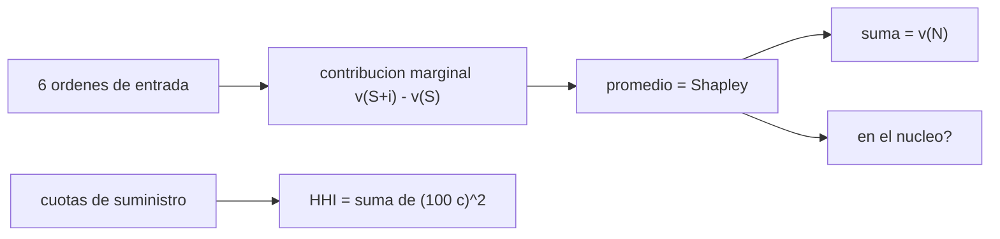

# B125-C04 — Alianzas y cooperación internacional empresarial

<!-- nav:top -->
[🏠 Programa](../../../../README.md) · [📚 Bloque B125](../../../tronco-comun/B125-creacion-y-operacion-de-empresas-espaciales.md) · [← Anterior: B125-C03 — Gobierno corporativo de una empresa espacial](../B125-C03-gobierno-corporativo-de-una-empresa-espacial/CLASE.md) · [Siguiente: B125-C05 — Control de exportaciones y transferencia de tecnología →](../B125-C05-control-de-exportaciones-y-transferencia-de-tecnologia/CLASE.md)
<!-- /nav -->

## 1. Ubicación, nivel y alcance

Clase 4 del bloque B125. Nivel N4. Una empresa espacial rara vez hace todo sola: depende de socios de otros países para plataformas, lanzamientos o datos. Aquí repartes el excedente de una alianza de tres socios con el **valor de Shapley**, compruebas si ningún socio gana más yéndose (el *núcleo*) y mides la dependencia de un componente crítico con el índice de Herfindahl. Usa la estructura de poder de [B125-C03](../B125-C03-gobierno-corporativo-de-una-empresa-espacial/CLASE.md) como contexto. **Esta clase es educativa: no es asesoría financiera, legal ni de inversión y no sustituye a un profesional.**

## 2. Por qué esta clase existe

Las empresas espaciales dependen de alianzas con socios de otros países y la clase de gobierno no explica cómo se reparte el valor ni cuánta dependencia se acepta; no está tratado. La decisión central: **¿cómo se reparte de forma justa el excedente de una alianza y cuánta dependencia de un solo socio o país es prudente?**

## 3. Lo que podrás hacer al terminar

1. Definir una función de coalición `v(S)` y calcular el excedente de la alianza.
2. Calcular el valor de Shapley por permutaciones y por la fórmula de tamaños, y comprobar que suman `v(N)`.
3. Comprobar si un reparto está en el núcleo.
4. Comparar el reparto de Shapley con el proporcional al valor individual.
5. Calcular el índice de Herfindahl–Hirschman de la dependencia de un suministro.
6. Separar lo consultado (principios de cooperación entre Estados) de lo sintético (empresas y valores).

La evidencia es la **ficha de reparto y dependencia de una alianza sintética** del ejercicio 12 (sección 20).

## 4. Con qué llegas y cómo comprobarlo

1. ¿Qué es una coalición?
2. ¿Qué es una permutación de tres elementos y cuántas hay?
3. ¿Qué es la contribución marginal de un socio?
4. ¿Qué es una cuota de mercado o de suministro?
5. ¿Qué es una verificación por segunda vía?

<details>
<summary>Ver respuestas</summary>

1. Un subconjunto de socios que cooperan. 2. Un orden posible; hay `3! = 6`. 3. Lo que añade al valor de la coalición ya formada. 4. La fracción del total que aporta un proveedor. 5. Calcular lo mismo con otro método y comparar.
</details>

Con cuatro o cinco aciertos, sigue; si no, repasa los prerrequisitos.

## 5. Un caso de contexto y casos de referencia

La página de los Acuerdos Artemis de la NASA (consultada el 2026-11-11) los describe como principios compartidos para la exploración y el uso civil del espacio (usos pacíficos, transparencia, interoperabilidad, asistencia en emergencias, registro de objetos, datos científicos, deconflicto, desechos orbitales) y reporta **78 signatarios** tras la firma de Vietnam el 2026-10-28; son compromisos entre Estados, **no** contratos entre empresas. El artículo VI del Tratado del Espacio Ultraterrestre —por un resumen de búsqueda, texto **no** leído— hace responsable al Estado de las actividades nacionales, también las privadas, que requieren autorización y supervisión continua; por eso una alianza internacional de empresas siempre involucra a los Estados de cada socio. El **ejemplo conductor** es sintético: tres socios con `v(A) = 10`, `v(B) = 20`, `v(C) = 0`, `v(AB) = 60`, `v(AC) = 30`, `v(BC) = 40`, `v(ABC) = 100` millones de u.m.; Shapley reparte `35`, `45` y `20`.

## 6. Vocabulario

Una **alianza** es una cooperación estable entre empresas. La **función de coalición** `v(S)` es el valor que logra el subconjunto `S`. El **excedente** es `v(N) − Σ v(i)`. El **valor de Shapley** es el promedio de las contribuciones marginales de un socio sobre todos los órdenes de entrada. El **núcleo** es el conjunto de repartos que ninguna coalición puede mejorar yéndose. El **índice HHI** es la suma de los cuadrados de las cuotas en porcentaje (0 a 10 000).

## 7. Modelo mental: tres socios que entran en orden



*Descripción textual:* se promedia lo que cada socio añade al entrar en cada orden posible; el reparto resultante suma el valor total y se contrasta con el núcleo; aparte, las cuotas de suministro dan el índice de dependencia.

Analogía: tres amigos arman un equipo y cada uno cobra según lo que aporta en promedio al llegar. Límite: el modelo supone valores conocidos, información completa y transferencias libres de dinero entre socios; no incluye negociación, poder ni leyes.

## 8. La explicación, paso a paso

### 8.1 Valor de Shapley

El valor del socio `i` es el promedio de `v(S ∪ {i}) − v(S)` sobre los `3! = 6` órdenes de entrada. El laboratorio lo calcula por permutaciones y por la fórmula con pesos `|S|!(n − |S| − 1)!/n!`; ambas coinciden.

| socio | `v` solo | Shapley | proporcional a `v` solo |
|---|---|---|---|
| A | 10,0 | 35,00 | 33,33 |
| B | 20,0 | 45,00 | 66,67 |
| C | 0,0 | 20,00 | 0,00 |

La suma de Shapley es `100,00 = v(ABC)`. El socio C, que solo no vale nada, recibe `20` porque **sin él** el excedente cae: el reparto proporcional a lo individual lo dejaría sin nada.

### 8.2 Núcleo

Un reparto está en el núcleo si cada coalición recibe al menos lo que puede lograr sola. El de Shapley cumple (`A+B = 80 ≥ 60`, `A+C = 55 ≥ 30`, `B+C = 65 ≥ 40`). El reparto `A = 10, B = 50, C = 40` también.

### 8.3 Dependencia

El **HHI** de un suministro con cuotas `c_i` es `Σ (100 c_i)²`.

| estructura | HHI |
|---|---|
| un solo país | 10 000,0 |
| 2 países 80/20 | 6 800,0 |
| 3 países 50/30/20 | 3 800,0 |
| 3 países iguales | 3 333,3 |

Diversificar baja el índice, pero sin resolver cuánto cuesta cambiar de proveedor. Los umbrales que usan los reguladores de competencia para clasificar un HHI **no** se consultaron y no se usan.

## 9. Magnitudes, símbolos y unidades

| Símbolo | Qué es | Unidad | Valor / nota |
|---|---|---|---|
| `v(S)` | valor de la coalición `S` | M u.m. | tabla sintética |
| `φᵢ` | valor de Shapley del socio `i` | M u.m. | 35; 45; 20 |
| `v(N)` | valor de la gran coalición | M u.m. | 100 |
| `c_i` | cuota de suministro | — | 0–1 |
| `HHI` | índice de concentración | — | 0–10 000 |

## 10. Convenciones y referencias

M u.m. = millones de unidades monetarias ficticias. Los socios A, B y C tienen países distintos. Las coaliciones se escriben por letras (`AB`). Sin impuestos ni tipos de cambio.

## 11. De dónde sale lo que afirmamos

| ID | Fuente | Localizador | Respalda | Estado |
|---|---|---|---|---|
| S1 | NASA, «Artemis Accords» — https://www.nasa.gov/artemis-accords/ (consultada 2026-11-11) | página | principios compartidos entre Estados; 78 signatarios tras la firma del 2026-10-28; no se describe como política no vinculante (esa caracterización no se confirmó) | Consultada |
| S2 | Tratado sobre los principios que deben regir las actividades de los Estados en la exploración y utilización del espacio ultraterrestre (1967), art. VI | — | responsabilidad del Estado por actividades nacionales, incluidas las privadas, con autorización y supervisión continua | Solo por resumen de búsqueda de sitios de la ONU y del Departamento de Estado; texto **no consultado** (los PDF y la página de UNOOSA dieron error 404) |
| — | Valor de Shapley, núcleo, HHI | — | todo el modelo; verificado con dos fórmulas y con enumeración | No consultado en una fuente concreta |
| — | Tres socios, valores de coalición y cuotas | — | todos los números | Sintético |

Límites: no se consultó ninguna alianza real ni ningún contrato; los Acuerdos Artemis son entre Estados; el texto del tratado no se leyó; el valor de coalición se supone conocido, lo cual casi nunca ocurre.

## 12. Cómo ver el reparto

| Magnitud | Valor |
|---|---|
| excedente `v(ABC) − Σ v(i)` | 70,0 M u.m. |
| Shapley de C | 20,00 M u.m. |
| ¿Shapley en el núcleo? | sí |
| HHI de un solo país | 10 000,0 |

Descripción larga: Shapley paga a cada socio por lo que añade en promedio, incluso al que solo no vale nada; el reparto proporcional a lo individual lo ignoraría; la dependencia se mide con un índice que va de 3 333 (tres iguales) a 10 000 (uno solo).

## 13. Ejemplo trabajado: el valor de Shapley de dos socios

Con dos socios `v(A) = 10`, `v(B) = 20`, `v(AB) = 60`.

**Paso 1 · Órdenes.** `AB` y `BA`.

**Paso 2 · Marginales de A.** En `AB`: `10`; en `BA`: `60 − 20 = 40`; promedio `25`.

**Paso 3 · Marginales de B.** En `AB`: `60 − 10 = 50`; en `BA`: `20`; promedio `35`.

**Paso 4 · Suma.** `25 + 35 = 60 = v(AB)`.

## 14. Distintas formas de describir una alianza

**Por valor:** `v(S)`. **Por reparto:** Shapley, proporcional, núcleo. **Por dependencia:** HHI. **Por Estado:** autorización y supervisión del país de cada socio. **Por riesgo:** salida de un socio.

## 15. Práctica guiada

**Ejercicio 1 · con los pasos indicados.** Calcula el excedente de la alianza ABC. *Pasos:* `v(ABC)` menos la suma de lo individual.

<details><summary>Solución comentada</summary>

`100 − (10 + 20 + 0) = 70` M u.m.
</details>

**Ejercicio 2 · con una pista.** Calcula el HHI de un suministro 70/30. *Pista:* `(70)² + (30)²`.

<details><summary>Solución comentada</summary>

`4 900 + 900 = 5 800`.
</details>

**Ejercicio 3 · casi autónomo.** Comprueba que `A + B = 80` cumple el núcleo con Shapley.

<details><summary>Solución comentada</summary>

`35 + 45 = 80 ≥ v(AB) = 60`: sí.
</details>

## 16. Práctica autónoma, transferencia e integrador

**Ejercicio 4 · autónomo.** Con `v(A) = 0`, `v(B) = 0`, `v(AB) = 40`, ¿cuánto recibe cada uno por Shapley?

<details><summary>Solución comentada</summary>

Por simetría `20` y `20`.
</details>

**Ejercicio 5 · autónomo.** Con 3 socios iguales, ¿cuál es el HHI mínimo y qué significa?

<details><summary>Solución comentada</summary>

`3 × (33,3)² = 3 333,3`; es el menor valor posible con tres proveedores: el reparto parejo es el menos concentrado.
</details>

**Ejercicio 6 · autónomo.** ¿Está en el núcleo el reparto `A = 5, B = 45, C = 50`?

<details><summary>Solución comentada</summary>

No: `A + B = 50 < v(AB) = 60`; A y B ganan más yéndose.
</details>

**Ejercicio 7 · autónomo.** Un cuarto proveedor entra y el suministro pasa de 50/30/20 a 40/30/20/10. Calcula el HHI.

<details><summary>Solución comentada</summary>

`1 600 + 900 + 400 + 100 = 3 000`.
</details>

**Ejercicio 8 · autónomo.** ¿Qué comprueba el laboratorio al calcular Shapley de dos maneras?

<details><summary>Solución comentada</summary>

Que el cálculo por permutaciones y por la fórmula de tamaños coinciden a 1e-9: una verificación por segunda vía.
</details>

**Ejercicio 9 · transferencia.** **Transferencia.** Los Acuerdos Artemis son compromisos entre Estados. ¿Qué papel juegan para una alianza de empresas?

<details><summary>Solución comentada</summary>

Dan un marco de principios (interoperabilidad, datos, desechos) del que dependen las autorizaciones estatales de cada socio, pero no reemplazan el contrato entre las empresas.
</details>

**Ejercicio 10 · transferencia.** **Transferencia.** ¿Por qué la salida de un socio con Shapley bajo puede igual poner en riesgo la alianza?

<details><summary>Solución comentada</summary>

Porque Shapley mide aporte promedio, no dependencia: un socio de bajo valor individual puede ser el único proveedor de algo crítico (alto HHI).
</details>

**Ejercicio 11 · transferencia.** **Transferencia.** El modelo supone que `v(S)` es conocido. ¿Qué pasa cuando es solo una estimación?

<details><summary>Solución comentada</summary>

El reparto hereda el error y los socios pueden discutirlo; conviene rangos y un procedimiento acordado antes de que haya resultados.
</details>

**Ejercicio 12 · integrador.** **Integrador.** Elabora tu *ficha de reparto y dependencia de una alianza sintética*: tabla de `v(S)`, Shapley, comprobación del núcleo, HHI de dos estructuras y lista de lo consultado, lo sintético y lo no consultado, con el aviso de que es educativa.

<details><summary>Solución comentada</summary>

Secciones 8.1–8.3 y la salida del laboratorio.
</details>

## 17. Laboratorio: reparto de Shapley y dependencia de socios

El script [alianzas.py](alianzas.py) calcula el valor de Shapley por permutaciones y por fórmula, lo compara con el reparto proporcional, comprueba el núcleo de dos repartos y calcula el HHI de cuatro estructuras (**comprueba** Shapley a 1e-9, que suma `v(N)` y los HHI extremos).

**Datos:** ningún dato de alianzas reales; todo es **sintético**. **Predice antes de ejecutar:** ¿cuánto recibirá C, que solo no vale nada? (más que cero.) **Ejecución del 2026-11-11 (Python 3.12.9):**

```text
Python 3.12.9 (biblioteca estandar)
Alianza SINTETICA de 3 socios; valores en millones de u.m.; sin cifras de alianzas reales.
socio  valor solo  Shapley (permutaciones)  Shapley (formula)  reparto proporcional a v(solo)
A            10.0                    35.00              35.00                         33.33
B            20.0                    45.00              45.00                         66.67
C             0.0                    20.00              20.00                          0.00
Suma de Shapley = 100.00 = v(ABC) = 100.0
Shapley en el nucleo (ninguna coalicion gana mas yendose): True 
Reparto A=10, B=50, C=40 en el nucleo: True 
Dependencia de un componente critico (cuota por pais proveedor):
  un solo pais       HHI = 10000.0
  2 paises 80/20     HHI =  6800.0
  3 paises 50/30/20  HHI =  3800.0
  3 paises iguales   HHI =  3333.3
Pruebas superadas.
```

```bash
python programa/clases/B125/B125-C04-alianzas-y-cooperacion-internacional-empresarial/alianzas.py
```

**Límites:** tres socios, valores de coalición conocidos y transferibles; sin negociación, impuestos ni derecho; no recomienda un reparto.

## 18. Errores frecuentes y cómo corregirlos

**Repartir en proporción a lo individual.** Se corrige con 8.1.

**Creer que un valor bajo de Shapley implica poca dependencia.** Se corrige con el ejercicio 10.

**Confundir un acuerdo entre Estados con un contrato entre empresas.** Se corrige con el ejercicio 9.

**Aplicar umbrales de HHI de reguladores sin haberlos consultado.** Se corrige con 8.3.

## 19. Cómo sabrás que vas bien

Tras la sección 8: ¿cuánto esperabas para C y cuánto obtuviste? Si dudas, repasa el ejemplo 13. Tras el laboratorio: ¿qué comprueba? (ver la sección 17).

## 20. Qué entregas y cómo se evalúa

El producto es tu **ficha de reparto y dependencia de una alianza sintética** (ejercicio 12).

| Criterio | Inicial | En desarrollo | Logrado | Destacado |
|---|---|---|---|---|
| Conceptos | Los confunde | Parciales | Calcula Shapley, núcleo y HHI | Explica la diferencia entre aporte y dependencia |
| Cálculo | Sin unidades | Con errores | Tablas completas con unidades | Calcula casos nuevos |
| Numérico | Sin comprobar | Un caso | Contraste con una segunda vía | Interpreta las diferencias |
| Fuentes | Sin fuente | Sin fecha | Fuentes con fecha y estado | Declara lo sintético y lo no consultado |
| Límites | No los nombra | Uno | Tres | Discute qué falta del modelo |

**Condiciones críticas (no se compensan con promedio):** rotular todos los datos de empresas como sintéticos o citados con su fuente; no presentar un resultado como asesoría financiera, legal o de inversión; citar solo lo consultado. No presentar un reparto como una recomendación de negociación.

## 21. Ética, seguridad y límites

Clase educativa: **no es asesoría financiera, legal, tributaria ni de inversión** y no sustituye a un abogado, un contador, un especialista en cumplimiento ni un asesor financiero; ningún resultado debe usarse para decidir una operación, una constitución societaria, una exportación o una inversión reales. Las alianzas reales exigen contratos revisados por abogados y autorizaciones de los Estados de cada socio; esta clase no los sustituye. Los modelos son simplificados y sus datos son sintéticos o ilustrativos. Accesibilidad: tablas equivalentes a las gráficas, fórmulas en texto, ejercicios sin conexión.

## 22. Para cerrar y seguir

Shapley reparte `35`, `45` y `20` millones, incluso al socio que solo no vale nada; un suministro de un solo país tiene HHI `10 000`. Queda una pregunta: ¿qué leyes limitan lo que los socios pueden compartirse?

**Glosario español–inglés.** alianza · *alliance*; valor de Shapley · *Shapley value*; núcleo · *core*; índice de Herfindahl–Hirschman · *Herfindahl–Hirschman index*; coalición · *coalition*.

**Continuidad.** [B125-C05](../B125-C05-control-de-exportaciones-y-transferencia-de-tecnologia/CLASE.md) trata el control de exportaciones.

**Referencias:** ver sección 11.

<!-- nav:bottom -->
---

[← Anterior: B125-C03 — Gobierno corporativo de una empresa espacial](../B125-C03-gobierno-corporativo-de-una-empresa-espacial/CLASE.md) · [📚 Bloque B125](../../../tronco-comun/B125-creacion-y-operacion-de-empresas-espaciales.md) · [Siguiente: B125-C05 — Control de exportaciones y transferencia de tecnología →](../B125-C05-control-de-exportaciones-y-transferencia-de-tecnologia/CLASE.md)
<!-- /nav -->
