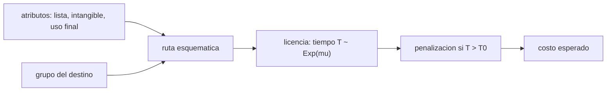

# B125-C05 — Control de exportaciones y transferencia de tecnología

<!-- nav:top -->
[🏠 Programa](../../../../README.md) · [📚 Bloque B125](../../../tronco-comun/B125-creacion-y-operacion-de-empresas-espaciales.md) · [← Anterior: B125-C04 — Alianzas y cooperación internacional empresarial](../B125-C04-alianzas-y-cooperacion-internacional-empresarial/CLASE.md) · [Siguiente: B125-C06 — Plan empresarial de una empresa espacial →](../B125-C06-plan-empresarial-de-una-empresa-espacial/CLASE.md)
<!-- /nav -->

## 1. Ubicación, nivel y alcance

Clase 5 del bloque B125. Nivel N4. La tecnología espacial puede estar sujeta a controles de exportación que condicionan quién puede comprar, qué se puede compartir con un socio extranjero y cuánto tarda una venta. Aquí recorres un **clasificador esquemático** de rutas (sin control aparente, licencia probable, consulta especializada) y calculas el costo esperado del retraso de una licencia. **No clasifica nada real**: la clasificación la hace un especialista con el texto vigente. Sigue a las alianzas de [B125-C04](../B125-C04-alianzas-y-cooperacion-internacional-empresarial/CLASE.md). **Esta clase es educativa: no es asesoría financiera, legal ni de inversión y no sustituye a un profesional.**

## 2. Por qué esta clase existe

La tecnología espacial está sujeta a controles de exportación que condicionan el negocio, y las alianzas de la clase anterior chocan con ellos; ninguna clase los trata. La decisión central: **¿qué ruta de exportación debe esperar un producto o una transferencia de tecnología y cuánto cuesta, en promedio, esperar la licencia?**

## 3. Lo que podrás hacer al terminar

1. Distinguir exportar un objeto de transferir tecnología de forma intangible (correo, acceso en línea, conversación).
2. Recorrer un clasificador esquemático con tres atributos y un grupo de destino y leer su ruta resultante.
3. Calcular la demora esperada de un trámite exponencial sobre un plazo comprometido: `E[max(0, T − T₀)] = μ e^(−T₀/μ)`.
4. Calcular el costo esperado de las penalizaciones con probabilidad de denegación y verificarlo con Monte Carlo.
5. Medir la sensibilidad del costo a la duración del trámite y al plazo.
6. Separar lo consultado (estructura de los regímenes) de lo sintético (artículos, destinos y plazos).

La evidencia es la **ficha de ruta de exportación esquemática con su costo esperado** del ejercicio 12 (sección 20).

## 4. Con qué llegas y cómo comprobarlo

1. ¿Qué es una licencia de exportación?
2. ¿Qué es una distribución exponencial?
3. ¿Qué es un valor esperado?
4. ¿Qué es una simulación Monte Carlo?
5. ¿Qué es un plazo comprometido?

<details>
<summary>Ver respuestas</summary>

1. Una autorización de una autoridad para enviar un artículo o transferir tecnología a un destino. 2. La de un tiempo de espera sin memoria; con media `μ`, `P(T > t) = e^(−t/μ)`. 3. El promedio ponderado por probabilidad. 4. Repetir muchos casos aleatorios con semilla fija y promediar. 5. La fecha de entrega pactada en un contrato.
</details>

Con cuatro o cinco aciertos, sigue; si no, repasa los prerrequisitos.

## 5. Un caso de contexto y casos de referencia

La sección 120.1 del Título 22 del CFR (texto del Legal Information Institute de Cornell, consultado el 2026-11-11, sin fecha de versión visible) dice que la Ley de Control de Exportaciones de Armas faculta al Presidente, con la autoridad delegada en el Secretario de Estado, y que la Dirección de Controles del Comercio de Defensa (DDTC) tiene oficinas de licencias, cumplimiento y política. En la Categoría XV de la Lista de Municiones (22 CFR 121.1, extracto leído) figuran componentes y naves «calificados para el espacio» —diseñados, fabricados o probados para operar sobre 100 km— y los artículos diseñados específicamente para una nave que no estén en ese párrafo quedan bajo otro régimen, las EAR. El Reglamento (UE) 2021/821 crea un régimen unitario de control de exportación, intermediación, asistencia técnica, tránsito y transferencia de artículos de doble uso; la transferencia electrónica de software o tecnología fuera de la UE cuenta como exportación, y existen autorizaciones individual, global, general nacional y general de la Unión. Nada de esto se usa como lista o umbral en el cálculo. El **ejemplo conductor** es sintético: un trámite con media de 45 días y un plazo comprometido de 60 días cuesta, en promedio, `21 826` u.m. de penalizaciones.

## 6. Vocabulario

La **exportación** es el envío de un artículo o la transferencia de tecnología a un destino extranjero. Un artículo de **doble uso** sirve para fines civiles y militares. La **transferencia intangible** es la de software o conocimiento por medios electrónicos u orales. La **licencia** es la autorización de la autoridad. La **denegación** es su rechazo. El **plazo comprometido** `T₀` es la fecha pactada con el cliente. La **demora esperada** es el promedio de lo que el trámite excede el plazo.

## 7. Modelo mental: un trámite con tiempo aleatorio



*Descripción textual:* los atributos del artículo y el grupo del destino dan una ruta esquemática; si requiere licencia, el tiempo del trámite es aleatorio y, si excede el plazo, se pagan penalizaciones cuyo promedio es el costo esperado.

Analogía: una fila en una ventanilla cuyo tiempo de atención nadie conoce. Límite: la exponencial no refleja plazos reales, el clasificador es una caricatura de regímenes que cambian y que no se transcriben aquí.

## 8. La explicación, paso a paso

### 8.1 Qué se controla

Se controlan objetos, pero también **tecnología**: según el Reglamento 2021/821, enviar por correo, subir a un servicio en línea o describir por teléfono una tecnología a alguien fuera de la UE cuenta como exportación. Para una empresa que comparte planos con un socio, la transferencia intangible es la ruta más fácil de pasar por alto.

### 8.2 Clasificador esquemático

Con atributos **sintéticos** (en lista de control sintética, intangible, uso final sensible) y tres grupos de destino inventados:

| artículo | país A | país C |
|---|---|---|
| estrella-sintética 1 | licencia probable | consulta especializada |
| panel solar genérico | sin control aparente (verificar) | sin control aparente (verificar) |
| software de actitud | licencia probable, con transferencia intangible | consulta especializada |
| planos de carga útil | licencia probable, con transferencia intangible | consulta especializada |
| tornillo estándar | sin control aparente (verificar) | sin control aparente (verificar) |
| módulo de propulsión | licencia probable | consulta especializada |

«Sin control aparente» siempre dice *verificar*: el clasificador no puede dar un sí.

### 8.3 Costo esperado del retraso

Con retraso `T ~ Exp(μ)`, `μ = 45` días, plazo `T₀ = 60`, penalización `2 000` u.m./día y probabilidad de denegación `8 %`: la demora esperada es `μ e^(−T₀/μ) = 11,86` días; el costo esperado (sin entrega no se paga demora) es `0,92 × 2 000 × 11,86 = 21 826` u.m.; el Monte Carlo (200 000 casos) da `21 932` (0,5 % de diferencia). La probabilidad de exceder el plazo es `e^(−60/45) = 0,264`.

### 8.4 Sensibilidad

| media del trámite (días) | plazo `T₀` (días) | costo esperado (u.m.) |
|---|---|---|
| 30 | 60 | 7 471 |
| 30 | 120 | 1 011 |
| 45 | 60 | 21 826 |
| 45 | 120 | 5 753 |
| 90 | 60 | 85 022 |
| 90 | 120 | 43 652 |

Duplicar el plazo reduce el costo muy por debajo de la mitad; duplicar la media del trámite (de 45 a 90 días con `T₀ = 60`) lo multiplica por casi cuatro. Negociar un plazo que incluya la licencia es una decisión comercial con valor medible.

## 9. Magnitudes, símbolos y unidades

| Símbolo | Qué es | Unidad | Valor / nota |
|---|---|---|---|
| `T` | duración del trámite | días | `Exp(μ)` |
| `μ` | media del trámite | días | 45 (sintético) |
| `T₀` | plazo comprometido | días | 60 |
| `p` | prob. de denegación | — | 0,08 |
| penalización | costo por día de demora | u.m./día | 2 000 |
| costo esperado | `(1 − p) · pen · μ e^(−T₀/μ)` | u.m. | 21 826 |

## 10. Convenciones y referencias

Días corridos; u.m. ficticias. Los grupos de destino A, B y C son inventados; ningún país real se clasifica. Semilla `125`. El clasificador devuelve etiquetas de ruta, no decisiones legales.

## 11. De dónde sale lo que afirmamos

| ID | Fuente | Localizador | Respalda | Estado |
|---|---|---|---|---|
| S1 | 22 CFR § 120.1, Legal Information Institute (Cornell) — https://www.law.cornell.edu/cfr/text/22/120.1 (consultada 2026-11-11; la página no muestra fecha de versión) | § 120.1 | facultad delegada al Departamento de Estado; oficinas de licencias, cumplimiento y política de la DDTC | Consultada; el resto de la Parte 120 y la USML completa **no** se leyeron |
| S2 | 22 CFR § 121.1, Categoría XV — https://www.law.cornell.edu/cfr/text/22/121.1 (consultada 2026-11-11; extracto desde el carácter 200 000) | Cat. XV, párr. (e) y definiciones | «calificado para el espacio»: sobre 100 km; artículos diseñados para naves no listados quedan bajo las EAR | Consultada parcialmente; el encabezado y los párrafos (b) a (d) no se leyeron |
| S3 | Reglamento (UE) 2021/821 — https://eur-lex.europa.eu/legal-content/EN/TXT/?uri=CELEX:32021R0821 (consultada 2026-11-11; primeros 100 000 de 193 379 caracteres) | objeto y definiciones | régimen unitario de doble uso; la transferencia electrónica cuenta como exportación; cuatro tipos de autorización | Consultada parcialmente; los anexos y las listas **no** se leyeron |
| — | Valor esperado de una exponencial y Monte Carlo | — | `μ e^(−T₀/μ)`; verificado con simulación | No consultado en una fuente concreta |
| — | Artículos, atributos, destinos, plazos, penalizaciones | — | todos los números | Sintético |

Límites: ninguna lista de control, umbral ni plazo real se consultó; las EAR (a las que remite la Categoría XV) no se leyeron; los textos cambian y esta clase no es una fuente vigente de cumplimiento.

## 12. Cómo ver la ruta y su costo

| Magnitud | Valor |
|---|---|
| demora esperada (`μ = 45`, `T₀ = 60`) | 11,86 días |
| costo esperado analítico | 21 826 u.m. |
| costo Monte Carlo | 21 932 u.m. |
| prob. de exceder el plazo | 0,264 |

Descripción larga: el costo esperado del retraso crece rápido con la media del trámite y cae rápido con un plazo mayor; la simulación confirma la fórmula a menos de 1 %.

## 13. Ejemplo trabajado: la demora esperada con `μ = 30` y `T₀ = 60`

**Paso 1 · Fórmula.** `E[max(0, T − T₀)] = μ e^(−T₀/μ)`.

**Paso 2 · Cálculo.** `30 × e^(−2) = 30 × 0,1353 = 4,06` días.

**Paso 3 · Costo.** `0,92 × 2 000 × 4,06 = 7 471` u.m.

## 14. Distintas formas de describir una ruta de exportación

**Por objeto:** artículo, componente, nave. **Por tecnología:** software, planos, conocimiento. **Por destino:** grupo del país. **Por régimen:** el que corresponda (verificar). **Por costo:** demora esperada.

## 15. Práctica guiada

**Ejercicio 1 · con los pasos indicados.** Calcula la demora esperada con `μ = 30` y `T₀ = 30`. *Pasos:* `μ e^(−T₀/μ)`.

<details><summary>Solución comentada</summary>

`30 e^(−1) = 11,04` días.
</details>

**Ejercicio 2 · con una pista.** Calcula la probabilidad de exceder el plazo con `μ = 45` y `T₀ = 90`. *Pista:* `e^(−T₀/μ)`.

<details><summary>Solución comentada</summary>

`e^(−2) = 0,135`.
</details>

**Ejercicio 3 · casi autónomo.** Con `p = 0,08`, penalización `1 000` y demora esperada `11,86`, calcula el costo esperado.

<details><summary>Solución comentada</summary>

`0,92 × 1 000 × 11,86 = 10 911` u.m.
</details>

## 16. Práctica autónoma, transferencia e integrador

**Ejercicio 4 · autónomo.** ¿Qué ruta esquemática da un artículo sin lista ni uso sensible hacia el país C?

<details><summary>Solución comentada</summary>

«Sin control aparente (verificar)».
</details>

**Ejercicio 5 · autónomo.** ¿Qué ruta da un software en lista, intangible, hacia el país A?

<details><summary>Solución comentada</summary>

«Licencia probable (incluye transferencia intangible)».
</details>

**Ejercicio 6 · autónomo.** Si `μ = 60` y `T₀ = 60`, ¿cuál es la demora esperada?

<details><summary>Solución comentada</summary>

`60 e^(−1) = 22,07` días.
</details>

**Ejercicio 7 · autónomo.** ¿Cuántas veces menor es el costo esperado al pasar el plazo de 60 a 120 días con `μ = 45`?

<details><summary>Solución comentada</summary>

De `21 826` a `5 753`: unas `3,8` veces.
</details>

**Ejercicio 8 · autónomo.** ¿Por qué el Monte Carlo no coincide exactamente con el analítico?

<details><summary>Solución comentada</summary>

Por el error de muestreo con 200 000 casos; la diferencia (0,5 %) está dentro de la tolerancia de 1 %.
</details>

**Ejercicio 9 · transferencia.** **Transferencia.** Un ingeniero envía por correo los planos de una carga útil a un socio en otro país. ¿Qué aprende de la clase?

<details><summary>Solución comentada</summary>

Que la transferencia intangible puede contar como exportación (según el Reglamento 2021/821); debe consultar al responsable de cumplimiento antes de enviar, no después.
</details>

**Ejercicio 10 · transferencia.** **Transferencia.** Un contrato fija 60 días de entrega y el trámite medio es de 90. ¿Qué cláusulas conviene negociar?

<details><summary>Solución comentada</summary>

Plazo que cuente desde la licencia, exclusión de penalizaciones por retraso de la autoridad o un plazo mayor; el costo esperado (`85 022` u.m. en el modelo) justifica el esfuerzo.
</details>

**Ejercicio 11 · transferencia.** **Transferencia.** ¿Qué límite tiene el clasificador esquemático y por qué «sin control aparente» incluye «verificar»?

<details><summary>Solución comentada</summary>

No usa listas reales ni conoce el uso final real; solo un especialista con el texto vigente puede afirmar que no hay control.
</details>

**Ejercicio 12 · integrador.** **Integrador.** Elabora tu *ficha de ruta de exportación esquemática con su costo esperado*: tabla de rutas de seis artículos sintéticos, costo esperado y sensibilidad y lista de lo consultado, lo sintético y lo no consultado, con el aviso de que es educativa y no es asesoría legal.

<details><summary>Solución comentada</summary>

Secciones 8.1–8.4 y la salida del laboratorio.
</details>

## 17. Laboratorio: ruta esquemática y costo esperado del retraso

El script [exportaciones.py](exportaciones.py) recorre el clasificador esquemático para seis artículos sintéticos y dos destinos, calcula el costo esperado analítico y por Monte Carlo y la sensibilidad a `μ` y `T₀` (**comprueba** que ambos costos difieren menos de 1 %).

**Datos:** no entra ninguna lista, umbral ni plazo real; todo es **sintético**. **Predice antes de ejecutar:** ¿qué ruta tendrá un software en lista hacia el país C? (consulta especializada.) **Ejecución del 2026-11-11 (Python 3.12.9):**

```text
Python 3.12.9 (biblioteca estandar)
Articulos, listas y destinos SINTETICOS; NO es una clasificacion real ni asesoria legal.
articulo               pais-A                                   pais-C
estrella-sintetica 1   licencia probable                        consulta especializada: probable denegacion
panel solar generico   sin control aparente (verificar)         sin control aparente (verificar)
software de actitud    licencia probable (incluye transferencia intangible) consulta especializada: probable denegacion
planos de carga util   licencia probable (incluye transferencia intangible) consulta especializada: probable denegacion
tornillo estandar      sin control aparente (verificar)         sin control aparente (verificar)
modulo de propulsion   licencia probable                        consulta especializada: probable denegacion
Demora esperada sobre el plazo = 11.86 dias ; costo esperado analitico = 21826 u.m. ; Monte Carlo = 21932 u.m.
media del tramite [dias]  plazo T0 [dias]  costo esperado [u.m.]
                     30               60                  7471
                     30              120                  1011
                     45               60                 21826
                     45              120                  5753
                     90               60                 85022
                     90              120                 43652
Probabilidad de entregar fuera de plazo (analitica, sin denegacion) = 0.264 ; con denegacion no entrega: 0.08
Pruebas superadas.
```

```bash
python programa/clases/B125/B125-C05-control-de-exportaciones-y-transferencia-de-tecnologia/exportaciones.py
```

**Límites:** la exponencial es una caricatura del trámite; el clasificador no refleja ninguna norma real; no es asesoría legal ni de cumplimiento.

## 18. Errores frecuentes y cómo corregirlos

**Pensar que solo se controlan los objetos físicos.** Se corrige con 8.1 y el ejercicio 9.

**Tomar «sin control aparente» como autorización.** Se corrige con el ejercicio 11.

**Ignorar el costo del retraso de licencia en un contrato.** Se corrige con 8.4 y el ejercicio 10.

**Usar el clasificador de la clase como herramienta de cumplimiento.** Se corrige con la sección 21.

## 19. Cómo sabrás que vas bien

Tras la sección 8: ¿qué costo esperabas con `μ = 90`, `T₀ = 60` y cuál obtuviste? Si dudas, repasa el ejemplo 13. Tras el laboratorio: ¿qué comprueba? (ver la sección 17).

## 20. Qué entregas y cómo se evalúa

El producto es tu **ficha de ruta de exportación esquemática con su costo esperado** (ejercicio 12).

| Criterio | Inicial | En desarrollo | Logrado | Destacado |
|---|---|---|---|---|
| Conceptos | Los confunde | Parciales | Calcula la demora y el costo esperados | Explica la transferencia intangible y los límites del clasificador |
| Cálculo | Sin unidades | Con errores | Tablas completas con unidades | Calcula casos nuevos |
| Numérico | Sin comprobar | Un caso | Contraste con una segunda vía | Interpreta las diferencias |
| Fuentes | Sin fuente | Sin fecha | Fuentes con fecha y estado | Declara lo sintético y lo no consultado |
| Límites | No los nombra | Uno | Tres | Discute qué falta del modelo |

**Condiciones críticas (no se compensan con promedio):** rotular todos los datos de empresas como sintéticos o citados con su fuente; no presentar un resultado como asesoría financiera, legal o de inversión; citar solo lo consultado. No usar el clasificador como herramienta de cumplimiento real.

## 21. Ética, seguridad y límites

Clase educativa: **no es asesoría financiera, legal, tributaria ni de inversión** y no sustituye a un abogado, un contador, un especialista en cumplimiento ni un asesor financiero; ningún resultado debe usarse para decidir una operación, una constitución societaria, una exportación o una inversión reales. El cumplimiento de exportaciones es un asunto legal con sanciones: consulta a un especialista y a la autoridad competente antes de exportar o compartir tecnología. Los modelos son simplificados y sus datos son sintéticos o ilustrativos. Accesibilidad: tablas equivalentes a las gráficas, fórmulas en texto, ejercicios sin conexión.

## 22. Para cerrar y seguir

Con un trámite medio de 45 días y un plazo de 60, el retraso cuesta en promedio `21 826` u.m.; compartir tecnología por medios electrónicos también puede ser exportar. Queda una pregunta: ¿cómo se juntan mercado, ingresos, gobierno, alianzas y exportaciones en un solo plan?

**Glosario español–inglés.** control de exportaciones · *export control*; doble uso · *dual-use*; licencia · *license*; transferencia intangible · *intangible transfer*; denegación · *denial*.

**Continuidad.** [B125-C06](../B125-C06-plan-empresarial-de-una-empresa-espacial/CLASE.md) integra todo en un plan empresarial.

**Referencias:** ver sección 11.

<!-- nav:bottom -->
---

[← Anterior: B125-C04 — Alianzas y cooperación internacional empresarial](../B125-C04-alianzas-y-cooperacion-internacional-empresarial/CLASE.md) · [📚 Bloque B125](../../../tronco-comun/B125-creacion-y-operacion-de-empresas-espaciales.md) · [Siguiente: B125-C06 — Plan empresarial de una empresa espacial →](../B125-C06-plan-empresarial-de-una-empresa-espacial/CLASE.md)
<!-- /nav -->
