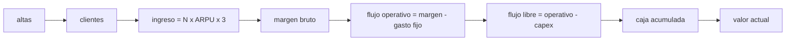

# B125-C06 — Plan empresarial de una empresa espacial

<!-- nav:top -->
[🏠 Programa](../../../../README.md) · [📚 Bloque B125](../../../tronco-comun/B125-creacion-y-operacion-de-empresas-espaciales.md) · [← Anterior: B125-C05 — Control de exportaciones y transferencia de tecnología](../B125-C05-control-de-exportaciones-y-transferencia-de-tecnologia/CLASE.md) · [Siguiente: B126-C01 — Capital semilla y financiamiento inicial →](../../../tronco-comun/B126-financiamiento-de-proyectos-y-negocios-espaciales.md#b126-c01)
<!-- /nav -->

## 1. Ubicación, nivel y alcance

Clase 6 del bloque B125, cierre del bloque. Nivel N4. Un plan empresarial junta el mercado (C01), los ingresos (C02), la organización (C03–C04) y los límites legales (C05) en un modelo de flujo de caja. Aquí armas un plan **sintético** a cinco años de una empresa de datos de observación de la Tierra: clientes, ingresos, margen, gasto fijo, inversión en satélites, caja, punto de equilibrio, brecha de financiación, valor actual y sensibilidad. Es un proyecto integrador; [B124-C20](../../../tronco-comun/B124-industria-economia-etica-y-proyectos-espaciales.md) es el proyecto general del área. **Esta clase es educativa: no es asesoría financiera, legal ni de inversión y no sustituye a un profesional.**

## 2. Por qué esta clase existe

Integrar mercado, finanzas y operación en un plan es el cierre del módulo; el proyecto de B124 es general y no trata una empresa concreta con su caja. La decisión central: **¿cuánta caja necesita la empresa para llegar a su punto de equilibrio y qué supuestos pueden hundir el plan?**

## 3. Lo que podrás hacer al terminar

1. Construir un flujo de caja trimestral a cinco años con clientes, ingresos, margen, gasto fijo e inversión.
2. Calcular el punto de equilibrio operativo, la caja mínima y la brecha de financiación.
3. Calcular el valor actual de los flujos por dos vías y comprobar que coinciden.
4. Hacer un análisis de sensibilidad a abandono, precio, gasto fijo e inversión.
5. Estimar la incertidumbre con una simulación Monte Carlo de las altas de clientes.
6. Separar lo consultado (descripción cualitativa de una empresa real, política de datos) de lo sintético (todo el plan).

La evidencia es la **plan empresarial sintético con sus supuestos y su sensibilidad** del ejercicio 12 (sección 20).

## 4. Con qué llegas y cómo comprobarlo

1. ¿Qué es un flujo de caja?
2. ¿Qué es el punto de equilibrio operativo?
3. ¿Qué es el valor actual?
4. ¿Qué es el abandono y el `LTV`?
5. ¿Qué es una distribución lognormal?

<details>
<summary>Ver respuestas</summary>

1. La diferencia entre lo que entra y lo que sale de la caja en un período. 2. Cuando el margen bruto iguala al gasto fijo. 3. La suma de flujos futuros divididos por `(1 + r)^t`. 4. Ver [B125-C02](../B125-C02-modelos-de-ingresos-suscripcion-y-servicio/CLASE.md). 5. Una cuyo logaritmo es normal; da factores positivos con cola a la derecha.
</details>

Con cuatro o cinco aciertos, sigue; si no, repasa los prerrequisitos.

## 5. Un caso de contexto y casos de referencia

El Formulario 10-K de Planet Labs PBC (ejercicio cerrado el 2026-01-31, SEC, consultado el 2026-11-11) muestra, como contraste cualitativo, a una empresa de datos de la Tierra que vende suscripciones y uso, servicios satelitales por hitos y capturas dedicadas, con dos clientes que suman 13 % y 12 % de los ingresos y **pérdidas netas** de `246,9`, `123,2` y `140,5` millones de dólares en los ejercicios cerrados en enero de 2026, 2025 y 2024 (**cifras citadas, no usadas en el modelo**). El reglamento europeo de Copernicus y la política Landsat del USGS muestran que existen datos gratuitos y abiertos (C01). El **ejemplo conductor** es sintético: con `300 + 120 t` altas por trimestre, `ARPU = 1 000`, margen `70 %`, gasto fijo de `6` M u.m. por trimestre y tres inversiones de satélites, la empresa llega al equilibrio operativo en el trimestre 6, pero su caja baja a `−25,7` M u.m. en el trimestre 10: necesita esa financiación adicional.

## 6. Vocabulario

El **flujo operativo** es el margen bruto menos el gasto fijo. El **flujo libre** es el flujo operativo menos la inversión (capex). La **caja** es el dinero disponible. La **brecha de financiación** es lo que hay que aportar para que la caja no baje de cero. El **valor actual** descuenta los flujos con una tasa. El **punto de equilibrio** es cuando el flujo operativo pasa a ser positivo. La **sensibilidad** mide cuánto cambia un resultado al variar un supuesto.

## 7. Modelo mental: un embudo de clientes a caja



*Descripción textual:* las altas forman la base de clientes, que genera ingreso y margen; restando gasto fijo e inversión queda el flujo libre, que se acumula en caja y se descuenta al valor actual.

Analogía: llenar un depósito con un grifo creciente mientras se abren grandes válvulas de salida (satélites). Límite: el modelo es determinista salvo en el Monte Carlo, sin impuestos, deuda, descuentos por volumen ni valor terminal; no valora ninguna empresa.

## 8. La explicación, paso a paso

### 8.1 Flujo de caja

Clientes: `N_t = N_{t−1}(1 − c_trim) + altas_t` con `c_trim = 1 − (1 − 0,02)³`. Ingreso trimestral: `N_t × 1 000 × 3/10⁶` M u.m. Margen `70 %`. Flujo operativo `= margen − 6`. Flujo libre `= operativo − capex` (`18` M u.m. en los trimestres 1, 2, 9, 10 y 15). Caja inicial `40`.

| trimestre | clientes | ingreso | flujo operativo | capex | caja |
|---|---|---|---|---|---|
| 1 | 300 | 0,90 | −5,37 | 18,0 | 16,6 |
| 2 | 702 | 2,11 | −4,53 | 18,0 | −5,9 |
| 6 | 3 220 | 9,66 | 0,76 | 0,0 | −11,7 |
| 10 | 6 953 | 20,86 | 8,60 | 18,0 | −25,7 |
| 13 | 10 391 | 31,17 | 15,82 | 0,0 | 14,3 |
| 20 | 20 020 | 60,06 | 36,04 | 0,0 | 185,6 |

### 8.2 Equilibrio, caja mínima y financiación

El flujo operativo es positivo desde el trimestre `6`; la caja mínima es `−25,7` M u.m. en el trimestre `10`; la **brecha de financiación** es `25,7` M u.m. La caja final es `185,6`. Que el negocio sea rentable al final no evita que **se quede sin caja a la mitad**.

### 8.3 Valor actual

A `12 %` anual (`r_trim = 1,12^0,25 − 1`) el valor actual de los flujos libres es `72,55` M u.m., calculado por suma directa y por Horner con la misma respuesta. No incluye valor terminal ni impuestos.

### 8.4 Sensibilidad

| escenario | caja mínima | caja final |
|---|---|---|
| base | −25,7 | 185,6 |
| abandono 4 % mensual | −33,6 | 113,8 |
| precio −20 % | −39,0 | 114,4 |
| gasto fijo +30 % | −43,7 | 149,6 |
| capex +25 % | −43,7 | 163,1 |

El precio y el abandono pesan más sobre la caja final que el gasto fijo y la inversión; estos pesan más sobre la caja mínima.

### 8.5 Incertidumbre

Con 2 000 casos y altas multiplicadas por un factor lognormal(0; 0,3) (semilla `125`): mediana de la caja final `182,4`, P10 `72,4`, P90 `347,7`, y la fracción con caja negativa en algún trimestre es `1,000`: en este plan sintético **todos** los casos necesitan financiación, porque la inversión llega antes que los clientes.

## 9. Magnitudes, símbolos y unidades

| Símbolo | Qué es | Unidad | Valor / nota |
|---|---|---|---|
| `N_t` | clientes al trimestre `t` | clientes | 300 en `t = 1` |
| `ARPU` | ingreso mensual por cliente | u.m./mes | 1 000 |
| `c_trim` | abandono trimestral | — | `1 − 0,98³ = 0,0588` |
| gasto fijo | costo fijo por trimestre | M u.m. | 6 |
| capex | inversión en satélites | M u.m. | 18 (cinco veces) |
| `r` | tasa de descuento anual | — | 0,12 |

## 10. Convenciones y referencias

M u.m. = millones de unidades monetarias ficticias; 20 trimestres; el trimestre 1 comienza con caja `40`. Sin impuestos, deuda ni valor terminal. Semilla `125`.

## 11. De dónde sale lo que afirmamos

| ID | Fuente | Localizador | Respalda | Estado |
|---|---|---|---|---|
| S1 | Planet Labs PBC, Formulario 10-K, ejercicio cerrado el 2026-01-31, SEC — https://www.sec.gov/Archives/edgar/data/1836833/000119312526119957/pl-20260131.htm (consultada 2026-11-11; extractos de negocio y factores de riesgo) | negocio y riesgos | tipos de ingreso, concentración de dos clientes (13 % y 12 %) y pérdidas netas de 246,9, 123,2 y 140,5 millones de dólares | Consultada; los estados financieros **no** se leyeron; las cifras no entran al modelo |
| S2 | Reglamento (UE) n.º 377/2014, art. 23 (EUR-Lex) y USGS «Landsat Data Access» | — | existencia de datos gratuitos y abiertos | Consultadas (ver B125-C01) |
| — | Flujo de caja, valor actual, Monte Carlo | — | todo el modelo; verificado con dos vías y con la recomputación de la caja | No consultado en una fuente concreta |
| — | Altas, ARPU, margen, gastos, inversión, tasa | — | todos los números | Sintético |

Límites: no se consultó ningún plan ni estado financiero real; las cifras de pérdidas se citan solo como contraste; el modelo no incluye impuestos, deuda, capital de trabajo ni valor terminal; no es una valoración.

## 12. Cómo ver el plan

| Magnitud | Valor |
|---|---|
| primer flujo operativo positivo | trimestre 6 |
| caja mínima | −25,7 M u.m. (trimestre 10) |
| brecha de financiación | 25,7 M u.m. |
| caja final | 185,6 M u.m. |
| valor actual a 12 % | 72,55 M u.m. |

Descripción larga: la empresa es rentable en lo operativo desde el trimestre 6, pero la inversión en satélites la deja con caja negativa hasta el trimestre 13; la sensibilidad muestra qué supuestos empujan más la caja y la simulación indica que, con estos números, todos los casos necesitan financiación.

## 13. Ejemplo trabajado: la caja del trimestre 3

**Paso 1 · Clientes.** `702 × 0,9412 + 540 = 1 201`.

**Paso 2 · Ingreso.** `1 201 × 1 000 × 3/10⁶ = 3,60` M u.m.

**Paso 3 · Flujo operativo.** `3,60 × 0,7 − 6 = −3,48`.

**Paso 4 · Caja.** `−5,9 − 3,48 = −9,4` M u.m. (sin capex en el trimestre 3).

## 14. Distintas formas de describir un plan empresarial

**Por tiempo:** trimestre a trimestre. **Por flujo:** operativo y libre. **Por caja:** mínima y final. **Por valor:** valor actual. **Por riesgo:** sensibilidad y Monte Carlo.

## 15. Práctica guiada

**Ejercicio 1 · con los pasos indicados.** Calcula el ingreso trimestral con 5 000 clientes y `ARPU = 1 000`. *Pasos:* `N × ARPU × 3`.

<details><summary>Solución comentada</summary>

`5 000 × 1 000 × 3 = 15 × 10⁶` u.m. = `15,0` M u.m.
</details>

**Ejercicio 2 · con una pista.** Calcula el flujo operativo con ese ingreso, margen `0,7` y gasto fijo `6`. *Pista:* `ingreso × margen − fijo`.

<details><summary>Solución comentada</summary>

`15 × 0,7 − 6 = 4,5` M u.m.
</details>

**Ejercicio 3 · casi autónomo.** Calcula el abandono trimestral si el mensual es `0,02`.

<details><summary>Solución comentada</summary>

`1 − 0,98³ = 0,0588`.
</details>

## 16. Práctica autónoma, transferencia e integrador

**Ejercicio 4 · autónomo.** Si la caja inicial fuera de `70` en vez de `40`, ¿cuál sería la caja mínima?

<details><summary>Solución comentada</summary>

`−25,7 + 30 = 4,3` M u.m.: no hace falta financiación (el resto no cambia).
</details>

**Ejercicio 5 · autónomo.** ¿Cuántos trimestres con flujo operativo negativo tiene el plan base?

<details><summary>Solución comentada</summary>

Cinco: del 1 al 5.
</details>

**Ejercicio 6 · autónomo.** Calcula el valor actual de un flujo de `10` M u.m. en el trimestre 4 a `12 %` anual.

<details><summary>Solución comentada</summary>

`r_trim = 1,12^0,25 − 1 = 0,0287`; `10/1,0287⁴ = 8,93` M u.m.
</details>

**Ejercicio 7 · autónomo.** En la sensibilidad, ¿qué escenario baja más la caja final y cuál la caja mínima?

<details><summary>Solución comentada</summary>

La caja final baja más con abandono 4 % (113,8) y precio −20 % (114,4); la caja mínima, con gasto fijo +30 % y capex +25 % (−43,7).
</details>

**Ejercicio 8 · autónomo.** ¿Por qué la fracción con caja negativa del Monte Carlo es `1,000`?

<details><summary>Solución comentada</summary>

Porque las dos primeras inversiones (36 M u.m.) superan la caja inicial (40 M u.m.) menos las pérdidas operativas iniciales, sea cual sea el factor de altas.
</details>

**Ejercicio 9 · transferencia.** **Transferencia.** La empresa del caso consultado reporta pérdidas netas en tres ejercicios. ¿Qué enseña el modelo sobre pérdidas y viabilidad?

<details><summary>Solución comentada</summary>

Que un negocio puede ser operativamente positivo y aun así necesitar financiación por la inversión previa; el modelo no puede decir nada de la empresa real, solo mostrar el mecanismo.
</details>

**Ejercicio 10 · transferencia.** **Transferencia.** Si el dato abierto (C01) baja el precio un 20 %, ¿qué cambia en el plan y qué respuesta estratégica sugiere?

<details><summary>Solución comentada</summary>

La caja final cae de 185,6 a 114,4 y la mínima a −39,0; sugiere ofrecer producto elaborado o servicio con mayor valor (C01–C02) y revisar la inversión.
</details>

**Ejercicio 11 · transferencia.** **Transferencia.** Los controles de exportación (C05) retrasan seis meses la entrega a un cliente. ¿Dónde lo reflejarías en el plan?

<details><summary>Solución comentada</summary>

Retrasando las altas de ese cliente (menos ingreso en los trimestres siguientes) y sumando el costo esperado de penalizaciones; probablemente aumenta la brecha de financiación.
</details>

**Ejercicio 12 · integrador.** **Integrador.** Elabora tu *plan empresarial sintético con sus supuestos y su sensibilidad*: tabla de cinco años, equilibrio, caja mínima y brecha, valor actual, sensibilidad, incertidumbre y lista de lo consultado, lo sintético y lo no consultado, con el aviso de que es educativo y no es asesoría financiera.

<details><summary>Solución comentada</summary>

Secciones 8.1–8.5 y la salida del laboratorio.
</details>

## 17. Laboratorio: plan sintético a cinco años

El script [plan.py](plan.py) calcula 20 trimestres de flujo de caja, el equilibrio, la caja mínima, el valor actual por dos vías, cuatro sensibilidades y un Monte Carlo de 2 000 casos (**comprueba** la caja recomputada por suma acumulada y el valor actual por dos vías a 1e-9).

**Datos:** ninguna cifra consultada entra al cálculo; todo es **sintético**. **Predice antes de ejecutar:** ¿tendrá la caja del plan base algún trimestre negativo? (sí: la inversión llega antes que los clientes.) **Ejecución del 2026-11-11 (Python 3.12.9):**

```text
Python 3.12.9 (biblioteca estandar)
Plan SINTETICO a 5 anos; M u.m. = millones de unidades monetarias; sin cifras de mercado ni de empresa real en el calculo.
Trim  clientes  ingreso  margen  flujo_oper  capex  flujo_libre  caja
   1       300     0.90    0.63       -5.37   18.0       -23.37   16.6
   2       702     2.11    1.47       -4.53   18.0       -22.53   -5.9
   3      1201     3.60    2.52       -3.48    0.0        -3.48   -9.4
   4      1790     5.37    3.76       -2.24    0.0        -2.24  -11.6
   5      2465     7.40    5.18       -0.82    0.0        -0.82  -12.4
   6      3220     9.66    6.76        0.76    0.0         0.76  -11.7
   7      4051    12.15    8.51        2.51    0.0         2.51   -9.2
   8      4953    14.86   10.40        4.40    0.0         4.40   -4.8
   9      5921    17.76   12.43        6.43   18.0       -11.57  -16.3
  10      6953    20.86   14.60        8.60   18.0        -9.40  -25.7
  11      8044    24.13   16.89       10.89    0.0        10.89  -14.8
  12      9191    27.57   19.30       13.30    0.0        13.30   -1.5
  13     10391    31.17   21.82       15.82    0.0        15.82   14.3
  14     11640    34.92   24.44       18.44    0.0        18.44   32.7
  15     12935    38.81   27.16       21.16   18.0         3.16   35.9
  16     14274    42.82   29.98       23.98    0.0        23.98   59.9
  17     15655    46.96   32.88       26.88    0.0        26.88   86.7
  18     17074    51.22   35.86       29.86    0.0        29.86  116.6
  19     18530    55.59   38.91       32.91    0.0        32.91  149.5
  20     20020    60.06   42.04       36.04    0.0        36.04  185.6
Caja final = 185.6 M u.m. ; caja minima = -25.7 M u.m. en el trimestre 10 ; primer flujo operativo positivo: trimestre 6
Brecha de financiacion (necesidad maxima de caja adicional para no bajar de 0) = 25.7 M u.m.
Valor actual de los flujos libres a 12 % anual = 72.55 M u.m. (dos vias coinciden); sin valor terminal
Sensibilidad (caja minima y caja final, M u.m.):
escenario                       caja min   caja final
base                               -25.7       185.6
abandono 4 % mensual               -33.6       113.8
precio -20 %                       -39.0       114.4
gasto fijo +30 %                   -43.7       149.6
capex +25 %                        -43.7       163.1
Monte Carlo (2000 casos, altas x lognormal(0, 0.3), semilla 125): mediana caja final = 182.4 ; P10 = 72.4 ; P90 = 347.7 ; fraccion con caja < 0 en algun trimestre = 1.000
Pruebas superadas.
```

```bash
python programa/clases/B125/B125-C06-plan-empresarial-de-una-empresa-espacial/plan.py
```

**Límites:** modelo determinista salvo el Monte Carlo; sin impuestos, deuda, capital de trabajo ni valor terminal; no es un plan real ni asesoría financiera.

## 18. Errores frecuentes y cómo corregirlos

**Confundir rentabilidad operativa con caja.** Se corrige con 8.2 y el ejercicio 9.

**Tomar el valor actual como valoración de la empresa.** Se corrige con 8.3 y la sección 21.

**Variar un solo supuesto y creer que el plan es robusto.** Se corrige con 8.4 y 8.5.

**Citar cifras de una empresa real como si fueran del modelo.** Se corrige con la sección 11.

## 19. Cómo sabrás que vas bien

Tras la sección 8: ¿qué caja mínima esperabas y cuál obtuviste? Si dudas, repasa el ejemplo 13. Tras el laboratorio: ¿qué comprueba? (ver la sección 17).

## 20. Qué entregas y cómo se evalúa

El producto es tu **plan empresarial sintético con sus supuestos y su sensibilidad** (ejercicio 12).

| Criterio | Inicial | En desarrollo | Logrado | Destacado |
|---|---|---|---|---|
| Conceptos | Los confunde | Parciales | Construye el flujo de caja y calcula la brecha | Explica la sensibilidad y lo que el modelo no puede decir |
| Cálculo | Sin unidades | Con errores | Tablas completas con unidades | Calcula casos nuevos |
| Numérico | Sin comprobar | Un caso | Contraste con una segunda vía | Interpreta las diferencias |
| Fuentes | Sin fuente | Sin fecha | Fuentes con fecha y estado | Declara lo sintético y lo no consultado |
| Límites | No los nombra | Uno | Tres | Discute qué falta del modelo |

**Condiciones críticas (no se compensan con promedio):** rotular todos los datos de empresas como sintéticos o citados con su fuente; no presentar un resultado como asesoría financiera, legal o de inversión; citar solo lo consultado. No presentar el plan o su valor actual como una valoración o una oferta de inversión.

## 21. Ética, seguridad y límites

Clase educativa: **no es asesoría financiera, legal, tributaria ni de inversión** y no sustituye a un abogado, un contador, un especialista en cumplimiento ni un asesor financiero; ningún resultado debe usarse para decidir una operación, una constitución societaria, una exportación o una inversión reales. Un plan real para captar capital o crear una empresa requiere asesoría legal, contable y financiera; esta clase no capta inversión ni valora ninguna empresa. Los modelos son simplificados y sus datos son sintéticos o ilustrativos. Accesibilidad: tablas equivalentes a las gráficas, fórmulas en texto, ejercicios sin conexión.

## 22. Para cerrar y seguir

El plan sintético llega al equilibrio operativo en el trimestre 6 y a `185,6` M u.m. de caja al final, pero necesita `25,7` M u.m. de financiación a mitad de camino. Cierras el bloque con un plan, sus supuestos y sus límites; el siguiente bloque, [B126](../../../tronco-comun/B126-financiamiento-de-proyectos-y-negocios-espaciales.md), trata cómo se financia.

**Glosario español–inglés.** plan empresarial · *business plan*; flujo de caja · *cash flow*; punto de equilibrio · *break-even*; valor actual · *present value*; análisis de sensibilidad · *sensitivity analysis*.

**Continuidad.** El área sigue con [B126](../../../tronco-comun/B126-financiamiento-de-proyectos-y-negocios-espaciales.md), sobre el financiamiento de proyectos y negocios espaciales.

**Referencias:** ver sección 11.

<!-- nav:bottom -->
---

[← Anterior: B125-C05 — Control de exportaciones y transferencia de tecnología](../B125-C05-control-de-exportaciones-y-transferencia-de-tecnologia/CLASE.md) · [📚 Bloque B125](../../../tronco-comun/B125-creacion-y-operacion-de-empresas-espaciales.md) · [Siguiente: B126-C01 — Capital semilla y financiamiento inicial →](../../../tronco-comun/B126-financiamiento-de-proyectos-y-negocios-espaciales.md#b126-c01)
<!-- /nav -->
