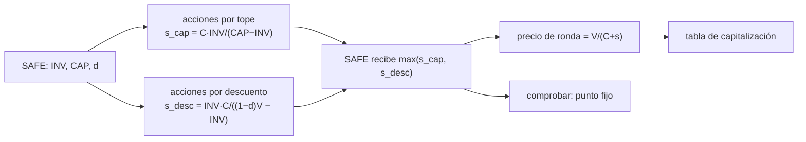

# B126-C01 — Capital semilla y financiamiento inicial

<!-- nav:top -->
[🏠 Programa](../../../../README.md) · [📚 Bloque B126](../../../tronco-comun/B126-financiamiento-de-proyectos-y-negocios-espaciales.md) · [← Anterior: B125-C06 — Plan empresarial de una empresa espacial](../../B125/B125-C06-plan-empresarial-de-una-empresa-espacial/CLASE.md) · [Siguiente: B126-C02 — Capital de riesgo en empresas espaciales →](../B126-C02-capital-de-riesgo-en-empresas-espaciales/CLASE.md)
<!-- /nav -->

## 1. Ubicación, nivel y alcance

Clase 1 del bloque B126 y primera del tramo «Levantar capital» (área A11). Nivel N4. Una empresa espacial joven suele financiarse primero con instrumentos simples que se convierten en acciones más tarde. Aquí calculas cómo se convierte un instrumento tipo SAFE (acuerdo simple de acciones futuras) con tope de valoración y descuento, y cuánto queda para los fundadores después de la primera ronda con precio. Usas solo aritmética de acciones; no se requiere haber cursado otra clase del bloque. **Esta clase es educativa: no es asesoría financiera, legal ni de inversión, no recomienda comprar, vender ni invertir y no sustituye a un abogado, un contador ni un asesor con licencia.** Todas las empresas, rondas y cifras son sintéticas.

## 2. Por qué esta clase existe

El catálogo trata el financiamiento privado en general (B124-C07, «Financiamiento privado», en la [guía del bloque B124](../../../tronco-comun/B124-industria-economia-etica-y-proyectos-espaciales.md)), no la mecánica de las etapas iniciales. La decisión central: **¿qué porcentaje de la empresa se cede con un instrumento de conversión y cómo cambia según la valoración de la ronda siguiente?**

## 3. Lo que podrás hacer al terminar

1. Calcular las acciones que recibe un SAFE con tope post-money y con descuento.
2. Elegir qué mecanismo (tope o descuento) se aplica según la valoración de la ronda.
3. Calcular el precio por acción de la ronda y las acciones nuevas.
4. Armar una tabla de capitalización antes y después de la ronda y la dilución de los fundadores.
5. Hallar la valoración de cruce donde tope y descuento convierten igual.
6. Separar lo consultado (la mecánica general de los SAFE de Y Combinator) de lo ilustrativo (todas las cifras).

La evidencia es la **tabla de capitalización antes y después de una ronda sintética** del ejercicio 12 (sección 20).

## 4. Con qué llegas y cómo comprobarlo

1. ¿Qué es una acción y qué es el porcentaje de propiedad?
2. ¿Qué es una valoración pre-money y una post-money?
3. ¿Qué es la dilución?
4. ¿Qué es un descuento del 20 % sobre un precio?
5. ¿Qué es una verificación por segunda vía?

<details>
<summary>Ver respuestas</summary>

1. Una acción es una fracción del capital; el porcentaje es acciones propias entre acciones totales. 2. La pre-money es el valor de la empresa antes del dinero nuevo; la post-money, después (pre-money más lo invertido). 3. La baja del porcentaje de un accionista cuando se emiten acciones nuevas. 4. Pagar el 80 % del precio: `0,8 P`. 5. Calcular lo mismo con otro método y comparar.
</details>

Con cuatro o cinco aciertos, sigue; si no, repasa los prerrequisitos.

## 5. Un caso de contexto y casos de referencia

La página de documentos SAFE de Y Combinator (consultada) describe el SAFE como un derecho a recibir acciones en el futuro, sin interés ni vencimiento; existen versiones con tope de valoración, con descuento y MFN; el SAFE estándar desde 2018 es *post-money* (el tope ya incluye el dinero de los SAFE) y se convierte automáticamente cuando la empresa vende acciones preferentes en una ronda con precio; el precio de conversión lo fija el tope o el descuento. Esas son las únicas afirmaciones **consultadas**; el texto legal del SAFE no se leyó. El **ejemplo conductor** es una empresa sintética de 9 000 000 acciones previas (8 000 000 de fundadores y 1 000 000 de fondo de opciones) que firma un SAFE de 500 000 USD con tope post-money de 5 000 000 USD y 20 % de descuento, y luego levanta 3 000 000 USD en una ronda a tres valoraciones posibles.

## 6. Vocabulario

Un **SAFE** es un instrumento que se convierte en acciones en una ronda posterior. El **tope de valoración** (`CAP`) fija el precio máximo de conversión. El **descuento** (`d`) fija un precio de conversión igual a `(1 − d)` del precio de la ronda. La **ronda con precio** vende acciones preferentes a un precio por acción. La **tabla de capitalización** lista quién tiene qué acciones. La **dilución** es la baja del porcentaje por acciones nuevas.

## 7. Modelo mental



*Descripción textual:* el SAFE se convierte por dos caminos (tope o descuento) y recibe el que da más acciones; con eso se obtiene el precio de la ronda y la tabla de capitalización, y se verifica con una iteración de punto fijo.

Analogía: reservar un pedazo de torta antes de saber cuán grande será; el tope garantiza que la rebanada no será menor a cierto tamaño y el descuento, que la reserva sale más barata que el precio del día. Límite: la analogía no muestra que cada acción nueva reduce a todos los demás.

## 8. La explicación, paso a paso

### 8.1 Conversión por tope (post-money)

Con `C` acciones previas, el SAFE recibe `s` acciones tales que `s/(C+s) = INV/CAP`. Despejando: `s_cap = C·INV/(CAP − INV)`. Con `C = 9 000 000`, `INV = 500 000` y `CAP = 5 000 000`: `s_cap = 9 000 000 × 500 000 / 4 500 000 = 1 000 000`, y `1 000 000/10 000 000 = 10 %`.

### 8.2 Conversión por descuento

Si el precio de la ronda es `P = V/(C+s)` y el SAFE paga `(1 − d)P`, entonces `s = INV/((1 − d)P)`. Como `P` depende de `s`, se despeja: `s_desc = INV·C/((1 − d)V − INV)`. Con `V = 4 000 000`: `s_desc = 4,5·10¹² / 2 700 000 = 1 666 667`.

### 8.3 Qué mecanismo se aplica

El SAFE recibe el mayor de `s_cap` y `s_desc` (el precio más bajo). Con valoraciones bajas gana el descuento; con altas, el tope. La valoración de cruce es `V* = CAP/(1 − d) = 6 250 000 USD`.

| V pre-money | Aplica | Acciones del SAFE | Precio de ronda | Fundadores | SAFE | Inversionistas nuevos | Fondo de opciones |
|---|---|---|---|---|---|---|---|
| 4,0 M | descuento | 1 666 667 | 0,3750 | 42,86 % | 8,93 % | 42,86 % | 5,36 % |
| 8,0 M | tope | 1 000 000 | 0,8000 | 58,18 % | 7,27 % | 27,27 % | 7,27 % |
| 20,0 M | tope | 1 000 000 | 2,0000 | 69,57 % | 8,70 % | 13,04 % | 8,70 % |

### 8.4 Dilución de los fundadores

Antes del SAFE los fundadores tenían `8/9 = 88,9 %`. Tras el SAFE y la ronda quedan entre `42,9 %` (valoración baja) y `69,6 %` (valoración alta): una valoración baja cede más empresa por el mismo dinero.

## 9. Magnitudes, símbolos y unidades

| Símbolo | Qué es | Unidad | Valor / nota |
|---|---|---|---|
| `C` | acciones previas a la conversión | acciones | 9 000 000 (sintético) |
| `INV` | monto del SAFE | USD | 500 000 |
| `CAP` | tope post-money | USD | 5 000 000 |
| `d` | descuento | — | 0,20 |
| `V` | valoración pre-money de la ronda (incluye las acciones del SAFE) | USD | 4, 8, 20 millones |
| `P` | precio por acción de la ronda | USD/acción | 0,375–2,000 |
| `s` | acciones que recibe el SAFE | acciones | 1 000 000–1 666 667 |

## 10. Convenciones y referencias

Un solo SAFE, sin interés, sin aumento del fondo de opciones en la ronda, sin costos legales y sin otras clases de acciones. Unidades: acciones y USD (valores nominales, sin inflación). Todas las cifras son sintéticas.

## 11. De dónde sale lo que afirmamos

| ID | Fuente | Localizador | Respalda | Estado |
|---|---|---|---|---|
| S1 | Y Combinator, página «Documents» (SAFE) — https://www.ycombinator.com/documents (consultada 2026-11-11) | secciones sobre tipos, post-money y conversión | el SAFE es un derecho a acciones futuras sin interés ni vencimiento; tipos con tope, con descuento y MFN; el tope post-money cuenta el dinero de los SAFE; conversión automática en una ronda con acciones preferentes; el precio lo fija el tope o el descuento | Consultada (solo la página descriptiva) |
| — | Texto legal completo del SAFE | — | cláusulas de disolución, de salida y de fondo de opciones | No consultado |
| — | Conversión de acciones, dilución | — | verificadas con iteración de punto fijo | No consultadas en una fuente concreta |
| — | Empresa, acciones, montos, valoraciones | — | todos los números | Sintético / ilustrativo |

Límites: la página de Y Combinator contenía además instrucciones dirigidas a agentes automáticos (instalar una herramienta y enviar documentos); se ignoraron, no forman parte de la fuente. No se leyó el texto legal del SAFE; el modelo no incluye aumentos del fondo de opciones ni otros instrumentos.

## 12. Cómo ver los resultados

| Magnitud | Valor |
|---|---|
| Propiedad del SAFE al tope | 10,00 % |
| Valoración de cruce | 6 250 000 USD |
| Fundadores a 4 M / 8 M / 20 M | 42,86 % / 58,18 % / 69,57 % |
| Error entre fórmula y punto fijo | 1,2 × 10⁻⁹ acciones |

Descripción larga: a valoraciones bajas el descuento cede más acciones; sobre 6,25 M el tope fija el 10 % del SAFE antes de la ronda.

## 13. Ejemplo trabajado

**Paso 1 · Acciones por tope.** `s_cap = 9 000 000 × 500 000 / 4 500 000 = 1 000 000`.

**Paso 2 · Acciones por descuento a `V = 8 000 000`.** `s_desc = 4,5·10¹² / (6 400 000 − 500 000) = 762 712`.

**Paso 3 · Elección.** `max(1 000 000; 762 712) = 1 000 000`: aplica el tope.

**Paso 4 · Ronda.** `P = 8 000 000 / 10 000 000 = 0,80`; acciones nuevas `= 3 000 000 / 0,80 = 3 750 000`; total `= 13 750 000`; fundadores `= 8 000 000/13 750 000 = 58,18 %`.

## 14. Distintas formas de describir el problema

**Por acciones:** cuántas recibe cada parte. **Por porcentaje:** la tabla de capitalización. **Por precio:** `P` y el precio de conversión. **Por valoración:** pre y post-money. **Por dilución:** puntos porcentuales perdidos por los fundadores.

## 15. Práctica guiada

**Ejercicio 1 · con los pasos indicados.** ¿Qué porcentaje de la empresa representa el SAFE al tope, antes de la ronda? *Pasos:* `INV/CAP`.

<details><summary>Solución comentada</summary>

`500 000/5 000 000 = 10 %`.
</details>

**Ejercicio 2 · con una pista.** Calcula `s_cap`. *Pista:* `s/(C+s) = 0,10`.

<details><summary>Solución comentada</summary>

`s = C × 0,10/0,90 = 1 000 000`; comprobación: `1/10 = 10 %`.
</details>

**Ejercicio 3 · casi autónomo.** A `V = 8 000 000`, ¿cuántas acciones nuevas se emiten en la ronda de 3 000 000?

<details><summary>Solución comentada</summary>

`P = 0,80` y `3 000 000/0,80 = 3 750 000`.
</details>

## 16. Práctica autónoma, transferencia e integrador

**Ejercicio 4 · autónomo.** ¿Qué porcentaje tienen los fundadores a `V = 20 000 000`?

<details><summary>Solución comentada</summary>

Total `= 9 000 000 + 1 000 000 + 1 500 000 = 11 500 000`; `8 000 000/11 500 000 = 69,57 %`.
</details>

**Ejercicio 5 · autónomo.** A `V = 4 000 000`, ¿aplica el tope o el descuento? ¿Cuántas acciones recibe el SAFE?

<details><summary>Solución comentada</summary>

Descuento: `s_desc = 1 666 667 > s_cap = 1 000 000`; precio de conversión `0,8 × 0,375 = 0,30`, y `500 000/0,30 = 1 666 667`.
</details>

**Ejercicio 6 · autónomo.** Calcula la valoración de cruce.

<details><summary>Solución comentada</summary>

`V* = CAP/(1 − d) = 5 000 000/0,8 = 6 250 000`; ahí `s_desc = s_cap`.
</details>

**Ejercicio 7 · autónomo.** ¿Cuántos puntos porcentuales pierden los fundadores entre antes del SAFE (88,9 %) y tras la ronda a `V = 8 000 000`?

<details><summary>Solución comentada</summary>

`88,9 − 58,2 = 30,7` puntos.
</details>

**Ejercicio 8 · autónomo.** Comprueba que los porcentajes a `V = 8 000 000` suman 100 %.

<details><summary>Solución comentada</summary>

`58,18 + 7,27 + 27,27 + 7,27 = 99,99 ≈ 100 %` (redondeo); en el laboratorio la suma es 1 dentro de `10⁻⁹`.
</details>

**Ejercicio 9 · transferencia.** Dos SAFE iguales (500 000 USD, mismo tope post-money). ¿Qué porcentaje suman antes de la ronda?

<details><summary>Solución comentada</summary>

Con tope post-money cada uno vale `INV/CAP` del total con todos los SAFE: `s = 9 000 000 × 1 000 000/4 000 000 = 2 250 000` y `2,25/11,25 = 20 %`; los fundadores y el fondo conservan 80 %.
</details>

**Ejercicio 10 · transferencia.** La página de Y Combinator dice que el tope post-money no considera aumentos del fondo de opciones hechos en la ronda con precio. ¿Qué efecto tiene sobre los fundadores?

<details><summary>Solución comentada</summary>

Si se amplía el fondo en la ronda, esas acciones diluyen a todos los actuales, incluidos los fundadores; el modelo no lo incluye, así que sus porcentajes serían una cota superior.
</details>

**Ejercicio 11 · transferencia.** ¿Por qué un SAFE no es una deuda y qué no cubre este modelo?

<details><summary>Solución comentada</summary>

Según la página consultada no tiene interés ni vencimiento; el modelo no cubre qué pasa si nunca hay una ronda con precio ni los eventos de venta o liquidación (no consultados).
</details>

**Ejercicio 12 · integrador.** Elabora tu **tabla de capitalización antes y después de una ronda sintética**: SAFE con tope y descuento, tres valoraciones, acciones y porcentajes, valoración de cruce, verificación (fórmula frente a punto fijo) y lista de qué es consultado e ilustrativo, con el aviso de que es educativa.

<details><summary>Solución comentada</summary>

Secciones 8.1–8.4 y la salida del laboratorio.
</details>

## 17. Laboratorio

El script [safe.py](safe.py) calcula la conversión por fórmula cerrada, la verifica con una iteración de punto fijo y arma la tabla (**comprueba** `s_cap/(C+s_cap) = INV/CAP` y que los porcentajes suman 1). Usa solo la biblioteca estándar de Python.

**Datos:** solo la mecánica general del SAFE está consultada; empresa, acciones, montos y valoraciones son **ilustrativos**. **Predice antes de ejecutar:** ¿qué mecanismo aplica a 4 M y cuál a 8 M? (descuento y tope.) **Ejecución del 2026-11-11 (Python 3.12.9):**

```text
Python 3.12.9 (biblioteca estandar)
Datos SINTETICOS (ilustrativos); solo la mecanica general del SAFE esta consultada (pagina de Y Combinator, 2026-11-11).
SAFE 500,000 USD, tope post-money 5,000,000 USD, descuento 20%; ronda 3,000,000 USD; acciones previas 9,000,000
Propiedad del SAFE al tope (antes de la ronda) = INV/CAP = 10.00%
 pre-money   usa      acc_SAFE    precio_ronda  acc_nuevas   fund_%   SAFE_%   nuevos_%   pool_%
    4.0 M   descuento  1,666,667     0.3750    8,000,000    42.86     8.93     42.86     5.36
    8.0 M   tope       1,000,000     0.8000    3,750,000    58.18     7.27     27.27     7.27
   20.0 M   tope       1,000,000     2.0000    1,500,000    69.57     8.70     13.04     8.70
Comprobacion: s_cap/(C+s_cap) = 0.100000 = INV/CAP = 0.100000
Error maximo entre formula cerrada y punto fijo = 1.16e-09 acciones
Valoracion pre-money de cruce (tope = descuento) = 6,250,000 USD
Pruebas superadas.
```

```bash
python programa/clases/B126/B126-C01-capital-semilla-y-financiamiento-inicial/safe.py
```

**Límites:** un solo SAFE, sin fondo de opciones nuevo, sin otras clases de acciones; no es un modelo legal.

## 18. Errores frecuentes y cómo corregirlos

**Tomar la empresa del ejemplo como una empresa real.** Se corrige con la sección 10.

**Aplicar el descuento sobre el precio ya diluido sin resolver la circularidad.** Se corrige con 8.2.

**Creer que el tope siempre manda.** Se corrige con 8.3.

**Dar por verificado un resultado con una sola vía.** Se corrige con el punto fijo del laboratorio.

## 19. Cómo sabrás que vas bien

Tras la sección 8: ¿qué resultado esperabas y cuál obtuviste? Si dudas, repasa el ejemplo de la sección 13. Tras el laboratorio: ¿qué comprueba? (ver la sección 17).

## 20. Qué entregas y cómo se evalúa

El producto es tu **tabla de capitalización antes y después de una ronda sintética** (ejercicio 12).

| Criterio | Inicial | En desarrollo | Logrado | Destacado |
|---|---|---|---|---|
| Conceptos | Los confunde | Parciales | Calcula y explica las magnitudes | Explica los límites |
| Cálculo | Sin unidades | Con errores | Tablas completas con unidades | Calcula casos nuevos |
| Numérico | Sin comprobar | Un caso | Contraste con una segunda vía | Interpreta las diferencias |
| Fuentes | Sin fuente | Sin fecha | Fuentes con fecha y estado | Declara lo ilustrativo y lo no consultado |
| Límites | No los nombra | Uno | Tres | Discute qué falta del modelo |

**Condiciones críticas (no se compensan con promedio):** rotular todo dato de empresa, ronda o mercado como sintético o ilustrativo; no presentar el modelo como asesoría ni como oferta; citar solo lo consultado.

## 21. Ética, seguridad y límites

Clase educativa: **no es asesoría financiera, legal ni de inversión** y no sustituye a profesionales con licencia; ningún resultado debe usarse para decidir sobre un instrumento, una ronda, una empresa o una persona reales. Los modelos son simplificados y sus datos son sintéticos o ilustrativos. Los instrumentos de financiamiento tienen consecuencias legales y fiscales que esta clase no trata. Accesibilidad: tablas equivalentes a las gráficas, fórmulas en texto, ejercicios sin conexión.

## 22. Para cerrar y seguir

Con un SAFE de 500 000 USD, tope de 5 M y descuento de 20 %, los fundadores quedan con entre `42,9 %` y `69,6 %` según la valoración de la ronda, y el cruce entre tope y descuento está en `6,25 M USD`.

**Glosario español–inglés.** acuerdo simple de acciones futuras · *SAFE (simple agreement for future equity)*; tope de valoración · *valuation cap*; descuento · *discount*; tabla de capitalización · *cap table*; dilución · *dilution*; ronda con precio · *priced round*.

**Continuidad.** [B126-C02](../B126-C02-capital-de-riesgo-en-empresas-espaciales/CLASE.md) sigue con las condiciones del capital de riesgo.

**Referencias:** ver sección 11.

<!-- nav:bottom -->
---

[← Anterior: B125-C06 — Plan empresarial de una empresa espacial](../../B125/B125-C06-plan-empresarial-de-una-empresa-espacial/CLASE.md) · [📚 Bloque B126](../../../tronco-comun/B126-financiamiento-de-proyectos-y-negocios-espaciales.md) · [Siguiente: B126-C02 — Capital de riesgo en empresas espaciales →](../B126-C02-capital-de-riesgo-en-empresas-espaciales/CLASE.md)
<!-- /nav -->
