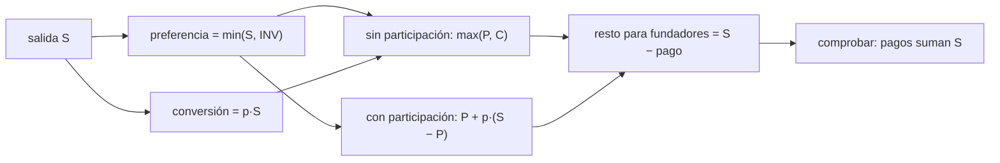

# B126-C02 — Capital de riesgo en empresas espaciales

<!-- nav:top -->
[🏠 Programa](../../../../README.md) · [📚 Bloque B126](../../../tronco-comun/B126-financiamiento-de-proyectos-y-negocios-espaciales.md) · [← Anterior: B126-C01 — Capital semilla y financiamiento inicial](../B126-C01-capital-semilla-y-financiamiento-inicial/CLASE.md) · [Siguiente: B126-C03 — Proyección de flujos de caja de un proyecto espacial →](../B126-C03-proyeccion-de-flujos-de-caja-de-un-proyecto-espacial/CLASE.md)
<!-- /nav -->

## 1. Ubicación, nivel y alcance

Clase 2 del bloque B126. Nivel N4. El capital de riesgo no solo aporta dinero: trae condiciones sobre quién cobra primero cuando la empresa se vende, y vive de una cartera donde pocos éxitos pagan a muchos fracasos. Aquí calculas el reparto de una salida con una preferencia de liquidación (con y sin participación) y el retorno de una cartera sintética con cola pesada. Retomas la tabla de capitalización de [B126-C01](../B126-C01-capital-semilla-y-financiamiento-inicial/CLASE.md). **Esta clase es educativa: no es asesoría financiera, legal ni de inversión, no recomienda comprar, vender ni invertir y no sustituye a un abogado, un contador ni un asesor con licencia.** Todas las empresas, rondas y cifras son sintéticas.

## 2. Por qué esta clase existe

El capital de riesgo tiene lógica y condiciones propias que el catálogo no trata. La decisión central: **¿cuánto recibe cada parte en una salida según las condiciones pactadas, y qué retorno cabe esperar de una cartera cuando casi todo el valor viene de pocos casos?**

## 3. Lo que podrás hacer al terminar

1. Calcular lo que cobra un inversionista con preferencia 1x sin participación y con participación.
2. Hallar la salida de cruce donde conviene convertir en lugar de cobrar la preferencia.
3. Calcular el resto que queda para fundadores y otros accionistas.
4. Calcular el múltiplo esperado de una cartera y la probabilidad de no recuperar lo invertido, de forma exacta y con Monte Carlo.
5. Ver cuánto del retorno depende del mayor éxito.
6. Separar lo consultado (el listado de documentos modelo de la NVCA) de lo ilustrativo (todos los números).

La evidencia es la **ficha de reparto de una salida y retorno de cartera sintéticos** del ejercicio 12 (sección 20).

## 4. Con qué llegas y cómo comprobarlo

1. ¿Qué es una acción preferente?
2. ¿Qué es un múltiplo de retorno?
3. ¿Qué es un valor esperado?
4. ¿Qué es una distribución de cola pesada?
5. ¿Qué es una simulación de Monte Carlo?

<details>
<summary>Ver respuestas</summary>

1. Una clase de acción con derechos adicionales, por ejemplo cobrar antes que las comunes. 2. Lo recuperado dividido por lo invertido: `2x` es el doble. 3. El promedio ponderado por probabilidad. 4. Una donde eventos raros y muy grandes pesan mucho en el total. 5. Estimar una probabilidad repitiendo un experimento aleatorio muchas veces.
</details>

Con cuatro o cinco aciertos, sigue; si no, repasa los prerrequisitos.

## 5. Un caso de contexto y casos de referencia

El listado de documentos modelo de la NVCA (consultado el 2026-11-11; solo la lista de la página, no sus textos) muestra que una ronda de capital de riesgo se documenta con varios instrumentos: certificado de incorporación, acuerdo de compra de acciones, acuerdo de derechos de inversionistas, acuerdo de voto y acuerdo de derecho de primera oferta y co-venta. Esa es la única afirmación **consultada**. La mecánica de la preferencia 1x **no se consultó** en una fuente primaria: se calcula y se verifica con dos vías. El **ejemplo conductor** es una inversión sintética de 10 M USD por el 20 % de una empresa con preferencia 1x, y una cartera sintética de 25 empresas cuyos múltiplos son `[0; 0,5; 2; 5; 20; 100]x`.

## 6. Vocabulario

La **preferencia de liquidación** `1x` da al inversionista el derecho de cobrar primero hasta lo invertido. **Sin participación**: cobra lo mayor entre la preferencia y lo que recibiría al convertir en acciones comunes. **Con participación**: cobra la preferencia y además su porcentaje del resto. La **salida** es el valor que se reparte al vender la empresa. El **múltiplo de cartera** es el valor devuelto entre el invertido. La **cola pesada** es la dependencia del total respecto de pocos casos.

## 7. Modelo mental



*Descripción textual:* de la salida se obtiene la preferencia y la conversión; sin participación se cobra la mayor y con participación se cobra la preferencia más una parte del resto; el resto va a los demás accionistas y se verifica que los pagos sumen la salida.

Analogía: en una herencia, un heredero cobra primero su parte fija y los demás se reparten lo que queda; la participación sería cobrar la parte fija y además un porcentaje del resto. Límite: no hay deudas ni otras clases de acciones.

## 8. La explicación, paso a paso

### 8.1 Sin participación

Con `INV = 10` y `p = 20 %`, el pago es `max(min(S, 10); 0,2 S)`. Si `S ≤ 10` cobra todo `S`; entre 10 y 50 cobra `10`; sobre 50 convierte y cobra `0,2 S`. La salida de cruce es `INV/p = 50 M USD`.

### 8.2 Con participación

El pago es `min(S, 10) + 0,2 × (S − min(S, 10))`. A `S = 40`: `10 + 0,2 × 30 = 16`, el 40 % de la salida con un 20 % de propiedad.

| Salida (M USD) | Sin participación | Con participación | Resto fundadores (sin) | Resto fundadores (con) |
|---|---|---|---|---|
| 5 | 5,00 | 5,00 | 0,00 | 0,00 |
| 10 | 10,00 | 10,00 | 0,00 | 0,00 |
| 20 | 10,00 | 12,00 | 10,00 | 8,00 |
| 40 | 10,00 | 16,00 | 30,00 | 24,00 |
| 100 | 20,00 | 28,00 | 80,00 | 72,00 |

### 8.3 Cartera con cola pesada

El múltiplo esperado por empresa es `0,25 × 0,5 + 0,15 × 2 + 0,10 × 5 + 0,045 × 20 + 0,005 × 100 = 2,325x`. Con 25 empresas, el Monte Carlo (20 000 carteras, semilla 126) da `2,318x`. La probabilidad de que la cartera devuelva menos de `1x` es `0,1513` exacta (convolución) y `0,1474` por Monte Carlo.

### 8.4 Dependencia de pocos casos

Percentiles del múltiplo de cartera: `P10 = 0,86x`, `P50 = 1,86x`, `P90 = 4,88x`. La mediana (1,86x) queda bajo la media (2,32x) y el mayor éxito aporta en promedio el `37,9 %` del retorno total.

## 9. Magnitudes, símbolos y unidades

| Símbolo | Qué es | Unidad | Valor / nota |
|---|---|---|---|
| `INV` | inversión | M USD | 10 |
| `p` | porcentaje post-money | — | 0,20 |
| `S` | salida | M USD | 5–100 |
| `m` | múltiplo de una empresa | x | 0–100 |
| `N` | empresas en la cartera | — | 25 |
| `P(<1x)` | prob. de cartera bajo 1x | — | 0,1513 |

## 10. Convenciones y referencias

Preferencia 1x, una sola clase de preferente, sin dividendos, sin deuda, sin costos de transacción y sin otras clases. Unidades: millones de USD. La distribución de múltiplos es inventada y las empresas independientes entre sí.

## 11. De dónde sale lo que afirmamos

| ID | Fuente | Localizador | Respalda | Estado |
|---|---|---|---|---|
| S1 | NVCA, «Model Legal Documents» — https://nvca.org/model-legal-documents/ (consultada 2026-11-11, solo el listado de la página) | listado de documentos | una ronda se documenta con certificado de incorporación, acuerdo de compra de acciones, derechos de inversionistas, voto y derecho de primera oferta y co-venta | Consultada (solo el listado; los textos no se leyeron) |
| — | Mecánica de preferencia con y sin participación | — | fórmulas de las secciones 8.1–8.2 | No consultada en una fuente primaria; verificada con dos vías |
| — | Distribución de múltiplos, cartera, montos | — | todos los números | Sintético / ilustrativo |

Límites: no se consultó ningún documento modelo en su texto ni ningún dato de retornos reales de fondos; la distribución de múltiplos no se calibró con datos.

## 12. Cómo ver los resultados

| Magnitud | Valor |
|---|---|
| Salida de cruce (sin participación) | 50 M USD |
| Múltiplo esperado por empresa | 2,325x |
| `P(cartera < 1x)` exacta / Monte Carlo | 0,1513 / 0,1474 |
| P10 / P50 / P90 de la cartera | 0,86x / 1,86x / 4,88x |

Descripción larga: la preferencia protege al inversionista en salidas bajas; sobre 50 M conviene convertir; en la cartera, la mediana queda bajo la media.

## 13. Ejemplo trabajado

**Paso 1 · Salida de 40 M sin participación.** `max(10; 0,2 × 40 = 8) = 10`.

**Paso 2 · Con participación.** `10 + 0,2 × (40 − 10) = 16`.

**Paso 3 · Resto.** Fundadores y otros: `40 − 10 = 30` (sin) y `40 − 16 = 24` (con).

**Paso 4 · Diferencia.** La participación cuesta 6 M USD al resto de los accionistas en esa salida.

## 14. Distintas formas de describir el problema

**Por pago:** cuánto cobra cada parte. **Por porcentaje de la salida:** pago entre `S`. **Por regla:** preferencia, conversión o participación. **Por cartera:** múltiplo esperado y percentiles. **Por concentración:** parte del retorno que aporta el mayor éxito.

## 15. Práctica guiada

**Ejercicio 1 · con los pasos indicados.** Salida de 20 M, sin participación: ¿cuánto cobra el inversionista? *Pasos:* `max(preferencia, conversión)`.

<details><summary>Solución comentada</summary>

`max(10; 0,2 × 20 = 4) = 10`.
</details>

**Ejercicio 2 · con una pista.** Salida de 20 M con participación. *Pista:* preferencia más el 20 % del resto.

<details><summary>Solución comentada</summary>

`10 + 0,2 × 10 = 12`.
</details>

**Ejercicio 3 · casi autónomo.** ¿A qué salida conviene convertir sin participación?

<details><summary>Solución comentada</summary>

`INV/p = 10/0,2 = 50 M`.
</details>

## 16. Práctica autónoma, transferencia e integrador

**Ejercicio 4 · autónomo.** Salida de 100 M: pago sin participación y resto para los demás.

<details><summary>Solución comentada</summary>

Convierte: `0,2 × 100 = 20`; resto `80`.
</details>

**Ejercicio 5 · autónomo.** Salida de 5 M: ¿cuánto queda para los fundadores?

<details><summary>Solución comentada</summary>

Cobra todo el inversionista (`min(5, 10) = 5`); resto `0`.
</details>

**Ejercicio 6 · autónomo.** ¿Qué fracción de la salida cobra el inversionista con participación a 40 M?

<details><summary>Solución comentada</summary>

`16/40 = 40 %`.
</details>

**Ejercicio 7 · autónomo.** Calcula el múltiplo esperado por empresa.

<details><summary>Solución comentada</summary>

`0,125 + 0,3 + 0,5 + 0,9 + 0,5 = 2,325x`.
</details>

**Ejercicio 8 · autónomo.** ¿Qué probabilidad hay de que, en 25 empresas, al menos una devuelva 100x?

<details><summary>Solución comentada</summary>

`1 − 0,995²⁵ = 0,118`.
</details>

**Ejercicio 9 · transferencia.** ¿Por qué importa a los fundadores que la preferencia sea con participación?

<details><summary>Solución comentada</summary>

A 40 M reciben 24 en lugar de 30: ceden 6 M más por los mismos acuerdos de propiedad.
</details>

**Ejercicio 10 · transferencia.** La mediana de la cartera (1,86x) es menor que la media (2,32x). ¿Por qué?

<details><summary>Solución comentada</summary>

Cola pesada: pocos casos de 20x y 100x suben la media; la mayoría de las carteras no los tiene.
</details>

**Ejercicio 11 · transferencia.** `P(<1x) = 0,15`: ¿significa que con probabilidad 0,85 se gana?

<details><summary>Solución comentada</summary>

No: significa que con 0,85 se recupera al menos lo invertido; con una distribución inventada no es una predicción de ningún fondo.
</details>

**Ejercicio 12 · integrador.** Elabora tu **ficha de reparto de una salida y retorno de cartera sintéticos**: tabla de pagos con y sin participación, salida de cruce, múltiplo esperado, `P(<1x)` exacta y Monte Carlo, y lista de qué es consultado e ilustrativo, con el aviso de que es educativa.

<details><summary>Solución comentada</summary>

Secciones 8.1–8.4 y la salida del laboratorio.
</details>

## 17. Laboratorio

El script [riesgo.py](riesgo.py) calcula los pagos con y sin participación, verifica con una segunda vía de decisión, y estima el retorno de la cartera con una convolución exacta y un Monte Carlo (**comprueba** que los pagos no superan la salida, la media a 0,03x y la probabilidad a 0,01). Usa solo la biblioteca estándar de Python.

**Datos:** solo el listado de documentos modelo de la NVCA está consultado; los números son **ilustrativos**. **Predice antes de ejecutar:** ¿cobrará más el inversionista con participación a 20 M? (sí: 12 frente a 10.) **Ejecución del 2026-11-11 (Python 3.12.9):**

```text
Python 3.12.9 (biblioteca estandar)
Datos SINTETICOS (ilustrativos); de la NVCA solo se consulto el listado de documentos (2026-11-11).
Inversion 10 M USD por 20% post-money, preferencia 1x. Salidas en M USD
 salida  sin_part  con_part   resto_fund(sin)  resto_fund(con)  inv_%salida(sin)
    5.0      5.00      5.00             0.00             0.00         100.0%
   10.0     10.00     10.00             0.00             0.00         100.0%
   20.0     10.00     12.00            10.00             8.00          50.0%
   40.0     10.00     16.00            30.00            24.00          25.0%
  100.0     20.00     28.00            80.00            72.00          20.0%
Salida de cruce (convertir = preferencia, sin participacion) = 50.0 M USD
Multiplo esperado por empresa (exacto) = 2.325x ; Monte Carlo de cartera = 2.318x
P(multiplo de cartera < 1x): exacta = 0.1513 ; Monte Carlo = 0.1474
Percentiles del multiplo de cartera (MC): P10 = 0.86x  P50 = 1.86x  P90 = 4.88x
Participacion media del mayor exito en el retorno total (MC) = 37.9%
Pruebas superadas.
```

```bash
python programa/clases/B126/B126-C02-capital-de-riesgo-en-empresas-espaciales/riesgo.py
```

**Límites:** una clase de preferente, sin dividendos, empresas independientes y distribución inventada; no representa ningún fondo.

## 18. Errores frecuentes y cómo corregirlos

**Tomar la distribución de la cartera como una predicción.** Se corrige con la sección 10.

**Olvidar que convertir también es una opción.** Se corrige con 8.1.

**Mirar solo la media de una distribución de cola pesada.** Se corrige con 8.4.

**Dar por verificado un resultado con una sola vía.** Se corrige con la convolución exacta.

## 19. Cómo sabrás que vas bien

Tras la sección 8: ¿qué resultado esperabas y cuál obtuviste? Si dudas, repasa el ejemplo de la sección 13. Tras el laboratorio: ¿qué comprueba? (ver la sección 17).

## 20. Qué entregas y cómo se evalúa

El producto es tu **ficha de reparto de una salida y retorno de cartera sintéticos** (ejercicio 12).

| Criterio | Inicial | En desarrollo | Logrado | Destacado |
|---|---|---|---|---|
| Conceptos | Los confunde | Parciales | Calcula y explica las magnitudes | Explica los límites |
| Cálculo | Sin unidades | Con errores | Tablas completas con unidades | Calcula casos nuevos |
| Numérico | Sin comprobar | Un caso | Contraste con una segunda vía | Interpreta las diferencias |
| Fuentes | Sin fuente | Sin fecha | Fuentes con fecha y estado | Declara lo ilustrativo y lo no consultado |
| Límites | No los nombra | Uno | Tres | Discute qué falta del modelo |

**Condiciones críticas (no se compensan con promedio):** rotular todo dato de empresa, ronda o mercado como sintético o ilustrativo; no presentar el modelo como asesoría ni como oferta; citar solo lo consultado.

## 21. Ética, seguridad y límites

Clase educativa: **no es asesoría financiera, legal ni de inversión** y no sustituye a profesionales con licencia; ningún resultado debe usarse para decidir sobre un instrumento, una ronda, una empresa o una persona reales. Los modelos son simplificados y sus datos son sintéticos o ilustrativos. Las condiciones de una ronda real se negocian con asesoría legal; esta clase no sustituye ese trabajo. Accesibilidad: tablas equivalentes a las gráficas, fórmulas en texto, ejercicios sin conexión.

## 22. Para cerrar y seguir

Con una preferencia 1x sobre el 20 % de una empresa, el inversionista cobra 10 M hasta una salida de 50 M y luego convierte; en una cartera de 25 empresas sintéticas el múltiplo esperado es `2,325x` pero la mediana es `1,86x` y `P(<1x) = 0,15`.

**Glosario español–inglés.** preferencia de liquidación · *liquidation preference*; con participación · *participating*; salida · *exit*; múltiplo · *multiple*; cola pesada · *heavy tail*; cartera · *portfolio*.

**Continuidad.** [B126-C03](../B126-C03-proyeccion-de-flujos-de-caja-de-un-proyecto-espacial/CLASE.md) pasa de las condiciones del capital a los flujos de caja del proyecto.

**Referencias:** ver sección 11.

<!-- nav:bottom -->
---

[← Anterior: B126-C01 — Capital semilla y financiamiento inicial](../B126-C01-capital-semilla-y-financiamiento-inicial/CLASE.md) · [📚 Bloque B126](../../../tronco-comun/B126-financiamiento-de-proyectos-y-negocios-espaciales.md) · [Siguiente: B126-C03 — Proyección de flujos de caja de un proyecto espacial →](../B126-C03-proyeccion-de-flujos-de-caja-de-un-proyecto-espacial/CLASE.md)
<!-- /nav -->
