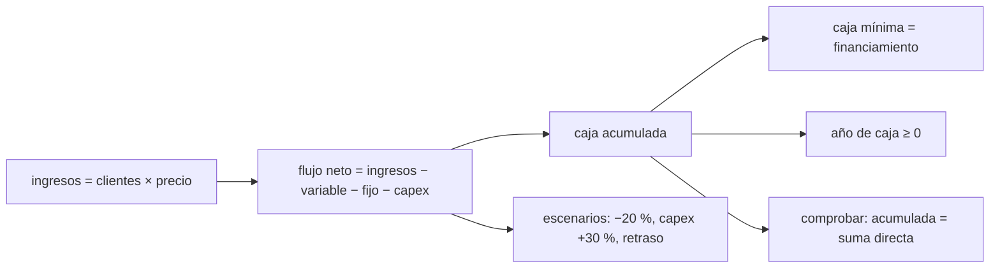

# B126-C03 — Proyección de flujos de caja de un proyecto espacial

<!-- nav:top -->
[🏠 Programa](../../../../README.md) · [📚 Bloque B126](../../../tronco-comun/B126-financiamiento-de-proyectos-y-negocios-espaciales.md) · [← Anterior: B126-C02 — Capital de riesgo en empresas espaciales](../B126-C02-capital-de-riesgo-en-empresas-espaciales/CLASE.md) · [Siguiente: B126-C04 — Costo de adquisición de clientes y economía unitaria →](../B126-C04-costo-de-adquisicion-de-clientes-y-economia-unitaria/CLASE.md)
<!-- /nav -->

## 1. Ubicación, nivel y alcance

Clase 3 del bloque B126 y primera del tramo «Modelar el negocio». Nivel N4. Un proyecto espacial gasta años antes de cobrar; decidir si es sostenible exige proyectar sus flujos de caja y saber cuánto financiamiento pide. Aquí proyectas 10 años de una constelación sintética de observación de la Tierra, hallas su caja mínima y comparas escenarios. Usas solo aritmética; los estimados de costo por categoría los trata el bloque B124. **Esta clase es educativa: no es asesoría financiera, legal ni de inversión, no recomienda comprar, vender ni invertir y no sustituye a un abogado, un contador ni un asesor con licencia.** Todas las empresas, rondas y cifras son sintéticas.

## 2. Por qué esta clase existe

[B124-C05](../../../tronco-comun/B124-industria-economia-etica-y-proyectos-espaciales.md) estima costos sin flujos de caja. La decisión central: **¿cuánto dinero hay que levantar y cuándo, y qué tan sensible es esa cifra a un retraso o a un sobrecosto?**

## 3. Lo que podrás hacer al terminar

1. Construir el flujo neto anual como ingresos menos costo variable, costo fijo e inversión.
2. Calcular la caja acumulada y su mínimo, que es el financiamiento necesario.
3. Hallar el año en que la caja acumulada vuelve a ser positiva.
4. Comparar escenarios: menos clientes, inversión mayor y retraso de un año.
5. Estimar el costo financiero de un retraso.
6. Separar lo consultado (el esquema de hitos de precio fijo del programa COTS) de lo ilustrativo (todas las cifras).

La evidencia es la **proyección a 10 años con su necesidad de financiamiento** del ejercicio 12 (sección 20).

## 4. Con qué llegas y cómo comprobarlo

1. ¿Qué es un flujo de caja?
2. ¿Qué es la caja acumulada?
3. ¿Qué diferencia hay entre inversión (capex) y costo operativo?
4. ¿Qué es un costo fijo y uno variable?
5. ¿Qué es un dólar constante?

<details>
<summary>Ver respuestas</summary>

1. El dinero que entra menos el que sale en un período. 2. La suma de los flujos hasta cada período. 3. La inversión compra activos duraderos; el costo operativo es el gasto del período. 4. El fijo no depende de las ventas; el variable es proporcional a ellas. 5. Un dólar medido con el poder adquisitivo de un año base, sin inflación.
</details>

Con cuatro o cinco aciertos, sigue; si no, repasa los prerrequisitos.

## 5. Un caso de contexto y casos de referencia

El informe de la NASA sobre el programa COTS (NASA SP-2014-617, consultado el 2026-11-11) explica que la agencia pagó por hitos de precio fijo: el pago llega al cumplir objetivos definidos y cualquier trabajo adicional para cumplirlos es responsabilidad de la empresa; los hitos financieros se fijaron temprano, de modo que si una empresa no reunía su parte del financiamiento privado el acuerdo podía terminarse antes de que la agencia invirtiera más (ocurrió con Rocketplane Kistler en octubre de 2007); y la agencia invirtió alrededor de 788 millones de USD en los socios mientras la industria aportó la mayor parte, cerca de 1000 millones, según el informe. Esas son las únicas afirmaciones **consultadas**. El **ejemplo conductor** es un proyecto sintético: inversión de 20, 15 y 10 M USD en los años 0 a 2, ingresos desde el año 2 y hasta 215 clientes a 0,35 M USD por año, costo variable de 25 % y costos fijos de 1 a 5 M USD por año.

## 6. Vocabulario

El **flujo neto** es ingresos menos costos e inversión de un año. La **caja acumulada** es su suma corrida. La **caja mínima** es el punto más bajo de esa suma y fija el **financiamiento necesario**. El **margen de seguridad** es un porcentaje sobre ese mínimo. Un **hito de precio fijo** es un pago contra un objetivo cumplido. Un **escenario** es un conjunto alternativo de supuestos.

## 7. Modelo mental



*Descripción textual:* los ingresos y costos dan el flujo neto de cada año; su suma corrida es la caja, cuyo mínimo es el financiamiento necesario; se repite con escenarios y se verifica con una suma directa.

Analogía: llenar un estanque que primero se vacía por una llave grande (la inversión) y solo después recibe agua; hay que saber cuán bajo llega el nivel antes de subir. Límite: el modelo no incluye impuestos, deuda ni capital de trabajo.

## 8. La explicación, paso a paso

### 8.1 Flujo neto de un año

`flujo = ingresos × (1 − 0,25) − costo fijo − inversión`. Año 2: `7,00 × 0,75 − 4,00 − 10,00 = −8,75`. Año 3: `21,00 × 0,75 − 5,00 − 4,00 = 6,75`.

### 8.2 Caja acumulada y financiamiento

| Año | Clientes | Ingreso | Flujo neto | Caja acumulada |
|---|---|---|---|---|
| 0 | 0 | 0,00 | −21,00 | −21,00 |
| 1 | 0 | 0,00 | −17,00 | −38,00 |
| 2 | 20 | 7,00 | −8,75 | −46,75 |
| 3 | 60 | 21,00 | 6,75 | −40,00 |
| 4 | 110 | 38,50 | 20,88 | −19,12 |
| 5 | 150 | 52,50 | 31,38 | 12,25 |
| 9 | 215 | 75,25 | 48,44 | 191,56 |

La caja mínima es `−46,75 M USD` (año 2); con un 15 % de margen, el financiamiento a levantar es `53,76 M USD`. La caja acumulada es positiva desde el año 5.

### 8.3 Escenarios

| Escenario | Caja mínima | Financiamiento con 15 % | Caja ≥ 0 | Acumulada año 9 |
|---|---|---|---|---|
| base | −46,75 (año 2) | 53,76 | año 5 | 191,56 |
| clientes −20 % | −47,80 (año 2) | 54,97 | año 6 | 131,45 |
| inversión +30 % | −60,25 (año 2) | 69,29 | año 6 | 171,46 |
| retraso de 1 año | −55,75 (año 3) | 64,11 | año 6 | 135,12 |

### 8.4 El costo de un retraso

Un año de retraso en los ingresos eleva la caja mínima de `46,75` a `55,75`: **9,00 M USD** más de financiamiento, porque los ingresos se corren un año mientras los costos fijos y la inversión siguen su calendario.

## 9. Magnitudes, símbolos y unidades

| Símbolo | Qué es | Unidad | Valor / nota |
|---|---|---|---|
| `t` | año | año | 0–9 |
| `capex_t` | inversión | M USD constantes | 20, 15, 10, 4, 3… |
| `n_t` | clientes | — | 0–215 |
| `π` | precio anual por cliente | M USD | 0,35 |
| `v` | costo variable (fracción) | — | 0,25 |
| `F_t` | costo fijo | M USD | 1–5 |
| `K_t` | caja acumulada | M USD | −46,75 a 191,56 |

## 10. Convenciones y referencias

Flujos anuales deterministas en M USD constantes, sin impuestos, sin deuda, sin capital de trabajo y sin valor terminal. Los ingresos del año `t` se cobran en el año `t`. Todas las cifras son sintéticas.

## 11. De dónde sale lo que afirmamos

| ID | Fuente | Localizador | Respalda | Estado |
|---|---|---|---|---|
| S1 | NASA, SP-2014-617, «Commercial Orbital Transportation Services: A New Era in Spaceflight» — https://www.nasa.gov/sites/default/files/files/SP-2014-617.pdf (consultada 2026-11-11, PDF leído con PyMuPDF) | capítulo 1 «Fixed-Price Milestones»; capítulo 2 (hitos financieros y salida anticipada); resumen final | pagos por hitos de precio fijo con el sobrecosto a cargo de la empresa; hitos financieros tempranos y terminación del acuerdo con Rocketplane Kistler en octubre de 2007; aporte de la agencia (~788 M USD) frente al de la industria (~1000 M USD) | Consultada |
| — | Costos, clientes, precios, inversión | — | todos los números | Sintético / ilustrativo |

Límites: ninguna cifra del informe se usó como dato del modelo; no se consultó la fecha exacta de cada pago ni la estructura de costos de una empresa real.

## 12. Cómo ver los resultados

| Magnitud | Valor |
|---|---|
| Caja mínima | −46,75 M USD (año 2) |
| Financiamiento con 15 % de margen | 53,76 M USD |
| Caja acumulada positiva desde | año 5 |
| Costo de un año de retraso | 9,00 M USD |

Descripción larga: la caja baja hasta el año 2, se recupera desde el año 3 y cruza el cero en el año 5; la inversión mayor y el retraso son los escenarios que más financiamiento piden.

## 13. Ejemplo trabajado

**Paso 1 · Flujos.** Años 0–2: `−21,00; −17,00; −8,75`.

**Paso 2 · Acumulada.** `−21,00; −38,00; −46,75`.

**Paso 3 · Mínimo.** `−46,75` en el año 2.

**Paso 4 · Financiamiento.** `46,75 × 1,15 = 53,76 M USD`.

## 14. Distintas formas de describir el problema

**Por año:** flujo neto. **Por acumulado:** caja. **Por necesidad:** el mínimo y el margen. **Por escenario:** variantes de ingresos, inversión y fechas. **Por hitos:** pagos programados que adelantan caja.

## 15. Práctica guiada

**Ejercicio 1 · con los pasos indicados.** Calcula el flujo neto del año 2. *Pasos:* `ingreso × 0,75 − fijo − capex`.

<details><summary>Solución comentada</summary>

`7,00 × 0,75 − 4,00 − 10,00 = −8,75`.
</details>

**Ejercicio 2 · con una pista.** Calcula el flujo neto del año 3. *Pista:* ingreso 21,00; fijo 5,00; capex 4,00.

<details><summary>Solución comentada</summary>

`15,75 − 5 − 4 = 6,75`.
</details>

**Ejercicio 3 · casi autónomo.** ¿Cuál es la caja mínima y en qué año?

<details><summary>Solución comentada</summary>

`−46,75` en el año 2.
</details>

## 16. Práctica autónoma, transferencia e integrador

**Ejercicio 4 · autónomo.** Financiamiento con 15 % de margen.

<details><summary>Solución comentada</summary>

`46,75 × 1,15 = 53,76 M USD`.
</details>

**Ejercicio 5 · autónomo.** ¿En qué año la caja acumulada pasa a positiva?

<details><summary>Solución comentada</summary>

Año 5 (`+12,25`).
</details>

**Ejercicio 6 · autónomo.** ¿Cuánto cuesta el retraso de 1 año en financiamiento adicional?

<details><summary>Solución comentada</summary>

`55,75 − 46,75 = 9,00 M USD`.
</details>

**Ejercicio 7 · autónomo.** Con inversión +30 %, ¿cuál es la caja mínima?

<details><summary>Solución comentada</summary>

`−60,25`: la inversión de los años 0–2 (45) sube 13,5.
</details>

**Ejercicio 8 · autónomo.** Con clientes −20 %, flujo del año 2 y caja mínima.

<details><summary>Solución comentada</summary>

16 clientes: `5,6 × 0,75 − 4 − 10 = −9,8`; mínimo `−47,80`.
</details>

**Ejercicio 9 · transferencia.** Si NASA pagara un hito ilustrativo de 10 M USD en el año 1, ¿cuánto financiamiento se necesita (sin margen)?

<details><summary>Solución comentada</summary>

La acumulada del año 2 sería `−36,75`: se necesitan `36,75` (cifra ilustrativa; no son los pagos reales de COTS).
</details>

**Ejercicio 10 · transferencia.** ¿Por qué la caja mínima no es lo mismo que la pérdida contable del proyecto?

<details><summary>Solución comentada</summary>

La inversión se gasta al inicio pero se reconoce en el resultado a lo largo de la vida de los activos; la caja registra el momento del pago.
</details>

**Ejercicio 11 · transferencia.** El modelo usa dólares constantes. Si el financiamiento es una deuda nominal, ¿qué debes cuidar?

<details><summary>Solución comentada</summary>

No mezclar flujos reales con intereses nominales; convertir con una inflación explícita (ver [B126-C05](../B126-C05-evaluacion-de-viabilidad-economica-de-un-negocio-espacial/CLASE.md)).
</details>

**Ejercicio 12 · integrador.** Elabora tu **proyección a 10 años con su necesidad de financiamiento**: tabla de flujos, caja mínima, cuatro escenarios, costo de un retraso, verificación (acumulada frente a suma directa) y lista de qué es consultado e ilustrativo, con el aviso de que es educativa.

<details><summary>Solución comentada</summary>

Secciones 8.1–8.4 y la salida del laboratorio.
</details>

## 17. Laboratorio

El script [flujos.py](flujos.py) proyecta los flujos, la caja acumulada y cuatro escenarios, y verifica la acumulada con una suma directa y el retraso con un recálculo (**comprueba** igualdad a 1e-9). Usa solo la biblioteca estándar de Python.

**Datos:** solo el esquema de hitos de COTS está consultado; todas las cifras son **ilustrativas**. **Predice antes de ejecutar:** ¿qué escenario exigirá más financiamiento? (inversión +30 %.) **Ejecución del 2026-11-11 (Python 3.12.9):**

```text
Python 3.12.9 (biblioteca estandar)
Datos SINTETICOS (ilustrativos); de COTS solo se consulto el esquema de hitos de precio fijo (NASA SP-2014-617, 2026-11-11).
Unidades: millones de USD constantes por ano; anos 0 a 9
 ano  clientes  ingreso   flujo_neto   caja_acumulada
   0         0     0.00       -21.00          -21.00
   1         0     0.00       -17.00          -38.00
   2        20     7.00        -8.75          -46.75
   3        60    21.00         6.75          -40.00
   4       110    38.50        20.88          -19.12
   5       150    52.50        31.38           12.25
   6       180    63.00        39.25           51.50
   7       200    70.00        44.50           96.00
   8       210    73.50        47.12          143.12
   9       215    75.25        48.44          191.56
Escenarios:
 base               caja minima   -46.75 M (ano 2)   financiamiento con 15 % de margen   53.76 M   acumulada ano 9   191.56 M   caja >= 0: ano 5
 clientes -20 %     caja minima   -47.80 M (ano 2)   financiamiento con 15 % de margen   54.97 M   acumulada ano 9   131.45 M   caja >= 0: ano 6
 capex +30 %        caja minima   -60.25 M (ano 2)   financiamiento con 15 % de margen   69.29 M   acumulada ano 9   171.46 M   caja >= 0: ano 6
 retraso 1 ano      caja minima   -55.75 M (ano 3)   financiamiento con 15 % de margen   64.11 M   acumulada ano 9   135.12 M   caja >= 0: ano 6
 (verif.) base      caja minima   -46.75 M (ano 2)   financiamiento con 15 % de margen   53.76 M   acumulada ano 9   191.56 M   caja >= 0: ano 5
Costo del retraso en financiamiento adicional = 9.00 M USD
Pruebas superadas.
```

```bash
python programa/clases/B126/B126-C03-proyeccion-de-flujos-de-caja-de-un-proyecto-espacial/flujos.py
```

**Límites:** flujos deterministas anuales, sin impuestos, deuda ni capital de trabajo; ningún valor viene de una empresa real.

## 18. Errores frecuentes y cómo corregirlos

**Confundir caja con utilidad.** Se corrige con el ejercicio 10.

**Olvidar el margen de seguridad.** Se corrige con 8.2.

**Ignorar que el retraso encarece el proyecto aunque los ingresos no cambien.** Se corrige con 8.4.

**Dar por verificado un resultado con una sola vía.** Se corrige con la suma directa del laboratorio.

## 19. Cómo sabrás que vas bien

Tras la sección 8: ¿qué resultado esperabas y cuál obtuviste? Si dudas, repasa el ejemplo de la sección 13. Tras el laboratorio: ¿qué comprueba? (ver la sección 17).

## 20. Qué entregas y cómo se evalúa

El producto es tu **proyección a 10 años con su necesidad de financiamiento** (ejercicio 12).

| Criterio | Inicial | En desarrollo | Logrado | Destacado |
|---|---|---|---|---|
| Conceptos | Los confunde | Parciales | Calcula y explica las magnitudes | Explica los límites |
| Cálculo | Sin unidades | Con errores | Tablas completas con unidades | Calcula casos nuevos |
| Numérico | Sin comprobar | Un caso | Contraste con una segunda vía | Interpreta las diferencias |
| Fuentes | Sin fuente | Sin fecha | Fuentes con fecha y estado | Declara lo ilustrativo y lo no consultado |
| Límites | No los nombra | Uno | Tres | Discute qué falta del modelo |

**Condiciones críticas (no se compensan con promedio):** rotular todo dato de empresa, ronda o mercado como sintético o ilustrativo; no presentar el modelo como asesoría ni como oferta; citar solo lo consultado.

## 21. Ética, seguridad y límites

Clase educativa: **no es asesoría financiera, legal ni de inversión** y no sustituye a profesionales con licencia; ningún resultado debe usarse para decidir sobre un instrumento, una ronda, una empresa o una persona reales. Los modelos son simplificados y sus datos son sintéticos o ilustrativos. Una proyección real requiere datos de la empresa y revisión de un contador. Accesibilidad: tablas equivalentes a las gráficas, fórmulas en texto, ejercicios sin conexión.

## 22. Para cerrar y seguir

El proyecto sintético toca fondo en `−46,75 M USD` en el año 2, pide `53,76 M USD` con margen y recupera la caja en el año 5; un año de retraso añade `9,00 M USD` de financiamiento.

**Glosario español–inglés.** flujo de caja · *cash flow*; caja acumulada · *cumulative cash*; inversión · *capital expenditure (capex)*; costo fijo · *fixed cost*; hito · *milestone*; escenario · *scenario*.

**Continuidad.** [B126-C04](../B126-C04-costo-de-adquisicion-de-clientes-y-economia-unitaria/CLASE.md) baja del proyecto al cliente individual.

**Referencias:** ver sección 11.

<!-- nav:bottom -->
---

[← Anterior: B126-C02 — Capital de riesgo en empresas espaciales](../B126-C02-capital-de-riesgo-en-empresas-espaciales/CLASE.md) · [📚 Bloque B126](../../../tronco-comun/B126-financiamiento-de-proyectos-y-negocios-espaciales.md) · [Siguiente: B126-C04 — Costo de adquisición de clientes y economía unitaria →](../B126-C04-costo-de-adquisicion-de-clientes-y-economia-unitaria/CLASE.md)
<!-- /nav -->
