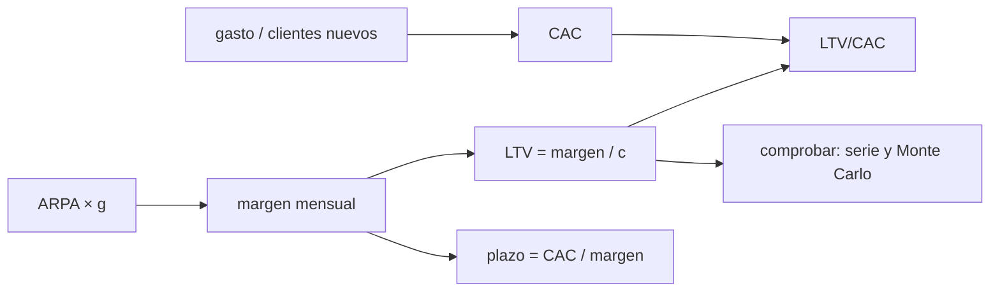

# B126-C04 — Costo de adquisición de clientes y economía unitaria

<!-- nav:top -->
[🏠 Programa](../../../../README.md) · [📚 Bloque B126](../../../tronco-comun/B126-financiamiento-de-proyectos-y-negocios-espaciales.md) · [← Anterior: B126-C03 — Proyección de flujos de caja de un proyecto espacial](../B126-C03-proyeccion-de-flujos-de-caja-de-un-proyecto-espacial/CLASE.md) · [Siguiente: B126-C05 — Evaluación de viabilidad económica de un negocio espacial →](../B126-C05-evaluacion-de-viabilidad-economica-de-un-negocio-espacial/CLASE.md)
<!-- /nav -->

## 1. Ubicación, nivel y alcance

Clase 4 del bloque B126. Nivel N4. Un negocio espacial que vende servicios (datos, conectividad, lanzamiento por contrato) debe saber si cada cliente que gana deja más de lo que costó ganarlo. Aquí calculas el costo de adquisición de clientes (CAC), el valor de vida del cliente (LTV), su razón y el plazo de recuperación, con su sensibilidad. Es la mirada por cliente de lo que [B126-C03](../B126-C03-proyeccion-de-flujos-de-caja-de-un-proyecto-espacial/CLASE.md) mira por año. **Esta clase es educativa: no es asesoría financiera, legal ni de inversión, no recomienda comprar, vender ni invertir y no sustituye a un abogado, un contador ni un asesor con licencia.** Todas las empresas, rondas y cifras son sintéticas.

## 2. Por qué esta clase existe

Un negocio espacial debe medir cuánto cuesta ganar un cliente; el catálogo no lo trata. La decisión central: **¿vale la pena el gasto de captación, dado cuánto tiempo se queda el cliente y cuánto margen deja?**

## 3. Lo que podrás hacer al terminar

1. Calcular el CAC como gasto de captación entre clientes nuevos.
2. Calcular el LTV con abandono constante, en forma cerrada y por serie.
3. Calcular la razón LTV/CAC y el plazo de recuperación.
4. Calcular el LTV descontado y compararlo con el no descontado.
5. Construir una tabla de sensibilidad al abandono y al CAC.
6. Separar lo consultado (nada: las definiciones no se consultaron en una fuente primaria) de lo ilustrativo (todas las cifras).

La evidencia es la **ficha de economía unitaria con sensibilidad** del ejercicio 12 (sección 20).

## 4. Con qué llegas y cómo comprobarlo

1. ¿Qué es el margen bruto?
2. ¿Qué es una serie geométrica?
3. ¿Qué es el abandono (churn)?
4. ¿Qué es descontar?
5. ¿Qué es una verificación por segunda vía?

<details>
<summary>Ver respuestas</summary>

1. Ingresos menos costos directos, como fracción de los ingresos. 2. Una suma de términos donde cada uno es el anterior multiplicado por un factor `q`; si `|q| < 1`, suma `1/(1 − q)` desde 1. 3. La fracción de clientes que se va en un período. 4. Dividir un flujo futuro por `(1 + r)^t` para llevarlo a valor presente. 5. Calcular lo mismo con otro método y comparar.
</details>

Con cuatro o cinco aciertos, sigue; si no, repasa los prerrequisitos.

## 5. Un caso de contexto y casos de referencia

Ninguna cifra ni definición de esta clase viene de una fuente consultada: CAC, LTV y plazo de recuperación son métricas de uso común en empresas de suscripción, pero **no se consultaron** en una fuente primaria; se verifican por dos vías de cálculo (serie y simulación). El **ejemplo conductor** es un servicio sintético de datos de observación de la Tierra por suscripción: gasto de captación de 240 000 USD por trimestre con 60 clientes nuevos, ingreso mensual por cliente (ARPA) de 900 USD, margen bruto de 70 % y abandono mensual de 2 %.

## 6. Vocabulario

El **CAC** es gasto de captación entre clientes nuevos. El **ARPA** es el ingreso medio por cliente y mes. El **margen bruto** `g` es la fracción de ingreso que queda tras los costos directos. El **abandono** `c` es la fracción de clientes que se va cada mes. El **LTV** es el margen total esperado de un cliente. El **plazo de recuperación** son los meses de margen necesarios para devolver el CAC. La **razón LTV/CAC** compara ambos.

## 7. Modelo mental



*Descripción textual:* el gasto y los clientes nuevos dan el CAC; el margen mensual y el abandono dan el LTV y el plazo; la razón LTV/CAC resume el negocio y se verifica con una serie y una simulación.

Analogía: comprar un árbol frutal: el CAC es lo que cuesta plantarlo y el LTV, toda la fruta que dará hasta que muera; el abandono es la probabilidad de que se seque cada mes. Límite: la razón no dice cuánta caja hace falta mientras el árbol crece.

## 8. La explicación, paso a paso

### 8.1 CAC y margen

`CAC = 240 000/60 = 4 000 USD`. Margen mensual por cliente: `900 × 0,70 = 630 USD`.

### 8.2 LTV con abandono constante

Si cada mes sobrevive la fracción `1 − c`, el margen total es una serie geométrica: `LTV = 630 × (1 + 0,98 + 0,98² + …) = 630/0,02 = 31 500 USD`. La serie truncada a 5000 meses da `31 500,00`. La vida media es `1/c = 50 meses` y el Monte Carlo da `50,4`.

### 8.3 Razón y plazo

`LTV/CAC = 31 500/4 000 = 7,88` y el plazo de recuperación es `4 000/630 = 6,35 meses`.

### 8.4 Descuento

A 10 % anual (`r = 0,797 %` mensual) el LTV es `630/(1 − 0,98/(1 + r)) = 22 700 USD` y `LTV/CAC = 5,68`: descontar baja la razón cerca de 28 %.

### 8.5 Sensibilidad

| Abandono \ CAC | 2000 | 4000 | 6000 | 8000 |
|---|---|---|---|---|
| 1 % | 31,50 | 15,75 | 10,50 | 7,88 |
| 2 % | 15,75 | 7,88 | 5,25 | 3,94 |
| 3 % | 10,50 | 5,25 | 3,50 | 2,62 |
| 5 % | 6,30 | 3,15 | 2,10 | 1,57 |
| 8 % | 3,94 | 1,97 | 1,31 | 0,98 |

El abandono máximo para `LTV/CAC = 3` con `CAC = 4 000` es `5,25 %` mensual.

## 9. Magnitudes, símbolos y unidades

| Símbolo | Qué es | Unidad | Valor / nota |
|---|---|---|---|
| `CAC` | costo de adquisición | USD por cliente | 4 000 |
| `ARPA` | ingreso por cliente | USD/mes | 900 |
| `g` | margen bruto | — | 0,70 |
| `c` | abandono mensual | — | 0,02 |
| `LTV` | valor de vida | USD | 31 500 |
| `r` | tasa mensual de descuento | — | 0,00797 |

## 10. Convenciones y referencias

Abandono constante, ARPA constante, sin expansión de ingresos, CAC mezclado entre todos los canales, margen bruto sin costos de servicio fijos. Unidades: USD y meses. Datos sintéticos.

## 11. De dónde sale lo que afirmamos

| ID | Fuente | Localizador | Respalda | Estado |
|---|---|---|---|---|
| — | Definiciones de CAC, LTV y plazo de recuperación | — | todas las fórmulas de la clase | No consultadas en una fuente primaria; verificadas con serie y Monte Carlo |
| — | Gasto, clientes, ARPA, margen, abandono, tasa | — | todos los números | Sintético / ilustrativo |

Límites: esta clase no cita ninguna fuente externa: se declara así para no atribuir a nadie las métricas ni los umbrales (por ejemplo, el valor 3 de `LTV/CAC` se usa solo como referencia de cálculo, no como norma).

## 12. Cómo ver los resultados

| Magnitud | Valor |
|---|---|
| CAC | 4 000 USD |
| LTV / LTV descontado | 31 500 / 22 700 USD |
| LTV/CAC / descontada | 7,88 / 5,68 |
| Plazo de recuperación | 6,35 meses |

Descripción larga: duplicar el abandono a 4 % reduciría el LTV a la mitad; la razón es más sensible al abandono que a casi cualquier otro parámetro del modelo.

## 13. Ejemplo trabajado

**Paso 1 · CAC.** `240 000/60 = 4 000`.

**Paso 2 · Margen.** `900 × 0,70 = 630`.

**Paso 3 · LTV.** `630/0,02 = 31 500`.

**Paso 4 · Razón y plazo.** `31 500/4 000 = 7,88`; `4 000/630 = 6,35 meses`.

## 14. Distintas formas de describir el problema

**Por cliente:** CAC y LTV. **Por mes:** margen y plazo de recuperación. **Por cohorte:** supervivencia `(1 − c)^t`. **Por razón:** LTV/CAC. **Por valor presente:** LTV descontado.

## 15. Práctica guiada

**Ejercicio 1 · con los pasos indicados.** Calcula el CAC si gastas 240 000 USD y ganas 60 clientes. *Pasos:* división.

<details><summary>Solución comentada</summary>

`240 000/60 = 4 000 USD`.
</details>

**Ejercicio 2 · con una pista.** Margen bruto mensual por cliente. *Pista:* `ARPA × g`.

<details><summary>Solución comentada</summary>

`900 × 0,70 = 630 USD`.
</details>

**Ejercicio 3 · casi autónomo.** Calcula el LTV con abandono de 2 %.

<details><summary>Solución comentada</summary>

`630/0,02 = 31 500 USD`.
</details>

## 16. Práctica autónoma, transferencia e integrador

**Ejercicio 4 · autónomo.** `LTV/CAC`.

<details><summary>Solución comentada</summary>

`31 500/4 000 = 7,88`.
</details>

**Ejercicio 5 · autónomo.** Plazo de recuperación del CAC.

<details><summary>Solución comentada</summary>

`4 000/630 = 6,35 meses`.
</details>

**Ejercicio 6 · autónomo.** `LTV/CAC` si el abandono sube a 5 %.

<details><summary>Solución comentada</summary>

`LTV = 630/0,05 = 12 600`; `12 600/4 000 = 3,15`.
</details>

**Ejercicio 7 · autónomo.** LTV descontado y su razón (10 % anual).

<details><summary>Solución comentada</summary>

`22 700 USD` y `5,68`.
</details>

**Ejercicio 8 · autónomo.** Abandono máximo para que `LTV/CAC` sea 3.

<details><summary>Solución comentada</summary>

`c = 630/(3 × 4 000) = 5,25 %`.
</details>

**Ejercicio 9 · transferencia.** El CAC es «mezclado». ¿Qué puede ocultar?

<details><summary>Solución comentada</summary>

Que un canal cueste mucho más que otro; conviene calcularlo por canal antes de decidir dónde gastar.
</details>

**Ejercicio 10 · transferencia.** Un negocio espacial B2B tiene 12 clientes grandes con contratos anuales. ¿Sirve un abandono mensual constante?

<details><summary>Solución comentada</summary>

No: con pocos clientes y contratos fijos conviene modelar renovaciones por contrato y por cliente, no una tasa mensual.
</details>

**Ejercicio 11 · transferencia.** Si el margen bruto depende del costo de lanzamiento, ¿qué cambia en la ficha?

<details><summary>Solución comentada</summary>

El margen `g` deja de ser constante: se hace un escenario por costo de lanzamiento y se recalculan LTV, razón y plazo.
</details>

**Ejercicio 12 · integrador.** Elabora tu **ficha de economía unitaria con sensibilidad**: CAC, margen, LTV (cerrada y serie), razón, plazo, LTV descontado, tabla de sensibilidad y lista de qué es consultado (nada) e ilustrativo, con el aviso de que es educativa.

<details><summary>Solución comentada</summary>

Secciones 8.1–8.5 y la salida del laboratorio.
</details>

## 17. Laboratorio

El script [economia_unitaria.py](economia_unitaria.py) calcula CAC, LTV (cerrada, serie y descontada), razón, plazo y sensibilidad, y verifica la vida media con un Monte Carlo (**comprueba** la serie a 1e-6 relativo y la simulación a 1 mes). Usa solo la biblioteca estándar de Python.

**Datos:** **ninguna cifra es consultada**; todas son **ilustrativas**. **Predice antes de ejecutar:** ¿superará `LTV/CAC` el valor 3 con abandono de 5 %? (sí, 3,15.) **Ejecución del 2026-11-11 (Python 3.12.9):**

```text
Python 3.12.9 (biblioteca estandar)
Datos SINTETICOS (ilustrativos); ninguna cifra viene de una fuente consultada.
CAC = 240,000 / 60 = 4,000 USD ; margen bruto mensual por cliente = 630 USD
LTV (formula cerrada) = 31,500 USD ; LTV (serie, 5000 meses) = 31,500.00 USD
LTV/CAC = 7.88 ; plazo de recuperacion = 6.35 meses
LTV descontado (10 % anual) = 22,700 USD (cerrada) ; serie = 22,700 USD ; LTV/CAC desc = 5.68
Vida media del cliente: 1/c = 50.0 meses ; Monte Carlo = 50.4 meses
Sensibilidad de LTV/CAC (filas: abandono mensual; columnas: CAC en USD)
   churn        2000     4000     6000     8000
      1%      31.50    15.75    10.50     7.88
      2%      15.75     7.88     5.25     3.94
      3%      10.50     5.25     3.50     2.62
      5%       6.30     3.15     2.10     1.57
      8%       3.94     1.97     1.31     0.98
Plazo de recuperacion y razon por margen bruto (CAC = 4000, abandono 2 %)
   g = 0.40: plazo = 11.11 meses ; LTV/CAC =  4.50
   g = 0.55: plazo =  8.08 meses ; LTV/CAC =  6.19
   g = 0.70: plazo =  6.35 meses ; LTV/CAC =  7.88
   g = 0.85: plazo =  5.23 meses ; LTV/CAC =  9.56
Abandono mensual maximo para LTV/CAC = 3: 0.0525 (5.25%)
Pruebas superadas.
```

```bash
python programa/clases/B126/B126-C04-costo-de-adquisicion-de-clientes-y-economia-unitaria/economia_unitaria.py
```

**Límites:** abandono constante, CAC mezclado, sin expansión de ingresos ni costos fijos de servicio; no representa ninguna empresa.

## 18. Errores frecuentes y cómo corregirlos

**Usar la razón sin descontar ni considerar el plazo.** Se corrige con 8.3–8.4.

**Tomar `LTV/CAC = 3` como una norma.** Se corrige con la sección 11.

**Calcular el CAC sin todos los costos de captación.** Se corrige con la sección 10.

**Dar por verificado un resultado con una sola vía.** Se corrige con la serie y el Monte Carlo.

## 19. Cómo sabrás que vas bien

Tras la sección 8: ¿qué resultado esperabas y cuál obtuviste? Si dudas, repasa el ejemplo de la sección 13. Tras el laboratorio: ¿qué comprueba? (ver la sección 17).

## 20. Qué entregas y cómo se evalúa

El producto es tu **ficha de economía unitaria con sensibilidad** (ejercicio 12).

| Criterio | Inicial | En desarrollo | Logrado | Destacado |
|---|---|---|---|---|
| Conceptos | Los confunde | Parciales | Calcula y explica las magnitudes | Explica los límites |
| Cálculo | Sin unidades | Con errores | Tablas completas con unidades | Calcula casos nuevos |
| Numérico | Sin comprobar | Un caso | Contraste con una segunda vía | Interpreta las diferencias |
| Fuentes | Sin fuente | Sin fecha | Fuentes con fecha y estado | Declara lo ilustrativo y lo no consultado |
| Límites | No los nombra | Uno | Tres | Discute qué falta del modelo |

**Condiciones críticas (no se compensan con promedio):** rotular todo dato de empresa, ronda o mercado como sintético o ilustrativo; no presentar el modelo como asesoría ni como oferta; citar solo lo consultado.

## 21. Ética, seguridad y límites

Clase educativa: **no es asesoría financiera, legal ni de inversión** y no sustituye a profesionales con licencia; ningún resultado debe usarse para decidir sobre un instrumento, una ronda, una empresa o una persona reales. Los modelos son simplificados y sus datos son sintéticos o ilustrativos. Las métricas por cliente pueden usarse para presentar una empresa mejor de lo que es; en la clase C06 se trata cómo rotularlas. Accesibilidad: tablas equivalentes a las gráficas, fórmulas en texto, ejercicios sin conexión.

## 22. Para cerrar y seguir

Con CAC de `4 000 USD`, margen de `630 USD` al mes y abandono de `2 %`, el LTV sintético es de `31 500 USD` (`22 700` descontado), la razón es `7,88` y el CAC se recupera en `6,35 meses`.

**Glosario español–inglés.** costo de adquisición de clientes · *customer acquisition cost (CAC)*; valor de vida del cliente · *lifetime value (LTV)*; abandono · *churn*; margen bruto · *gross margin*; plazo de recuperación · *payback period*.

**Continuidad.** [B126-C05](../B126-C05-evaluacion-de-viabilidad-economica-de-un-negocio-espacial/CLASE.md) reúne flujos y rentabilidad en una evaluación de viabilidad.

**Referencias:** ver sección 11.

<!-- nav:bottom -->
---

[← Anterior: B126-C03 — Proyección de flujos de caja de un proyecto espacial](../B126-C03-proyeccion-de-flujos-de-caja-de-un-proyecto-espacial/CLASE.md) · [📚 Bloque B126](../../../tronco-comun/B126-financiamiento-de-proyectos-y-negocios-espaciales.md) · [Siguiente: B126-C05 — Evaluación de viabilidad económica de un negocio espacial →](../B126-C05-evaluacion-de-viabilidad-economica-de-un-negocio-espacial/CLASE.md)
<!-- /nav -->
