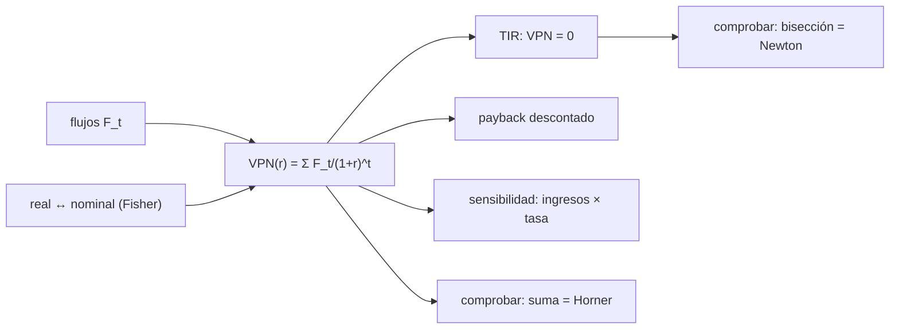

# B126-C05 — Evaluación de viabilidad económica de un negocio espacial

<!-- nav:top -->
[🏠 Programa](../../../../README.md) · [📚 Bloque B126](../../../tronco-comun/B126-financiamiento-de-proyectos-y-negocios-espaciales.md) · [← Anterior: B126-C04 — Costo de adquisición de clientes y economía unitaria](../B126-C04-costo-de-adquisicion-de-clientes-y-economia-unitaria/CLASE.md) · [Siguiente: B126-C06 — Presentación financiera ante inversionistas con evidencia →](../B126-C06-presentacion-financiera-ante-inversionistas-con-evidencia/CLASE.md)
<!-- /nav -->

## 1. Ubicación, nivel y alcance

Clase 5 del bloque B126. Nivel N4. Con los flujos de [B126-C03](../B126-C03-proyeccion-de-flujos-de-caja-de-un-proyecto-espacial/CLASE.md) puedes responder si el negocio crea valor: lo haces con el valor presente neto (VPN), la tasa interna de retorno (TIR) y el plazo de recuperación descontado, y con una tabla de sensibilidad. Sigues la práctica de la Circular A-94 de la OMB de usar la tasa que corresponde a la medición de los flujos y de recalcular los resultados ante los supuestos principales. **Esta clase es educativa: no es asesoría financiera, legal ni de inversión, no recomienda comprar, vender ni invertir y no sustituye a un abogado, un contador ni un asesor con licencia.** Todas las empresas, rondas y cifras son sintéticas.

## 2. Por qué esta clase existe

[B124-C12](../../../tronco-comun/B124-industria-economia-etica-y-proyectos-espaciales.md) evalúa retorno científico, no viabilidad económica. La decisión central: **¿vale hoy más lo que el negocio devolverá que lo que cuesta, y cuánto pueden equivocarse los supuestos antes de que deje de valer?**

## 3. Lo que podrás hacer al terminar

1. Calcular el VPN de una serie de flujos a distintas tasas.
2. Calcular la TIR por dos métodos y comprobar que el VPN en la TIR es cero.
3. Calcular el plazo de recuperación descontado.
4. Aplicar la regla de tasa real para flujos constantes y nominal para flujos nominales, y comprobar la relación de Fisher.
5. Armar una tabla de sensibilidad y hallar el factor de ingresos con VPN cero.
6. Separar lo consultado (la regla de tasa y la sensibilidad de la Circular A-94) de lo ilustrativo (flujos y tasas).

La evidencia es la **informe de viabilidad con tabla de sensibilidad** del ejercicio 12 (sección 20).

## 4. Con qué llegas y cómo comprobarlo

1. ¿Qué es el valor presente de un flujo futuro?
2. ¿Qué es una tasa de descuento?
3. ¿Qué es la caja acumulada?
4. ¿Qué es la inflación y qué es un dólar constante?
5. ¿Qué es una raíz de una función?

<details>
<summary>Ver respuestas</summary>

1. El flujo dividido por `(1 + r)^t`. 2. La tasa que traslada dinero futuro a hoy y refleja costo del dinero y riesgo. 3. La suma de los flujos hasta cada año (ver [B126-C03](../B126-C03-proyeccion-de-flujos-de-caja-de-un-proyecto-espacial/CLASE.md)). 4. La subida general de precios; un dólar constante mide con el poder adquisitivo de un año base. 5. Un valor donde la función vale cero.
</details>

Con cuatro o cinco aciertos, sigue; si no, repasa los prerrequisitos.

## 5. Un caso de contexto y casos de referencia

La Circular A-94 de la OMB (revisión del 2023-11-09, consultada el 2026-11-11) establece que un análisis de beneficios y costos debe descontar con una tasa real si los flujos están en dólares constantes y con una tasa nominal si están en dólares nominales (sección 8.a), que los resultados deben recalcularse para ver su sensibilidad a los supuestos principales (sección 9.c) y que el Apéndice B ilustra el descuento con una tasa de 3,1 % solo como ejemplo. Esas son las únicas afirmaciones **consultadas**; la circular guía el análisis de programas federales de EE. UU. y **no fija la tasa de una empresa privada**. El **ejemplo conductor** usa los flujos sintéticos del caso base de C03 (años 0 a 9, M USD constantes), tasas entre 6 y 14 % y valor terminal nulo.

## 6. Vocabulario

El **VPN** es la suma de los flujos descontados. La **TIR** es la tasa que hace el VPN igual a cero. El **plazo de recuperación descontado** es el primer año en que el VPN acumulado es positivo. La **tasa real** excluye la inflación y la **nominal** la incluye; se relacionan por `1 + nominal = (1 + real)(1 + π)` (relación de Fisher). La **sensibilidad** es el cambio del resultado ante un cambio en un supuesto.

## 7. Modelo mental



*Descripción textual:* los flujos y una tasa dan el VPN; de él salen la TIR, el plazo descontado y la sensibilidad; la tasa debe corresponder a la medición de los flujos (real o nominal); se verifica con dos métodos.

Analogía: pesar hoy lo que entrará mañana en una balanza que descuenta cada mes de espera; la sensibilidad pregunta cuánto puede cambiar el peso de un platillo antes de que la balanza se incline. Límite: la balanza no sabe si los flujos futuros son realistas.

## 8. La explicación, paso a paso

### 8.1 VPN

`VPN(r) = Σ F_t/(1 + r)^t`. Con los flujos de C03:

| Tasa | VPN (M USD) | Payback descontado |
|---|---|---|
| 6 % | 116,32 | año 5 |
| 8 % | 98,20 | año 6 |
| 10 % | 82,64 | año 6 |
| 12 % | 69,23 | año 6 |
| 14 % | 57,65 | año 6 |

A `r = 0` el VPN es la caja acumulada del año 9, `191,56`.

### 8.2 TIR

La TIR es `33,013269 %` por bisección y por Newton (acuerdo a 10⁻⁹), y `VPN(TIR) = 3 × 10⁻¹⁴`: el VPN en la TIR es cero.

### 8.3 Real frente a nominal

Con tasa real de 10 % e inflación de 3 %, la tasa nominal es `13,3 %`. El VPN de los flujos reales a 10 % (`82,642264`) coincide con el de los flujos nominales a 13,3 % (`82,642264`). Descontar flujos nominales con la tasa real da `108,77` y sobrestima el VPN en `26,13`.

### 8.4 Sensibilidad

VPN (M USD) según el factor sobre los ingresos y la tasa:

| Factor | 6 % | 10 % | 14 % | TIR |
|---|---|---|---|---|
| 0,6 | 33,76 | 17,20 | 5,08 | 16,12 % |
| 0,8 | 75,04 | 49,92 | 31,37 | 25,46 % |
| 1,0 | 116,32 | 82,64 | 57,65 | 33,01 % |
| 1,2 | 157,61 | 115,36 | 83,93 | 39,48 % |

A 10 % el VPN es cero con un factor de `0,4949`: los ingresos pueden caer `50,5 %` antes de perder valor, siempre que los costos no cambien.

## 9. Magnitudes, símbolos y unidades

| Símbolo | Qué es | Unidad | Valor / nota |
|---|---|---|---|
| `F_t` | flujo del año `t` | M USD constantes | −21,00 … 48,44 |
| `r` | tasa de descuento | — | 0,06–0,14 |
| `VPN` | valor presente neto | M USD | 57,65–116,32 |
| `TIR` | tasa interna de retorno | — | 0,3301 |
| `π` | inflación | — | 0,03 (ilustrativa) |
| `k` | factor sobre los ingresos | — | 0,6–1,2 |

## 10. Convenciones y referencias

Flujos en M USD constantes (caso base de B126-C03), años 0 a 9, valor terminal nulo, sin impuestos. El primer flujo ocurre en `t = 0` y no se descuenta. Datos sintéticos.

## 11. De dónde sale lo que afirmamos

| ID | Fuente | Localizador | Respalda | Estado |
|---|---|---|---|---|
| S1 | Office of Management and Budget, Circular A-94 (revisión del 2023-11-09) — https://www.whitehouse.gov/wp-content/uploads/2023/11/CircularA-94.pdf (consultada 2026-11-11, PDF leído con PyMuPDF) | sección 8.a (tasas real y nominal); sección 9.c (análisis de sensibilidad); Apéndice B (ejemplo con 3,1 %) | usar tasa real con flujos constantes y nominal con flujos nominales; recalcular resultados ante supuestos principales; el 3,1 % es una tasa de ejemplo | Consultada |
| — | VPN, TIR, payback, relación de Fisher | — | fórmulas de la sección 8 | No consultadas en una fuente concreta; verificadas con dos vías |
| — | Flujos, tasas, inflación | — | todos los números | Sintético / ilustrativo |

Límites: la Circular A-94 guía programas federales de EE. UU.; no se consultó ninguna tasa para empresas privadas y no se usó el valor vigente del Apéndice D. Las tasas de 6–14 % son ilustrativas y no se derivan de la circular.

## 12. Cómo ver los resultados

| Magnitud | Valor |
|---|---|
| VPN a 10 % | 82,64 M USD |
| TIR | 33,01 % |
| Payback descontado a 10 % | año 6 |
| Factor de ingresos con VPN = 0 (10 %) | 0,4949 |

Descripción larga: el VPN baja al subir la tasa y sube con los ingresos; incluso con ingresos al 60 % el VPN a 14 % sigue positivo en este caso sintético.

## 13. Ejemplo trabajado

**Paso 1 · Factores.** A 10 %: `1; 0,9091; 0,8264; …`.

**Paso 2 · Primeros términos.** `−21,00 − 17,00 × 0,9091 − 8,75 × 0,8264 = −43,69`.

**Paso 3 · Suma completa.** `VPN(10 %) = 82,64 M USD`.

**Paso 4 · Lectura.** Positivo: a 10 % el negocio sintético crea valor sobre su costo de capital supuesto; la sensibilidad dice cuánto pueden fallar los ingresos.

## 14. Distintas formas de describir el problema

**Por valor presente:** VPN. **Por tasa:** TIR. **Por tiempo:** payback descontado. **Por supuestos:** tabla de sensibilidad. **Por unidades:** real o nominal.

## 15. Práctica guiada

**Ejercicio 1 · con los pasos indicados.** Calcula el valor presente de 6,75 recibido en el año 3 a 10 %. *Pasos:* `6,75/1,1³`.

<details><summary>Solución comentada</summary>

`6,75/1,331 = 5,07 M USD`.
</details>

**Ejercicio 2 · con una pista.** VPN a 0 % de los flujos. *Pista:* es la suma.

<details><summary>Solución comentada</summary>

`191,56 M USD`, igual a la caja acumulada del año 9 de C03.
</details>

**Ejercicio 3 · casi autónomo.** ¿Cuál es el VPN a 10 %?

<details><summary>Solución comentada</summary>

`82,64 M USD`.
</details>

## 16. Práctica autónoma, transferencia e integrador

**Ejercicio 4 · autónomo.** TIR del proyecto.

<details><summary>Solución comentada</summary>

`33,01 %`.
</details>

**Ejercicio 5 · autónomo.** Tasa nominal si la real es 10 % y la inflación 3 %.

<details><summary>Solución comentada</summary>

`1,10 × 1,03 − 1 = 13,3 %`.
</details>

**Ejercicio 6 · autónomo.** ¿Qué error se comete al descontar los flujos nominales a la tasa real?

<details><summary>Solución comentada</summary>

VPN `108,77` en lugar de `82,64`: sobrestima en `26,13`.
</details>

**Ejercicio 7 · autónomo.** ¿Qué factor de ingresos anula el VPN a 10 %?

<details><summary>Solución comentada</summary>

`0,4949`.
</details>

**Ejercicio 8 · autónomo.** VPN a 14 % con ingresos al 60 %.

<details><summary>Solución comentada</summary>

`5,08 M USD`, aún positivo.
</details>

**Ejercicio 9 · transferencia.** La A-94 no fija la tasa de una empresa privada. ¿Qué tasa usarías y qué debes justificar?

<details><summary>Solución comentada</summary>

Una tasa que refleje el costo de capital y el riesgo del proyecto; debes justificarla con evidencia y mostrar la sensibilidad; esta clase no la deriva.
</details>

**Ejercicio 10 · transferencia.** El valor terminal es nulo. ¿Es conservador y qué cambia si no lo fuera?

<details><summary>Solución comentada</summary>

Es conservador si el negocio sigue generando caja tras el año 9; agregar un valor terminal sube el VPN y debe justificarse.
</details>

**Ejercicio 11 · transferencia.** Dos proyectos excluyentes: uno con TIR mayor y otro con VPN mayor. ¿Cuál criterio priorizas y por qué?

<details><summary>Solución comentada</summary>

El VPN mide valor creado en dinero y es el criterio de decisión; la TIR ignora la escala. Conviene mostrar ambos y la sensibilidad.
</details>

**Ejercicio 12 · integrador.** Elabora tu **informe de viabilidad con tabla de sensibilidad**: VPN a cinco tasas, TIR por dos métodos, payback descontado, comprobación real/nominal, tabla de sensibilidad y lista de qué es consultado e ilustrativo, con el aviso de que es educativa.

<details><summary>Solución comentada</summary>

Secciones 8.1–8.4 y la salida del laboratorio.
</details>

## 17. Laboratorio

El script [viabilidad.py](viabilidad.py) calcula VPN, TIR por bisección y Newton, payback descontado, la comprobación de Fisher y la tabla de sensibilidad (**comprueba** `VPN(TIR) = 0`, la igualdad de TIR y la de VPN real y nominal a 1e-9). Usa solo la biblioteca estándar de Python.

**Datos:** solo la regla de tasa y la sensibilidad de la Circular A-94 están consultadas; flujos y tasas son **ilustrativos**. **Predice antes de ejecutar:** ¿seguirá siendo positivo el VPN a 14 % con ingresos al 60 %? (sí, 5,08.) **Ejecución del 2026-11-11 (Python 3.12.9):**

```text
Python 3.12.9 (biblioteca estandar)
Datos SINTETICOS (ilustrativos); de la Circular A-94 solo se consultaron la regla de tasa real/nominal y la sensibilidad (2026-11-11).
Unidades: M USD constantes; anos 0 a 9; valor terminal nulo
 tasa   6%: VPN =   116.32 M USD ; payback descontado = ano 5
 tasa   8%: VPN =    98.20 M USD ; payback descontado = ano 6
 tasa  10%: VPN =    82.64 M USD ; payback descontado = ano 6
 tasa  12%: VPN =    69.23 M USD ; payback descontado = ano 6
 tasa  14%: VPN =    57.65 M USD ; payback descontado = ano 6
TIR (biseccion) = 33.013269% ; TIR (Newton) = 33.013269% ; VPN(TIR) = 3.20e-14
Fisher: real 10 % e inflacion 3 % -> nominal 13.3000% ; VPN real = 82.642264 ; VPN nominal = 82.642264
Error tipico (flujos nominales con tasa real): VPN = 108.77 M USD (sobrestima 26.13)
Sensibilidad del VPN (M USD) al factor de ingresos y a la tasa (flujo = ingreso*factor*0,75 - costos fijos - capex)
   factor          6%       10%       14%     TIR
     0.6        33.76     17.20      5.08    16.12%
     0.8        75.04     49.92     31.37    25.46%
     1.0       116.32     82.64     57.65    33.01%
     1.2       157.61    115.36     83.93    39.48%
Factor de ingresos con VPN = 0 a 10 %: 0.4949 (los ingresos pueden caer 50.5% antes de perder valor)
Pruebas superadas.
```

```bash
python programa/clases/B126/B126-C05-evaluacion-de-viabilidad-economica-de-un-negocio-espacial/viabilidad.py
```

**Límites:** flujos deterministas, valor terminal nulo, sin impuestos; las tasas no provienen de ninguna fuente; no es una recomendación de inversión.

## 18. Errores frecuentes y cómo corregirlos

**Mezclar flujos nominales con una tasa real.** Se corrige con 8.3.

**Decidir solo con la TIR.** Se corrige con el ejercicio 11.

**Presentar un único VPN sin sensibilidad.** Se corrige con 8.4.

**Dar por verificado un resultado con una sola vía.** Se corrige con la bisección y Newton.

## 19. Cómo sabrás que vas bien

Tras la sección 8: ¿qué resultado esperabas y cuál obtuviste? Si dudas, repasa el ejemplo de la sección 13. Tras el laboratorio: ¿qué comprueba? (ver la sección 17).

## 20. Qué entregas y cómo se evalúa

El producto es tu **informe de viabilidad con tabla de sensibilidad** (ejercicio 12).

| Criterio | Inicial | En desarrollo | Logrado | Destacado |
|---|---|---|---|---|
| Conceptos | Los confunde | Parciales | Calcula y explica las magnitudes | Explica los límites |
| Cálculo | Sin unidades | Con errores | Tablas completas con unidades | Calcula casos nuevos |
| Numérico | Sin comprobar | Un caso | Contraste con una segunda vía | Interpreta las diferencias |
| Fuentes | Sin fuente | Sin fecha | Fuentes con fecha y estado | Declara lo ilustrativo y lo no consultado |
| Límites | No los nombra | Uno | Tres | Discute qué falta del modelo |

**Condiciones críticas (no se compensan con promedio):** rotular todo dato de empresa, ronda o mercado como sintético o ilustrativo; no presentar el modelo como asesoría ni como oferta; citar solo lo consultado.

## 21. Ética, seguridad y límites

Clase educativa: **no es asesoría financiera, legal ni de inversión** y no sustituye a profesionales con licencia; ningún resultado debe usarse para decidir sobre un instrumento, una ronda, una empresa o una persona reales. Los modelos son simplificados y sus datos son sintéticos o ilustrativos. Una evaluación real exige datos propios, una tasa justificada y revisión profesional. Accesibilidad: tablas equivalentes a las gráficas, fórmulas en texto, ejercicios sin conexión.

## 22. Para cerrar y seguir

A 10 %, el negocio sintético tiene un VPN de `82,64 M USD` y una TIR de `33,01 %`, sigue siendo positivo incluso con ingresos al 60 % y a 14 %, y dejaría de valer solo si los ingresos cayeran un `50,5 %`.

**Glosario español–inglés.** valor presente neto · *net present value (NPV)*; tasa interna de retorno · *internal rate of return (IRR)*; tasa de descuento · *discount rate*; análisis de sensibilidad · *sensitivity analysis*; tasa real · *real rate*; tasa nominal · *nominal rate*.

**Continuidad.** [B126-C06](../B126-C06-presentacion-financiera-ante-inversionistas-con-evidencia/CLASE.md) enseña a comunicar estas cifras con su evidencia.

**Referencias:** ver sección 11.

<!-- nav:bottom -->
---

[← Anterior: B126-C04 — Costo de adquisición de clientes y economía unitaria](../B126-C04-costo-de-adquisicion-de-clientes-y-economia-unitaria/CLASE.md) · [📚 Bloque B126](../../../tronco-comun/B126-financiamiento-de-proyectos-y-negocios-espaciales.md) · [Siguiente: B126-C06 — Presentación financiera ante inversionistas con evidencia →](../B126-C06-presentacion-financiera-ante-inversionistas-con-evidencia/CLASE.md)
<!-- /nav -->
