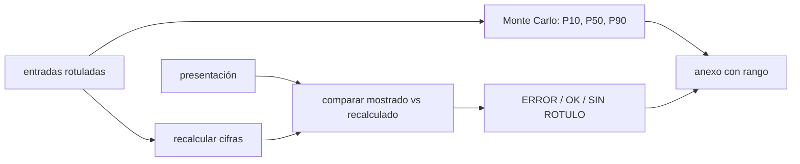

# B126-C06 — Presentación financiera ante inversionistas con evidencia

<!-- nav:top -->
[🏠 Programa](../../../../README.md) · [📚 Bloque B126](../../../tronco-comun/B126-financiamiento-de-proyectos-y-negocios-espaciales.md) · [← Anterior: B126-C05 — Evaluación de viabilidad económica de un negocio espacial](../B126-C05-evaluacion-de-viabilidad-economica-de-un-negocio-espacial/CLASE.md) · [Siguiente: B127-C01 — Seguros de lanzamiento →](../../B127/B127-C01-seguros-de-lanzamiento/CLASE.md)
<!-- /nav -->

## 1. Ubicación, nivel y alcance

Clase 6 del bloque B126 y última del tramo «Evaluar y comunicar». Nivel N4. Presentar a inversionistas es comunicar cifras: cada una debe poder rastrearse a su cálculo o a su fuente y llevar su incertidumbre. Aquí armas un anexo financiero con una matriz de evidencia y usas un auditor que recalcula cada cifra de una presentación. Reutilizas las cifras sintéticas de [B126-C04](../B126-C04-costo-de-adquisicion-de-clientes-y-economia-unitaria/CLASE.md) y [B126-C05](../B126-C05-evaluacion-de-viabilidad-economica-de-un-negocio-espacial/CLASE.md). **Esta clase no es un prospecto ni una oferta de valores y no dice cómo cumplir la regulación de valores: cualquier oferta real requiere un abogado.** **Esta clase es educativa: no es asesoría financiera, legal ni de inversión, no recomienda comprar, vender ni invertir y no sustituye a un abogado, un contador ni un asesor con licencia.** Todas las empresas, rondas y cifras son sintéticas.

## 2. Por qué esta clase existe

[B124-C19](../../../tronco-comun/B124-industria-economia-etica-y-proyectos-espaciales.md) redacta propuestas de misión, no financieras. La decisión central: **¿qué cifra se muestra, con qué rótulo y con qué rango, de modo que un tercero pueda comprobarla?**

## 3. Lo que podrás hacer al terminar

1. Armar una matriz de evidencia donde cada cifra tiene valor, rótulo (consultada, sintética o calculada) y fuente.
2. Recalcular cada cifra de una presentación desde sus entradas y detectar un error.
3. Detectar una cifra sin rótulo ni fuente.
4. Dar un rango de incertidumbre del VPN con una simulación y compararlo con el caso central.
5. Resumir qué dice la SEC en su página de ofertas exentas y por qué no basta para decidir cómo ofrecer valores.
6. Separar lo consultado (la página de la SEC y la A-94) de lo ilustrativo (todas las cifras de la empresa).

La evidencia es la **anexo financiero con matriz de evidencia** del ejercicio 12 (sección 20).

## 4. Con qué llegas y cómo comprobarlo

1. ¿Qué es un VPN?
2. ¿Qué es un percentil?
3. ¿Qué diferencia hay entre un dato consultado, uno sintético y uno calculado?
4. ¿Qué es una distribución triangular?
5. ¿Qué es una simulación de Monte Carlo?

<details>
<summary>Ver respuestas</summary>

1. La suma de los flujos futuros descontados a hoy (ver [B126-C05](../B126-C05-evaluacion-de-viabilidad-economica-de-un-negocio-espacial/CLASE.md)). 2. El valor bajo el cual cae una fracción dada de los casos; P10 deja al 10 % por debajo. 3. El consultado viene de una fuente con fecha; el sintético se inventa y se rotula; el calculado se obtiene de entradas con una fórmula. 4. Una distribución definida por un mínimo, una moda y un máximo. 5. Estimar una cantidad repitiendo un experimento aleatorio muchas veces.
</details>

Con cuatro o cinco aciertos, sigue; si no, repasa los prerrequisitos.

## 5. Un caso de contexto y casos de referencia

La página de ofertas exentas de la SEC (revisada por la SEC el 2026-01-26, consultada el 2026-11-11) indica que la Regla 506(b) limita las ventas a no más de 35 inversionistas no acreditados en 90 días y no admite solicitación general; que la 506(c) la admite si todos los compradores son acreditados y verificados; que la Regulation Crowdfunding permite ofertas de hasta 5 millones de USD por un intermediario registrado; que la Regulation A llega a 75 millones; y que el Form D se presenta dentro de 15 días tras la primera venta. La Circular A-94 (consultada) pide recalcular los resultados para ver su sensibilidad y presentar la incertidumbre. Esas son las únicas afirmaciones **consultadas**; no se leyeron las normas completas. El **ejemplo conductor** es una presentación sintética de siete cifras, una de ellas con un error de cálculo plantado a propósito y otra sin rótulo ni fuente.

## 6. Vocabulario

La **matriz de evidencia** lista cada cifra con su rótulo y su fuente. Un **rótulo** es consultada, sintética o calculada. Una cifra **trazable** puede rastrearse hasta sus entradas. El **rango de incertidumbre** (`P10–P90`) resume la dispersión de un resultado simulado. La **solicitación general** es ofrecer valores al público; la regulan normas que esta clase no desarrolla. Un **inversionista acreditado** es una categoría legal cuya definición no se consultó.

## 7. Modelo mental



*Descripción textual:* las entradas rotuladas permiten recalcular cada cifra de la presentación y compararla con lo mostrado; el resultado marca errores o cifras sin rótulo; con la simulación se agrega el rango, y todo va al anexo.

Analogía: la cuenta de un restaurante con el detalle de cada plato: cualquiera puede sumar y verificar. Límite: la cuenta no dice si el precio de cada plato es justo.

## 8. La explicación, paso a paso

### 8.1 Auditar cifras

El auditor recalcula `CAC`, `LTV`, `LTV/CAC`, `VPN` y financiamiento desde las entradas sintéticas y compara con la diapositiva:

| Cifra | Mostrado | Recalculado | Estado |
|---|---|---|---|
| CAC | 4 000 | 4 000 | OK |
| LTV | 31 500 | 31 500 | OK |
| LTV/CAC | 8,90 | 7,875 | ERROR (+13 %) |
| VPN a 10 % | 82,64 | 82,642 | OK |
| Financiamiento | 46,75 | 46,750 | OK |
| Tope Reg. Crowdfunding | 5,0 M | — | OK (consultada, con fuente) |
| «Tamaño del mercado» | 500 | — | SIN ROTULO/FUENTE |

El error plantado es `8,90` en lugar de `31 500/4 000 = 7,875`; la cifra del mercado no se puede mostrar sin una fuente consultada.

### 8.2 Rango de incertidumbre

Con 20 000 corridas (semilla 126) y distribuciones triangulares (factor de ingresos `0,6–1,0–1,2`; tasa `8–10–14 %`; inversión `×0,9–1,0–1,4`): `P10 = 32,7`, `P50 = 63,6`, `P90 = 90,7` M USD y `P(VPN < 0) = 0,001`. El caso central determinista (`82,6`) cae dentro del rango, por encima de la mediana: el rango es asimétrico porque la inversión puede superar su valor central más de lo que puede bajar.

### 8.3 Qué se muestra

Una cifra en una presentación debe llevar: valor, unidad, año, rótulo y fuente (o su fórmula y entradas). La incertidumbre se muestra como rango, no como un valor único.

### 8.4 Lo que la SEC aclara y lo que no

La página de la SEC enumera exenciones y topes, pero no dice cuál conviene, quién es acreditado ni qué debe decir una presentación para no inducir a error; eso requiere asesoría legal. Esta clase no lo cubre.

## 9. Magnitudes, símbolos y unidades

| Símbolo | Qué es | Unidad | Valor / nota |
|---|---|---|---|
| `CAC`, `LTV` | por cliente | USD | 4 000; 31 500 |
| `VPN` | valor presente neto | M USD | 82,64 |
| `P10`, `P50`, `P90` | percentiles del VPN simulado | M USD | 32,7; 63,6; 90,7 |
| `P(VPN<0)` | probabilidad simulada | — | 0,001 |
| Tolerancia | diferencia admitida | cifra | CAC y LTV 0,5; razón 0,05; VPN 0,1 |

## 10. Convenciones y referencias

Cifras de la empresa sintética de B126-C03 a C05; la tolerancia de cada cifra se fija antes de comparar. Rótulos: consultada, sintética, calculada. Simulación con semilla 126 y distribuciones inventadas; el rango no es un pronóstico.

## 11. De dónde sale lo que afirmamos

| ID | Fuente | Localizador | Respalda | Estado |
|---|---|---|---|---|
| S1 | U.S. Securities and Exchange Commission, «Exempt Offerings» (resources for small businesses) — https://www.sec.gov/resources-small-businesses/exempt-offerings (revisada por la SEC el 2026-01-26; consultada 2026-11-11) | reglas 506(b), 506(c), Regulation Crowdfunding, Regulation A y Form D | límites y plazos citados en la sección 5 | Consultada (solo la página descriptiva; las normas completas no se leyeron) |
| S2 | Office of Management and Budget, Circular A-94 (2023-11-09) — https://www.whitehouse.gov/wp-content/uploads/2023/11/CircularA-94.pdf (consultada 2026-11-11, PDF leído con PyMuPDF) | sección 9.c | recalcular resultados para ver su sensibilidad ante supuestos principales | Consultada |
| — | Normas de valores completas, definición de inversionista acreditado | — | cualquier oferta real | No consultadas |
| — | Mercado espacial, tamaño de mercado | — | ninguna cifra de mercado se usa | No consultado (la OCDE devolvió acceso denegado) |
| — | Cifras de la empresa, distribuciones | — | todos los números | Sintético / ilustrativo |

Límites: no se consultó ningún prospecto, ninguna norma completa ni ningún dato de mercado; el auditor comprueba coherencia de cálculo, no verdad de los supuestos.

## 12. Cómo ver los resultados

| Magnitud | Valor |
|---|---|
| Cifras con error de cálculo | 1 (LTV/CAC) |
| Cifras sin rótulo ni fuente | 1 |
| VPN P10 / P50 / P90 | 32,7 / 63,6 / 90,7 M USD |
| `P(VPN < 0)` | 0,001 |

Descripción larga: de siete cifras, cuatro coinciden, una tiene un error de 13 %, una está respaldada por una fuente y una no tiene respaldo; el VPN va acompañado de su rango.

## 13. Ejemplo trabajado

**Paso 1 · Recalcular.** `LTV/CAC = 31 500/4 000 = 7,875`.

**Paso 2 · Comparar.** Mostrado `8,90`; diferencia `1,025 > 0,05`: ERROR.

**Paso 3 · Corregir.** Se muestra `7,9` y se anota «calculada, entradas sintéticas».

**Paso 4 · Rango.** El VPN se presenta como `63,6 (P10 32,7 – P90 90,7) M USD`, no como un valor único.

## 14. Distintas formas de describir el problema

**Por cifra:** valor, unidad, fecha, rótulo. **Por trazabilidad:** fórmula y entradas. **Por incertidumbre:** `P10–P90`. **Por evidencia:** consultada, sintética o calculada. **Por límite:** lo que no se afirma.

## 15. Práctica guiada

**Ejercicio 1 · con los pasos indicados.** Recalcula `CAC` y `LTV/CAC` desde las entradas. *Pasos:* `240 000/60` y `31 500/CAC`.

<details><summary>Solución comentada</summary>

`4 000` y `7,875`.
</details>

**Ejercicio 2 · con una pista.** ¿Es correcta la cifra 8,90 de la diapositiva? *Pista:* compara con la tolerancia 0,05.

<details><summary>Solución comentada</summary>

No: difiere en `1,025` (13 %).
</details>

**Ejercicio 3 · casi autónomo.** La diapositiva dice «Mercado: 500». ¿Qué falta?

<details><summary>Solución comentada</summary>

Rótulo y fuente; sin ellas no se muestra.
</details>

## 16. Práctica autónoma, transferencia e integrador

**Ejercicio 4 · autónomo.** ¿Cuál es el tope de la Regulation Crowdfunding según la página consultada?

<details><summary>Solución comentada</summary>

5 millones de USD.
</details>

**Ejercicio 5 · autónomo.** ¿Cuántos inversionistas no acreditados admite la 506(b) en 90 días?

<details><summary>Solución comentada</summary>

No más de 35.
</details>

**Ejercicio 6 · autónomo.** ¿En cuántos días se presenta el Form D tras la primera venta?

<details><summary>Solución comentada</summary>

15 días.
</details>

**Ejercicio 7 · autónomo.** Presenta el VPN con su rango.

<details><summary>Solución comentada</summary>

`63,6 M USD (P10 32,7 – P90 90,7)`; el caso central es 82,6.
</details>

**Ejercicio 8 · autónomo.** ¿Qué significa `P(VPN < 0) = 0,001`?

<details><summary>Solución comentada</summary>

En el 0,1 % de las corridas simuladas el VPN fue negativo; con distribuciones inventadas no es una probabilidad real.
</details>

**Ejercicio 9 · transferencia.** ¿Por qué la mediana (63,6) queda bajo el caso central (82,6)?

<details><summary>Solución comentada</summary>

El rango de la inversión es asimétrico hacia arriba (`×0,9–1,4`) y el de los ingresos hacia abajo; la mediana de la simulación se corre respecto del caso central.
</details>

**Ejercicio 10 · transferencia.** Un inversionista pide el «tamaño del mercado». ¿Cómo respondes sin inventar?

<details><summary>Solución comentada</summary>

Con una fuente consultada y fechada, o diciendo «no consultado»; nunca con una cifra sin rótulo.
</details>

**Ejercicio 11 · transferencia.** Quieres anunciar la ronda en redes. ¿Qué haces antes?

<details><summary>Solución comentada</summary>

Consultar a un abogado: la página de la SEC distingue ofertas con y sin solicitación general y esta clase no basta para decidirlo.
</details>

**Ejercicio 12 · integrador.** Elabora tu **anexo financiero con matriz de evidencia**: tabla de cifras con rótulo, fuente y tolerancia, auditoría con un error detectado, rango del VPN y lista de qué es consultado e ilustrativo, con el aviso de que no es una oferta ni asesoría.

<details><summary>Solución comentada</summary>

Secciones 8.1–8.4 y la salida del laboratorio.
</details>

## 17. Laboratorio

El script [anexo.py](anexo.py) recalcula las cifras de una presentación, detecta el error plantado y la cifra sin rótulo, y estima el rango del VPN con Monte Carlo (**comprueba** que se detectan exactamente esos dos problemas y que el caso central cae dentro de `P10–P90`). Usa solo la biblioteca estándar de Python.

**Datos:** solo la página de ofertas exentas de la SEC y la sensibilidad de la A-94 están consultadas; las cifras de la empresa son **sintéticas**. **Predice antes de ejecutar:** ¿cuántas cifras marcará el auditor como error? (una: LTV/CAC.) **Ejecución del 2026-11-11 (Python 3.12.9):**

```text
Python 3.12.9 (biblioteca estandar)
Datos SINTETICOS (ilustrativos); de la SEC solo se consulto la pagina de ofertas exentas (rev. 2026-01-26); de la A-94, sensibilidad e incertidumbre.
 cifra                                 mostrado   recalculado  estado
 CAC                                     4000.00     4000.000   OK
 LTV                                    31500.00    31500.000   OK
 LTV/CAC                                    8.90        7.875   ERROR
 VPN a 10 %                                82.64       82.642   OK
 financiamiento necesario                  46.75       46.750   OK
 tope de la Regulation Crowdfunding         5.00            -   OK (consultada, con fuente)
 tamano del mercado espacial              500.00            -   SIN ROTULO/FUENTE
Errores de calculo detectados: ['LTV/CAC'] ; cifras sin rotulo o fuente: ['tamano del mercado espacial']
VPN con incertidumbre (M USD): P10 = 32.7 ; P50 = 63.6 ; P90 = 90.7 ; P(VPN < 0) = 0.001
Caso central determinista (factor 1, tasa 10 %, capex x1) = 82.6 M USD
Pruebas superadas.
```

```bash
python programa/clases/B126/B126-C06-presentacion-financiera-ante-inversionistas-con-evidencia/anexo.py
```

**Límites:** el auditor verifica coherencia aritmética y rótulos, no la verdad de los supuestos; las distribuciones son inventadas; no es un prospecto ni una oferta.

## 18. Errores frecuentes y cómo corregirlos

**Mostrar un valor único donde hay incertidumbre.** Se corrige con 8.2.

**Pegar una cifra de mercado sin fuente.** Se corrige con 8.1.

**Creer que revisar los números equivale a cumplir la regulación de valores.** Se corrige con 8.4.

**Dar por verificado un resultado con una sola vía.** Se corrige con el recálculo independiente.

## 19. Cómo sabrás que vas bien

Tras la sección 8: ¿qué resultado esperabas y cuál obtuviste? Si dudas, repasa el ejemplo de la sección 13. Tras el laboratorio: ¿qué comprueba? (ver la sección 17).

## 20. Qué entregas y cómo se evalúa

El producto es tu **anexo financiero con matriz de evidencia** (ejercicio 12).

| Criterio | Inicial | En desarrollo | Logrado | Destacado |
|---|---|---|---|---|
| Conceptos | Los confunde | Parciales | Calcula y explica las magnitudes | Explica los límites |
| Cálculo | Sin unidades | Con errores | Tablas completas con unidades | Calcula casos nuevos |
| Numérico | Sin comprobar | Un caso | Contraste con una segunda vía | Interpreta las diferencias |
| Fuentes | Sin fuente | Sin fecha | Fuentes con fecha y estado | Declara lo ilustrativo y lo no consultado |
| Límites | No los nombra | Uno | Tres | Discute qué falta del modelo |

**Condiciones críticas (no se compensan con promedio):** rotular todo dato de empresa, ronda o mercado como sintético o ilustrativo; no presentar el modelo como asesoría ni como oferta; citar solo lo consultado.

## 21. Ética, seguridad y límites

Clase educativa: **no es asesoría financiera, legal ni de inversión** y no sustituye a profesionales con licencia; ningún resultado debe usarse para decidir sobre un instrumento, una ronda, una empresa o una persona reales. Los modelos son simplificados y sus datos son sintéticos o ilustrativos. Presentar cifras inventadas como reales, o cifras reales sin su incertidumbre, puede inducir a error a terceros y tener consecuencias legales; consulta a un abogado antes de cualquier oferta real. Accesibilidad: tablas equivalentes a las gráficas, fórmulas en texto, ejercicios sin conexión.

## 22. Para cerrar y seguir

De siete cifras de una presentación sintética, el auditor detecta un error de `13 %` en `LTV/CAC` y una cifra sin respaldo, y el VPN se muestra como `63,6 M USD` con rango `32,7–90,7`. Con esto termina el bloque B126.

**Glosario español–inglés.** matriz de evidencia · *evidence matrix*; trazabilidad · *traceability*; rango de incertidumbre · *uncertainty range*; inversionista acreditado · *accredited investor*; oferta exenta · *exempt offering*; percentil · *percentile*.

**Continuidad.** [B127](../../../tronco-comun/B127-seguros-espaciales.md) es el bloque siguiente del programa, sobre seguros espaciales.

**Referencias:** ver sección 11.

<!-- nav:bottom -->
---

[← Anterior: B126-C05 — Evaluación de viabilidad económica de un negocio espacial](../B126-C05-evaluacion-de-viabilidad-economica-de-un-negocio-espacial/CLASE.md) · [📚 Bloque B126](../../../tronco-comun/B126-financiamiento-de-proyectos-y-negocios-espaciales.md) · [Siguiente: B127-C01 — Seguros de lanzamiento →](../../B127/B127-C01-seguros-de-lanzamiento/CLASE.md)
<!-- /nav -->
