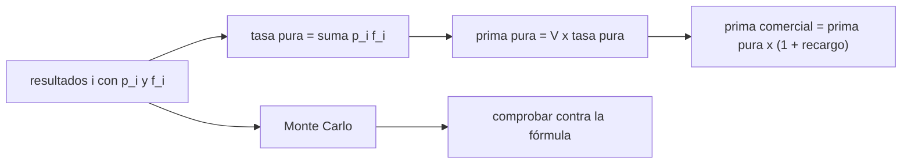

# B127-C01 — Seguros de lanzamiento

<!-- nav:top -->
[🏠 Programa](../../../../README.md) · [📚 Bloque B127](../../../tronco-comun/B127-seguros-espaciales.md) · [← Anterior: B126-C06 — Presentación financiera ante inversionistas con evidencia](../../../tronco-comun/B126-financiamiento-de-proyectos-y-negocios-espaciales.md#b126-c06) · [Siguiente: B127-C02 — Seguros en órbita →](../B127-C02-seguros-en-orbita/CLASE.md)
<!-- /nav -->

## 1. Ubicación, nivel y alcance

Clase 1 del bloque B127, «Seguros espaciales» (área A11). Nivel N4. El lanzamiento es el tramo más corto y más arriesgado de una misión: en minutos se juega el valor del satélite. Aquí aprendes cómo se descompone el precio de un seguro de lanzamiento: probabilidad de cada resultado, pago, tasa pura y recargo. Esta clase usa lo visto sobre riesgo y seguros en general en el bloque [B124](../../../tronco-comun/B124-industria-economia-etica-y-proyectos-espaciales.md) solo como contexto. **Es educativa: no es una cotización ni asesoría financiera, legal ni de seguros.** Todos los números son sintéticos.

## 2. Por qué esta clase existe

B124-C08 presenta el riesgo y los seguros en general; el seguro de lanzamiento tiene estructura y coberturas propias. La decisión central: **¿qué prima es coherente con la probabilidad de fallo y qué parte de ella es recargo?**

## 3. Lo que podrás hacer al terminar

1. Describir un lanzamiento como un conjunto de resultados excluyentes con su pago.
2. Calcular la tasa pura `Σ pᵢ fᵢ` y la prima pura `V Σ pᵢ fᵢ`.
3. Añadir un recargo y obtener la prima y la tasa comerciales.
4. Verificar la fórmula con una simulación de Monte Carlo.
5. Medir la sensibilidad de la tasa a la probabilidad de pérdida total.
6. Separar lo consultado (ventana de cobertura de 14 CFR 440) de lo sintético.

La evidencia es la **ficha de cotización sintética de un lanzamiento** del ejercicio 12 (sección 20).

## 4. Con qué llegas y cómo comprobarlo

1. ¿Qué es una probabilidad y cómo suman las de resultados excluyentes?
2. ¿Qué es un valor esperado?
3. ¿Qué es una tasa expresada como porcentaje de un valor?
4. ¿Qué es una simulación de Monte Carlo?
5. ¿Qué es un recargo en un precio?

<details>
<summary>Ver respuestas</summary>

1. Un número entre 0 y 1; las de resultados que no pueden ocurrir juntos y agotan los casos suman 1. 2. El promedio de los valores ponderado por su probabilidad. 3. La fracción `precio / valor` multiplicada por 100. 4. Estimar una cantidad repitiendo un experimento aleatorio muchas veces. 5. Un porcentaje que se suma al costo esperado para cubrir gastos, capital y margen.
</details>

Con cuatro o cinco aciertos, sigue; si no, repasa los prerrequisitos.

## 5. Un caso de contexto y casos de referencia

El reglamento de EE. UU. 14 CFR parte 440 (responsabilidad financiera de lanzamiento y reentrada) fija una **ventana de cobertura**: para un lanzamiento orbital, hasta el mayor de 30 días tras la separación de la carga o 30 días desde el encendido. Es la única afirmación **consultada** de esta clase (leída mediante un resumen automático; ver sección 11). El **ejemplo conductor** es un lanzamiento sintético con valor asegurado `V = 200 MUSD` y cuatro resultados: éxito `0,940`, pérdida parcial leve `0,025` (25 %), pérdida parcial grave `0,015` (60 %) y pérdida total `0,020`. Su tasa pura es `3,525 %` y su tasa comercial con 35 % de recargo, `4,759 %`. Todo es **ilustrativo**.

## 6. Vocabulario

El **valor asegurado** `V` es el máximo que paga la póliza. La **tasa** es la prima dividida por `V`. La **prima pura** es la pérdida esperada. El **recargo** cubre gastos, capital y margen. La **pérdida parcial** paga una fracción `f` de `V`. La **ventana de cobertura** es el periodo en que el seguro responde. **MUSD** son millones de dólares ficticios.

## 7. Modelo mental: una apuesta con cuatro resultados



*Descripción textual:* los resultados con su probabilidad y su pago dan la tasa pura; multiplicada por el valor asegurado es la prima pura; el recargo da la comercial; una simulación comprueba la cuenta.

Analogía: una apuesta justa se paga a su valor esperado; el asegurador cobra algo más para cubrir costos. Límite: la prima de equilibrio solo es «justa» a largo plazo y con muchas pólizas; un solo lanzamiento es todo o nada.

## 8. La explicación, paso a paso

### 8.1 Tasa y prima puras

`tasa pura = 0,940·0 + 0,025·0,25 + 0,015·0,60 + 0,020·1,00 = 0,03525`. La prima pura es `200 × 0,03525 = 7,050 MUSD`.

### 8.2 Recargo

`prima comercial = 7,050 × 1,35 = 9,518 MUSD`; tasa `9,518/200 = 4,759 %`.

### 8.3 Verificación

El Monte Carlo (200 000 lanzamientos, semilla 127) da una pérdida media de `7,103 MUSD`, error relativo `0,75 %`. La frecuencia de siniestro simulada es `0,0603` (teórica `0,0600`).

### 8.4 Sensibilidad

Si `P(total)` pasa de `0,020` a `0,040` (restando masa al éxito), la tasa comercial sube de `4,759 %` a `7,459 %`; con `0,080`, a `12,859 %`. Un lanzador con poca historia tiene una `P(total)` incierta y la prima lo refleja.

### 8.5 Ventana de cobertura

La prima paga solo por el periodo cubierto: lo que ocurra después (por ejemplo, un fallo del satélite meses más tarde) corresponde a otra cobertura, la de [C02](../B127-C02-seguros-en-orbita/CLASE.md).

## 9. Magnitudes, símbolos y unidades

| Símbolo | Qué es | Unidad | Valor / nota |
|---|---|---|---|
| `V` | valor asegurado | MUSD ficticios | 200 |
| `pᵢ` | probabilidad del resultado `i` | — | 0,94 / 0,025 / 0,015 / 0,02 |
| `fᵢ` | fracción pagada | — | 0 / 0,25 / 0,60 / 1 |
| `r` | recargo | — | 0,35 |
| tasa | prima / `V` | % | 3,525 pura; 4,759 comercial |

## 10. Convenciones y referencias

Un solo lanzamiento, resultados excluyentes, pago proporcional a `f`, sin deducible, sin reembolso ni prima de reinstalación, sin impuestos. Unidades: MUSD ficticios. Los resultados y probabilidades son sintéticos y no representan a ningún lanzador.

## 11. De dónde sale lo que afirmamos

| ID | Fuente | Localizador | Respalda | Estado |
|---|---|---|---|---|
| S1 | Código de Regulaciones Federales de EE. UU., título 14, parte 440 «Financial Responsibility» — https://www.ecfr.gov/current/title-14/part-440 (consultada 2026-11-11 mediante resumen automático de WebFetch, no lectura directa) | 440.11 | ventana de cobertura de un lanzamiento orbital (30 días) | Consultada (verificar en la fuente) |
| — | Tasas, primas y siniestros de mercado | — | ninguna cifra de mercado de lanzamiento se usa | No consultadas |
| — | Resultados, probabilidades, `V`, recargo | — | todos los números | Ilustrativo |

Límites: no se consultó ninguna cotización ni tasa de lanzamiento real; el reglamento no se leyó íntegro ni en su versión original; esta clase no interpreta ninguna póliza.

## 12. Cómo ver la cotización

| Magnitud | Valor |
|---|---|
| Tasa pura | 3,525 % |
| Prima pura | 7,050 MUSD |
| Prima comercial | 9,518 MUSD |
| Tasa comercial | 4,759 % |
| Error Monte Carlo | 0,75 % |

Descripción larga: la prima comercial es la pérdida esperada más un 35 %; con la simulación coincide en menos de 1 %.

## 13. Ejemplo trabajado: cotizar un lanzamiento

**Paso 1 · Resultados.** Cuatro resultados con `p = (0,940; 0,025; 0,015; 0,020)` y `f = (0; 0,25; 0,60; 1)`.

**Paso 2 · Tasa pura.** `0,025·0,25 + 0,015·0,60 + 0,020 = 0,00625 + 0,009 + 0,020 = 0,03525`.

**Paso 3 · Prima pura.** `200 × 0,03525 = 7,050 MUSD`.

**Paso 4 · Prima comercial.** `7,050 × 1,35 = 9,518 MUSD`, tasa `4,759 %`.

## 14. Distintas formas de describir una cotización

**Por resultados:** tabla `p`, `f`. **Por tasa:** porcentaje de `V`. **Por prima:** MUSD. **Por riesgo:** `P(total)` y frecuencia de siniestro. **Por simulación:** media y error.

## 15. Práctica guiada

**Ejercicio 1 · con los pasos indicados.** Calcula la tasa pura de un lanzamiento con `p(total) = 0,03` y `p(éxito) = 0,97`. *Pasos:* `0,97·0 + 0,03·1`.

<details><summary>Solución comentada</summary>

`0,03 = 3 %`.
</details>

**Ejercicio 2 · con una pista.** Prima pura con `V = 200 MUSD` y tasa `3,525 %`. *Pista:* multiplica.

<details><summary>Solución comentada</summary>

`200 × 0,03525 = 7,050 MUSD`.
</details>

**Ejercicio 3 · casi autónomo.** Prima comercial con un recargo del 35 %.

<details><summary>Solución comentada</summary>

`7,050 × 1,35 = 9,518 MUSD`.
</details>

## 16. Práctica autónoma, transferencia e integrador

**Ejercicio 4 · autónomo.** Frecuencia teórica de siniestro (cualquier pérdida).

<details><summary>Solución comentada</summary>

`0,025 + 0,015 + 0,020 = 0,060`.
</details>

**Ejercicio 5 · autónomo.** Tasa pura si `P(total) = 0,040` y el éxito baja a `0,920`.

<details><summary>Solución comentada</summary>

`0,00625 + 0,009 + 0,040 = 0,05525 = 5,525 %`; con 35 % de recargo, `7,459 %`.
</details>

**Ejercicio 6 · autónomo.** Una prima cobrada de `8 MUSD` frente a la pura de `7,050`: ¿qué recargo implícito hay?

<details><summary>Solución comentada</summary>

`8/7,050 − 1 = 13,5 %`.
</details>

**Ejercicio 7 · autónomo.** ¿Qué fracción de la pérdida máxima es la prima comercial?

<details><summary>Solución comentada</summary>

`9,518/200 = 4,76 %`.
</details>

**Ejercicio 8 · autónomo.** ¿Cuánto vale la diferencia entre la simulación y la fórmula?

<details><summary>Solución comentada</summary>

`7,103 − 7,050 = 0,053 MUSD`, es decir `0,75 %`.
</details>

**Ejercicio 9 · transferencia.** **Transferencia.** Un aviso: el valor asegurado, ¿debe incluir solo el satélite o también el costo del lanzamiento?

<details><summary>Solución comentada</summary>

Depende de qué pérdida se quiere cubrir; si se asegura también el costo del servicio de lanzamiento, `V` crece y con él la prima. El modelo solo escala: `prima = V × tasa`.
</details>

**Ejercicio 10 · transferencia.** **Transferencia.** El satélite falla a los 45 días de un lanzamiento con ventana de 30 días. ¿Qué cobertura responde?

<details><summary>Solución comentada</summary>

No la de lanzamiento, que ya cerró; responde la cobertura en órbita si existe (clase C02).
</details>

**Ejercicio 11 · transferencia.** **Transferencia.** Un lanzador nuevo no tiene historia. ¿Cómo cambia la tasa y por qué?

<details><summary>Solución comentada</summary>

Sube, porque `P(total)` es incierta; como muestra la sensibilidad de 8.4, duplicar `P(total)` casi duplica la tasa pura.
</details>

**Ejercicio 12 · integrador.** **Integrador.** Elabora tu *ficha de cotización sintética de un lanzamiento*: tabla de resultados, tasa y prima pura y comercial, verificación Monte Carlo, sensibilidad a `P(total)`, ventana de cobertura y lista de qué es consultado e ilustrativo, con el aviso de que no es asesoría.

<details><summary>Solución comentada</summary>

Secciones 8.1–8.5 y la salida del laboratorio.
</details>

## 17. Laboratorio: tasa de prima de un lanzamiento

El script [prima_lanzamiento.py](prima_lanzamiento.py) calcula la tasa y la prima, simula 200 000 lanzamientos y **comprueba** un error relativo menor que 2 %. Tarda unos pocos segundos.

**Datos:** solo la ventana de 14 CFR 440 consultada; resultados, probabilidades, `V` y recargo **ilustrativos**. **Predice antes de ejecutar:** ¿la tasa comercial será mayor o menor que `5 %`? (menor, `4,76 %`.) **Ejecución del 2026-11-11 (Python 3.12.9):**

```text
Python 3.12.9 (biblioteca estandar)
Datos SINTETICOS; solo la ventana de 30 dias de 14 CFR 440 es conceptual y consultada.
Valor asegurado V = 200.0 MUSD ; recargo = 35%
Tasa pura = 3.5250% ; prima pura = 7.050 MUSD
Prima comercial = 9.518 MUSD ; tasa comercial = 4.7588%
Monte Carlo (200000 lanzamientos): perdida media = 7.103 MUSD ; error relativo = 0.75%
Frecuencia de siniestro MC = 0.0603 (teorica 0.0600) ; perdida total MC = 0.0201 (teorica 0.0200)
Sensibilidad: tasa comercial segun la probabilidad de perdida total
  P(total) = 0.010 -> tasa comercial = 3.4088%
  P(total) = 0.020 -> tasa comercial = 4.7588%
  P(total) = 0.040 -> tasa comercial = 7.4588%
  P(total) = 0.080 -> tasa comercial = 12.8588%
Perdida maxima por lanzamiento = 200.0 MUSD ; prima/perdida maxima = 4.76%
Pruebas superadas.
```

```bash
python programa/clases/B127/B127-C01-seguros-de-lanzamiento/prima_lanzamiento.py
```

**Límites:** resultados excluyentes, sin deducible, sin prima de reinstalación, un solo lanzamiento; no es una cotización.

## 18. Errores frecuentes y cómo corregirlos

**Tomar la tasa sintética como una tasa de mercado.** Se corrige con la sección 10.

**Confundir prima pura con prima comercial.** Se corrige con 8.1–8.2.

**Ignorar la ventana de cobertura.** Se corrige con 8.5 y el ejercicio 10.

**Creer que la prima «justa» elimina el riesgo de un solo lanzamiento.** Se corrige con la analogía de la sección 7.

## 19. Cómo sabrás que vas bien

Tras la sección 8: ¿qué tasa esperabas y cuál obtuviste? Si dudas, repasa el ejemplo 13. Tras el laboratorio: ¿qué comprueba? (ver la sección 17).

## 20. Qué entregas y cómo se evalúa

El producto es tu **ficha de cotización sintética de un lanzamiento** (ejercicio 12).

| Criterio | Inicial | En desarrollo | Logrado | Destacado |
|---|---|---|---|---|
| Conceptos | Los confunde | Parciales | Distingue pura, comercial y tasa | Explica los límites |
| Cálculo | Sin unidades | Con errores | Tablas completas con unidades | Calcula casos nuevos |
| Numérico | Sin comprobar | Un caso | Contraste con la simulación | Interpreta las diferencias |
| Fuentes | Sin fuente | Sin fecha | Fuentes con fecha y estado | Declara lo ilustrativo y lo no consultado |
| Límites | No los nombra | Uno | Tres | Discute qué falta del modelo |

**Condiciones críticas (no se compensan con promedio):** rotular los datos como sintéticos; no presentar la prima como una cotización ni como asesoría; citar solo lo consultado.

## 21. Ética, seguridad y límites

Clase educativa: **no es asesoría financiera, legal ni de seguros** y no sustituye a un corredor, un actuario ni una póliza real; ningún resultado debe usarse para contratar ni tarificar un lanzamiento. Los modelos son simplificados y sus datos son sintéticos. Accesibilidad: tablas equivalentes a las gráficas, fórmulas en texto, ejercicios sin conexión.

## 22. Para cerrar y seguir

Un lanzamiento sintético de `200 MUSD` con `6 %` de frecuencia de siniestro y `2 %` de pérdida total tiene una prima pura de `7,050 MUSD` y una comercial de `9,518 MUSD` (`4,76 %`); si la pérdida total se duplica, la tasa sube a `7,46 %`. La siguiente clase trata el riesgo después de la ventana de lanzamiento.

**Glosario español–inglés.** seguro de lanzamiento · *launch insurance*; prima · *premium*; tasa · *rate*; valor asegurado · *insured value*; recargo · *loading*; pérdida total · *total loss*.

**Continuidad.** [B127-C02](../B127-C02-seguros-en-orbita/CLASE.md) trata el seguro durante la vida en órbita.

**Referencias:** ver sección 11.

<!-- nav:bottom -->
---

[← Anterior: B126-C06 — Presentación financiera ante inversionistas con evidencia](../../../tronco-comun/B126-financiamiento-de-proyectos-y-negocios-espaciales.md#b126-c06) · [📚 Bloque B127](../../../tronco-comun/B127-seguros-espaciales.md) · [Siguiente: B127-C02 — Seguros en órbita →](../B127-C02-seguros-en-orbita/CLASE.md)
<!-- /nav -->
