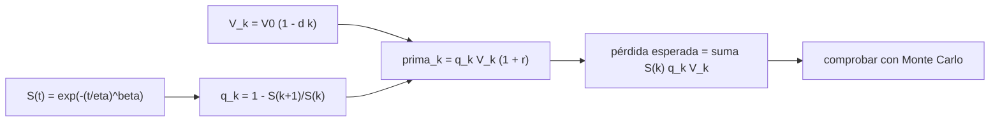

# B127-C02 — Seguros en órbita

<!-- nav:top -->
[🏠 Programa](../../../../README.md) · [📚 Bloque B127](../../../tronco-comun/B127-seguros-espaciales.md) · [← Anterior: B127-C01 — Seguros de lanzamiento](../B127-C01-seguros-de-lanzamiento/CLASE.md) · [Siguiente: B127-C03 — Seguros de responsabilidad civil espacial →](../B127-C03-seguros-de-responsabilidad-civil-espacial/CLASE.md)
<!-- /nav -->

## 1. Ubicación, nivel y alcance

Clase 2 del bloque B127, «Seguros espaciales» (área A11). Nivel N4. Pasada la ventana de lanzamiento, el satélite vive años en órbita y el riesgo cambia: los fallos tempranos son más probables que los tardíos y el valor que queda por perder baja con el tiempo. Aquí modelas esa tasa de fallo con una distribución de Weibull y calculas una prima anual. Usas [C01](../B127-C01-seguros-de-lanzamiento/CLASE.md) para la idea de prima pura y recargo. **Es educativa: no es una cotización ni asesoría financiera, legal ni de seguros.** Todos los parámetros son sintéticos.

## 2. Por qué esta clase existe

La cobertura durante la vida en órbita difiere de la de lanzamiento y no estaba tratada. La decisión central: **¿cuánto debe costar cada año de cobertura si el riesgo baja con la edad pero el valor asegurado también?**

## 3. Lo que podrás hacer al terminar

1. Definir una supervivencia de Weibull `S(t)` y leer su parámetro de forma `β`.
2. Calcular la probabilidad condicional de fallo de cada año `q_k`.
3. Construir la prima anual con valor asegurado decreciente.
4. Calcular la pérdida esperada total ponderando por la supervivencia.
5. Verificar con Monte Carlo.
6. Separar lo consultado (volatilidad del mercado en 2025) de lo sintético.

La evidencia es la **tabla de prima por año de vida en órbita** del ejercicio 12 (sección 20).

## 4. Con qué llegas y cómo comprobarlo

1. ¿Qué es una función de supervivencia?
2. ¿Qué es una probabilidad condicional?
3. ¿Qué es una función exponencial?
4. ¿Qué es la depreciación lineal?
5. ¿Qué es la mortalidad infantil en fiabilidad?

<details>
<summary>Ver respuestas</summary>

1. La probabilidad de seguir funcionando después del tiempo `t`. 2. La probabilidad de un evento sabiendo que otro ya ocurrió. 3. Una función `eˣ`, que crece o decrece de forma proporcional a su valor. 4. Una baja de valor constante por unidad de tiempo. 5. La tasa de fallo alta al principio que luego decrece (`β < 1`).
</details>

Con cuatro o cinco aciertos, sigue; si no, repasa los prerrequisitos.

## 5. Un caso de contexto y casos de referencia

El informe de mercado de Gallagher «Space insurance market update Q1 2026» (10 de abril de 2026) señala que el *loss ratio* de suscripción de 2025 pasó de unos `15 %` a unos `75 %` tras un siniestro confirmado (SpainSat NG-2, asegurado por más de `400 MUSD`). Es corretaje, no un organismo público, y trae opiniones además de datos; solo ilustra la **volatilidad** de la clase y es lo único **consultado**. El **ejemplo conductor** es un satélite sintético con `β = 0,7`, `η = 120 años`, valor inicial `150 MUSD`, depreciación `8 %` anual y recargo `30 %`. Todo es **ilustrativo**.

## 6. Vocabulario

La **supervivencia** `S(t)` es la probabilidad de seguir operando. La **tasa de fallo** es la probabilidad de fallar por unidad de tiempo. **Weibull** es una familia de distribuciones con forma `β` y escala `η`. `q_k` es la probabilidad de fallar en el año `k` dado que llegó vivo. La **depreciación** reduce el valor asegurado. El ***loss ratio*** es siniestros divididos por primas.

## 7. Modelo mental: el riesgo baja, el valor también



*Descripción textual:* la supervivencia de Weibull da la probabilidad de fallo anual; con el valor decreciente se calcula la prima de cada año y la pérdida esperada total, que se contrasta por simulación.

Analogía: un coche nuevo tiene más riesgo de defecto de fábrica en el primer año, pero también vale más. Límite: la depreciación lineal y un único modo de fallo son simplificaciones; un satélite real pierde capacidad por partes.

## 8. La explicación, paso a paso

### 8.1 Supervivencia y fallo anual

`S(t) = exp(−(t/η)^β)`. Con `β = 0,7 < 1` la tasa de fallo decrece. `S(1) = 0,9656`, de modo que `q₁ = 1 − 0,9656 = 0,03443`. En el año 2, `q₂ = 0,02165`.

### 8.2 Prima anual

`prima_k = q_k · V_k · 1,30`. Año 1: `0,03443 × 150 × 1,30 = 6,715 MUSD` (tasa `4,476 %`). Año 2: `0,02165 × 138 × 1,30 = 3,883 MUSD`. Año 5: `2,057 MUSD` (tasa `2,017 %`).

### 8.3 La prima baja doblemente

Baja porque `q_k` decrece (el año 1 tiene `2,77` veces la tasa pura del año 10) y porque `V_k` decrece. La tasa comercial pasa de `4,48 %` a `1,49 %` en el año 13.

### 8.4 Pérdida esperada total

La prima del año `k` es condicional a haber llegado vivo; la pérdida esperada total pondera por `S(k)`: `Σ S(k) q_k V_k = 17,941 MUSD`, con recargo `23,323 MUSD`. El Monte Carlo (100 000 satélites, semilla 127) da `18,040 MUSD` y `S(5) = 0,8967` frente a `0,8975`.

### 8.5 Lo que el modelo deja fuera

La pérdida **parcial** de capacidad, la correlación entre satélites de una misma serie y el error de operación. Un fallo de serie puede afectar a varios satélites a la vez, algo que el modelo independiente no ve.

## 9. Magnitudes, símbolos y unidades

| Símbolo | Qué es | Unidad | Valor / nota |
|---|---|---|---|
| `β` | forma de Weibull | — | 0,7 |
| `η` | escala | años | 120 |
| `S(t)` | supervivencia | — | 0,9656 a 1 año |
| `q_k` | fallo en el año `k` | — | 0,0344 a 0,0109 |
| `V₀`, `d` | valor inicial y depreciación | MUSD; 1/año | 150; 0,08 |
| `r` | recargo | — | 0,30 |

## 10. Convenciones y referencias

Tiempo en años desde el inicio de la vida en órbita; el año `k` va de `k` a `k+1`. Un solo modo de fallo (pérdida total). Pago del valor `V_k` del año del fallo. Los parámetros son sintéticos y no representan ningún satélite ni ninguna cotización.

## 11. De dónde sale lo que afirmamos

| ID | Fuente | Localizador | Respalda | Estado |
|---|---|---|---|---|
| S1 | Gallagher, «Space insurance market update Q1 2026», 10-04-2026 — https://specialty.ajg.com/plane-talking/space-insurance-market-update-q1-2026 (consultada 2026-11-11, WebFetch) | texto del informe | el *loss ratio* de 2025 pasa de ~15 % a ~75 % por un siniestro (SpainSat NG-2, asegurado por más de 400 MUSD) | Consultada; corretaje con opiniones |
| — | Distribución de Weibull | — | verificada con Monte Carlo | No consultada en una fuente concreta |
| — | Tasas de prima en órbita de mercado | — | ninguna cifra se usa | No consultadas |
| — | `β`, `η`, `V₀`, `d`, `r` | — | todos los números | Ilustrativo |

Límites: las tasas de mercado de órbita citadas en la prensa no se consultaron y no se usan; el informe de Gallagher no da primas totales ni tasas absolutas.

## 12. Cómo ver la prima por año

| Año | `q_k` | `V_k` (MUSD) | Prima (MUSD) | Tasa |
|---|---|---|---|---|
| 1 | 0,03443 | 150,0 | 6,715 | 4,48 % |
| 2 | 0,02165 | 138,0 | 3,883 | 2,81 % |
| 5 | 0,01551 | 102,0 | 2,057 | 2,02 % |
| 10 | 0,01241 | 42,0 | 0,678 | 1,61 % |

Descripción larga: la prima cae con rapidez los primeros años y después con la depreciación.

## 13. Ejemplo trabajado: prima del año 3

**Paso 1 · Fallo.** `q₃ = 0,01851`.

**Paso 2 · Valor.** `V₃ = 150 (1 − 0,08·2) = 126 MUSD`.

**Paso 3 · Prima.** `0,01851 × 126 × 1,30 = 3,032 MUSD`.

**Paso 4 · Tasa.** `3,032/126 = 2,41 %`.

## 14. Distintas formas de describir el riesgo en órbita

**Por supervivencia:** `S(t)`. **Por fallo anual:** `q_k`. **Por prima:** MUSD por año. **Por tasa:** porcentaje del valor. **Por pérdida esperada:** suma ponderada.

## 15. Práctica guiada

**Ejercicio 1 · con los pasos indicados.** Valor asegurado del año 4 (`k = 3`). *Pasos:* `150 (1 − 0,08·3)`.

<details><summary>Solución comentada</summary>

`150 × 0,76 = 114 MUSD`.
</details>

**Ejercicio 2 · con una pista.** `q` del año 2 sabiendo `S(1) = 0,9656` y `S(2) = 0,9447`. *Pista:* `1 − S(2)/S(1)`.

<details><summary>Solución comentada</summary>

`1 − 0,9447/0,9656 = 0,02164`, coherente con `0,02165`.
</details>

**Ejercicio 3 · casi autónomo.** Prima del año 4: `q₄ = 0,01673`, `V₄ = 114`.

<details><summary>Solución comentada</summary>

`0,01673 × 114 × 1,30 = 2,479 MUSD`.
</details>

## 16. Práctica autónoma, transferencia e integrador

**Ejercicio 4 · autónomo.** Probabilidad de seguir operando a los 5 años.

<details><summary>Solución comentada</summary>

`S(5) = 0,8975` (simulada `0,8967`).
</details>

**Ejercicio 5 · autónomo.** ¿Cuántas veces mayor es la tasa pura del año 1 que la del año 10?

<details><summary>Solución comentada</summary>

`0,03443/0,01241 = 2,77`.
</details>

**Ejercicio 6 · autónomo.** Recargo en MUSD de la prima del año 1.

<details><summary>Solución comentada</summary>

`6,715 − 6,715/1,30 = 1,550 MUSD`.
</details>

**Ejercicio 7 · autónomo.** ¿Por qué la prima del año 14 es nula?

<details><summary>Solución comentada</summary>

Porque `V₁₄ = 150 (1 − 0,08·13) < 0` se trunca a `0`: el modelo no deja valor asegurado.
</details>

**Ejercicio 8 · autónomo.** Diferencia entre la pérdida esperada analítica y la simulada.

<details><summary>Solución comentada</summary>

`18,040 − 17,941 = 0,099 MUSD` (0,6 %).
</details>

**Ejercicio 9 · transferencia.** **Transferencia.** Si `β` fuera `1,5` (desgaste), ¿cómo cambiaría la forma de la prima?

<details><summary>Solución comentada</summary>

La tasa de fallo crecería con la edad: la prima ya no caería con `q_k`, sino que `q_k` subiría mientras `V_k` baja, y habría un máximo intermedio.
</details>

**Ejercicio 10 · transferencia.** **Transferencia.** Cinco satélites de la misma serie comparten un defecto. ¿Qué supuesto del modelo se rompe?

<details><summary>Solución comentada</summary>

La independencia: la pérdida de una cartera sería más extrema que la suma de pérdidas independientes (ver clase C05).
</details>

**Ejercicio 11 · transferencia.** **Transferencia.** El informe consultado habla de un salto del *loss ratio* de 15 % a 75 % por un siniestro. ¿Qué dice eso del precio de una póliza individual?

<details><summary>Solución comentada</summary>

Muestra que el resultado anual es volátil y dominado por pocos siniestros grandes; no permite deducir la prima de una póliza concreta.
</details>

**Ejercicio 12 · integrador.** **Integrador.** Elabora tu *tabla de prima por año de vida en órbita*: `S`, `q_k`, `V_k`, prima y tasa, pérdida esperada, verificación Monte Carlo, límites del modelo y lista de qué es consultado e ilustrativo, con el aviso de que no es asesoría.

<details><summary>Solución comentada</summary>

Secciones 8.1–8.5 y la salida del laboratorio.
</details>

## 17. Laboratorio: prima en órbita con Weibull

El script [prima_en_orbita.py](prima_en_orbita.py) construye la tabla de 15 años, calcula la pérdida esperada y la contrasta con 100 000 satélites simulados (**comprueba** `S(5)` a 0,005 y la pérdida total a 3 %).

**Datos:** solo el contexto de volatilidad consultado; parámetros **ilustrativos**. **Predice antes de ejecutar:** ¿la tasa del año 1 será mayor que la del año 5? (sí.) **Ejecución del 2026-11-11 (Python 3.12.9):**

```text
Python 3.12.9 (biblioteca estandar)
Datos SINTETICOS; solo el contexto de volatilidad de mercado (Gallagher Q1 2026) es consultado.
Weibull beta = 0.7, eta = 120.0 anios ; V0 = 150.0 MUSD ; depreciacion 8%/anio ; recargo 30%
 anio  q_k(fallo)  S(fin)  V_k[MUSD]  prima[MUSD]  tasa comercial
    1    0.03443   0.9656     150.00      6.7146     4.4764%
    2    0.02165   0.9447     138.00      3.8832     2.8139%
    3    0.01851   0.9272     126.00      3.0318     2.4062%
    4    0.01673   0.9117     114.00      2.4787     2.1743%
    5    0.01551   0.8975     102.00      2.0569     2.0166%
    6    0.01461   0.8844      90.00      1.7092     1.8991%
    7    0.01390   0.8721      78.00      1.4092     1.8066%
    8    0.01332   0.8605      66.00      1.1425     1.7311%
    9    0.01283   0.8495      54.00      0.9005     1.6676%
   10    0.01241   0.8389      42.00      0.6775     1.6131%
   11    0.01204   0.8288      30.00      0.4697     1.5656%
   12    0.01172   0.8191      18.00      0.2743     1.5237%
   13    0.01143   0.8098       6.00      0.0892     1.4863%
   14    0.01117   0.8007       0.00      0.0000     0.0000%
   15    0.01094   0.7919       0.00      0.0000     0.0000%
Perdida esperada total (ponderada por supervivencia) = 17.941 MUSD ; con recargo = 23.323 MUSD
S(5) analitica = 0.8975 ; Monte Carlo = 0.8967 ; diferencia = 0.0008
Perdida media 15 anios: analitica = 17.941 ; Monte Carlo = 18.040 MUSD
Razon de tasa pura anio 1 / anio 10 = 2.77
Pruebas superadas.
```

```bash
python programa/clases/B127/B127-C02-seguros-en-orbita/prima_en_orbita.py
```

**Límites:** un solo modo de fallo, depreciación lineal, satélites independientes; no es una cotización.

## 18. Errores frecuentes y cómo corregirlos

**Sumar las primas anuales sin ponderar por supervivencia.** Se corrige con 8.4.

**Tomar `β` como una medida de calidad.** Describe la forma del riesgo, no su nivel; se corrige con 8.1.

**Creer que la prima sintética es una tasa de mercado.** Se corrige con la sección 10.

**Olvidar la pérdida parcial.** Se corrige con 8.5.

## 19. Cómo sabrás que vas bien

Tras la sección 8: ¿qué prima esperabas para el año 3 y cuál obtuviste? Si dudas, repasa el ejemplo 13. Tras el laboratorio: ¿qué comprueba? (ver la sección 17).

## 20. Qué entregas y cómo se evalúa

El producto es tu **tabla de prima por año de vida en órbita** (ejercicio 12).

| Criterio | Inicial | En desarrollo | Logrado | Destacado |
|---|---|---|---|---|
| Conceptos | Los confunde | Parciales | Distingue `S`, `q_k` y prima | Explica los límites |
| Cálculo | Sin unidades | Con errores | Tabla completa con unidades | Calcula casos nuevos |
| Numérico | Sin comprobar | Un caso | Contraste con la simulación | Interpreta las diferencias |
| Fuentes | Sin fuente | Sin fecha | Fuentes con fecha y estado | Declara lo ilustrativo y lo no consultado |
| Límites | No los nombra | Uno | Tres | Discute qué falta del modelo |

**Condiciones críticas (no se compensan con promedio):** rotular los parámetros como sintéticos; no presentar la tabla como cotización ni asesoría; citar solo lo consultado.

## 21. Ética, seguridad y límites

Clase educativa: **no es asesoría financiera, legal ni de seguros** y no sustituye a un corredor, un actuario ni una póliza real. Los modelos son simplificados y sus datos son sintéticos. Accesibilidad: tablas equivalentes a las gráficas, fórmulas en texto, ejercicios sin conexión.

## 22. Para cerrar y seguir

Un satélite sintético de `150 MUSD` tiene una prima comercial de `6,715 MUSD` el primer año y de `2,057 MUSD` el quinto; su pérdida esperada a 15 años es `17,941 MUSD`. La siguiente clase trata el daño que el satélite puede causar a terceros.

**Glosario español–inglés.** seguro en órbita · *in-orbit insurance*; supervivencia · *survival*; tasa de fallo · *hazard rate*; depreciación · *depreciation*; *loss ratio* · *loss ratio*.

**Continuidad.** [B127-C03](../B127-C03-seguros-de-responsabilidad-civil-espacial/CLASE.md) trata la responsabilidad civil espacial.

**Referencias:** ver sección 11.

<!-- nav:bottom -->
---

[← Anterior: B127-C01 — Seguros de lanzamiento](../B127-C01-seguros-de-lanzamiento/CLASE.md) · [📚 Bloque B127](../../../tronco-comun/B127-seguros-espaciales.md) · [Siguiente: B127-C03 — Seguros de responsabilidad civil espacial →](../B127-C03-seguros-de-responsabilidad-civil-espacial/CLASE.md)
<!-- /nav -->
