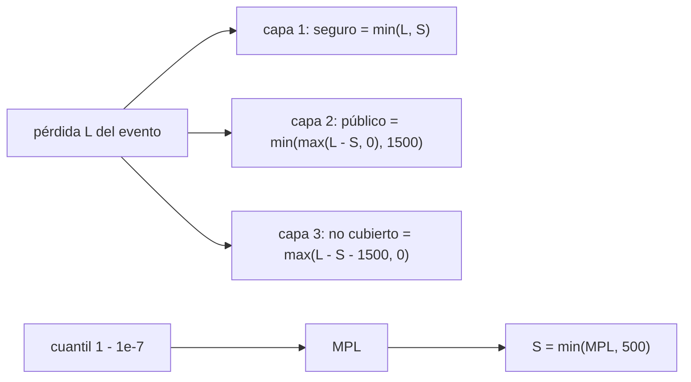

# B127-C03 — Seguros de responsabilidad civil espacial

<!-- nav:top -->
[🏠 Programa](../../../../README.md) · [📚 Bloque B127](../../../tronco-comun/B127-seguros-espaciales.md) · [← Anterior: B127-C02 — Seguros en órbita](../B127-C02-seguros-en-orbita/CLASE.md) · [Siguiente: B127-C04 — Exclusiones, deducibles y límites de pólizas →](../B127-C04-exclusiones-deducibles-y-limites-de-polizas/CLASE.md)
<!-- /nav -->

## 1. Ubicación, nivel y alcance

Clase 3 del bloque B127, «Seguros espaciales» (área A11). Nivel N4. Un lanzamiento o un satélite pueden dañar a terceros: personas o bienes en tierra, aeronaves u otros satélites. Ese riesgo se asegura aparte y está encuadrado por el derecho internacional y, en algunos países, por reglamentos que exigen un seguro mínimo. Aquí aprendes la lógica de capas: pérdida máxima probable, seguro exigido y excedente público. Usas [C01](../B127-C01-seguros-de-lanzamiento/CLASE.md) y [C02](../B127-C02-seguros-en-orbita/CLASE.md) solo por contraste: aquellas cubren la pérdida del propio satélite. **Es educativa: no es asesoría financiera, legal ni de seguros y no describe el régimen aplicable a ningún caso real.**

## 2. Por qué esta clase existe

La responsabilidad por daños a terceros se asegura aparte y ninguna clase la trataba. La decisión central: **¿cuánto seguro de terceros se exige y quién paga lo que lo supera?**

## 3. Lo que podrás hacer al terminar

1. Distinguir responsabilidad absoluta (superficie y aeronaves) de responsabilidad por culpa (en el espacio) según el Convenio de 1972.
2. Definir la pérdida máxima probable (MPL) como un cuantil de una distribución de pérdidas.
3. Calcular el seguro exigido `min(MPL, tope)`.
4. Repartir un evento entre seguro, excedente público y lo no cubierto.
5. Comprobar un cuantil analítico con Monte Carlo y ver sus límites en la cola.
6. Separar lo consultado (Convenio, 14 CFR 440) de lo sintético.

La evidencia es la **ficha de capas de responsabilidad sintética** del ejercicio 12 (sección 20).

## 4. Con qué llegas y cómo comprobarlo

1. ¿Qué es un cuantil?
2. ¿Qué es una distribución lognormal?
3. ¿Qué es un tercero en un seguro de responsabilidad?
4. ¿Qué es un Estado de lanzamiento?
5. ¿Qué es una cola pesada?

<details>
<summary>Ver respuestas</summary>

1. El valor bajo el cual queda una fracción dada de los casos. 2. La de una variable cuyo logaritmo es normal; es asimétrica y de cola larga. 3. Quien no es parte del contrato ni de la actividad asegurada. 4. El Estado que lanza o hace lanzar un objeto, o desde cuyo territorio o instalación se lanza (Convenio, art. I). 5. Una distribución donde los valores extremos tienen una probabilidad no despreciable.
</details>

Con cuatro o cinco aciertos, sigue; si no, repasa los prerrequisitos.

## 5. Un caso de contexto y casos de referencia

Dos fuentes **consultadas** fijan el marco. El **Convenio sobre responsabilidad internacional por daños causados por objetos espaciales (1972)**: el Estado de lanzamiento es **absolutamente responsable** de los daños de su objeto en la superficie de la Tierra o a aeronaves en vuelo (art. II) y responde **por culpa** de los daños causados en otro lugar (art. III). Y el reglamento de EE. UU. **14 CFR parte 440** (leído mediante un resumen): define la pérdida máxima probable de terceros como la que tiene una probabilidad no menor que `1 en 10 millones`; el seguro exigido no excede el menor entre `500 MUSD` y el máximo disponible a costo razonable; y el Gobierno puede pagar excedentes hasta `1 500 MUSD` (ajustados por inflación), con condiciones. El **ejemplo conductor** es una pérdida de tercero sintética `L ~ Lognormal(μ = 2, σ = 1,6)` en MUSD: mediana `7,39`, media `26,58`. Es **ilustrativa**; el reglamento y el Convenio no aportan ningún número de la distribución.

## 6. Vocabulario

La **responsabilidad absoluta** no exige probar culpa. La **responsabilidad por culpa** sí. La **pérdida máxima probable** (*maximum probable loss*, MPL) es una pérdida con una probabilidad muy pequeña de ser superada. El **seguro exigido** es el monto mínimo requerido. El **excedente público** es el pago del Estado por encima del seguro. Una **capa** es un tramo de pérdida cubierto por un pagador.

## 7. Modelo mental: tres capas apiladas



*Descripción textual:* el cuantil `1 − 10⁻⁷` define la MPL; el seguro exigido `S` es su mínimo con el tope de 500; la pérdida de un evento se reparte en seguro, excedente público y resto.

Analogía: un edificio con tres pisos de cobertura apilados; cada piso solo paga lo que el anterior no cubrió. Límite: el excedente público tiene condiciones (aviso, defensa, aprobación del Congreso) que un cálculo de capas no recoge.

## 8. La explicación, paso a paso

### 8.1 Cuantiles de una cola pesada

Con `L ~ Lognormal(2; 1,6)`, el cuantil `p` es `exp(μ + σ z_p)`: mediana `7,39`, `p = 0,99` → `305,6 MUSD`, `p = 0,999` → `1 037 MUSD`, `p = 1 − 10⁻⁶` → `14 846 MUSD`.

### 8.2 La MPL del modelo

`MPL = cuantil(1 − 10⁻⁷) = 30 301 MUSD`. Como excede los `500 MUSD`, el seguro exigido es `min(30 301; 500) = 500 MUSD`: el tope es lo que manda, no la MPL. **Simplificación declarada:** el laboratorio aplica el cuantil al evento condicionado; el reglamento aplica la probabilidad de la pérdida, que incluye la probabilidad de que ocurra un evento.

### 8.3 Probabilidad de superar cada capa

`P(L > 500) = 4,2 × 10⁻³`; `P(L > 2 000) = 2,3 × 10⁻⁴` (supera seguro más excedente).

### 8.4 Reparto de un evento

Un evento de `800 MUSD` se reparte `500` (seguro), `300` (excedente público) y `0` no cubierto. En promedio por evento: seguro `24,758`, público `1,591`, no cubierto `0,239` MUSD; suman `26,588` (media analítica `26,576`).

### 8.5 Verificación y límite del Monte Carlo

Con 400 000 eventos el cuantil `99,9 %` simulado es `1 060` frente a `1 037` analítico (`2,2 %`). La MPL a `10⁻⁷` **no** se puede verificar por simulación directa (haría falta del orden de `10⁷` eventos): se confía en la fórmula analítica, que solo vale si la lognormal es correcta en la cola, algo que ningún dato de este laboratorio prueba.

## 9. Magnitudes, símbolos y unidades

| Símbolo | Qué es | Unidad | Valor / nota |
|---|---|---|---|
| `μ`, `σ` | parámetros de `ln L` | ln(MUSD) | 2; 1,6 |
| `L` | pérdida de un evento | MUSD ficticios | media 26,58 |
| MPL | cuantil `1 − 10⁻⁷` | MUSD | 30 301 (modelo) |
| `S` | seguro exigido | MUSD | `min(MPL, 500)` |
| `G` | tope público | MUSD | 1 500 (14 CFR 440, consultado) |

## 10. Convenciones y referencias

Se modela solo el daño a terceros de un evento; la frecuencia del evento no entra en el laboratorio. Los topes de `500` y `1 500 MUSD` son los del reglamento consultado, usados como parámetros de ejemplo; **no** se aplican los ajustes por inflación ni las condiciones. La distribución de `L` es sintética.

## 11. De dónde sale lo que afirmamos

| ID | Fuente | Localizador | Respalda | Estado |
|---|---|---|---|---|
| S1 | Naciones Unidas, UNOOSA, *International Space Law: United Nations Instruments* (ST/SPACE/61/Rev.1) — https://www.unoosa.org/pdf/publications/st_space_61E.pdf (consultada 2026-11-11, PDF leído con PyMuPDF) | Convenio de 1972, arts. I, II, III; Tratado del Espacio Ultraterrestre, art. VII | definiciones de daño y Estado de lanzamiento; responsabilidad absoluta (superficie y aeronaves) y por culpa (otros lugares); el art. VII del Tratado hace responsable al Estado que lanza | Consultada |
| S2 | 14 CFR parte 440 — https://www.ecfr.gov/current/title-14/part-440 (consultada 2026-11-11 mediante resumen automático, no lectura directa) | 440.3, 440.9, 440.19 | MPL con probabilidad no menor que 1 en 10 millones; seguro exigido hasta el menor de 500 MUSD o el máximo de mercado; pago público adicional hasta 1 500 MUSD con condiciones | Consultada (verificar en la fuente) |
| — | Distribución lognormal de pérdidas de terceros | — | todos los números de `L` | Ilustrativo |

Límites: no se consultó el texto original de 14 CFR 440 ni su historia de actualizaciones; el régimen de otros países no se consultó; ningún caso real de reclamación por daños a terceros se usa.

## 12. Cómo ver las capas

| Magnitud | Valor |
|---|---|
| Mediana de `L` | 7,39 MUSD |
| Cuantil 99,9 % | 1 037 MUSD |
| MPL (modelo) | 30 301 MUSD |
| Seguro exigido | 500 MUSD |
| `P(L > 500)` | 0,42 % |
| `P(L > 2 000)` | 0,023 % |

Descripción larga: la mayoría de los eventos cabe en el seguro; la cola extrema depende del excedente público y, más allá, queda sin cubrir.

## 13. Ejemplo trabajado: un evento de 1 800 MUSD

**Paso 1 · Seguro.** `min(1 800; 500) = 500`.

**Paso 2 · Excedente.** `min(max(1 800 − 500; 0); 1 500) = 1 300`.

**Paso 3 · Resto.** `max(1 800 − 500 − 1 500; 0) = 0`.

**Paso 4 · Lectura.** El evento cabe en las dos primeras capas; el seguro paga el `27,8 %`.

## 14. Distintas formas de describir la responsabilidad

**Por régimen:** absoluta o por culpa. **Por cuantil:** MPL. **Por capas:** seguro, público, resto. **Por probabilidad:** de superar cada capa. **Por pagador:** asegurador, Estado, perjudicado.

## 15. Práctica guiada

**Ejercicio 1 · con los pasos indicados.** Reparto de un evento de `300 MUSD`. *Pasos:* seguro `min(300; 500)`; público `max(300 − 500; 0)`.

<details><summary>Solución comentada</summary>

Seguro `300`, público `0`, resto `0`.
</details>

**Ejercicio 2 · con una pista.** Seguro exigido si la MPL fuera `120 MUSD`. *Pista:* el menor entre MPL y tope.

<details><summary>Solución comentada</summary>

`min(120; 500) = 120 MUSD`.
</details>

**Ejercicio 3 · casi autónomo.** Reparto de un evento de `800 MUSD`.

<details><summary>Solución comentada</summary>

Seguro `500`, público `300`, resto `0`.
</details>

## 16. Práctica autónoma, transferencia e integrador

**Ejercicio 4 · autónomo.** ¿Qué régimen del Convenio se aplica a un fragmento que cae sobre una ciudad?

<details><summary>Solución comentada</summary>

Responsabilidad absoluta del Estado de lanzamiento (art. II).
</details>

**Ejercicio 5 · autónomo.** ¿Y a la colisión de dos satélites en órbita?

<details><summary>Solución comentada</summary>

Responsabilidad por culpa (art. III): solo si el daño se debe a la culpa del Estado de lanzamiento o de quienes responden por él.
</details>

**Ejercicio 6 · autónomo.** Probabilidad de que un evento supere el seguro de `500 MUSD`.

<details><summary>Solución comentada</summary>

`4,2 × 10⁻³`.
</details>

**Ejercicio 7 · autónomo.** Media de la pérdida cubierta por el seguro como fracción de la media total.

<details><summary>Solución comentada</summary>

`24,758/26,588 = 93,1 %`.
</details>

**Ejercicio 8 · autónomo.** ¿Cuántas simulaciones harían falta para ver una pérdida de probabilidad `10⁻⁷`?

<details><summary>Solución comentada</summary>

Del orden de `10⁷` o más; por eso se usa la fórmula analítica.
</details>

**Ejercicio 9 · transferencia.** **Transferencia.** El modelo supone una lognormal. ¿Qué pasa con la MPL si la cola real fuera más pesada?

<details><summary>Solución comentada</summary>

La MPL sería mayor; como el seguro exigido está topado en `500 MUSD`, lo que crece es el tramo que queda al excedente público o sin cubrir. La MPL es muy sensible al modelo de cola.
</details>

**Ejercicio 10 · transferencia.** **Transferencia.** ¿Por qué el seguro de un satélite propio (C01–C02) no cubre un daño a terceros?

<details><summary>Solución comentada</summary>

Porque asegura el bien del operador y no su responsabilidad hacia otros; son riesgos y pólizas distintos.
</details>

**Ejercicio 11 · transferencia.** **Transferencia.** El reglamento permite el pago público solo con condiciones. ¿Por qué no basta un cálculo de capas para planificar?

<details><summary>Solución comentada</summary>

Porque la tercera capa depende de requisitos y aprobaciones (aviso, participación en la defensa, plan aprobado) que no son probabilísticos y deben leerse en la fuente.
</details>

**Ejercicio 12 · integrador.** **Integrador.** Elabora tu *ficha de capas de responsabilidad sintética*: distribución de `L`, cuantiles, MPL, seguro exigido, reparto de un evento, verificación Monte Carlo y sus límites, marco legal consultado y lista de qué es consultado e ilustrativo, con el aviso de que no es asesoría.

<details><summary>Solución comentada</summary>

Secciones 8.1–8.5 y la salida del laboratorio.
</details>

## 17. Laboratorio: capas de responsabilidad

El script [capas_responsabilidad.py](capas_responsabilidad.py) calcula cuantiles, MPL y capas, y verifica el cuantil `99,9 %` con 400 000 eventos (**comprueba** error relativo menor que 10 %).

**Datos:** Convenio y 14 CFR 440 consultados (conceptos y topes); distribución de `L` **ilustrativa**. **Predice antes de ejecutar:** ¿la MPL del modelo estará por encima o por debajo de `500 MUSD`? (muy por encima.) **Ejecución del 2026-11-11 (Python 3.12.9):**

```text
Python 3.12.9 (biblioteca estandar)
Distribucion SINTETICA; consultados: 14 CFR 440 (via resumen) y Convenio de 1972 (Art. II-III).
L ~ Lognormal(mu=2.0, sigma=1.6) MUSD ; mediana = 7.39 ; media = 26.58
MPL (cuantil 1-1e-7) = 30301.1 MUSD ; seguro exigido = min(MPL, 500) = 500.0 MUSD
Cuantiles de L [MUSD]:
  p = 0.500000 ->       7.39
  p = 0.900000 ->      57.43
  p = 0.990000 ->     305.56
  p = 0.999000 ->    1037.30
  p = 0.999900 ->    2836.78
  p = 0.999999 ->   14845.90
P(L > seguro) = 4.218e-03 ; P(L > seguro + excedente publico) = 2.321e-04
Cuantil 99.9 %: analitico = 1037.30 ; Monte Carlo = 1060.15 ; error relativo = 2.20%
Perdida media por evento: seguro = 24.758 ; excedente publico = 1.591 ; no cubierto = 0.23897 MUSD
Total = 26.588 ; media analitica = 26.576
Reparto de un evento de 800 MUSD: seguro 500.0 ; publico 300.0 ; no cubierto 0.0
Pruebas superadas.
```

```bash
python programa/clases/B127/B127-C03-seguros-de-responsabilidad-civil-espacial/capas_responsabilidad.py
```

**Límites:** MPL sobre el evento condicionado, sin frecuencia, sin inflación ni condiciones del excedente, lognormal supuesta; no describe ningún régimen aplicable.

## 18. Errores frecuentes y cómo corregirlos

**Confundir seguro de daños propios con seguro de responsabilidad.** Se corrige con el ejercicio 10.

**Creer que la MPL del laboratorio es la del reglamento.** Se corrige con la simplificación de 8.2.

**Tratar el excedente público como un derecho automático.** Se corrige con el ejercicio 11.

**Fiarse de la simulación para probabilidades de `10⁻⁷`.** Se corrige con 8.5.

## 19. Cómo sabrás que vas bien

Tras la sección 8: ¿qué reparto esperabas para el evento de `800 MUSD` y cuál obtuviste? Si dudas, repasa el ejemplo 13. Tras el laboratorio: ¿qué comprueba? (ver la sección 17).

## 20. Qué entregas y cómo se evalúa

El producto es tu **ficha de capas de responsabilidad sintética** (ejercicio 12).

| Criterio | Inicial | En desarrollo | Logrado | Destacado |
|---|---|---|---|---|
| Conceptos | Los confunde | Parciales | Distingue régimen, MPL y capas | Explica los límites |
| Cálculo | Sin unidades | Con errores | Tablas completas con unidades | Calcula casos nuevos |
| Numérico | Sin comprobar | Un caso | Contraste con la simulación y su límite | Interpreta las diferencias |
| Fuentes | Sin fuente | Sin fecha | Fuentes con fecha y estado | Declara lo ilustrativo y lo no consultado |
| Límites | No los nombra | Uno | Tres | Discute qué falta del modelo |

**Condiciones críticas (no se compensan con promedio):** rotular la distribución como sintética; no presentar el reparto como asesoría legal ni de seguros; citar solo lo consultado y rotular el resumen de 14 CFR 440.

## 21. Ética, seguridad y límites

Clase educativa: **no es asesoría financiera, legal ni de seguros** y no sustituye a un abogado ni a un asegurador; no interpreta el Convenio ni el reglamento para ningún caso real. Los modelos son simplificados y sus datos son sintéticos. Accesibilidad: tablas equivalentes a las gráficas, fórmulas en texto, ejercicios sin conexión.

## 22. Para cerrar y seguir

Con una pérdida de tercero sintética de media `26,58 MUSD` y cola pesada, el seguro exigido queda en el tope de `500 MUSD` aunque la MPL del modelo sea `30 301 MUSD`; el `93,1 %` de la pérdida media cae en la primera capa. La siguiente clase enseña a leer las condiciones que recortan lo que una póliza paga.

**Glosario español–inglés.** responsabilidad civil · *third-party liability*; pérdida máxima probable · *maximum probable loss*; Estado de lanzamiento · *launching State*; capa · *layer*; responsabilidad absoluta · *absolute liability*.

**Continuidad.** [B127-C04](../B127-C04-exclusiones-deducibles-y-limites-de-polizas/CLASE.md) trata exclusiones, deducibles y límites.

**Referencias:** ver sección 11.

<!-- nav:bottom -->
---

[← Anterior: B127-C02 — Seguros en órbita](../B127-C02-seguros-en-orbita/CLASE.md) · [📚 Bloque B127](../../../tronco-comun/B127-seguros-espaciales.md) · [Siguiente: B127-C04 — Exclusiones, deducibles y límites de pólizas →](../B127-C04-exclusiones-deducibles-y-limites-de-polizas/CLASE.md)
<!-- /nav -->
