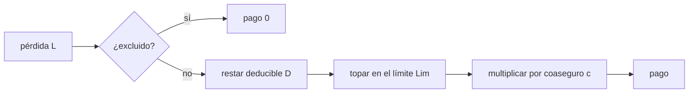

# B127-C04 — Exclusiones, deducibles y límites de pólizas

<!-- nav:top -->
[🏠 Programa](../../../../README.md) · [📚 Bloque B127](../../../tronco-comun/B127-seguros-espaciales.md) · [← Anterior: B127-C03 — Seguros de responsabilidad civil espacial](../B127-C03-seguros-de-responsabilidad-civil-espacial/CLASE.md) · [Siguiente: B127-C05 — Evaluación actuarial básica del riesgo espacial →](../B127-C05-evaluacion-actuarial-basica-del-riesgo-espacial/CLASE.md)
<!-- /nav -->

## 1. Ubicación, nivel y alcance

Clase 4 del bloque B127, «Seguros espaciales» (área A11). Nivel N4. Una póliza no paga «todo lo que pierdes»: paga lo que sus condiciones dicen. Aquí aprendes a leer tres de esas condiciones —deducible, límite y exclusión— más el coaseguro, y a calcular cuánto del siniestro medio llega realmente a pagar la póliza. Usas [C01](../B127-C01-seguros-de-lanzamiento/CLASE.md) a [C03](../B127-C03-seguros-de-responsabilidad-civil-espacial/CLASE.md) como las coberturas a las que se aplican estas condiciones. **Es educativa: no interpreta ninguna póliza real y no es asesoría financiera, legal ni de seguros.**

## 2. Por qué esta clase existe

Leer una póliza exige entender sus exclusiones, deducibles y límites; el catálogo no lo trataba. La decisión central: **¿qué parte de la pérdida retiene el asegurado y cómo cambia el precio al cambiar las condiciones?**

## 3. Lo que podrás hacer al terminar

1. Aplicar deducible, límite y coaseguro a una pérdida: `c·min(max(L − D, 0), Lim)`.
2. Calcular el pago esperado con la fórmula cerrada del valor esperado limitado de una lognormal.
3. Incorporar una probabilidad de exclusión.
4. Comparar cuatro pólizas por pago esperado y fracción de la pérdida cubierta.
5. Verificar la fórmula con Monte Carlo.
6. Separar lo consultado (condiciones de 14 CFR 440) de lo sintético.

La evidencia es la **comparación de cuatro pólizas sintéticas** del ejercicio 12 (sección 20).

## 4. Con qué llegas y cómo comprobarlo

1. ¿Qué es un deducible?
2. ¿Qué es un límite de póliza?
3. ¿Qué es una exclusión?
4. ¿Qué es un valor esperado?
5. ¿Qué es una distribución lognormal?

<details>
<summary>Ver respuestas</summary>

1. La parte de cada pérdida que asume el asegurado antes de que pague la póliza. 2. El máximo que paga la póliza por siniestro. 3. Una circunstancia o causa que la póliza declara no cubierta. 4. El promedio ponderado por probabilidad. 5. La de una variable cuyo logaritmo es normal.
</details>

Con cuatro o cinco aciertos, sigue; si no, repasa los prerrequisitos.

## 5. Un caso de contexto y casos de referencia

El reglamento de EE. UU. 14 CFR parte 440 (leído mediante un resumen) ofrece tres ideas **consultadas**: la póliza paga «desde el primer dólar», de modo que un deducible solo se admite si su monto está respaldado en garantía (*escrow*) o en fondos libres (440.13); las exclusiones deben especificarse (440.13); y el Gobierno puede cubrir riesgos que la póliza excluye si no están disponibles comercialmente a tarifas razonables (440.19). Las cifras de esta clase **no** salen de ahí. El **ejemplo conductor** es una severidad sintética `L ~ Lognormal(μ = 1,5; σ = 1,2)` MUSD (media `9,207`) y cuatro pólizas: A sin deducible; B con deducible `5`; C con deducible `5` y límite `50`; D como C, con `10 %` de eventos excluidos y coaseguro `80 %`. Todo es **ilustrativo**.

## 6. Vocabulario

El **deducible** `D` se resta de cada pérdida. El **límite** `Lim` topa el pago. La **exclusión** deja sin pago un evento. El **coaseguro** `c` es la fracción de la pérdida que paga el asegurador. El **valor esperado limitado** `E[min(L, u)]` es la media de la pérdida topada en `u`. El ***escrow*** es un fondo en garantía.

## 7. Modelo mental: la pérdida pasa por tres filtros



*Descripción textual:* una pérdida primero se comprueba contra las exclusiones; si no está excluida, se resta el deducible, se topa en el límite y se multiplica por la fracción coasegurada.

Analogía: una criba que deja pasar solo parte del agua. Límite: la lectura de una póliza real depende de su redacción exacta, que esta clase no reproduce.

## 8. La explicación, paso a paso

### 8.1 Pago de una pérdida

`pago(L) = c · min(max(L − D, 0), Lim)`. Con la póliza C: una pérdida `L = 30` paga `min(25; 50) = 25`; una de `80` paga `min(75; 50) = 50` y el asegurado retiene `30`.

### 8.2 Pago esperado en forma cerrada

Para lognormal, `E[min(L, u)] = e^(μ+σ²/2) Φ((ln u − μ − σ²)/σ) + u (1 − Φ((ln u − μ)/σ))`. El pago medio es `c (1 − p_exc) (LEV(D + Lim) − LEV(D))`, con `LEV(u)` el valor esperado limitado. No necesita simulación.

### 8.3 Las cuatro pólizas

| Póliza | Pago medio | % de la pérdida media |
|---|---|---|
| A sin deducible (límite 200) | 9,135 | 99,2 % |
| B deducible 5 | 5,589 | 60,7 % |
| C deducible 5, límite 50 | 4,945 | 53,7 % |
| D como C, 10 % excluido, 80 % coas. | 3,561 | 38,7 % |

### 8.4 Qué mueve cada condición

Un deducible de `5` quita casi el `40 %` del pago medio de A: solo el `46,4 %` de los eventos lo supera (`P(L > 5) = 0,4637`). Pasar el límite de `200` a `50` quita otro `0,64` MUSD en la cola. La exclusión y el coaseguro actúan multiplicando: `0,9 × 0,8 = 0,72` sobre el pago de C.

### 8.5 Verificación

Monte Carlo con 400 000 eventos da pagos dentro de `0,29 %` de la fórmula en las cuatro pólizas. Si la póliza paga menos, su prima pura baja en la misma proporción: **menos cobertura, menos prima**, y la diferencia la retiene el asegurado (en B: `3,619 MUSD` por evento).

## 9. Magnitudes, símbolos y unidades

| Símbolo | Qué es | Unidad | Valor / nota |
|---|---|---|---|
| `μ`, `σ` | parámetros de `ln L` | ln(MUSD) | 1,5; 1,2 |
| `D` | deducible | MUSD | 0; 5 |
| `Lim` | límite por siniestro | MUSD | 200; 50 |
| `p_exc` | probabilidad de exclusión | — | 0; 0,10 |
| `c` | coaseguro | — | 1; 0,8 |

## 10. Convenciones y referencias

Un evento por póliza, exclusión independiente de la pérdida, deducible por siniestro (no agregado), sin reinstalaciones. Unidades: MUSD ficticios. Las pólizas son ficticias y no reproducen redacción alguna.

## 11. De dónde sale lo que afirmamos

| ID | Fuente | Localizador | Respalda | Estado |
|---|---|---|---|---|
| S1 | 14 CFR parte 440 — https://www.ecfr.gov/current/title-14/part-440 (consultada 2026-11-11 mediante resumen automático, no lectura directa) | 440.13, 440.19 | pago «desde el primer dólar»; deducible solo respaldado en garantía; exclusiones especificadas; cobertura estatal de riesgos no asegurables a tarifas razonables | Consultada (verificar en la fuente) |
| — | Fórmula del valor esperado limitado de la lognormal | — | verificada con Monte Carlo | No consultada en una fuente concreta |
| — | Pólizas, deducibles, límites, exclusiones | — | todos los números | Ilustrativo |

Límites: no se consultó ninguna póliza real ni cláusulas de exclusión de mercado; no se debe inferir cómo se redactan.

## 12. Cómo ver la comparación

| Magnitud | Valor |
|---|---|
| Media de `L` | 9,207 MUSD |
| `P(L > 5)` | 0,4637 |
| `P(L > 20)` | 0,1063 |
| Pago de D | 3,561 MUSD (38,7 %) |
| Retención del asegurado en B | 3,619 MUSD |

Descripción larga: cada condición reduce el pago; el deducible pesa más que el límite porque la mayoría de las pérdidas son pequeñas.

## 13. Ejemplo trabajado: la póliza D ante una pérdida de 30 MUSD

**Paso 1 · Exclusión.** Si el evento no está excluido, continúa.

**Paso 2 · Deducible.** `30 − 5 = 25`.

**Paso 3 · Límite.** `min(25; 50) = 25`.

**Paso 4 · Coaseguro.** `0,8 × 25 = 20 MUSD`; el asegurado retiene `10 MUSD`.

## 14. Distintas formas de describir una póliza

**Por condiciones:** `D`, `Lim`, `c`, `p_exc`. **Por pago medio:** MUSD. **Por fracción cubierta:** porcentaje de la pérdida media. **Por retención:** lo que queda al asegurado. **Por prima:** proporcional al pago medio más recargo.

## 15. Práctica guiada

**Ejercicio 1 · con los pasos indicados.** Pago de C ante `L = 3`. *Pasos:* `max(3 − 5; 0)`.

<details><summary>Solución comentada</summary>

`0`: la pérdida no supera el deducible.
</details>

**Ejercicio 2 · con una pista.** Pago de C ante `L = 80`. *Pista:* `min(75; 50)`.

<details><summary>Solución comentada</summary>

`50 MUSD`; retención `30`.
</details>

**Ejercicio 3 · casi autónomo.** Pago de D ante `L = 30` si el evento no está excluido.

<details><summary>Solución comentada</summary>

`0,8 × 25 = 20 MUSD`.
</details>

## 16. Práctica autónoma, transferencia e integrador

**Ejercicio 4 · autónomo.** ¿Qué fracción de la pérdida media paga B?

<details><summary>Solución comentada</summary>

`5,589/9,207 = 60,7 %`.
</details>

**Ejercicio 5 · autónomo.** ¿Qué fracción de los eventos supera el deducible de `20`?

<details><summary>Solución comentada</summary>

`0,1063`.
</details>

**Ejercicio 6 · autónomo.** Factor multiplicativo de exclusión y coaseguro de D.

<details><summary>Solución comentada</summary>

`0,9 × 0,8 = 0,72`.
</details>

**Ejercicio 7 · autónomo.** Retención media del asegurado en la póliza A.

<details><summary>Solución comentada</summary>

`9,207 − 9,135 = 0,072 MUSD` (la cola que supera el límite de 200).
</details>

**Ejercicio 8 · autónomo.** Diferencia entre la fórmula y el Monte Carlo en C.

<details><summary>Solución comentada</summary>

`4,9551 − 4,9451 = 0,010 MUSD` (0,20 %).
</details>

**Ejercicio 9 · transferencia.** **Transferencia.** Un asegurado prefiere B a A porque su prima es menor. ¿Qué debe comprobar?

<details><summary>Solución comentada</summary>

Que puede absorber `5 MUSD` por siniestro; si el deducible exige fondos en garantía, ese dinero queda inmovilizado. La ganancia de prima compra más retención de riesgo.
</details>

**Ejercicio 10 · transferencia.** **Transferencia.** Una exclusión cubre un riesgo que ningún mercado ofrece. ¿Qué dice el reglamento consultado sobre eso?

<details><summary>Solución comentada</summary>

Que, para ciertas exclusiones usuales no disponibles a tarifas razonables, el Gobierno puede cubrir las reclamaciones, previa certificación del licenciatario (440.19); según el resumen consultado, que debe verificarse en la fuente.
</details>

**Ejercicio 11 · transferencia.** **Transferencia.** ¿Qué condición de la póliza D sube más el riesgo retenido de cola?

<details><summary>Solución comentada</summary>

El límite de `50`: una pérdida extrema deja sin pagar todo lo que lo supera, mientras que el deducible y el coaseguro actúan en todo el rango.
</details>

**Ejercicio 12 · integrador.** **Integrador.** Elabora tu *comparación de cuatro pólizas sintéticas*: condiciones, pago medio, fracción cubierta, retención, verificación Monte Carlo, qué condición pesa más y lista de qué es consultado e ilustrativo, con el aviso de que no es asesoría.

<details><summary>Solución comentada</summary>

Secciones 8.1–8.5 y la salida del laboratorio.
</details>

## 17. Laboratorio: cuatro pólizas

El script [poliza.py](poliza.py) calcula el pago medio con la fórmula cerrada, lo contrasta con 400 000 eventos simulados y **comprueba** un error relativo menor que 1,5 % en cada póliza.

**Datos:** solo conceptos de 14 CFR 440; severidad y condiciones **ilustrativas**. **Predice antes de ejecutar:** ¿qué póliza paga más, A o B? (A.) **Ejecución del 2026-11-11 (Python 3.12.9):**

```text
Python 3.12.9 (biblioteca estandar)
Severidad SINTETICA; 14 CFR 440.13 (via resumen) se usa solo como concepto.
L ~ Lognormal(mu=1.5, s=1.2) MUSD ; media = 9.207
 poliza                              pago cerrado  pago MC   err rel   %perdida pagada
 A sin deducible                         9.1349    9.1522    0.19%        99.2%
 B deducible 5                           5.5888    5.6051    0.29%        60.7%
 C deducible 5 y limite 50               4.9451    4.9551    0.20%        53.7%
 D como C, 10% excluido, 80% coas.       3.5605    3.5670    0.18%        38.7%
P(L > D= 0.0) = 1.0000
P(L > D= 5.0) = 0.4637
P(L > D=20.0) = 0.1063
Perdida retenida por el asegurado en B = 3.6186 MUSD por evento
Pruebas superadas.
```

```bash
python programa/clases/B127/B127-C04-exclusiones-deducibles-y-limites-de-polizas/poliza.py
```

**Límites:** deducible por siniestro, sin agregados, exclusión independiente de la pérdida, lognormal supuesta; no interpreta ninguna póliza.

## 18. Errores frecuentes y cómo corregirlos

**Restar el deducible después de aplicar el límite.** El orden es deducible, luego límite; se corrige con 8.1.

**Creer que menos prima siempre es mejor.** Se corrige con el ejercicio 9.

**Ignorar la retención de cola por el límite.** Se corrige con el ejercicio 11.

**Tomar las pólizas ficticias como modelos de redacción.** Se corrige con la sección 10.

## 19. Cómo sabrás que vas bien

Tras la sección 8: ¿qué pago esperabas para D ante `L = 30` y cuál obtuviste? Si dudas, repasa el ejemplo 13. Tras el laboratorio: ¿qué comprueba? (ver la sección 17).

## 20. Qué entregas y cómo se evalúa

El producto es tu **comparación de cuatro pólizas sintéticas** (ejercicio 12).

| Criterio | Inicial | En desarrollo | Logrado | Destacado |
|---|---|---|---|---|
| Conceptos | Los confunde | Parciales | Distingue deducible, límite, exclusión y coaseguro | Explica los límites |
| Cálculo | Sin unidades | Con errores | Tablas completas con unidades | Calcula casos nuevos |
| Numérico | Sin comprobar | Un caso | Contraste con la simulación | Interpreta las diferencias |
| Fuentes | Sin fuente | Sin fecha | Fuentes con fecha y estado | Declara lo ilustrativo y lo no consultado |
| Límites | No los nombra | Uno | Tres | Discute qué falta del modelo |

**Condiciones críticas (no se compensan con promedio):** rotular las pólizas como ficticias; no presentar la comparación como asesoría ni como lectura de una póliza real; citar solo lo consultado.

## 21. Ética, seguridad y límites

Clase educativa: **no es asesoría financiera, legal ni de seguros** y no sustituye a un corredor, un abogado ni la lectura íntegra de una póliza real. Los modelos son simplificados y sus datos son sintéticos. Accesibilidad: tablas equivalentes a las gráficas, fórmulas en texto, ejercicios sin conexión.

## 22. Para cerrar y seguir

Con una severidad sintética de media `9,207 MUSD`, un deducible de `5` baja el pago medio del `99,2 %` al `60,7 %` de la pérdida; con límite de `50`, exclusión del `10 %` y coaseguro del `80 %`, queda en `38,7 %`. La siguiente clase pasa de las condiciones a cómo se estima el precio.

**Glosario español–inglés.** deducible · *deductible*; límite · *limit*; exclusión · *exclusion*; coaseguro · *coinsurance*; valor esperado limitado · *limited expected value*.

**Continuidad.** [B127-C05](../B127-C05-evaluacion-actuarial-basica-del-riesgo-espacial/CLASE.md) trata la evaluación actuarial básica.

**Referencias:** ver sección 11.

<!-- nav:bottom -->
---

[← Anterior: B127-C03 — Seguros de responsabilidad civil espacial](../B127-C03-seguros-de-responsabilidad-civil-espacial/CLASE.md) · [📚 Bloque B127](../../../tronco-comun/B127-seguros-espaciales.md) · [Siguiente: B127-C05 — Evaluación actuarial básica del riesgo espacial →](../B127-C05-evaluacion-actuarial-basica-del-riesgo-espacial/CLASE.md)
<!-- /nav -->
