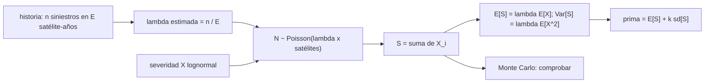

# B127-C05 — Evaluación actuarial básica del riesgo espacial

<!-- nav:top -->
[🏠 Programa](../../../../README.md) · [📚 Bloque B127](../../../tronco-comun/B127-seguros-espaciales.md) · [← Anterior: B127-C04 — Exclusiones, deducibles y límites de pólizas](../B127-C04-exclusiones-deducibles-y-limites-de-polizas/CLASE.md) · [Siguiente: B127-C06 — Gestión de siniestros espaciales →](../B127-C06-gestion-de-siniestros-espaciales/CLASE.md)
<!-- /nav -->

## 1. Ubicación, nivel y alcance

Clase 5 del bloque B127, «Seguros espaciales» (área A11). Nivel N4. Las clases [C01](../B127-C01-seguros-de-lanzamiento/CLASE.md) a [C04](../B127-C04-exclusiones-deducibles-y-limites-de-polizas/CLASE.md) calcularon primas con probabilidades dadas. Aquí aprendes de dónde salen: se estima una **frecuencia** de siniestros y una **severidad**, se combinan en una pérdida agregada de cartera y se mide cuánta incertidumbre arrastra la prima. Usas estadística básica, tratada en el bloque B12, pero aquí aplicada a seguros. **Es educativa: no es un cálculo actuarial profesional ni asesoría financiera, legal o de seguros.** Los datos son sintéticos.

## 2. Por qué esta clase existe

Estimar primas y pérdidas requiere nociones actuariales; B12 trata estadística sin su aplicación a seguros. La decisión central: **¿cuánto confiar en una frecuencia estimada con pocos años de historia y qué margen cobrar por la incertidumbre?**

## 3. Lo que podrás hacer al terminar

1. Modelar un año de una cartera con frecuencia de Poisson y severidad lognormal.
2. Calcular media y varianza de la pérdida agregada con fórmulas cerradas.
3. Estimar una frecuencia desde una historia corta y obtener su intervalo de confianza.
4. Fijar una prima con el principio de desviación estándar.
5. Verificar con Monte Carlo y leer cuantiles y *loss ratio*.
6. Separar lo consultado (definición de *loss ratio* de un informe de mercado) de lo sintético.

La evidencia es la **estimación de prima pura con intervalo** del ejercicio 12 (sección 20).

## 4. Con qué llegas y cómo comprobarlo

1. ¿Qué es una distribución de Poisson?
2. ¿Qué es la varianza?
3. ¿Qué es un intervalo de confianza?
4. ¿Qué es un cuantil?
5. ¿Qué es un *loss ratio*?

<details>
<summary>Ver respuestas</summary>

1. La del número de eventos en un periodo cuando ocurren al azar con una tasa media. 2. El promedio de los cuadrados de las desviaciones respecto de la media. 3. Un rango que, bajo supuestos, contiene el valor verdadero con una probabilidad dada. 4. El valor bajo el cual queda una fracción dada de los casos. 5. Siniestros divididos por primas.
</details>

Con cuatro o cinco aciertos, sigue; si no, repasa los prerrequisitos.

## 5. Un caso de contexto y casos de referencia

El informe de mercado de Gallagher «Space insurance market update Q1 2026» (10 de abril de 2026) usa el *loss ratio* de suscripción de 2025 y lo muestra moviéndose de unos `15 %` a unos `75 %` por **un solo siniestro** (SpainSat NG-2, asegurado por más de `400 MUSD`). Es corretaje, con datos y opiniones; solo aporta la definición y la idea de que pocos siniestros dominan el año, y es lo único **consultado**. El **ejemplo conductor** es una cartera sintética de `40` satélites con frecuencia verdadera `0,06` siniestros por satélite-año y severidad `Lognormal(2,5; 1,3)` MUSD (media `28,36`, desviación `59,62`). Todo es **ilustrativo**.

## 6. Vocabulario

La **frecuencia** `λ` es el número esperado de siniestros por unidad de exposición. La **severidad** `X` es el costo de un siniestro. La **exposición** es la cantidad de riesgo observado (satélite-años). La **pérdida agregada** `S = ΣXᵢ` es el total del año. La **prima pura** es `E[S]`. El **principio de desviación estándar** cobra `E[S] + k·sd[S]`. El **Poisson compuesto** combina una frecuencia de Poisson con una severidad.

## 7. Modelo mental: contar y medir



*Descripción textual:* una historia da la frecuencia estimada; con la severidad forma la pérdida agregada de Poisson compuesto, cuya media y varianza tienen fórmula cerrada; de ellas sale la prima y una simulación lo comprueba.

Analogía: contar cuántas tormentas caen al año y cuánto daña cada una; el total anual depende de ambas. Límite: con pocos siniestros históricos la frecuencia es muy incierta y la severidad apenas se observa.

## 8. La explicación, paso a paso

### 8.1 Momentos de la severidad

`E[X] = e^(μ+σ²/2) = 28,36 MUSD`; `E[X²] = e^(2μ+2σ²)`, con desviación `59,62 MUSD` y coeficiente de variación `2,10`: cola pesada.

### 8.2 Estimar la frecuencia con historia corta

Una historia **simulada** de `200` satélite-años dio `7` siniestros: `λ̂ = 0,0350`, frente a la verdadera `0,06`. Intervalo normal `95 %`: `[0,0091; 0,0609]`, de ancho relativo `148 %`. Con esa `λ̂` la prima pura por satélite-año sería `0,035 × 28,36 = 0,99 MUSD` en vez de `1,70`: **42 % de subestimación** por azar.

### 8.3 Pérdida agregada de la cartera

`λ = 0,06 × 40 = 2,4` siniestros al año. `E[S] = 2,4 × 28,36 = 68,07 MUSD`; `Var[S] = 2,4 × E[X²]`, `sd[S] = 102,28 MUSD`; `CV = 1,50`.

### 8.4 Prima con margen

`prima = E[S] + 0,5 sd[S] = 68,07 + 51,14 = 119,21 MUSD`: un recargo del `75,1 %` sobre la prima pura, grande porque la desviación es mayor que la media.

### 8.5 Simulación y cola

Con 20 000 años simulados: media `67,75` (error `0,47 %`), desviación `104,64` (varianza con error `4,66 %`). Cuantiles: `95 %` → `226,6 MUSD`, `99 %` → `450,7 MUSD`. `P(S = 0) = 0,0901` (teórica `e^(−2,4) = 0,0907`). Con la prima `119,21`, el *loss ratio* mediano es `31 %` pero `P(loss ratio > 100 %) = 0,164`: un año de cada seis pierde dinero.

## 9. Magnitudes, símbolos y unidades

| Símbolo | Qué es | Unidad | Valor / nota |
|---|---|---|---|
| `λ` | frecuencia | siniestros/satélite-año | 0,06 (verdadera) |
| `μ`, `σ` | severidad lognormal | ln(MUSD) | 2,5; 1,3 |
| `E[X]` | severidad media | MUSD | 28,36 |
| `E[S]`, `sd[S]` | media y desviación del agregado | MUSD/año | 68,07; 102,28 |
| `k` | factor de desviación | — | 0,5 |

## 10. Convenciones y referencias

Un año, `40` satélites independientes e idénticos, siniestros independientes, severidad independiente de la frecuencia, sin inflación ni tendencia, sin deducibles. Unidades: MUSD ficticios y satélite-años. La historia de `200` satélite-años y todos los parámetros son sintéticos; la historia es **simulada**, no observada.

## 11. De dónde sale lo que afirmamos

| ID | Fuente | Localizador | Respalda | Estado |
|---|---|---|---|---|
| S1 | Gallagher, «Space insurance market update Q1 2026», 10-04-2026 — https://specialty.ajg.com/plane-talking/space-insurance-market-update-q1-2026 (consultada 2026-11-11, WebFetch) | texto del informe | el *loss ratio* de suscripción de 2025 pasa de ~15 % a ~75 % por un siniestro; el informe no da primas totales | Consultada; corretaje con opiniones |
| — | Modelo de Poisson compuesto, principio de desviación estándar | — | verificados con Monte Carlo | No consultados en una fuente concreta |
| — | Frecuencia, severidad, historia, `k` | — | todos los números | Ilustrativo (historia simulada) |

Límites: no se consultó ninguna estadística real de siniestros espaciales ni método actuarial normativo; el intervalo normal de la frecuencia es aproximado para pocos eventos.

## 12. Cómo ver la estimación

| Magnitud | Valor |
|---|---|
| `λ̂` (7 en 200 satélite-años) | 0,0350 |
| Intervalo 95 % | [0,0091; 0,0609] |
| `E[S]` de la cartera | 68,07 MUSD |
| Prima (`k = 0,5`) | 119,21 MUSD |
| `P(loss ratio > 100 %)` | 0,164 |

Descripción larga: la frecuencia estimada es mucho menos precisa que la media de la cartera, y la prima resultante deja un año de cada seis con pérdida.

## 13. Ejemplo trabajado: prima pura de la cartera

**Paso 1 · Frecuencia.** `λ = 0,06 × 40 = 2,4`.

**Paso 2 · Severidad media.** `e^(2,5 + 0,845) = 28,36 MUSD`.

**Paso 3 · Pérdida media.** `2,4 × 28,36 = 68,07 MUSD`.

**Paso 4 · Recargo.** `+ 0,5 × 102,28 = 119,21 MUSD`.

## 14. Distintas formas de describir el riesgo de una cartera

**Por frecuencia y severidad:** `λ`, `X`. **Por momentos:** media y desviación. **Por cuantiles:** 95 % y 99 %. **Por *loss ratio*:** distribución de siniestros sobre prima. **Por incertidumbre:** intervalo de `λ̂`.

## 15. Práctica guiada

**Ejercicio 1 · con los pasos indicados.** Frecuencia estimada con `5` siniestros en `100` satélite-años. *Pasos:* `5/100`.

<details><summary>Solución comentada</summary>

`0,05`.
</details>

**Ejercicio 2 · con una pista.** Pérdida media anual con `λ = 2,4` y `E[X] = 28,36`. *Pista:* producto.

<details><summary>Solución comentada</summary>

`68,07 MUSD`.
</details>

**Ejercicio 3 · casi autónomo.** Prima con `k = 0,5`, `E[S] = 68,07`, `sd = 102,28`.

<details><summary>Solución comentada</summary>

`68,07 + 51,14 = 119,21 MUSD`.
</details>

## 16. Práctica autónoma, transferencia e integrador

**Ejercicio 4 · autónomo.** Coeficiente de variación de la cartera.

<details><summary>Solución comentada</summary>

`102,28/68,07 = 1,50`.
</details>

**Ejercicio 5 · autónomo.** Probabilidad de un año sin siniestros con `λ = 2,4`.

<details><summary>Solución comentada</summary>

`e^(−2,4) = 0,0907`.
</details>

**Ejercicio 6 · autónomo.** Subestimación de la prima por satélite-año al usar `λ̂ = 0,035`.

<details><summary>Solución comentada</summary>

`1 − 0,035/0,06 = 41,7 %`.
</details>

**Ejercicio 7 · autónomo.** Recargo implícito de la prima de `119,21`.

<details><summary>Solución comentada</summary>

`119,21/68,07 − 1 = 75,1 %`.
</details>

**Ejercicio 8 · autónomo.** Diferencia entre la media simulada y la analítica.

<details><summary>Solución comentada</summary>

`67,75 − 68,07 = −0,32 MUSD` (0,47 %).
</details>

**Ejercicio 9 · transferencia.** **Transferencia.** Con el doble de historia (`400` satélite-años) y la misma `λ̂`, ¿cómo cambia el ancho relativo del intervalo?

<details><summary>Solución comentada</summary>

Se reduce en `√2`: pasa de `148 %` a unos `105 %`; sigue siendo ancho porque hay pocos siniestros.
</details>

**Ejercicio 10 · transferencia.** **Transferencia.** Cinco satélites comparten una falla común. ¿Qué supuesto falla y hacia dónde se mueve la cola?

<details><summary>Solución comentada</summary>

La independencia entre siniestros; la correlación engorda la cola de `S` y el modelo de Poisson compuesto la subestima.
</details>

**Ejercicio 11 · transferencia.** **Transferencia.** El informe consultado ve que un siniestro mueve el *loss ratio* de 15 % a 75 %. ¿Qué dice eso de la estimación de `λ`?

<details><summary>Solución comentada</summary>

Que con pocos siniestros por año una sola observación cambia mucho la estimación; la historia necesita varios años y exposición grande antes de confiar en `λ̂`.
</details>

**Ejercicio 12 · integrador.** **Integrador.** Elabora tu *estimación de prima pura con intervalo*: severidad, frecuencia estimada e intervalo, `E[S]` y `sd[S]`, prima con margen, verificación Monte Carlo, cuantiles y *loss ratio*, y lista de qué es consultado e ilustrativo, con el aviso de que no es un cálculo profesional.

<details><summary>Solución comentada</summary>

Secciones 8.1–8.5 y la salida del laboratorio.
</details>

## 17. Laboratorio: frecuencia, severidad y pérdida agregada

El script [actuarial.py](actuarial.py) estima la frecuencia de una historia simulada, calcula la pérdida agregada y simula 20 000 años (**comprueba** media a 2 % y varianza a 8 %). Tarda unos pocos segundos.

**Datos:** solo la definición de *loss ratio* consultada; todo lo demás **ilustrativo** (historia simulada). **Predice antes de ejecutar:** ¿la `λ̂` caerá cerca de `0,06`? (con tan poca historia, puede errar mucho.) **Ejecución del 2026-11-11 (Python 3.12.9):**

```text
Python 3.12.9 (biblioteca estandar)
Datos SINTETICOS; solo la definicion de loss ratio (Gallagher Q1 2026) es consultada.
Severidad: media = 28.361 MUSD ; desviacion = 59.621 MUSD (cola pesada: CV = 2.10)
Historia SIMULADA: 7 siniestros en 200 satelite-anios ; lam_hat = 0.0350 (verdadera 0.06)
Intervalo 95 % = [0.0091, 0.0609] ; ancho relativo = 148%
Prima pura por satelite-anio = lam * E[X] = 1.7016 MUSD
Cartera de 40 satelites: E[S] = 68.065 ; sd[S] = 102.282 MUSD ; CV = 1.50
Prima por principio de desviacion estandar (k = 0.5) = 119.206 MUSD ; recargo = 75.1%
Monte Carlo (20000 anios): media = 67.746 ; sd = 104.639 ; error media = 0.47% ; error varianza = 4.66%
Cuantil 95 % = 226.60 ; cuantil 99 % = 450.71 MUSD ; P(S = 0) = 0.0901 (teorica 0.0907)
Loss ratio con la prima 119.21: mediana = 31% ; P(loss ratio > 100 %) = 0.164
Pruebas superadas.
```

```bash
python programa/clases/B127/B127-C05-evaluacion-actuarial-basica-del-riesgo-espacial/actuarial.py
```

**Límites:** satélites independientes e idénticos, sin tendencia ni inflación, intervalo normal aproximado, historia simulada; no es un cálculo actuarial profesional.

## 18. Errores frecuentes y cómo corregirlos

**Confiar en una frecuencia estimada con pocos siniestros.** Se corrige con 8.2.

**Cobrar solo la pérdida media.** Se corrige con 8.4–8.5.

**Tomar la historia simulada como observada.** Se corrige con la sección 10.

**Suponer independencia sin discutirla.** Se corrige con el ejercicio 10.

## 19. Cómo sabrás que vas bien

Tras la sección 8: ¿qué prima esperabas y cuál obtuviste? Si dudas, repasa el ejemplo 13. Tras el laboratorio: ¿qué comprueba? (ver la sección 17).

## 20. Qué entregas y cómo se evalúa

El producto es tu **estimación de prima pura con intervalo** (ejercicio 12).

| Criterio | Inicial | En desarrollo | Logrado | Destacado |
|---|---|---|---|---|
| Conceptos | Los confunde | Parciales | Distingue frecuencia, severidad y agregado | Explica los límites |
| Cálculo | Sin unidades | Con errores | Tablas completas con unidades | Calcula casos nuevos |
| Numérico | Sin comprobar | Un caso | Contraste con la simulación | Interpreta las diferencias |
| Fuentes | Sin fuente | Sin fecha | Fuentes con fecha y estado | Declara lo ilustrativo y lo no consultado |
| Límites | No los nombra | Uno | Tres | Discute qué falta del modelo |

**Condiciones críticas (no se compensan con promedio):** rotular la historia como simulada y los parámetros como sintéticos; no presentar la prima como cálculo profesional ni asesoría; citar solo lo consultado.

## 21. Ética, seguridad y límites

Clase educativa: **no es asesoría financiera, legal ni de seguros** y no sustituye a un actuario; ningún resultado debe usarse para tarificar una póliza real. Los modelos son simplificados y sus datos son sintéticos. Accesibilidad: tablas equivalentes a las gráficas, fórmulas en texto, ejercicios sin conexión.

## 22. Para cerrar y seguir

Una cartera sintética de `40` satélites pierde en promedio `68,07 MUSD` al año con una desviación de `102,28`; una historia corta dio una frecuencia con intervalo de ancho `148 %` y una prima un `42 %` baja. Con una prima de `119,21 MUSD`, uno de cada seis años supera el `100 %` de *loss ratio*. La siguiente clase sigue el proceso cuando la pérdida ocurre.

**Glosario español–inglés.** frecuencia · *frequency*; severidad · *severity*; pérdida agregada · *aggregate loss*; prima pura · *pure premium*; exposición · *exposure*.

**Continuidad.** [B127-C06](../B127-C06-gestion-de-siniestros-espaciales/CLASE.md) trata la gestión de siniestros.

**Referencias:** ver sección 11.

<!-- nav:bottom -->
---

[← Anterior: B127-C04 — Exclusiones, deducibles y límites de pólizas](../B127-C04-exclusiones-deducibles-y-limites-de-polizas/CLASE.md) · [📚 Bloque B127](../../../tronco-comun/B127-seguros-espaciales.md) · [Siguiente: B127-C06 — Gestión de siniestros espaciales →](../B127-C06-gestion-de-siniestros-espaciales/CLASE.md)
<!-- /nav -->
