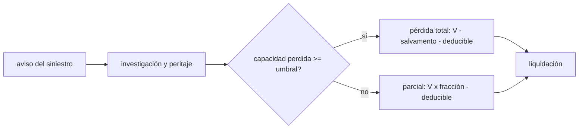

# B127-C06 — Gestión de siniestros espaciales

<!-- nav:top -->
[🏠 Programa](../../../../README.md) · [📚 Bloque B127](../../../tronco-comun/B127-seguros-espaciales.md) · [← Anterior: B127-C05 — Evaluación actuarial básica del riesgo espacial](../B127-C05-evaluacion-actuarial-basica-del-riesgo-espacial/CLASE.md) · [Siguiente: B127-C07 — Reaseguro espacial →](../B127-C07-reaseguro-espacial/CLASE.md)
<!-- /nav -->

## 1. Ubicación, nivel y alcance

Clase 6 del bloque B127, «Seguros espaciales» (área A11). Nivel N4. Cuando un satélite falla, empieza un proceso: aviso, investigación, peritaje, valoración, liquidación y, si hay daño a terceros, reclamaciones con plazos. Aquí aprendes a calcular el pago de un siniestro total o parcial con salvamento y deducible, y a construir el calendario de plazos con el ejemplo del Convenio de 1972. Usas las condiciones de [C04](../B127-C04-exclusiones-deducibles-y-limites-de-polizas/CLASE.md) y la prima de [C02](../B127-C02-seguros-en-orbita/CLASE.md). **Es educativa: no sustituye a un perito, un ajustador ni un abogado y no es asesoría financiera, legal ni de seguros.**

## 2. Por qué esta clase existe

Tras una pérdida hay un proceso de reclamación y peritaje que ninguna clase describía. La decisión central: **¿cuándo se considera total una pérdida parcial y cuánto cambia el pago por cruzar ese umbral?**

## 3. Lo que podrás hacer al terminar

1. Describir las etapas de un siniestro: aviso, investigación, valoración, liquidación.
2. Distinguir pérdida parcial de pérdida total constructiva con un umbral.
3. Calcular el pago `max(0, bruta − salvamento − deducible)`.
4. Detectar el salto de pago en el umbral.
5. Construir un calendario de plazos y calcular días entre fechas.
6. Calcular el pago esperado y el tiempo de peritaje con integración y Monte Carlo.
7. Separar lo consultado (arts. IX, X y XIV del Convenio) de lo sintético.

La evidencia es el **expediente de siniestro sintético con calendario** del ejercicio 12 (sección 20).

## 4. Con qué llegas y cómo comprobarlo

1. ¿Qué es un deducible?
2. ¿Qué es un valor de salvamento?
3. ¿Qué es una pérdida total?
4. ¿Qué es una distribución lognormal?
5. ¿Qué es una integración numérica?

<details>
<summary>Ver respuestas</summary>

1. La parte de la pérdida que asume el asegurado. 2. Lo que se recupera de un bien dañado. 3. Una pérdida que se liquida como el valor completo, aunque el bien conserve algo de uso. 4. La de una variable cuyo logaritmo es normal. 5. Aproximar una integral sumando muchas áreas pequeñas.
</details>

Con cuatro o cinco aciertos, sigue; si no, repasa los prerrequisitos.

## 5. Un caso de contexto y casos de referencia

El **Convenio sobre responsabilidad internacional por daños causados por objetos espaciales (1972)**, consultado en la compilación de las Naciones Unidas, fija plazos **entre Estados** que sirven de ejemplo de calendario: la reclamación se presenta por vía diplomática (art. IX), a más tardar **un año** después de la fecha del daño o de identificarse al Estado de lanzamiento (art. X), con posibilidad de revisarla hasta un año después de conocerse la extensión del daño (art. X.3); y si no hay arreglo **un año** después de notificada la documentación, se constituye una Comisión de Reclamaciones a pedido de cualquiera de las partes (art. XIV). Son plazos del Convenio, no de una póliza. El **ejemplo conductor** es un siniestro sintético de `V = 120 MUSD`, deducible `3`, umbral de pérdida total `75 %` de capacidad perdida y salvamento `4` en pérdida total. Todo es **ilustrativo**.

## 6. Vocabulario

El **aviso** es la notificación del siniestro. El **peritaje** es la evaluación técnica de la causa y la magnitud. La **pérdida total constructiva** es la que se paga como total porque reparar o recuperar no es razonable. La **pérdida parcial** paga la fracción perdida. El **salvamento** es el valor recuperable. La **liquidación** es el pago final. Una **Comisión de Reclamaciones** es el órgano del Convenio para disputas entre Estados.

## 7. Modelo mental: del aviso a la liquidación



*Descripción textual:* tras el aviso y el peritaje, la capacidad perdida se compara con el umbral: si lo alcanza se paga como pérdida total menos salvamento y deducible; si no, la fracción perdida menos el deducible.

Analogía: un coche chocado que se declara siniestro total cuando reparar cuesta casi lo que vale. Límite: el umbral y la definición de pérdida total de una póliza real dependen de su texto.

## 8. La explicación, paso a paso

### 8.1 Cálculo del pago

`bruta = V` si la capacidad perdida `f ≥ 0,75`, si no `V f`. `pago = max(0; bruta − salvamento − D)`. Con `f = 0,30`: `120 × 0,30 = 36`; `pago = 36 − 3 = 33 MUSD`. Con `f = 0,90`: `120 − 4 − 3 = 113 MUSD`.

### 8.2 El salto del umbral

Con `f = 0,74` el pago es `85,80`; con `f = 0,75`, `113,00`. Un punto porcentual de capacidad cambia el pago en `27,2 MUSD`. Por eso el peritaje que decide `f` es el centro del conflicto.

### 8.3 Pago esperado

Con `f ~ Beta(0,6; 1,4)` (sintética), la integración numérica da un pago esperado de `34,397 MUSD` y `P(total) = 0,0828`; el Monte Carlo (100 000 expedientes) da `34,342` y `0,0825`; error `0,16 %`.

### 8.4 Tiempos

El tiempo de peritaje sintético es lognormal de mediana `90 d` y `σ = 0,5`: media teórica `102,0 d`, simulada `101,9 d`. La media supera a la mediana por la cola larga: algunos expedientes tardan mucho más.

### 8.5 Calendario a la manera del Convenio

Daño el `2027-03-14`: la reclamación se presentaría hasta el `2028-03-14` (`366` días, por el año bisiesto 2028). Si la documentación se notifica el `2027-09-01`, la Comisión de Reclamaciones podría pedirse desde el `2028-09-01`. Son fechas **ficticias** para practicar el cómputo.

## 9. Magnitudes, símbolos y unidades

| Símbolo | Qué es | Unidad | Valor / nota |
|---|---|---|---|
| `V` | valor asegurado | MUSD ficticios | 120 |
| `f` | capacidad perdida | — | 0–1 |
| `D` | deducible | MUSD | 3 |
| umbral | pérdida total | — | 0,75 |
| salvamento | recuperable | MUSD | 4 |
| `t` | tiempo de peritaje | días | mediana 90 |

## 10. Convenciones y referencias

Un solo siniestro, pago único, sin intereses, sin disputa de cobertura, sin pagos a cuenta. Los plazos del Convenio se usan solo como ejemplo de cómputo de fechas; las fechas, la distribución de `f` y la de `t` son sintéticas. Unidades: MUSD ficticios y días.

## 11. De dónde sale lo que afirmamos

| ID | Fuente | Localizador | Respalda | Estado |
|---|---|---|---|---|
| S1 | Naciones Unidas, UNOOSA, *International Space Law: United Nations Instruments* (ST/SPACE/61/Rev.1) — https://www.unoosa.org/pdf/publications/st_space_61E.pdf (consultada 2026-11-11, PDF leído con PyMuPDF) | Convenio de 1972, arts. IX, X, XIV | vía diplomática; plazo de un año desde el daño o la identificación; revisión hasta un año tras conocerse la extensión; Comisión de Reclamaciones un año después de la notificación de la documentación | Consultada |
| — | Procesos de peritaje y liquidación de una póliza espacial real | — | no se consultaron; la secuencia de etapas es genérica | No consultados |
| — | `V`, `D`, umbral, salvamento, `f`, `t`, fechas | — | todos los números | Ilustrativo |

Límites: el Convenio regula reclamaciones entre Estados, no la liquidación de una póliza; no se consultó ninguna póliza ni práctica de ajustadores.

## 12. Cómo ver la liquidación

| Capacidad perdida | ¿Total? | Bruta | Salvamento | Pago (MUSD) |
|---|---|---|---|---|
| 10 % | no | 12,0 | 0 | 9,00 |
| 30 % | no | 36,0 | 0 | 33,00 |
| 60 % | no | 72,0 | 0 | 69,00 |
| 74 % | no | 88,8 | 0 | 85,80 |
| 75 % | sí | 120,0 | 4 | 113,00 |
| 90 % | sí | 120,0 | 4 | 113,00 |

Descripción larga: el pago crece de forma lineal con la capacidad perdida hasta el umbral y salta a `113 MUSD` al alcanzarlo.

## 13. Ejemplo trabajado: un siniestro de 60 % de capacidad

**Paso 1 · Clasificación.** `0,60 < 0,75`: parcial.

**Paso 2 · Bruta.** `120 × 0,60 = 72 MUSD`.

**Paso 3 · Deducible.** `72 − 3 = 69 MUSD`.

**Paso 4 · Contraste.** Con `0,75` pagaría `113 MUSD`: `44 MUSD` más por `15` puntos de capacidad.

## 14. Distintas formas de describir un siniestro

**Por etapas:** aviso, peritaje, valoración, liquidación. **Por monto:** bruta, salvamento, deducible, pago. **Por clasificación:** parcial o total. **Por calendario:** fechas y plazos. **Por tiempo:** días de peritaje.

## 15. Práctica guiada

**Ejercicio 1 · con los pasos indicados.** Pago con `f = 0,10`. *Pasos:* `120 × 0,10 − 3`.

<details><summary>Solución comentada</summary>

`12 − 3 = 9 MUSD`.
</details>

**Ejercicio 2 · con una pista.** Pago con `f = 0,90`. *Pista:* es total: `V − salvamento − D`.

<details><summary>Solución comentada</summary>

`120 − 4 − 3 = 113 MUSD`.
</details>

**Ejercicio 3 · casi autónomo.** Fecha límite del art. X para un daño del `2027-03-14`.

<details><summary>Solución comentada</summary>

`2028-03-14` (un año; `366` días).
</details>

## 16. Práctica autónoma, transferencia e integrador

**Ejercicio 4 · autónomo.** Salto de pago entre `f = 0,74` y `f = 0,75`.

<details><summary>Solución comentada</summary>

`113,00 − 85,80 = 27,20 MUSD`.
</details>

**Ejercicio 5 · autónomo.** Pago con `f = 0,60`.

<details><summary>Solución comentada</summary>

`69 MUSD`.
</details>

**Ejercicio 6 · autónomo.** Fecha desde la que podría pedirse la Comisión si la documentación se notifica el `2027-09-01`.

<details><summary>Solución comentada</summary>

`2028-09-01` (un año después, art. XIV).
</details>

**Ejercicio 7 · autónomo.** Media de un tiempo lognormal de mediana `90` y `σ = 0,5`.

<details><summary>Solución comentada</summary>

`90 e^(0,125) = 102,0 d`.
</details>

**Ejercicio 8 · autónomo.** Diferencia entre el pago esperado integrado y el simulado.

<details><summary>Solución comentada</summary>

`34,397 − 34,342 = 0,055 MUSD` (0,16 %).
</details>

**Ejercicio 9 · transferencia.** **Transferencia.** El asegurado y el asegurador discrepan sobre si `f` fue `0,74` o `0,76`. ¿Qué está en juego y qué evidencia ayuda?

<details><summary>Solución comentada</summary>

Están en juego `27,2 MUSD`. Ayudan telemetría, informes de la investigación y un peritaje independiente; el modelo solo muestra la sensibilidad, no resuelve la discusión.
</details>

**Ejercicio 10 · transferencia.** **Transferencia.** ¿Por qué el valor de salvamento de un satélite perdido en órbita puede ser casi nulo?

<details><summary>Solución comentada</summary>

Porque recuperarlo es imposible o carísimo; en el modelo sintético vale `4 MUSD`, un dato ilustrativo que en un caso real habría que justificar.
</details>

**Ejercicio 11 · transferencia.** **Transferencia.** Un daño se conoce 8 meses después de ocurrir. ¿Cómo corre el plazo del art. X?

<details><summary>Solución comentada</summary>

Si el Estado no conoció el daño, el plazo de un año corre desde que lo supo, sin exceder un año desde que razonablemente debió saberlo (art. X.2).
</details>

**Ejercicio 12 · integrador.** **Integrador.** Elabora tu *expediente de siniestro sintético con calendario*: etapas, tabla de liquidación, salto del umbral, pago esperado verificado, tiempos de peritaje y fechas, con lista de qué es consultado e ilustrativo y el aviso de que no es asesoría.

<details><summary>Solución comentada</summary>

Secciones 8.1–8.5 y la salida del laboratorio.
</details>

## 17. Laboratorio: liquidación y calendario

El script [siniestro.py](siniestro.py) liquida seis casos, calcula fechas con `datetime`, integra el pago esperado y lo contrasta con 100 000 expedientes (**comprueba** error menor que 1 % en el pago y en el tiempo medio).

**Datos:** plazos de los arts. IX, X y XIV consultados; expedientes **ilustrativos**. **Predice antes de ejecutar:** ¿el pago con `f = 0,75` será mayor o menor que con `0,74`? (mucho mayor.) **Ejecución del 2026-11-11 (Python 3.12.9):**

```text
Python 3.12.9 (biblioteca estandar)
Expedientes SINTETICOS; consultados solo los plazos de los Arts. IX, X y XIV del Convenio de 1972 (entre Estados).
V = 120.0 MUSD ; deducible = 3.0 ; umbral de perdida total = 75% ; salvamento si total = 4.0
 capacidad perdida  total?  bruta  salvam.  pago
             10%  False    12.0     0.0   9.00
             30%  False    36.0     0.0  33.00
             60%  False    72.0     0.0  69.00
             74%  False    88.8     0.0  85.80
             75%  True    120.0     4.0 113.00
             90%  True    120.0     4.0 113.00
Salto de pago al cruzar el umbral: 85.80 -> 113.00 MUSD
Calendario ejemplo: dano 2027-03-14 ; reclamacion (Art. X) hasta 2028-03-14 (366 dias)
  documentacion notificada 2027-09-01 ; Comision de Reclamaciones (Art. XIV) a pedido desde 2028-09-01
Pago esperado por siniestro: integracion = 34.397 ; Monte Carlo = 34.342 MUSD ; error relativo = 0.16%
P(perdida total): integracion = 0.0828 ; Monte Carlo = 0.0825
Tiempo medio de peritaje (lognormal, mediana 90 d, sigma 0.5): 101.9 d (teorico 102.0)
Pruebas superadas.
```

```bash
python programa/clases/B127/B127-C06-gestion-de-siniestros-espaciales/siniestro.py
```

**Límites:** un siniestro, sin disputas de cobertura ni pagos a cuenta ni intereses; el calendario del Convenio no es el de una póliza.

## 18. Errores frecuentes y cómo corregirlos

**Aplicar el deducible antes del salvamento sin saber qué dice la póliza.** El orden depende del texto; se corrige con la sección 10.

**Ignorar el salto del umbral.** Se corrige con 8.2.

**Contar mal el año de un plazo (bisiestos).** Se corrige con 8.5.

**Tomar los plazos entre Estados como plazos de póliza.** Se corrige con la sección 5.

## 19. Cómo sabrás que vas bien

Tras la sección 8: ¿qué pago esperabas con `f = 0,60` y cuál obtuviste? Si dudas, repasa el ejemplo 13. Tras el laboratorio: ¿qué comprueba? (ver la sección 17).

## 20. Qué entregas y cómo se evalúa

El producto es tu **expediente de siniestro sintético con calendario** (ejercicio 12).

| Criterio | Inicial | En desarrollo | Logrado | Destacado |
|---|---|---|---|---|
| Conceptos | Los confunde | Parciales | Distingue parcial, total y salvamento | Explica los límites |
| Cálculo | Sin unidades | Con errores | Tablas y fechas correctas | Calcula casos nuevos |
| Numérico | Sin comprobar | Un caso | Contraste con la simulación | Interpreta las diferencias |
| Fuentes | Sin fuente | Sin fecha | Fuentes con fecha y estado | Declara lo ilustrativo y lo no consultado |
| Límites | No los nombra | Uno | Tres | Discute qué falta del modelo |

**Condiciones críticas (no se compensan con promedio):** rotular los expedientes como sintéticos; no presentar el cálculo como asesoría ni como lectura de una póliza; citar solo lo consultado.

## 21. Ética, seguridad y límites

Clase educativa: **no es asesoría financiera, legal ni de seguros** y no sustituye a un perito, un ajustador ni un abogado; ningún resultado debe usarse para reclamar ni liquidar un siniestro real. Los modelos son simplificados y sus datos son sintéticos. Accesibilidad: tablas equivalentes a las gráficas, fórmulas en texto, ejercicios sin conexión.

## 22. Para cerrar y seguir

Un siniestro sintético de `120 MUSD` paga `69 MUSD` con `60 %` de capacidad perdida y `113 MUSD` desde el umbral de `75 %`; el pago esperado es `34,4 MUSD` y el peritaje medio dura `102 d`. La siguiente clase trata cómo el asegurador reparte ese riesgo.

**Glosario español–inglés.** siniestro · *claim / loss event*; peritaje · *loss adjustment*; pérdida total constructiva · *constructive total loss*; salvamento · *salvage*; liquidación · *settlement*; Comisión de Reclamaciones · *Claims Commission*.

**Continuidad.** [B127-C07](../B127-C07-reaseguro-espacial/CLASE.md) trata el reaseguro espacial.

**Referencias:** ver sección 11.

<!-- nav:bottom -->
---

[← Anterior: B127-C05 — Evaluación actuarial básica del riesgo espacial](../B127-C05-evaluacion-actuarial-basica-del-riesgo-espacial/CLASE.md) · [📚 Bloque B127](../../../tronco-comun/B127-seguros-espaciales.md) · [Siguiente: B127-C07 — Reaseguro espacial →](../B127-C07-reaseguro-espacial/CLASE.md)
<!-- /nav -->
