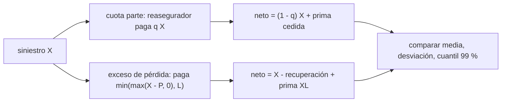

# B127-C07 — Reaseguro espacial

<!-- nav:top -->
[🏠 Programa](../../../../README.md) · [📚 Bloque B127](../../../tronco-comun/B127-seguros-espaciales.md) · [← Anterior: B127-C06 — Gestión de siniestros espaciales](../B127-C06-gestion-de-siniestros-espaciales/CLASE.md) · [Siguiente: B127-C08 — Simulación de cobertura de seguros para una misión →](../B127-C08-simulacion-de-cobertura-de-seguros-para-una-mision/CLASE.md)
<!-- /nav -->

## 1. Ubicación, nivel y alcance

Clase 7 del bloque B127, «Seguros espaciales» (área A11). Nivel N4. Un asegurador que acumula satélites de varios clientes no puede quedarse con todo el riesgo: lo reparte con otros mediante el **reaseguro**. Aquí comparas las dos formas básicas —cuota parte y exceso de pérdida— sobre una cartera sintética y mides qué hacen con el costo medio, la dispersión y la cola. Usas la cartera y el modelo de frecuencia y severidad de [C05](../B127-C05-evaluacion-actuarial-basica-del-riesgo-espacial/CLASE.md) y los límites de [C04](../B127-C04-exclusiones-deducibles-y-limites-de-polizas/CLASE.md). **Es educativa: no describe contratos de reaseguro reales y no es asesoría financiera, legal ni de seguros.**

## 2. Por qué esta clase existe

El riesgo espacial se reparte mediante reaseguro; no había clase al respecto. La decisión central: **¿qué parte del riesgo se cede y cuánto cuesta reducir la cola?**

## 3. Lo que podrás hacer al terminar

1. Distinguir reaseguro proporcional (cuota parte) de no proporcional (exceso de pérdida).
2. Calcular la recuperación esperada de un exceso de pérdida `P xs` con el valor esperado limitado.
3. Calcular la prima de cada programa a partir de un recargo o una comisión.
4. Calcular el costo neto de la cedente: pérdidas retenidas más prima de reaseguro.
5. Comparar media, desviación y cuantil 99 % de tres programas.
6. Separar lo consultado (contexto de capacidad de mercado) de lo modelado y lo ilustrativo.

La evidencia es la **comparación de dos programas de reaseguro** del ejercicio 12 (sección 20).

## 4. Con qué llegas y cómo comprobarlo

1. ¿Qué es un valor esperado limitado?
2. ¿Qué es una cola pesada?
3. ¿Qué es una cedente?
4. ¿Qué es una prioridad en un contrato de exceso de pérdida?
5. ¿Qué es una comisión de cesión?

<details>
<summary>Ver respuestas</summary>

1. La media de una pérdida topada en un valor. 2. Una distribución con extremos de probabilidad no despreciable. 3. El asegurador que transfiere parte del riesgo. 4. La pérdida por siniestro sobre la cual empieza a pagar el reasegurador. 5. Un porcentaje de la prima cedida que el reasegurador devuelve a la cedente por sus gastos.
</details>

Con cuatro o cinco aciertos, sigue; si no, repasa los prerrequisitos.

## 5. Un caso de contexto y casos de referencia

El informe de mercado de Gallagher «Space insurance market update Q1 2026» (10 de abril de 2026) describe la capacidad del mercado espacial como aportada por aseguradoras, Lloyd's y agentes de suscripción (MGA), y su volatilidad como rasgo de la clase. Es corretaje, con datos y opiniones, y es lo único **consultado**: **no** describe contratos de reaseguro, de modo que las formas de esta clase no se verificaron en una fuente concreta y se contrastan por simulación. El **ejemplo conductor** es la cartera sintética de C05 con `λ = 2,4` siniestros al año y severidad `Lognormal(2,5; 1,3)` MUSD, prima bruta `80 MUSD`, y tres programas: sin reaseguro; cuota parte `30 %` con comisión `25 %`; exceso de pérdida `120 xs 40` por siniestro con recargo `35 %`. Todo es **ilustrativo**.

## 6. Vocabulario

La **cesión** es la parte del riesgo transferida. La **cuota parte** cede una fracción fija `q` de cada siniestro y de la prima. El **exceso de pérdida** (*per risk*) paga por siniestro `min(max(X − P, 0), L)`, con **prioridad** `P` y **límite** `L`. La **recuperación** es lo que paga el reasegurador. La **comisión** devuelve parte de la prima cedida. El **costo neto** es pérdida retenida más prima de reaseguro.

## 7. Modelo mental: dos formas de repartir



*Descripción textual:* un mismo siniestro se reparte proporcionalmente en la cuota parte y por tramo en el exceso de pérdida; en cada caso se calcula el costo neto de la cedente y se comparan media, desviación y cuantil 99 %.

Analogía: compartir un gasto a partes iguales (cuota parte) frente a pagar un seguro que solo responde cuando el golpe supera un umbral (exceso de pérdida). Límite: aquí el reasegurador no quiebra y siempre paga; en la práctica existe riesgo de contraparte.

## 8. La explicación, paso a paso

### 8.1 La cartera sin reaseguro

Pérdida bruta media `λ E[X] = 2,4 × 28,36 = 68,07 MUSD`; con prima bruta `80`, el *loss ratio* medio es `85 %`. La desviación simulada es `104,6` y el cuantil `99 %`, `450,7 MUSD`.

### 8.2 Cuota parte

Recupera en media `0,30 × 68,07 = 20,42 MUSD`. La prima cedida es `0,30 × 80 × (1 − 0,25) = 18,00 MUSD`. Costo neto medio: `0,70 × 67,745 + 18,00 = 65,42`. Reduce **todo** en proporción: desviación `73,3` (−30 %) y cuantil 99 % `333,5`.

### 8.3 Exceso de pérdida `120 xs 40`

Recuperación esperada por siniestro `LEV(160) − LEV(40)`; anual `19,207 MUSD`. Prima `19,207 × 1,35 = 25,93 MUSD`. Costo neto medio `74,58`: **cuesta `6,8 MUSD` más** que no reasegurar, a cambio de desviación `76,9` y cuantil 99 % `336,8`.

### 8.4 Qué compra cada programa

Con estos parámetros ambos recortan la cola en cerca de un `26 %`. La cuota parte lo hace barato porque la comisión es generosa (dato sintético); el exceso de pérdida lo hace caro pero **solo protege contra siniestros grandes**, como los que dominan este tipo de cartera, y deja intacta la frecuencia de los pequeños.

### 8.5 Verificación

El Monte Carlo (20 000 años, semilla 127) da una pérdida bruta media de `67,745` (error `0,47 %`) y una recuperación XL de `19,098` (error `0,57 %`). La **comisión** y el **recargo** son parámetros del ejercicio: cambiarlos cambia la conclusión.

## 9. Magnitudes, símbolos y unidades

| Símbolo | Qué es | Unidad | Valor / nota |
|---|---|---|---|
| `λ` | siniestros por año | 1/año | 2,4 |
| `q` | cuota cedida | — | 0,30 |
| `P`, `L` | prioridad y límite | MUSD | 40; 120 |
| comisión | sobre la prima cedida | — | 0,25 |
| recargo XL | sobre la recuperación esperada | — | 0,35 |
| prima bruta | de la cedente | MUSD/año | 80 |

## 10. Convenciones y referencias

Un año, siniestros independientes, exceso de pérdida por siniestro sin reposiciones ni agregado anual, reasegurador sin riesgo de contraparte, sin impuestos. El «costo neto» no incluye la prima de la cedente. Los tres programas y sus precios son sintéticos.

## 11. De dónde sale lo que afirmamos

| ID | Fuente | Localizador | Respalda | Estado |
|---|---|---|---|---|
| S1 | Gallagher, «Space insurance market update Q1 2026», 10-04-2026 — https://specialty.ajg.com/plane-talking/space-insurance-market-update-q1-2026 (consultada 2026-11-11, WebFetch) | texto del informe | la capacidad del mercado procede de aseguradoras, Lloyd's y MGA; la clase es volátil | Consultada; corretaje con opiniones |
| — | Cuota parte, exceso de pérdida, valor esperado limitado | — | verificados con Monte Carlo | No consultados en una fuente concreta |
| — | Programas, prioridad, límite, comisión, recargo | — | todos los números | Ilustrativo |

Límites: no se consultó ningún contrato ni tratado de reaseguro, ni precios de reaseguro; las formas descritas son las clásicas y se usan de manera simplificada.

## 12. Cómo ver los programas

| Programa | Costo neto medio | Desv. est. | Cuantil 99 % |
|---|---|---|---|
| Sin reaseguro | 67,745 | 104,646 | 450,714 |
| Cuota parte 30 % | 65,421 | 73,252 | 333,500 |
| XL 120 xs 40 | 74,576 | 76,947 | 336,828 |

Descripción larga: ambos programas bajan la dispersión y la cola; la cuota parte lo hace con un costo medio menor y el exceso de pérdida con uno mayor.

## 13. Ejemplo trabajado: un siniestro de 100 MUSD

**Paso 1 · Cuota parte.** El reasegurador paga `0,30 × 100 = 30`; la cedente retiene `70`.

**Paso 2 · Exceso de pérdida.** Paga `min(max(100 − 40; 0); 120) = 60`; retiene `40`.

**Paso 3 · Siniestro de 20.** Cuota parte: `6`; exceso: `0`.

**Paso 4 · Lectura.** El exceso solo actúa en siniestros grandes; la cuota parte actúa en todos.

## 14. Distintas formas de describir un reaseguro

**Por forma:** proporcional o no proporcional. **Por parámetros:** `q`, comisión; `P`, `L`, recargo. **Por efecto:** media, desviación, cuantil. **Por precio:** prima cedida o prima XL. **Por riesgo residual:** lo que retiene la cedente.

## 15. Práctica guiada

**Ejercicio 1 · con los pasos indicados.** Recuperación de la cuota parte ante `X = 50`. *Pasos:* `0,30 × 50`.

<details><summary>Solución comentada</summary>

`15 MUSD`.
</details>

**Ejercicio 2 · con una pista.** Recuperación del XL `120 xs 40` ante `X = 70`. *Pista:* `X − P`.

<details><summary>Solución comentada</summary>

`min(30; 120) = 30 MUSD`.
</details>

**Ejercicio 3 · casi autónomo.** Recuperación del XL ante `X = 300`.

<details><summary>Solución comentada</summary>

`min(260; 120) = 120 MUSD`; la cedente retiene `180`.
</details>

## 16. Práctica autónoma, transferencia e integrador

**Ejercicio 4 · autónomo.** Prima cedida de la cuota parte.

<details><summary>Solución comentada</summary>

`0,30 × 80 × 0,75 = 18,00 MUSD`.
</details>

**Ejercicio 5 · autónomo.** Prima del XL a partir de su recuperación esperada.

<details><summary>Solución comentada</summary>

`19,207 × 1,35 = 25,93 MUSD`.
</details>

**Ejercicio 6 · autónomo.** Reducción relativa del cuantil 99 % con la cuota parte.

<details><summary>Solución comentada</summary>

`1 − 333,5/450,7 = 26,0 %`.
</details>

**Ejercicio 7 · autónomo.** Sobrecosto medio del XL frente a no reasegurar.

<details><summary>Solución comentada</summary>

`74,576 − 67,745 = 6,83 MUSD`.
</details>

**Ejercicio 8 · autónomo.** Error relativo de la recuperación XL simulada.

<details><summary>Solución comentada</summary>

`(19,207 − 19,098)/19,207 = 0,57 %`.
</details>

**Ejercicio 9 · transferencia.** **Transferencia.** Si la comisión de la cuota parte fuera `0 %`, ¿qué programa tendría el menor costo medio?

<details><summary>Solución comentada</summary>

La prima cedida sería `0,30 × 80 = 24` y el costo medio `0,70 × 67,745 + 24 = 71,42`; seguiría siendo menor que el XL (`74,58`) pero mayor que sin reaseguro. La conclusión depende de la comisión.
</details>

**Ejercicio 10 · transferencia.** **Transferencia.** Un reasegurador cae en insolvencia tras un siniestro. ¿Qué supuesto del modelo falla?

<details><summary>Solución comentada</summary>

El de ausencia de riesgo de contraparte: la recuperación no es segura y el neto de la cedente sube.
</details>

**Ejercicio 11 · transferencia.** **Transferencia.** La cartera pasa a tener una falla común en una serie de satélites. ¿Qué programa protege mejor?

<details><summary>Solución comentada</summary>

Uno con agregado anual o por evento (no incluido aquí); el XL por siniestro protege cada pérdida individual pero no la acumulación de varias medianas.
</details>

**Ejercicio 12 · integrador.** **Integrador.** Elabora tu *comparación de dos programas de reaseguro*: parámetros, recuperaciones y primas, costo neto, desviación y cuantil de los tres casos, verificación Monte Carlo, sensibilidad a la comisión y lista de qué es consultado e ilustrativo, con el aviso de que no es asesoría.

<details><summary>Solución comentada</summary>

Secciones 8.1–8.5 y la salida del laboratorio.
</details>

## 17. Laboratorio: cuota parte frente a exceso de pérdida

El script [reaseguro.py](reaseguro.py) calcula las recuperaciones esperadas con la fórmula cerrada y simula 20 000 años (**comprueba** media bruta y recuperación XL a 2,5 %).

**Datos:** solo el contexto de capacidad consultado; cartera y precios **ilustrativos**. **Predice antes de ejecutar:** ¿qué programa tendrá la menor desviación? (muy similares; la cuota parte `73,3` y el XL `76,9`.) **Ejecución del 2026-11-11 (Python 3.12.9):**

```text
Python 3.12.9 (biblioteca estandar)
Cartera SINTETICA; el contexto de capacidad (Gallagher Q1 2026) es lo unico consultado.
Bruto medio anual = 68.065 MUSD ; prima bruta = 80.0 ; loss ratio bruto medio = 85%
Cuota parte 30%: recuperacion media = 20.420 ; prima cedida = 18.000
XL 120 xs 40: recuperacion media = 19.207 ; prima = 25.929 ; tasa sobre limite por siniestro = 6.67%
Monte Carlo: bruto medio = 67.745 (error 0.47%) ; recuperacion XL media = 19.098 (error 0.57%)
 programa            costo neto medio  desv. est.  cuantil 99 %
 sin reaseguro               67.745     104.646      450.714
 cuota parte 30%             65.421      73.252      333.500
 XL 120 xs 40                74.576      76.947      336.828
Pruebas superadas.
```

```bash
python programa/clases/B127/B127-C07-reaseguro-espacial/reaseguro.py
```

**Límites:** sin agregados ni reposiciones, sin riesgo de contraparte, sin impuestos; los precios son inventados.

## 18. Errores frecuentes y cómo corregirlos

**Creer que el reaseguro siempre abarata.** Se corrige con 8.3.

**Comparar solo medias.** Se corrige con 8.4 y la tabla 12.

**Olvidar el riesgo de contraparte.** Se corrige con el ejercicio 10.

**Tomar las comisiones y recargos como precios de mercado.** Se corrige con la sección 10.

## 19. Cómo sabrás que vas bien

Tras la sección 8: ¿qué programa esperabas más barato y cuál lo fue? Si dudas, repasa el ejemplo 13. Tras el laboratorio: ¿qué comprueba? (ver la sección 17).

## 20. Qué entregas y cómo se evalúa

El producto es tu **comparación de dos programas de reaseguro** (ejercicio 12).

| Criterio | Inicial | En desarrollo | Logrado | Destacado |
|---|---|---|---|---|
| Conceptos | Los confunde | Parciales | Distingue proporcional y no proporcional | Explica los límites |
| Cálculo | Sin unidades | Con errores | Tablas completas con unidades | Calcula casos nuevos |
| Numérico | Sin comprobar | Un caso | Contraste con la simulación | Interpreta las diferencias |
| Fuentes | Sin fuente | Sin fecha | Fuentes con fecha y estado | Declara lo ilustrativo y lo no consultado |
| Límites | No los nombra | Uno | Tres | Discute qué falta del modelo |

**Condiciones críticas (no se compensan con promedio):** rotular los programas y precios como sintéticos; no presentar la comparación como asesoría; citar solo lo consultado.

## 21. Ética, seguridad y límites

Clase educativa: **no es asesoría financiera, legal ni de seguros** y no sustituye a un reasegurador ni a un actuario; ningún resultado debe usarse para estructurar o contratar un reaseguro real. Los modelos son simplificados y sus datos son sintéticos. Accesibilidad: tablas equivalentes a las gráficas, fórmulas en texto, ejercicios sin conexión.

## 22. Para cerrar y seguir

Sobre una cartera sintética con pérdida media de `68,07 MUSD` y cuantil 99 % de `450,7`, una cuota parte del `30 %` y un exceso de pérdida `120 xs 40` recortan la cola cerca del `26 %`; la primera con un costo neto medio de `65,4` y el segundo con `74,6`. La última clase integra todo en una misión.

**Glosario español–inglés.** reaseguro · *reinsurance*; cedente · *cedent*; cuota parte · *quota share*; exceso de pérdida · *excess of loss*; prioridad · *retention / attachment point*; recuperación · *recovery*.

**Continuidad.** [B127-C08](../B127-C08-simulacion-de-cobertura-de-seguros-para-una-mision/CLASE.md) integra los seguros en una misión.

**Referencias:** ver sección 11.

<!-- nav:bottom -->
---

[← Anterior: B127-C06 — Gestión de siniestros espaciales](../B127-C06-gestion-de-siniestros-espaciales/CLASE.md) · [📚 Bloque B127](../../../tronco-comun/B127-seguros-espaciales.md) · [Siguiente: B127-C08 — Simulación de cobertura de seguros para una misión →](../B127-C08-simulacion-de-cobertura-de-seguros-para-una-mision/CLASE.md)
<!-- /nav -->
