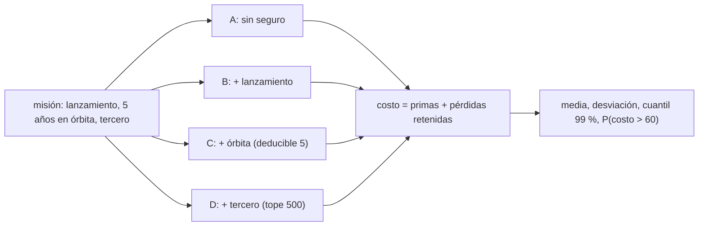

# B127-C08 — Simulación de cobertura de seguros para una misión

<!-- nav:top -->
[🏠 Programa](../../../../README.md) · [📚 Bloque B127](../../../tronco-comun/B127-seguros-espaciales.md) · [← Anterior: B127-C07 — Reaseguro espacial](../B127-C07-reaseguro-espacial/CLASE.md) · [Siguiente: B128-C01 — Accesibilidad de la observación nocturna →](../../B128/B128-C01-accesibilidad-de-la-observacion-nocturna/CLASE.md)
<!-- /nav -->

## 1. Ubicación, nivel y alcance

Clase 8 del bloque B127, «Seguros espaciales», y última del área A11. Nivel N4. Integras lo aprendido en una decisión: para una misión sintética con lanzamiento, cinco años en órbita y riesgo de daño a terceros, comparas cuatro estrategias de cobertura por su costo medio y por el riesgo que dejan en manos del operador. Reutilizas los modelos de [C01](../B127-C01-seguros-de-lanzamiento/CLASE.md), [C02](../B127-C02-seguros-en-orbita/CLASE.md), [C03](../B127-C03-seguros-de-responsabilidad-civil-espacial/CLASE.md) y [C04](../B127-C04-exclusiones-deducibles-y-limites-de-polizas/CLASE.md). **Es educativa: no es una recomendación ni asesoría financiera, legal ni de seguros; ninguna cifra es una cotización.**

## 2. Por qué esta clase existe

Integrar los seguros de una misión en un caso permite practicar la decisión; no existía tal caso. La decisión central: **¿cuánto se paga de más por reducir el riesgo y qué riesgo se está dispuesto a retener?**

## 3. Lo que podrás hacer al terminar

1. Componer tres coberturas (lanzamiento, órbita, tercero) con sus primas a partir de pagos esperados analíticos.
2. Simular el costo total del operador: primas más pérdidas retenidas.
3. Comparar estrategias por costo medio, desviación, cuantil 99 % y probabilidad de superar un umbral.
4. Explicar por qué la estrategia más barata en promedio no es la menos riesgosa.
5. Verificar las coberturas con Monte Carlo, incluida la cola pesada del tercero.
6. Separar lo consultado, lo modelado y lo ilustrativo y declarar los límites.

La evidencia es el **informe de cobertura de una misión sintética** del ejercicio 12 (sección 20).

## 4. Con qué llegas y cómo comprobarlo

1. ¿Qué es una prima pura y una comercial?
2. ¿Qué es una tasa de fallo de Weibull?
3. ¿Qué es un deducible y un tope?
4. ¿Qué es una cola pesada?
5. ¿Qué es un cuantil 99 %?

<details>
<summary>Ver respuestas</summary>

1. La pérdida esperada, y esa más un recargo. 2. Una tasa que cambia con la edad según un parámetro de forma. 3. La parte que retiene el asegurado y el máximo que paga la póliza. 4. Una distribución con extremos de probabilidad no despreciable. 5. El valor que el costo supera solo en uno de cada cien casos.
</details>

Con cuatro o cinco aciertos, sigue; si no, repasa los prerrequisitos.

## 5. Un caso de contexto y casos de referencia

Tres fuentes **consultadas** dan el contexto, ninguna aporta cifras al modelo. El reglamento de EE. UU. 14 CFR parte 440 (leído mediante un resumen) exige seguro de responsabilidad hacia terceros hasta el menor entre `500 MUSD` y el máximo del mercado, con pago público adicional hasta `1 500 MUSD` bajo condiciones. El Convenio de 1972 establece responsabilidad absoluta del Estado de lanzamiento en la superficie (art. II) y por culpa en el espacio (art. III). El informe de mercado de Gallagher (10 de abril de 2026) muestra un *loss ratio* de 2025 que pasa de ~`15 %` a ~`75 %` por un siniestro: la volatilidad es parte del problema. El **ejemplo conductor** es una misión sintética: satélite de `200 MUSD`; lanzamiento con los resultados de C01; cinco años en órbita con el Weibull de C02 (`β = 0,7`; `η = 120`; depreciación `8 %`/año; deducible `5 MUSD`); y un evento de tercero con probabilidad `0,02` por misión y severidad `Lognormal(2; 1,6)` con tope `500 MUSD`. Todo es **ilustrativo**.

## 6. Vocabulario

La **estrategia** es la combinación de coberturas contratadas. El **costo del operador** es las primas más las pérdidas que él retiene. La **pérdida retenida** es la que la póliza no paga. El **riesgo retenido** se mide por la desviación y los cuantiles del costo. El **autoseguro** es no contratar y asumir la pérdida.

## 7. Modelo mental: cuatro estrategias, un mismo azar



*Descripción textual:* el mismo conjunto de eventos aleatorios se aplica a cuatro estrategias que añaden coberturas de a una; para cada una se simula el costo del operador y se resumen su media, su desviación, su cuantil 99 % y la probabilidad de superar `60 MUSD`.

Analogía: elegir cuántos candados poner a una bicicleta: cada uno cuesta y reduce el riesgo de robo con rendimientos decrecientes. Límite: aquí el operador es neutral al costo de capital y no hay efectos de segundo orden, como la caída del negocio tras una pérdida.

## 8. La explicación, paso a paso

### 8.1 Pagos esperados y primas

Pagos esperados analíticos: lanzamiento `7,050`, órbita `16,392` (solo si el lanzamiento sale bien, con deducible `5`), tercero `0,494` MUSD. Primas con recargos `35 %`, `30 %` y `50 %`: `9,518`; `21,309` y `0,741` MUSD.

### 8.2 Verificación por simulación

Monte Carlo con 100 000 misiones (semilla 127): lanzamiento `7,011` (error `0,55 %`), órbita `16,633` (`1,47 %`), tercero `0,529` (`7,05 %`). El tercero es mucho más ruidoso: pocos eventos (`2 %`) con cola pesada; el laboratorio exige solo `12 %` para él.

### 8.3 Las cuatro estrategias

| Estrategia | Costo medio | Desv. est. | Cuantil 99 % | P(costo > 60) |
|---|---|---|---|---|
| A sin seguro | 24,690 | 60,708 | 200,000 | 0,1344 |
| B lanzamiento | 27,196 | 53,874 | 209,518 | 0,0997 |
| C lanzamiento + órbita | 31,873 | 12,033 | 39,167 | 0,0039 |
| D lanzamiento + órbita + tercero | 32,085 | 4,915 | 36,567 | 0,0001 |

### 8.4 Cuánto cuesta la certeza

Pasar de A a D sube el costo medio en `7,40 MUSD` (`30 %`) y baja la desviación de `60,7` a `4,9`. El cuantil 99 % cae de `200` a `36,6`. Añadir solo el seguro de lanzamiento (B) casi no ayuda: el riesgo dominante sigue siendo el de la órbita.

### 8.5 Qué decidir y qué no

Un operador que tolera perder hasta `60 MUSD` con probabilidad `1 %` o menos descarta A y B y evalúa C frente a D. El tercero cuesta `0,74` y baja la desviación de `12,0` a `4,9`: **barato para lo que cubre**, además de que cubre una responsabilidad que puede ser exigida por ley. Esta es una lectura del modelo sintético, no una recomendación.

## 9. Magnitudes, símbolos y unidades

| Símbolo | Qué es | Unidad | Valor / nota |
|---|---|---|---|
| `V` | valor asegurado | MUSD ficticios | 200 |
| `D_orb` | deducible en órbita | MUSD | 5 |
| `p_terc` | prob. de evento de tercero | por misión | 0,02 |
| tope tercero | límite de la póliza | MUSD | 500 |
| recargos | lanzamiento, órbita, tercero | — | 0,35; 0,30; 0,50 |

## 10. Convenciones y referencias

Misión de un lanzamiento y cinco años; un fallo en órbita cuesta el valor `V_k` del año del fallo, menos el deducible; a un lanzamiento fallido no le sigue vida en órbita; el evento de tercero es independiente. El operador asume sin tope la parte de tercero que excede `500` en D y todo el tercero en A–C. Unidades: MUSD ficticios. Todas las probabilidades y severidades son sintéticas.

## 11. De dónde sale lo que afirmamos

| ID | Fuente | Localizador | Respalda | Estado |
|---|---|---|---|---|
| S1 | 14 CFR parte 440 — https://www.ecfr.gov/current/title-14/part-440 (consultada 2026-11-11 mediante resumen automático, no lectura directa) | 440.3, 440.9, 440.19 | seguro de terceros hasta el menor de 500 MUSD o el máximo de mercado; pago público adicional hasta 1 500 MUSD con condiciones | Consultada (verificar en la fuente) |
| S2 | Naciones Unidas, UNOOSA, *International Space Law: United Nations Instruments* (ST/SPACE/61/Rev.1) — https://www.unoosa.org/pdf/publications/st_space_61E.pdf (consultada 2026-11-11, PDF leído con PyMuPDF) | Convenio de 1972, arts. II y III | responsabilidad absoluta en la superficie y por culpa en el espacio | Consultada |
| S3 | Gallagher, «Space insurance market update Q1 2026», 10-04-2026 — https://specialty.ajg.com/plane-talking/space-insurance-market-update-q1-2026 (consultada 2026-11-11, WebFetch) | texto del informe | *loss ratio* de 2025 de ~15 % a ~75 % por un siniestro | Consultada; corretaje con opiniones |
| — | Modelos de C01–C04 | — | verificados con Monte Carlo | No consultados en una fuente concreta |
| — | Probabilidades, severidades, recargos, deducible | — | todos los números | Ilustrativo |

Límites: no se consultó ninguna cotización, póliza ni estadística real de siniestros; no se modeló la correlación entre coberturas, la pérdida parcial en órbita ni los efectos de la pérdida sobre el negocio.

## 12. Cómo ver la decisión

| Magnitud | Valor |
|---|---|
| Costo medio A | 24,69 MUSD |
| Costo medio D | 32,09 MUSD |
| Costo de la certeza (D − A) | 7,40 MUSD |
| Desviación A → D | 60,7 → 4,9 |
| Cuantil 99 % A → D | 200,0 → 36,6 |

Descripción larga: contratar todo cuesta unos `7,4 MUSD` más en promedio y elimina casi toda la cola.

## 13. Ejemplo trabajado: costo de la estrategia B en dos mundos

**Paso 1 · Lanzamiento exitoso, sin fallo en órbita ni tercero.** Costo: la prima, `9,518`.

**Paso 2 · Pérdida total en el lanzamiento.** La póliza paga `200`; el operador solo paga la prima: `9,518`.

**Paso 3 · Éxito en el lanzamiento y fallo en órbita en el año 2 (`V = 138`).** B no cubre la órbita: `9,518 + 138 = 147,5`.

**Paso 4 · Lectura.** B protege del tramo del lanzamiento, pero deja expuesto el riesgo mayor, el de la órbita.

## 14. Distintas formas de describir una estrategia

**Por coberturas:** lanzamiento, órbita, tercero. **Por prima:** MUSD. **Por costo medio:** primas más retenciones. **Por riesgo:** desviación, cuantil 99 %. **Por umbral:** probabilidad de superar un costo dado.

## 15. Práctica guiada

**Ejercicio 1 · con los pasos indicados.** Prima total de la estrategia D. *Pasos:* suma las tres primas.

<details><summary>Solución comentada</summary>

`9,518 + 21,309 + 0,741 = 31,568 MUSD`.
</details>

**Ejercicio 2 · con una pista.** Sobrecosto medio de D frente a A. *Pista:* resta los costos medios.

<details><summary>Solución comentada</summary>

`32,085 − 24,690 = 7,395 MUSD`.
</details>

**Ejercicio 3 · casi autónomo.** Costo de la estrategia C si falla en el año 1 (`V = 150`).

<details><summary>Solución comentada</summary>

Primas `9,518 + 21,309 = 30,827`, más el deducible `5` = `35,827 MUSD`.
</details>

## 16. Práctica autónoma, transferencia e integrador

**Ejercicio 4 · autónomo.** Reducción relativa de la desviación al pasar de A a D.

<details><summary>Solución comentada</summary>

`1 − 4,915/60,708 = 91,9 %`.
</details>

**Ejercicio 5 · autónomo.** Reducción de la desviación al añadir el seguro de tercero a C.

<details><summary>Solución comentada</summary>

`1 − 4,915/12,033 = 59,2 %`.
</details>

**Ejercicio 6 · autónomo.** Costo de D ante una pérdida total en el lanzamiento, sin otros eventos.

<details><summary>Solución comentada</summary>

Las tres primas, `31,568 MUSD`, porque la póliza paga los `200`.
</details>

**Ejercicio 7 · autónomo.** ¿Qué estrategia tiene la menor probabilidad de superar `60 MUSD`?

<details><summary>Solución comentada</summary>

D, con `0,0001`.
</details>

**Ejercicio 8 · autónomo.** Error relativo de la cobertura de tercero simulada y por qué es mayor.

<details><summary>Solución comentada</summary>

`7,05 %`: pocos eventos (`2 %` de las misiones) con cola pesada; la simulación converge más despacio.
</details>

**Ejercicio 9 · transferencia.** **Transferencia.** Un operador con capital abundante y neutral al riesgo, ¿qué estrategia elegiría por costo medio?

<details><summary>Solución comentada</summary>

A, la de menor costo medio (`24,69`), porque la prima incluye un recargo; si exige un seguro por ley o por un financiador, A deja de ser una opción.
</details>

**Ejercicio 10 · transferencia.** **Transferencia.** Un financiador exige que `P(costo > 60) < 1 %`. ¿Qué estrategias lo cumplen?

<details><summary>Solución comentada</summary>

C (`0,39 %`) y D (`0,01 %`); A y B no.
</details>

**Ejercicio 11 · transferencia.** **Transferencia.** ¿Qué cambiaría si el evento de tercero ocurriera con probabilidad `0,2` en vez de `0,02`?

<details><summary>Solución comentada</summary>

El tercero pasaría a dominar el riesgo retenido en A–C y su prima subiría unas diez veces; D tendría más valor. El modelo permite recalcularlo cambiando `P_TERC`.
</details>

**Ejercicio 12 · integrador.** **Integrador.** Elabora tu *informe de cobertura de una misión sintética*: modelo de cada riesgo, primas, tabla de las cuatro estrategias con verificación, la estrategia que tu criterio explícito elegiría y por qué, sensibilidad a un parámetro, límites y lista de qué es consultado, modelado e ilustrativo, con el aviso de que no es asesoría.

<details><summary>Solución comentada</summary>

Secciones 8.1–8.5 y la salida del laboratorio.
</details>

## 17. Laboratorio: cobertura de una misión

El script [cobertura_mision.py](cobertura_mision.py) calcula los pagos esperados y las primas, simula 100 000 misiones y resume las cuatro estrategias (**comprueba** lanzamiento y órbita a 3 % y tercero a 12 %). Tarda unos pocos segundos.

**Datos:** solo conceptos de 14 CFR 440, del Convenio y del informe de mercado consultados; todo lo demás **ilustrativo**. **Predice antes de ejecutar:** ¿qué estrategia tendrá el menor costo medio? (A, sin seguro.) **Ejecución del 2026-11-11 (Python 3.12.9):**

```text
Python 3.12.9 (biblioteca estandar)
Mision SINTETICA; consultados solo el contexto de 14 CFR 440 (via resumen), el Convenio de 1972 y Gallagher Q1 2026.
Pagos esperados analiticos: lanzamiento = 7.050 ; orbita = 16.392 ; tercero = 0.4937 MUSD
Primas: lanzamiento = 9.518 ; orbita = 21.309 ; tercero = 0.7405 MUSD
Pago esperado por cobertura: analitico frente a Monte Carlo
  L: analitico = 7.0500 ; MC = 7.0111 ; error relativo = 0.55%
  O: analitico = 16.3916 ; MC = 16.6325 ; error relativo = 1.47%
  T: analitico = 0.4937 ; MC = 0.5285 ; error relativo = 7.05%
Estrategia                         costo medio  desv. est.  cuantil 99 %  P(costo>60)
  A sin seguro                      24.690      60.708      200.000      0.1344
  B lanzamiento                     27.196      53.874      209.518      0.0997
  C lanzamiento + orbita            31.873      12.033       39.167      0.0039
  D lanz. + orbita + tercero        32.085       4.915       36.567      0.0001
Pruebas superadas.
```

```bash
python programa/clases/B127/B127-C08-simulacion-de-cobertura-de-seguros-para-una-mision/cobertura_mision.py
```

**Límites:** riesgos independientes, pérdida total en órbita, deducible por siniestro, sin efectos sobre el negocio; no es una recomendación.

## 18. Errores frecuentes y cómo corregirlos

**Elegir por costo medio sin mirar la cola.** Se corrige con 8.4.

**Creer que cubrir el lanzamiento cubre la misión.** Se corrige con el ejemplo 13.

**Tomar la estrategia «ganadora» del modelo como recomendación.** Se corrige con 8.5 y la sección 21.

**Ignorar el ruido de la simulación en eventos raros.** Se corrige con 8.2 y el ejercicio 8.

## 19. Cómo sabrás que vas bien

Tras la sección 8: ¿qué estrategia esperabas más barata y cuál lo fue? Si dudas, repasa el ejemplo 13. Tras el laboratorio: ¿qué comprueba? (ver la sección 17).

## 20. Qué entregas y cómo se evalúa

El producto es tu **informe de cobertura de una misión sintética** (ejercicio 12).

| Criterio | Inicial | En desarrollo | Logrado | Destacado |
|---|---|---|---|---|
| Conceptos | Los confunde | Parciales | Distingue prima, retención y riesgo | Explica los límites |
| Cálculo | Sin unidades | Con errores | Tablas completas con unidades | Calcula casos nuevos |
| Numérico | Sin comprobar | Un caso | Contraste con la simulación y su ruido | Interpreta las diferencias |
| Fuentes | Sin fuente | Sin fecha | Fuentes con fecha y estado | Declara lo ilustrativo y lo no consultado |
| Límites | No los nombra | Uno | Tres | Discute qué falta del modelo |

**Condiciones críticas (no se compensan con promedio):** rotular la misión y sus datos como sintéticos; no presentar el resultado como recomendación ni asesoría; citar solo lo consultado.

## 21. Ética, seguridad y límites

Clase educativa: **no es asesoría financiera, legal ni de seguros** y no sustituye a un corredor, un actuario ni un abogado; ningún resultado debe usarse para contratar, tarificar ni reclamar seguros reales. Los modelos son simplificados y sus datos son sintéticos. Accesibilidad: tablas equivalentes a las gráficas, fórmulas en texto, ejercicios sin conexión.

## 22. Para cerrar y seguir

En una misión sintética, la estrategia sin seguro cuesta `24,69 MUSD` en promedio con desviación `60,7`; contratar lanzamiento, órbita y tercero cuesta `32,09` y deja la desviación en `4,9`: unos `7,4 MUSD` de más para quitar casi toda la cola. Con esto termina el bloque B127 y el área A11 de economía, industria y gestión de proyectos espaciales.

**Glosario español–inglés.** estrategia de cobertura · *coverage strategy*; autoseguro · *self-insurance*; pérdida retenida · *retained loss*; costo del operador · *operator's cost*; cola · *tail*.

**Continuidad.** [B128](../../../tronco-comun/B128-accesibilidad-e-inclusion-en-la-ensenanza-de-la-astronomia.md) es el bloque siguiente del programa, sobre accesibilidad e inclusión en la enseñanza de la astronomía.

**Referencias:** ver sección 11.

<!-- nav:bottom -->
---

[← Anterior: B127-C07 — Reaseguro espacial](../B127-C07-reaseguro-espacial/CLASE.md) · [📚 Bloque B127](../../../tronco-comun/B127-seguros-espaciales.md) · [Siguiente: B128-C01 — Accesibilidad de la observación nocturna →](../../B128/B128-C01-accesibilidad-de-la-observacion-nocturna/CLASE.md)
<!-- /nav -->
