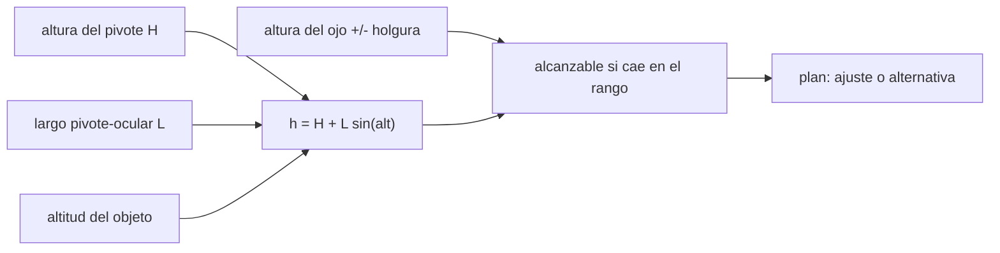

# B128-C01 — Accesibilidad de la observación nocturna

<!-- nav:top -->
[🏠 Programa](../../../../README.md) · [📚 Bloque B128](../../../tronco-comun/B128-accesibilidad-e-inclusion-en-la-ensenanza-de-la-astronomia.md) · [← Anterior: B127-C08 — Simulación de cobertura de seguros para una misión](../../B127/B127-C08-simulacion-de-cobertura-de-seguros-para-una-mision/CLASE.md) · [Siguiente: B128-C02 — Diseño universal de aprendizaje aplicado a la astronomía →](../B128-C02-diseno-universal-de-aprendizaje-aplicado-a-la-astronomia/CLASE.md)
<!-- /nav -->

## 1. Ubicación, nivel y alcance

Clase 1 del bloque B128. Nivel N4. Una noche de observación suele diseñarse para una persona de pie, con buena vista y sin movilidad reducida. Aquí conviertes esa suposición en una pregunta medible: **¿a qué altitudes del cielo alcanza el ocular una persona sentada, un niño o un adulto de pie, según cómo esté montado el telescopio?** Usas solo trigonometría elemental. Las alturas, el largo del tubo y las holguras son sintéticas e ilustrativas; no describen a ninguna persona ni a ningún instrumento real.

## 2. Por qué esta clase existe

Un telescopio apuntado a un objeto alto pone el ocular fuera del alcance de quien está sentado o es de menor estatura, y uno apuntado a un objeto bajo lo pone incómodo para quien está de pie. La barrera no está en la persona sino en el montaje. La decisión central: **¿qué ajuste del montaje y de la planificación deja alcanzables más objetivos sin pedir a nadie que «se adapte»?**

## 3. Lo que podrás hacer al terminar

1. Calcular la altura del ocular `h = H + L sin(alt)` para una altitud dada.
2. Obtener el intervalo de altitudes alcanzable para una postura y una holgura.
3. Comprobar el cálculo analítico con un barrido numérico.
4. Comparar dos montajes (alto y bajo) para tres posturas.
5. Planificar una noche con objetivos que sean alcanzables o con alternativa declarada.
6. Separar lo consultado (principios) de lo ilustrativo (medidas).

La evidencia es el **plan de una noche de observación accesible** del ejercicio 12 (sección 20).

## 4. Con qué llegas y cómo comprobarlo

1. ¿Qué es la altitud de un objeto en astronomía?
2. ¿Qué es el seno de un ángulo en un triángulo rectángulo?
3. ¿Qué es una holgura de ajuste?
4. ¿Qué es un dato ilustrativo?
5. ¿Qué es una verificación por segunda vía?

<details>
<summary>Ver respuestas</summary>

1. El ángulo sobre el horizonte, de 0° a 90°. 2. El cateto opuesto dividido por la hipotenusa. 3. El margen de altura, por arriba y por abajo del ojo, dentro del cual el ocular es cómodo. 4. Un valor inventado para el ejemplo, no medido. 5. Calcular lo mismo con otro método y comparar.
</details>

Con cuatro o cinco aciertos, sigue; si no, repasa los prerrequisitos.

## 5. Un caso de contexto y casos de referencia

Un reflector tipo Newton con distancia pivote–ocular `L = 1,10 m` sobre una montura de `H = 0,90 m` pone el ocular a `1,185 m` del suelo a 15° y a `2,000 m` en el cenit. Una persona sentada con el ojo a `1,15 m` y holgura de `−0,25 m / +0,10 m` solo alcanza de 15,0° a 18,6°. Bajando la montura a `H = 0,60 m`, alcanza de 15,8° a 36,2°. Es el **ejemplo conductor**; todo es **ilustrativo**.

## 6. Vocabulario

La **altitud** es el ángulo de un objeto sobre el horizonte. La **altura del ocular** `h` es su distancia vertical al suelo. La **holgura** es el rango de alturas, por debajo y por encima del ojo, en que el ocular es cómodo. El **diseño universal** busca que el entorno sirva a la mayoría sin adaptaciones posteriores.

## 7. Modelo mental: una grúa con el gancho en el ocular



*Descripción textual:* la altura del pivote, el largo del tubo y la altitud fijan la altura del ocular; se compara con el rango cómodo de cada persona y de ahí sale el plan.

Analogía: el ocular es la punta de una grúa que sube al subir el objeto. Límite: se desprecia el desplazamiento lateral del ocular y el tipo de telescopio; un refractor con diagonal se comporta distinto.

## 8. La explicación, paso a paso

### 8.1 Altura del ocular

Con `H = 0,90 m`, `L = 1,10 m` y 30°: `h = 0,90 + 1,10 × 0,5 = 1,450 m`. A 90°: `2,000 m`.

### 8.2 Intervalo alcanzable

Se exige `ojo − 0,25 ≤ h ≤ ojo + 0,10`. Despejando el seno: `sin(alt) ∈ [(ojo − 0,25 − H)/L, (ojo + 0,10 − H)/L]`. Para una persona sentada (`ojo = 1,15`) y `H = 0,60`: de `0,3/1,1 = 0,2727` (se recorta a 15° porque el sitio no observa más bajo) a `0,65/1,1 = 0,5909`, es decir hasta 36,2°.

### 8.3 Dos montajes, tres posturas

| Montaje | Sentada | Niño de pie | Adulta de pie |
|---|---|---|---|
| `H = 0,90 m` | 15,0°–18,6° | 15,0°–27,0° | 24,1°–46,7° |
| `H = 0,60 m` | 15,8°–36,2° | 24,1°–46,7° | 43,0°–90,0° |

Ningún montaje sirve a las tres posturas a toda altitud: por eso la decisión es de **diseño del conjunto** (montura regulable, banco, plataforma, más de un instrumento).

### 8.4 Plan de noche sintético

Con cuatro objetivos de altitud inventada (28°, 52°, 70° y 38°), la persona sentada alcanza 0 con la montura alta y 1 con la baja; la adulta de pie, 2 en ambos. La conclusión no es «la persona no puede observar»: es «el montaje y el plan deben ofrecer otra vía» (monitor con cámara, objetivo a otra hora, banco regulable; ver [C03](../B128-C03-alternativas-a-la-observacion-visual/CLASE.md)).

## 9. Magnitudes, símbolos y unidades

| Símbolo | Qué es | Unidad | Valor / nota |
|---|---|---|---|
| `H` | altura del pivote | m | 0,90 o 0,60 (ilustrativo) |
| `L` | pivote–ocular | m | 1,10 (ilustrativo) |
| `alt` | altitud del objeto | ° | 15 a 90 |
| `h` | altura del ocular | m | 0,885 a 2,000 |
| `ojo` | altura del ojo de la persona | m | 1,15; 1,30; 1,60 (ilustrativo) |
| holgura | rango cómodo | m | −0,25 / +0,10 (ilustrativo) |

## 10. Convenciones y referencias

Suelo horizontal, altitud desde el horizonte, metros y grados. El modelo desprecia el desplazamiento lateral del ocular. Ninguna medida es de una persona o un equipo real. Los criterios ergonómicos reales (alturas, alcances, ángulos de visión, superficies) **no se consultaron**.

## 11. De dónde sale lo que afirmamos

| ID | Fuente | Localizador | Respalda | Estado |
|---|---|---|---|---|
| S1 | UNESCO, Inclusion in education — https://www.unesco.org/en/inclusion-education (consultada 2026-11-11) | página completa | identificar los obstáculos al aprendizaje y quitarlos; reformar contenidos y métodos | Consultada |
| S2 | CAST, UDL Guidelines 3.0 (2024) — https://udlguidelines.cast.org/ (consultada 2026-11-11) | índice de principios y pautas | existen la pauta 1 «Percepción» y la 4 «Interacción» | Consultada |
| — | Ergonomía y dimensiones de alcance; adaptación a la oscuridad; seguridad en campo | — | — | No consultada |

Límites: no se consultó ninguna norma de accesibilidad física ni evidencia sobre observación nocturna con personas con discapacidad; las alturas son inventadas.

## 12. Cómo ver el alcance del ocular

| Magnitud | Valor |
|---|---|
| `h` a 15° y 90° (`H = 0,90`) | 1,185 m y 2,000 m |
| sentada, `H = 0,60` | 15,8°–36,2° |
| adulta de pie, `H = 0,60` | 43,0°–90,0° |
| diferencia analítico–barrido | ≤ 0,1° |

Descripción larga: bajar la montura 0,30 m desplaza hacia altitudes mayores la franja de cada postura (la persona sentada pasa de 18,6° a 36,2° como máximo), pero deja fuera los objetivos bajos de la adulta de pie; el intervalo de cada persona es una franja de altitudes.

## 13. Ejemplo trabajado: alcance de una persona sentada

**Paso 1 · Rango de alturas.** `ojo = 1,15`: de `0,90 m` a `1,25 m`.

**Paso 2 · Seno máximo.** Con `H = 0,60`: `(1,25 − 0,60)/1,10 = 0,5909`.

**Paso 3 · Altitud.** `arcsen(0,5909) = 36,2°`.

**Paso 4 · Lectura.** Los objetivos por encima de 36° requieren otra vía.

## 14. Distintas formas de describir el alcance

**En fórmula:** `ojo − 0,25 ≤ H + L sen(alt) ≤ ojo + 0,10`. **En tabla:** intervalos por postura. **En texto:** «desde tal altitud hasta tal otra». **En el cielo:** una franja entre dos altitudes; los objetivos fuera de la franja piden otra vía.

## 15. Práctica guiada

**Ejercicio 1 · con los pasos indicados.** Calcula `h` a 30° con `H = 0,90 m` y `L = 1,10 m`. *Pasos:* `sen 30° = 0,5`; multiplica; suma.

<details><summary>Solución comentada</summary>

`0,90 + 1,10 × 0,5 = 1,450 m`.
</details>

**Ejercicio 2 · con una pista.** Calcula `h` a 45° con `H = 0,60 m`. *Pista:* `sen 45° = 0,7071`.

<details><summary>Solución comentada</summary>

`0,60 + 1,10 × 0,7071 = 1,378 m` (coincide con el laboratorio).
</details>

**Ejercicio 3 · casi autónomo.** ¿Por qué bajar la montura ayuda a la persona sentada?

<details><summary>Solución comentada</summary>

Baja `h` a cualquier altitud; con `H = 0,60` el intervalo sentado pasa de 15,0°–18,6° a 15,8°–36,2°.
</details>

## 16. Práctica autónoma, transferencia e integrador

**Ejercicio 4 · autónomo.** Altitud máxima alcanzable sentada con `H = 0,60`.

<details><summary>Solución comentada</summary>

`arcsen((1,15 + 0,10 − 0,60)/1,10) = 36,2°`.
</details>

**Ejercicio 5 · autónomo.** Altitud mínima alcanzable por la adulta de pie con `H = 0,60`.

<details><summary>Solución comentada</summary>

`arcsen((1,60 − 0,25 − 0,60)/1,10) = arcsen(0,6818) = 43,0°`.
</details>

**Ejercicio 6 · autónomo.** Altitud máxima del niño de pie con `H = 0,90`.

<details><summary>Solución comentada</summary>

`arcsen((1,30 + 0,10 − 0,90)/1,10) = arcsen(0,4545) = 27,0°`.
</details>

**Ejercicio 7 · autónomo.** Si `L = 1,30 m` con `H = 0,60`, ¿hasta qué altitud llega la persona sentada?

<details><summary>Solución comentada</summary>

`arcsen(0,65/1,30) = arcsen(0,5) = 30,0°`: un tubo más largo reduce el alcance.
</details>

**Ejercicio 8 · autónomo.** ¿Qué `H` máxima permite a la persona sentada llegar a 60° con `L = 1,10`?

<details><summary>Solución comentada</summary>

`H ≤ 1,25 − 1,10 × 0,8660 = 0,297 m`.
</details>

**Ejercicio 9 · transferencia.** **Transferencia.** Un colega dice «las personas en silla de ruedas no pueden usar telescopios». Responde con esta clase.

<details><summary>Solución comentada</summary>

Depende del montaje y del plan: con montura baja la persona sentada alcanza objetivos de 15,8° a 36,2° y, con monitor o banco regulable, más. La barrera es del diseño, no de la persona.
</details>

**Ejercicio 10 · transferencia.** **Transferencia.** Un refractor con diagonal tiene el ocular casi fijo en altura. ¿Qué cambia en el modelo?

<details><summary>Solución comentada</summary>

`h` deja de depender fuertemente de la altitud; el problema pasa a ser alcanzar el ocular girando el tubo, que no se modela aquí.
</details>

**Ejercicio 11 · transferencia.** **Transferencia.** Además del ocular, ¿qué otras barreras debe revisar el plan de una noche en terreno abierto?

<details><summary>Solución comentada</summary>

Ruta y superficie, iluminación de baja intensidad, información previa en formato accesible, descanso, baños y seguridad; ninguna se consultó en una fuente concreta (sección 11).
</details>

**Ejercicio 12 · integrador.** **Integrador.** Elabora tu *plan de una noche de observación accesible*: tabla de intervalos por postura y montaje, cuatro objetivos con altitud, para cada uno quién lo alcanza y qué alternativa se ofrece, y lista de qué es consultado e ilustrativo.

<details><summary>Solución comentada</summary>

Secciones 8.2–8.4 y la salida del laboratorio; cada objetivo no alcanzable declara una alternativa (monitor, banco, otra hora).
</details>

## 17. Laboratorio: alcance del ocular

El script [ocular.py](ocular.py) calcula `h`, los intervalos alcanzables por postura y montaje, y un plan sintético (**comprueba** la solución analítica con un barrido cada 0,01°, tolerancia 0,011°).

**Datos:** todo **ilustrativo**. **Predice antes de ejecutar:** ¿cuántos de los cuatro objetivos alcanza la persona sentada con la montura alta? (ninguno: su franja es 15,0°–18,6° y los objetivos están a 28° o más.) **Ejecución del 2026-11-11 (Python 3.12.9):**

```text
Python 3.12.9 (biblioteca estandar)
Datos ILUSTRATIVOS: L = 1.1 m; holgura -0.25/+0.1 m; altitudes 15-90 grados
Altura del ocular [m] segun la altitud:
 alt    montura alta H=0.90   montura baja H=0.60
  15                  1.185                 0.885
  30                  1.450                 1.150
  45                  1.678                 1.378
  60                  1.853                 1.553
  90                  2.000                 1.700
Intervalo de altitudes alcanzable [grados] (analitico | barrido):
  montura alta H=0.90    sentada (silla) :  15.0 a  18.6   |   15.0 a  18.6
  montura alta H=0.90    nino de pie     :  15.0 a  27.0   |   15.0 a  27.0
  montura alta H=0.90    adulta de pie   :  24.1 a  46.7   |   24.1 a  46.6
  montura baja H=0.60    sentada (silla) :  15.8 a  36.2   |   15.8 a  36.2
  montura baja H=0.60    nino de pie     :  24.1 a  46.7   |   24.1 a  46.6
  montura baja H=0.60    adulta de pie   :  43.0 a  90.0   |   43.0 a  90.0
Plan de noche SINTETICO (altitudes inventadas):
  sentada (silla)  montura alta H=0.90   : 0 de 4 objetivos alcanzables sin ajuste
  sentada (silla)  montura baja H=0.60   : 1 de 4 objetivos alcanzables sin ajuste
  nino de pie      montura alta H=0.90   : 0 de 4 objetivos alcanzables sin ajuste
  nino de pie      montura baja H=0.60   : 2 de 4 objetivos alcanzables sin ajuste
  adulta de pie    montura alta H=0.90   : 2 de 4 objetivos alcanzables sin ajuste
  adulta de pie    montura baja H=0.60   : 2 de 4 objetivos alcanzables sin ajuste
Pruebas superadas.
```

```bash
python programa/clases/B128/B128-C01-accesibilidad-de-la-observacion-nocturna/ocular.py
```

**Límites:** modelo geométrico sin desplazamiento lateral; alturas inventadas; no sustituye la medición con las personas usuarias.

## 18. Errores frecuentes y cómo corregirlos

**Pensar que la persona «no puede observar».** Se corrige con 8.3 y 8.4: la barrera es el montaje.

**Diseñar para una sola estatura.** Se corrige con la tabla 8.3.

**Tomar las alturas del ejemplo como normas.** Se corrige con la sección 10.

**Olvidar el resto de la noche.** El ocular es una barrera; ruta, luz y descanso también (ejercicio 11).

## 19. Cómo sabrás que vas bien

Tras la sección 8: ¿qué intervalo esperabas para la persona sentada con `H = 0,60` y cuál obtuviste? Si dudas, repasa el ejemplo 13. Tras el laboratorio: ¿qué comprueba? (ver la sección 17).

## 20. Qué entregas y cómo se evalúa

El producto es tu **plan de una noche de observación accesible** (ejercicio 12).

| Criterio | Inicial | En desarrollo | Logrado | Destacado |
|---|---|---|---|---|
| Conceptos | Los confunde | Parciales | Calcula `h` y el intervalo | Explica los límites |
| Cálculo | Sin unidades | Con errores | Tablas completas con unidades | Calcula casos nuevos |
| Numérico | Sin comprobar | Un caso | Contraste con el barrido | Interpreta las diferencias |
| Fuentes | Sin fuente | Sin fecha | Fuentes con fecha y estado | Declara lo ilustrativo y lo no consultado |
| Límites | No los nombra | Uno | Tres | Discute qué falta del modelo |

**Condiciones críticas (no se compensan con promedio):** tratar las barreras como del diseño y no de las personas; rotular las medidas como ilustrativas; citar solo lo consultado.

## 21. Ética, seguridad y límites

Clase educativa y respetuosa: se habla de barreras del entorno, no de carencias de las personas, y la planificación real se hace **con** las personas usuarias. La observación nocturna implica riesgos físicos (terreno, oscuridad, frío) que no se evalúan aquí. Accesibilidad: tablas equivalentes a las gráficas, fórmulas en texto, ejercicios sin conexión.

## 22. Para cerrar y seguir

Con la montura a `0,90 m` la persona sentada alcanza de 15,0° a 18,6°; con `0,60 m`, de 15,8° a 36,2°. Queda una pregunta: ¿qué se hace cuando el objetivo sigue fuera de alcance? Esa es la clase siguiente de diseño.

**Glosario español–inglés.** altitud · *altitude*; ocular · *eyepiece*; holgura · *clearance*; diseño universal · *universal design*; barrera · *barrier*.

**Continuidad.** [B128-C02](../B128-C02-diseno-universal-de-aprendizaje-aplicado-a-la-astronomia/CLASE.md) aplica el diseño universal de aprendizaje al plan completo.

**Referencias:** ver sección 11.

<!-- nav:bottom -->
---

[← Anterior: B127-C08 — Simulación de cobertura de seguros para una misión](../../B127/B127-C08-simulacion-de-cobertura-de-seguros-para-una-mision/CLASE.md) · [📚 Bloque B128](../../../tronco-comun/B128-accesibilidad-e-inclusion-en-la-ensenanza-de-la-astronomia.md) · [Siguiente: B128-C02 — Diseño universal de aprendizaje aplicado a la astronomía →](../B128-C02-diseno-universal-de-aprendizaje-aplicado-a-la-astronomia/CLASE.md)
<!-- /nav -->
