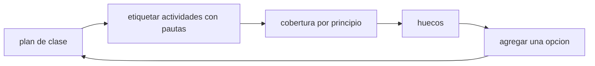

# B128-C02 — Diseño universal de aprendizaje aplicado a la astronomía

<!-- nav:top -->
[🏠 Programa](../../../../README.md) · [📚 Bloque B128](../../../tronco-comun/B128-accesibilidad-e-inclusion-en-la-ensenanza-de-la-astronomia.md) · [← Anterior: B128-C01 — Accesibilidad de la observación nocturna](../B128-C01-accesibilidad-de-la-observacion-nocturna/CLASE.md) · [Siguiente: B128-C03 — Alternativas a la observación visual →](../B128-C03-alternativas-a-la-observacion-visual/CLASE.md)
<!-- /nav -->

## 1. Ubicación, nivel y alcance

Clase 2 del bloque B128. Nivel N4. El diseño universal de aprendizaje (DUA) propone planificar desde el inicio varias formas de implicarse, de recibir la información y de mostrar lo aprendido. Aquí usas las nueve pautas de las directrices DUA 3.0 como lista de comprobación de un plan de clase de astronomía y mides su cobertura. El plan («Las fases de la Luna») es sintético; el etiquetado de pautas es un juicio del autor, no una medición.

## 2. Por qué esta clase existe

Un plan pensado para «el estudiante promedio» deja barreras que luego se parchean una a una. La decisión central: **¿qué pautas cubre ya mi plan, cuáles no, y dónde falta una opción?**

## 3. Lo que podrás hacer al terminar

1. Nombrar los tres principios y las nueve pautas de las directrices DUA 3.0.
2. Etiquetar las actividades de un plan con las pautas que cubren.
3. Calcular la cobertura por principio y total.
4. Contar los minutos que recibe cada pauta.
5. Detectar actividades sin pauta y principios con poca cobertura.
6. Distinguir qué es consultado (las pautas) de qué es juicio del autor (el etiquetado).

La evidencia es la **matriz de cobertura de un plan de clase** del ejercicio 12 (sección 20).

## 4. Con qué llegas y cómo comprobarlo

1. ¿Qué es un plan de clase?
2. ¿Qué es una barrera de aprendizaje?
3. ¿Qué es un porcentaje de cobertura?
4. ¿Qué es un dato sintético?
5. ¿Qué es una verificación por segunda vía?

<details>
<summary>Ver respuestas</summary>

1. La secuencia de actividades de una sesión con su objetivo. 2. Algo del entorno o del diseño que impide o dificulta aprender. 3. La parte de elementos esperados que están presentes, en porcentaje. 4. Un dato inventado para el ejemplo. 5. Calcular lo mismo con otro método y comparar.
</details>

Con cuatro o cinco aciertos, sigue; si no, repasa los prerrequisitos.

## 5. Un caso de contexto y casos de referencia

Un plan de 90 minutos con siete actividades cubre 7 de las 9 pautas (77,8 %): las tres de «Representación», las tres de «Acción y expresión» y solo una de «Implicación» (33,3 %). Faltan las pautas 8 y 9 y la última actividad no declara ninguna. Es el **ejemplo conductor**; el plan es **sintético**.

## 6. Vocabulario

Los **principios** del DUA son tres: implicación, representación y acción y expresión. Las **pautas** son nueve, tres por principio. La **cobertura** es la fracción de pautas que el plan declara atender. Una **opción** es una vía alternativa para lo mismo (leer, escuchar o tocar).

## 7. Modelo mental: un menú, no un plato único



*Descripción textual:* se etiquetan las actividades, se mide la cobertura, se encuentran los huecos y se agrega una opción, volviendo al plan.

Analogía: un menú con varias opciones sirve a más comensales que un plato único. Límite: contar pautas no mide si las opciones funcionan para las personas; eso solo se sabe con ellas.

## 8. La explicación, paso a paso

### 8.1 Las nueve pautas (DUA 3.0)

| Principio | Pautas |
|---|---|
| Implicación | 7 Dar la bienvenida a intereses e identidades · 8 Sostener el esfuerzo y la persistencia · 9 Capacidad emocional |
| Representación | 1 Percepción · 2 Lenguaje y símbolos · 3 Construcción de conocimiento |
| Acción y expresión | 4 Interacción · 5 Expresión y comunicación · 6 Desarrollo de estrategias |

### 8.2 Etiquetar el plan

La pregunta de entrada atiende la pauta 7; la lectura con glosario y dibujo descrito, las 1 y 2; el modelo con pelota y lámpara, las 1, 3 y 4; la tabla con porcentaje iluminado, las 2 y 3; la elección de formato de entrega, la 5; la lista de pasos, la 6; el cierre no declara ninguna.

### 8.3 Cobertura

Unión de pautas: `{1,2,3,4,5,6,7}`, 7 de 9 = 77,8 %. Por principio: Implicación 1/3 (33,3 %), Representación 3/3, Acción y expresión 3/3. La segunda vía cuenta, para cada pauta, si alguna actividad la declara; coincide con la unión.

### 8.4 Minutos por pauta

La pauta 1 recibe 35 min; la 3, 30; la 2, 25; la 4, 20; la 5, 15; la 6 y la 7, 10 cada una; la 8 y la 9, 0. El cierre reflexivo («qué me costó y qué me ayudó») es candidato natural a cubrir las pautas 8 y 9 si se rediseña con apoyo emocional y metas graduales.

## 9. Magnitudes, símbolos y unidades

| Símbolo | Qué es | Unidad | Valor / nota |
|---|---|---|---|
| principios | grandes líneas del DUA | — | 3 |
| pautas | guías dentro de los principios | — | 9 |
| cobertura | pautas declaradas / 9 | % | 77,8 |
| minutos por pauta | tiempo del plan que la declara | min | 0 a 35 |

## 10. Convenciones y referencias

Numeración de pautas según CAST UDL 3.0 (2024). Una actividad puede declarar varias pautas y sus minutos se cuentan completos en cada una (por eso la suma de minutos por pauta supera 90). El etiquetado es un juicio del autor del plan.

## 11. De dónde sale lo que afirmamos

| ID | Fuente | Localizador | Respalda | Estado |
|---|---|---|---|---|
| S1 | CAST, UDL Guidelines 3.0 (2024) — https://udlguidelines.cast.org/ (consultada 2026-11-11) | página principal | versión 3.0 publicada el 30 de julio de 2024; tres principios y nueve pautas con los nombres de la sección 8.1 | Consultada |
| S2 | UNESCO, Inclusion in education — https://www.unesco.org/en/inclusion-education (consultada 2026-11-11) | página completa | identificar y quitar los obstáculos al aprendizaje; reformar contenidos y métodos | Consultada |
| — | Evidencia empírica del efecto del DUA sobre el aprendizaje | — | — | No consultada |

Límites: se consultaron los nombres de principios y pautas, no los puntos de verificación de cada pauta ni la evidencia de impacto; no se afirma que aplicar el DUA mejore resultados.

## 12. Cómo ver la cobertura

| Principio | Pautas cubiertas |
|---|---|
| Implicación | 1 de 3 (33,3 %) |
| Representación | 3 de 3 (100 %) |
| Acción y expresión | 3 de 3 (100 %) |
| Total | 7 de 9 (77,8 %) |

Descripción larga: el plan está equilibrado en representación y expresión, pero débil en implicación; el hueco concreto son las pautas 8 y 9.

## 13. Ejemplo trabajado: agregar una opción

**Paso 1 · Hueco.** Pautas 8 y 9 sin cubrir.

**Paso 2 · Opción.** Reformular el cierre: elegir entre escribir, dibujar o hablar lo que costó, con una meta pequeña para la próxima sesión.

**Paso 3 · Etiqueta.** El cierre pasa a declarar {8, 9}.

**Paso 4 · Nueva cobertura.** 9 de 9 pautas declaradas = 100 %; vale como cuenta, no como prueba de que funcione.

## 14. Distintas formas de describir un plan

**Por actividades:** lista con minutos. **Por pautas:** qué pauta atiende cada actividad. **Por matriz:** actividades en filas, pautas en columnas. **Por huecos:** qué pautas faltan.

## 15. Práctica guiada

**Ejercicio 1 · con los pasos indicados.** Cuenta las pautas del principio «Representación». *Pasos:* mira la tabla 8.1.

<details><summary>Solución comentada</summary>

Tres: 1, 2 y 3.
</details>

**Ejercicio 2 · con una pista.** Calcula la cobertura total. *Pista:* 7 de 9.

<details><summary>Solución comentada</summary>

`7/9 = 77,8 %`.
</details>

**Ejercicio 3 · casi autónomo.** ¿Qué principio tiene menor cobertura?

<details><summary>Solución comentada</summary>

Implicación, 1 de 3 (33,3 %).
</details>

## 16. Práctica autónoma, transferencia e integrador

**Ejercicio 4 · autónomo.** ¿Cuántos minutos recibe la pauta 3?

<details><summary>Solución comentada</summary>

30 (modelo 20 + tabla 10).
</details>

**Ejercicio 5 · autónomo.** ¿Cuáles actividades no declaran ninguna pauta?

<details><summary>Solución comentada</summary>

La del cierre.
</details>

**Ejercicio 6 · autónomo.** Si se agrega una actividad de 10 min que cubre {8}, ¿cuál es la nueva cobertura?

<details><summary>Solución comentada</summary>

8 de 9 = 88,9 %; Implicación 2 de 3.
</details>

**Ejercicio 7 · autónomo.** ¿Por qué la suma de minutos por pauta no es 90?

<details><summary>Solución comentada</summary>

Una actividad declara varias pautas y se cuenta completa en cada una (sección 10).
</details>

**Ejercicio 8 · autónomo.** Escribe una opción alternativa para la tabla de fases de la pauta 2.

<details><summary>Solución comentada</summary>

Un glosario con imagen descrita y la misma tabla en texto narrado; ver [C09](../B128-C09-apoyo-multilingue-y-glosarios/CLASE.md).
</details>

**Ejercicio 9 · transferencia.** **Transferencia.** Un plan cubre 9 de 9 pautas, pero todas con la misma actividad de lectura. ¿Es un buen plan?

<details><summary>Solución comentada</summary>

No necesariamente: declarar no es ofrecer opciones reales; hay que ver las vías distintas y probarlas con estudiantes.
</details>

**Ejercicio 10 · transferencia.** **Transferencia.** Aplica la matriz a una salida de observación con telescopio (ver [C01](../B128-C01-accesibilidad-de-la-observacion-nocturna/CLASE.md)). ¿Qué pauta la observación fija ya cubre mal?

<details><summary>Solución comentada</summary>

La 4 (Interacción) y la 1 (Percepción) si hay una sola vía de acceso al ocular; piden alternativas.
</details>

**Ejercicio 11 · transferencia.** **Transferencia.** ¿Qué no dice la cobertura de pautas sobre la calidad del plan?

<details><summary>Solución comentada</summary>

No mide si las opciones funcionan, si son equivalentes ni si el estudiante aprende; solo declara que existen.
</details>

**Ejercicio 12 · integrador.** **Integrador.** Elabora tu *matriz de cobertura de un plan de clase*: tu plan con 6 a 8 actividades, minutos, pautas declaradas, cobertura por principio, huecos y una opción nueva por hueco.

<details><summary>Solución comentada</summary>

Secciones 8.2–8.4 y la salida del laboratorio; cada hueco tiene una opción propuesta y se aclara que el etiquetado es un juicio.
</details>

## 17. Laboratorio: cobertura de pautas

El script [cobertura_dua.py](cobertura_dua.py) calcula cobertura por principio y total y minutos por pauta de un plan sintético (**comprueba** la unión de conjuntos contra una matriz de incidencia).

**Datos:** nombres de pautas de CAST (consultados); plan y etiquetas **sintéticos**. **Predice antes de ejecutar:** ¿cuántas pautas cubrirá el plan? (7 de 9.) **Ejecución del 2026-11-11 (Python 3.12.9):**

```text
Python 3.12.9 (biblioteca estandar)
Plan SINTETICO; pautas segun CAST UDL 3.0 (consultado 2026-11-11). Cubrir = juicio del autor, no medicion.
Minutos totales: 90
Implicacion         : 1 de 3 pautas ( 33.3 %)  sin cubrir: [8, 9]
Representacion      : 3 de 3 pautas (100.0 %)  sin cubrir: []
Accion y expresion  : 3 de 3 pautas (100.0 %)  sin cubrir: []
Cobertura total: 7 de 9 pautas (77.8 %)
Minutos por pauta:
  pauta 1:  35 min
  pauta 2:  25 min
  pauta 3:  30 min
  pauta 4:  20 min
  pauta 5:  15 min
  pauta 6:  10 min
  pauta 7:  10 min
  pauta 8:   0 min
  pauta 9:   0 min
Principio con menor cobertura: Implicacion
Actividades sin pauta declarada: ['Cierre: que me costo y que me ayudo']
Pruebas superadas.
```

```bash
python programa/clases/B128/B128-C02-diseno-universal-de-aprendizaje-aplicado-a-la-astronomia/cobertura_dua.py
```

**Límites:** cuenta pautas declaradas; no mide efecto en el aprendizaje ni calidad de las opciones.

## 18. Errores frecuentes y cómo corregirlos

**Confundir declarar con ofrecer.** Se corrige con el ejercicio 9.

**Dar por probado que el DUA mejora resultados.** No se consultó evidencia de impacto (sección 11).

**Tratar el etiquetado como medición.** Es un juicio del autor (sección 10).

**Ignorar el principio de implicación.** Es el hueco del ejemplo (8.3).

## 19. Cómo sabrás que vas bien

Tras la sección 8: ¿qué cobertura esperabas y cuál obtuviste? Si dudas, repasa el ejemplo 13. Tras el laboratorio: ¿qué comprueba? (ver la sección 17).

## 20. Qué entregas y cómo se evalúa

El producto es tu **matriz de cobertura de un plan de clase** (ejercicio 12).

| Criterio | Inicial | En desarrollo | Logrado | Destacado |
|---|---|---|---|---|
| Conceptos | Los confunde | Parciales | Usa principios y pautas | Explica los límites |
| Cálculo | Sin unidades | Con errores | Cobertura y minutos correctos | Calcula casos nuevos |
| Numérico | Sin comprobar | Un caso | Contraste con una segunda vía | Interpreta las diferencias |
| Fuentes | Sin fuente | Sin fecha | Fuentes con fecha y estado | Declara lo no consultado |
| Límites | No los nombra | Uno | Tres | Discute qué falta de la matriz |

**Condiciones críticas (no se compensan con promedio):** rotular el plan como sintético y el etiquetado como juicio; no afirmar impacto sin fuente; citar solo lo consultado.

## 21. Ética, seguridad y límites

Clase educativa y respetuosa: el DUA habla de opciones de diseño para todas las personas, no de «tipos» de estudiantes. Ningún dato describe a estudiantes reales. La matriz no sustituye la consulta ni la prueba con las personas. Accesibilidad: tablas equivalentes a las gráficas, fórmulas en texto, ejercicios sin conexión.

## 22. Para cerrar y seguir

El plan sintético cubre 7 de 9 pautas (77,8 %), con el hueco en implicación. Queda una pregunta: cuando la vía principal es visual, ¿qué alternativas equivalentes ofrecer?

**Glosario español–inglés.** diseño universal de aprendizaje · *universal design for learning*; pauta · *guideline*; implicación · *engagement*; representación · *representation*; acción y expresión · *action and expression*.

**Continuidad.** [B128-C03](../B128-C03-alternativas-a-la-observacion-visual/CLASE.md) construye alternativas equivalentes a la observación visual.

**Referencias:** ver sección 11.

<!-- nav:bottom -->
---

[← Anterior: B128-C01 — Accesibilidad de la observación nocturna](../B128-C01-accesibilidad-de-la-observacion-nocturna/CLASE.md) · [📚 Bloque B128](../../../tronco-comun/B128-accesibilidad-e-inclusion-en-la-ensenanza-de-la-astronomia.md) · [Siguiente: B128-C03 — Alternativas a la observación visual →](../B128-C03-alternativas-a-la-observacion-visual/CLASE.md)
<!-- /nav -->
