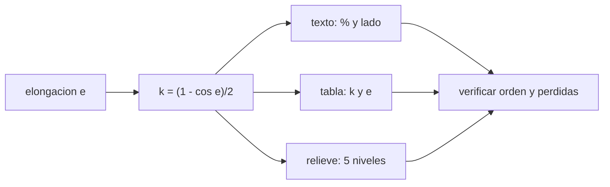

# B128-C03 — Alternativas a la observación visual

<!-- nav:top -->
[🏠 Programa](../../../../README.md) · [📚 Bloque B128](../../../tronco-comun/B128-accesibilidad-e-inclusion-en-la-ensenanza-de-la-astronomia.md) · [← Anterior: B128-C02 — Diseño universal de aprendizaje aplicado a la astronomía](../B128-C02-diseno-universal-de-aprendizaje-aplicado-a-la-astronomia/CLASE.md) · [Siguiente: B128-C04 — Documentos y contenidos para lectores de pantalla →](../B128-C04-documentos-y-contenidos-para-lectores-de-pantalla/CLASE.md)
<!-- /nav -->

## 1. Ubicación, nivel y alcance

Clase 3 del bloque B128. Nivel N4. Mirar la Luna por el ocular es una vía; no es la única de acceder a la información. Aquí conviertes una misma observación, las **fases de la Luna**, en tres formatos equivalentes (texto descriptivo, tabla de datos y relieve de cinco niveles) y compruebas qué información conserva cada uno. Usas la fracción iluminada `k = (1 − cos e)/2`. Las ocho elongaciones son una discretización didáctica, no efemérides de fechas reales.

## 2. Por qué esta clase existe

«Alternativa» no significa «versión reducida». Si el relieve pierde resolución o el texto omite el lado iluminado, la persona recibe menos información que quien mira. La decisión central: **¿qué información necesita conservar cada formato para ser equivalente, y dónde pierde?**

## 3. Lo que podrás hacer al terminar

1. Calcular la fracción iluminada de la Luna desde la elongación.
2. Comprobar el cálculo con una integración numérica.
3. Generar una descripción textual que incluya porcentaje y lado iluminado.
4. Cuantizar la fracción en relieve de cinco niveles y medir su pérdida de resolución.
5. Verificar que cada formato permite ordenar las fases igual.
6. Separar lo modelado (geometría simplificada) de lo ilustrativo (escala de relieve).

La evidencia es el **paquete de alternativas equivalentes** del ejercicio 12 (sección 20).

## 4. Con qué llegas y cómo comprobarlo

1. ¿Qué es la elongación de la Luna?
2. ¿Qué es el coseno de un ángulo?
3. ¿Qué es una cuantización?
4. ¿Qué es una descripción textual de una imagen?
5. ¿Qué es una verificación por segunda vía?

<details>
<summary>Ver respuestas</summary>

1. El ángulo Luna–Sol visto desde la Tierra, de 0° (nueva) a 180° (llena). 2. La razón entre el cateto adyacente y la hipotenusa. 3. Reducir un valor continuo a unos pocos niveles. 4. Un texto que da la misma información que la imagen para quien no la ve. 5. Calcular lo mismo con otro método y comparar.
</details>

Con cuatro o cinco aciertos, sigue; si no, repasa los prerrequisitos.

## 5. Un caso de contexto y casos de referencia

Para una elongación de 90° (cuarto creciente), `k = 0,5000`: el texto dice «50 % del disco iluminado, a la derecha (hemisferio norte)», la tabla da `0,5000`, y el relieve usa el nivel 2 de 4. Con 45° y 315° `k = 0,1464` en ambos: el relieve los pone en el mismo nivel 1, así que **el relieve no distingue creciente de menguante**; el texto y la tabla sí, con el lado. Es el **ejemplo conductor**; todo es **ilustrativo** o **modelado**.

## 6. Vocabulario

La **fracción iluminada** `k` es la parte del disco visible que recibe luz solar. La **elongación** `e` es el ángulo Luna–Sol. Una **alternativa equivalente** entrega la misma información por otra vía. La **descripción textual** reemplaza una imagen con palabras. El **relieve** codifica un valor como altura que se toca.

## 7. Modelo mental: una misma partitura en tres instrumentos



*Descripción textual:* de la elongación sale la fracción iluminada, que se expresa en texto, tabla y relieve; luego se verifica el orden y se anotan las pérdidas de cada formato.

Analogía: la misma partitura puede tocarse en tres instrumentos; ninguno suena igual, pero cada uno debe llevar todas las notas. Límite: cada formato pierde algo distinto y se compensan entre sí.

## 8. La explicación, paso a paso

### 8.1 Fracción iluminada

`k = (1 − cos e)/2`. En 0° `k = 0`; en 90° `k = 0,5`; en 180° `k = 1`. La integración numérica del ancho de la franja iluminada da lo mismo con diferencia menor que `1 × 10⁻⁴`; valida la integración y el código, no es una prueba independiente de la geometría.

### 8.2 Tabla

| Elongación | Fase | `k` |
|---|---|---|
| 0° | nueva | 0,0000 |
| 45° | creciente iluminada | 0,1464 |
| 90° | cuarto creciente | 0,5000 |
| 135° | gibosa creciente | 0,8536 |
| 180° | llena | 1,0000 |
| 225° | gibosa menguante | 0,8536 |
| 270° | cuarto menguante | 0,5000 |
| 315° | menguante iluminada | 0,1464 |

### 8.3 Texto y relieve

El texto incluye porcentaje y lado: «Parte iluminada de 15 % del disco, a la derecha». El relieve usa `nivel = round(4k)`: niveles 0, 1, 2, 3, 4, 3, 2, 1 para las ocho fases. Solo hay **5 niveles distintos** para 8 fases.

### 8.4 Qué pierde cada formato

El texto pierde la forma; la tabla pierde la intuición espacial; el relieve pierde la dirección (creciente y menguante coinciden) y la resolución fina (0,1464 y 0,0 quedan a un nivel de diferencia). Por eso el paquete debe tener los tres y cada uno debe declarar su pérdida. El orden de las fases por texto y por relieve coincide en la salida, pero el relieve no separa pares creciente/menguante sin ayuda adicional (marca táctil de lado).

## 9. Magnitudes, símbolos y unidades

| Símbolo | Qué es | Unidad | Valor / nota |
|---|---|---|---|
| `e` | elongación | ° | 0 a 315 en pasos de 45 |
| `k` | fracción iluminada | — | 0 a 1 |
| nivel | nivel de relieve | — | 0 a 4 |
| tolerancia | entre fórmula e integral | — | 1e-4 |

## 10. Convenciones y referencias

Elongación geocéntrica con órbita circular; las ocho fases son una discretización didáctica y no corresponden a fechas. La descripción del lado iluminado vale para el hemisferio norte (en el sur se ve invertido). La escala de relieve (5 niveles) es del curso y no se consultó.

## 11. De dónde sale lo que afirmamos

| ID | Fuente | Localizador | Respalda | Estado |
|---|---|---|---|---|
| S1 | W3C, WCAG 2.2 — https://www.w3.org/TR/WCAG22/ (consultada 2026-11-11; solo el primer tramo del documento) | criterios 1.1.1 y 1.2.1 | el contenido no textual necesita una alternativa textual con el mismo propósito; hay alternativas para audio y video | Consultada |
| S2 | W3C WAI, Understanding 1.1.1 — https://www.w3.org/WAI/WCAG22/Understanding/non-text-content.html (consultada 2026-11-11) | secciones sobre imágenes complejas | descripción larga que resume datos y tendencias, con la tabla de datos cuando sea práctico | Consultada |
| S3 | I-OAE (IAU), Accessible Prints — https://oae.inaf.it/projects/educational-resources/accessible-prints (consultada 2026-11-11) | página completa | existe una iniciativa de impresión táctil con mapas táctiles de fases lunares para personas ciegas o con baja visión | Consultada |
| — | Relación `k = (1 − cos e)/2` | — | la comprueba el laboratorio | No consultada en una fuente concreta |

Límites: no se consultaron evaluaciones del uso de estos materiales con personas; no se afirma que cinco niveles sean suficientes para ninguna persona.

## 12. Cómo ver las alternativas

| Magnitud | Valor |
|---|---|
| `k` a 90° | 0,5000 |
| niveles de relieve distintos | 5 de 8 fases |
| fases con el mismo nivel que otra | 3 pares |
| diferencia fórmula–integral | menor que 1e-4 |

Descripción larga: ocho fases se reducen a cinco niveles de relieve porque creciente y menguante coinciden; el texto añade el lado y la tabla añade el valor numérico.

## 13. Ejemplo trabajado: el cuarto creciente

**Paso 1 · Elongación.** `e = 90°`.

**Paso 2 · Fracción.** `k = (1 − 0)/2 = 0,5000`.

**Paso 3 · Relieve.** `round(4 × 0,5) = 2`.

**Paso 4 · Texto.** «Parte iluminada de 50 % del disco, a la derecha (hemisferio norte)».

## 14. Distintas formas de describir una fase

**En texto:** porcentaje y lado. **En tabla:** `e` y `k`. **En relieve:** nivel 0 a 4. **En sonido:** una frecuencia por fase (ver [C07](../B128-C07-modelos-tactiles-y-sonificacion/CLASE.md)).

## 15. Práctica guiada

**Ejercicio 1 · con los pasos indicados.** Calcula `k` para `e = 135°`. *Pasos:* `cos 135° = −0,7071`; `(1 + 0,7071)/2`.

<details><summary>Solución comentada</summary>

`k = 0,8536`.
</details>

**Ejercicio 2 · con una pista.** ¿Qué nivel de relieve le toca? *Pista:* `round(4k)`.

<details><summary>Solución comentada</summary>

`round(3,414) = 3`.
</details>

**Ejercicio 3 · casi autónomo.** ¿Por qué 45° y 315° comparten nivel?

<details><summary>Solución comentada</summary>

Tienen el mismo `k = 0,1464`; difieren en el lado, que el relieve no codifica.
</details>

## 16. Práctica autónoma, transferencia e integrador

**Ejercicio 4 · autónomo.** Calcula `k` para `e = 60°`.

<details><summary>Solución comentada</summary>

`(1 − 0,5)/2 = 0,25`.
</details>

**Ejercicio 5 · autónomo.** ¿Cuántos niveles distintos usa el relieve con 8 fases?

<details><summary>Solución comentada</summary>

5 (0, 1, 2, 3, 4).
</details>

**Ejercicio 6 · autónomo.** Redacta el texto para `e = 225°`.

<details><summary>Solución comentada</summary>

«Parte iluminada de 85 % del disco, a la izquierda (hemisferio norte)».
</details>

**Ejercicio 7 · autónomo.** Si el relieve tuviera 9 niveles (`round(8k)`), ¿se distinguirían 0,1464 y 0,5?

<details><summary>Solución comentada</summary>

`round(1,17) = 1` y `round(4) = 4`: sí, con más separación.
</details>

**Ejercicio 8 · autónomo.** Propón una marca táctil para distinguir creciente de menguante.

<details><summary>Solución comentada</summary>

Un punto en relieve a la derecha para creciente y a la izquierda para menguante, o una muesca en el borde; debe probarse con las personas usuarias.
</details>

**Ejercicio 9 · transferencia.** **Transferencia.** Un colega entrega solo una imagen de las fases con «fases de la Luna» como texto alternativo. ¿Es equivalente?

<details><summary>Solución comentada</summary>

No: falta el contenido (porcentaje, lado, orden); ver la guía de descripciones largas de WCAG (S2).
</details>

**Ejercicio 10 · transferencia.** **Transferencia.** En el hemisferio sur, ¿cambia el texto?

<details><summary>Solución comentada</summary>

Sí: el lado iluminado aparece invertido; el texto debe indicar el hemisferio o la convención.
</details>

**Ejercicio 11 · transferencia.** **Transferencia.** ¿Qué no sabes sobre la eficacia de estos formatos con estudiantes reales?

<details><summary>Solución comentada</summary>

Nada se midió con personas en esta clase; la equivalencia aquí es de información, no de experiencia ni de aprendizaje.
</details>

**Ejercicio 12 · integrador.** **Integrador.** Elabora tu *paquete de alternativas equivalentes* para las fases lunares: tabla, textos de las ocho fases, mapa de relieve y la lista de qué pierde cada formato y cómo se compensa.

<details><summary>Solución comentada</summary>

Secciones 8.2–8.4 y la salida del laboratorio.
</details>

## 17. Laboratorio: fases en tres formatos

El script [fases_lunares.py](fases_lunares.py) calcula `k` por fórmula y por integración numérica, genera el texto y el relieve y compara el orden (**comprueba** diferencia < 1e-4 y 5 niveles).

**Datos:** geometría modelada; ocho elongaciones **didácticas**; escala de relieve **ilustrativa**. **Predice antes de ejecutar:** ¿cuántos niveles de relieve distintos habrá? (5.) **Ejecución del 2026-11-11 (Python 3.12.9):**

```text
Python 3.12.9 (biblioteca estandar)
Discretizacion DIDACTICA de ocho elongaciones; no son efemerides de fechas reales.
 elong  fase                    k formula   k integral   nivel  relieve  descripcion
    0  nueva                      0.0000       0.0000      0           Disco oscuro, sin parte iluminada.
   45  creciente iluminada        0.1464       0.1464      1  #        Parte iluminada de 15 % del disco, a la derecha (hemisferio norte).
   90  cuarto creciente           0.5000       0.5000      2  ##       Parte iluminada de 50 % del disco, a la derecha (hemisferio norte).
  135  gibosa creciente           0.8536       0.8536      3  ###      Parte iluminada de 85 % del disco, a la derecha (hemisferio norte).
  180  llena                      1.0000       1.0000      4  ####     Disco completo iluminado.
  225  gibosa menguante           0.8536       0.8536      3  ###      Parte iluminada de 85 % del disco, a la izquierda (hemisferio norte).
  270  cuarto menguante           0.5000       0.5000      2  ##       Parte iluminada de 50 % del disco, a la izquierda (hemisferio norte).
  315  menguante iluminada        0.1464       0.1464      1  #        Parte iluminada de 15 % del disco, a la izquierda (hemisferio norte).
Orden por texto (porcentaje): [0, 45, 315, 90, 270, 135, 225, 180]
Orden por relieve (5 niveles): [0, 45, 315, 90, 270, 135, 225, 180]
Niveles de relieve distintos: 5 de 8 fases (el relieve pierde resolucion; se compensa con tabla y texto)
Pruebas superadas.
```

```bash
python programa/clases/B128/B128-C03-alternativas-a-la-observacion-visual/fases_lunares.py
```

**Límites:** órbita circular, hemisferio norte, sin libración; el contraste con la integral valida el código.

## 18. Errores frecuentes y cómo corregirlos

**Pensar que una alternativa es una versión reducida.** Se corrige con 8.4.

**Dar un solo formato como «la» alternativa.** Se corrige con el ejercicio 12.

**Olvidar el hemisferio.** Se corrige con la sección 10.

**Dar por probada la equivalencia sin probarla con personas.** Se corrige con el ejercicio 11.

## 19. Cómo sabrás que vas bien

Tras la sección 8: ¿qué `k` esperabas a 135° y cuál obtuviste? Si dudas, repasa el ejemplo 13. Tras el laboratorio: ¿qué comprueba? (ver la sección 17).

## 20. Qué entregas y cómo se evalúa

El producto es tu **paquete de alternativas equivalentes** (ejercicio 12).

| Criterio | Inicial | En desarrollo | Logrado | Destacado |
|---|---|---|---|---|
| Conceptos | Los confunde | Parciales | Distingue equivalencia de reducción | Explica los límites |
| Cálculo | Sin unidades | Con errores | Tabla y textos correctos | Calcula casos nuevos |
| Numérico | Sin comprobar | Un caso | Contraste con una segunda vía | Interpreta las diferencias |
| Fuentes | Sin fuente | Sin fecha | Fuentes con fecha y estado | Declara lo no consultado |
| Límites | No los nombra | Uno | Tres | Discute qué falta del paquete |

**Condiciones críticas (no se compensan con promedio):** declarar qué pierde cada formato; no afirmar eficacia sin pruebas con personas; citar solo lo consultado.

## 21. Ética, seguridad y límites

Clase educativa y respetuosa: ningún formato es «para las personas ciegas»; todos son para quien los quiera usar, y se diseñan con las personas. No se afirma eficacia de ningún formato. Accesibilidad: tablas equivalentes a las gráficas, fórmulas en texto, ejercicios sin conexión.

## 22. Para cerrar y seguir

Cuatro números describen las fases: `k = 0,5000` a 90°, cinco niveles de relieve para ocho fases y un par creciente/menguante que el relieve no separa. Queda una pregunta: ¿cómo se comprueba que un documento digital llegue bien a un lector de pantalla?

**Glosario español–inglés.** fracción iluminada · *illuminated fraction*; elongación · *elongation*; alternativa equivalente · *equivalent alternative*; descripción larga · *long description*; relieve · *relief*.

**Continuidad.** [B128-C04](../B128-C04-documentos-y-contenidos-para-lectores-de-pantalla/CLASE.md) revisa documentos para lectores de pantalla.

**Referencias:** ver sección 11.

<!-- nav:bottom -->
---

[← Anterior: B128-C02 — Diseño universal de aprendizaje aplicado a la astronomía](../B128-C02-diseno-universal-de-aprendizaje-aplicado-a-la-astronomia/CLASE.md) · [📚 Bloque B128](../../../tronco-comun/B128-accesibilidad-e-inclusion-en-la-ensenanza-de-la-astronomia.md) · [Siguiente: B128-C04 — Documentos y contenidos para lectores de pantalla →](../B128-C04-documentos-y-contenidos-para-lectores-de-pantalla/CLASE.md)
<!-- /nav -->
