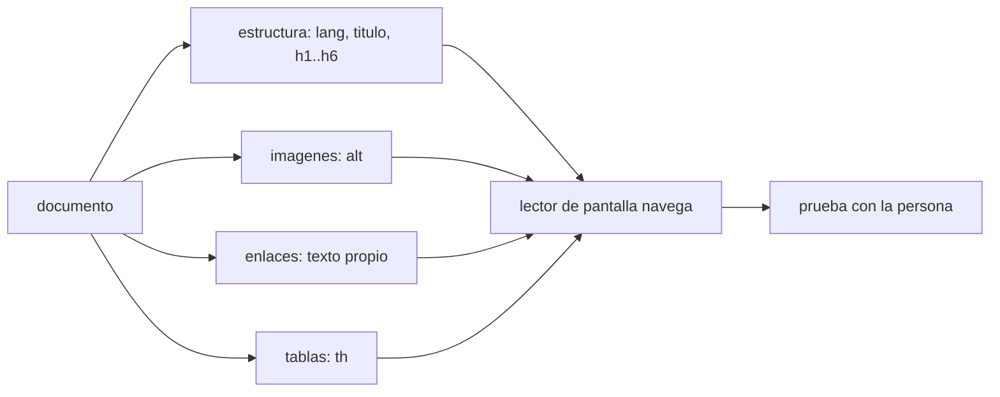

# B128-C04 — Documentos y contenidos para lectores de pantalla

<!-- nav:top -->
[🏠 Programa](../../../../README.md) · [📚 Bloque B128](../../../tronco-comun/B128-accesibilidad-e-inclusion-en-la-ensenanza-de-la-astronomia.md) · [← Anterior: B128-C03 — Alternativas a la observación visual](../B128-C03-alternativas-a-la-observacion-visual/CLASE.md) · [Siguiente: B128-C05 — Subtítulos y transcripciones →](../B128-C05-subtitulos-y-transcripciones/CLASE.md)
<!-- /nav -->

## 1. Ubicación, nivel y alcance

Clase 4 del bloque B128. Nivel N4. Un lector de pantalla convierte la página en voz o en braille y avanza por títulos, enlaces, imágenes y tablas. Si la estructura falta, la persona escucha una pared de texto sin mapa. Aquí revisas un documento HTML con un programa que comprueba siete reglas y comparas una versión deficiente con una corregida. El documento sobre las lunas de Júpiter es sintético. La revisión automática detecta una parte de los problemas y **no** reemplaza probar con un lector de pantalla y con personas.

## 2. Por qué esta clase existe

Una imagen sin texto alternativo, una tabla sin encabezados o un enlace «haz clic aquí» no se ven como problema a simple vista pero dejan a una persona sin la información. La decisión central: **¿qué comprobaciones mínimas puedo automatizar y qué debo revisar a mano?**

## 3. Lo que podrás hacer al terminar

1. Reconocer los elementos que un lector de pantalla usa para navegar.
2. Escribir un texto alternativo útil, y dejar vacío el de una imagen decorativa.
3. Estructurar títulos sin saltos de nivel.
4. Dar a las tablas celdas de encabezado.
5. Escribir enlaces que se entiendan fuera de contexto.
6. Ejecutar y leer un informe de revisión automática y declarar sus límites.

La evidencia es el **informe de revisión de un documento** del ejercicio 12 (sección 20).

## 4. Con qué llegas y cómo comprobarlo

1. ¿Qué es un lector de pantalla?
2. ¿Qué es un texto alternativo?
3. ¿Qué es un encabezado en un documento?
4. ¿Qué es un dato sintético?
5. ¿Qué es una verificación por segunda vía?

<details>
<summary>Ver respuestas</summary>

1. Un programa que lee en voz alta o en braille lo que hay en pantalla. 2. Un texto que reemplaza a una imagen para quien no la ve. 3. Un título que organiza el documento en secciones. 4. Un dato inventado para el ejemplo. 5. Calcular lo mismo con otro método y comparar.
</details>

Con cuatro o cinco aciertos, sigue; si no, repasa los prerrequisitos.

## 5. Un caso de contexto y casos de referencia

El documento deficiente tiene **8 hallazgos**: sin idioma, sin título, un salto de encabezado de `h2` a `h4`, una imagen sin `alt`, otra con `alt` pobre («gráfico»), dos enlaces genéricos y una tabla sin celdas `th`. La versión corregida tiene **0 hallazgos** según las mismas reglas, lo que no significa que sea accesible: solo que pasa estas siete reglas. Es el **ejemplo conductor**; el documento es **sintético**.

## 6. Vocabulario

El **texto alternativo** (`alt`) es la descripción de una imagen. Una imagen **decorativa** lleva `alt` vacío para que el lector la omita. Un **encabezado** (`h1`–`h6`) marca la estructura. Una **celda de encabezado** (`th`) etiqueta filas o columnas de una tabla. El **idioma** (`lang`) permite pronunciar bien. El **texto de enlace** es lo que se lee al recorrer los enlaces.

## 7. Modelo mental: un mapa para quien no ve la ciudad



*Descripción textual:* el documento aporta estructura, imágenes, enlaces y tablas al lector de pantalla; la prueba final la hace una persona.

Analogía: los títulos son las calles señalizadas de un mapa. Límite: una regla automática comprueba presencia, no calidad; un `alt` puede existir y ser inútil.

## 8. La explicación, paso a paso

### 8.1 Las reglas del laboratorio

Las siete reglas son del curso, inspiradas en el criterio 1.1.1 de WCAG 2.2 (contenido no textual con alternativa): idioma declarado, título, un solo `h1`, sin saltos de nivel, `alt` presente y no pobre, enlaces no genéricos y tablas con `th`. No son una lista oficial.

### 8.2 Texto alternativo

WCAG distingue una descripción corta que identifica la imagen y su propósito, y una descripción larga que resume los datos y las tendencias, con los datos en una tabla cuando sea práctico. Una imagen decorativa lleva `alt=""` para no distraer.

### 8.3 Estructura

Los títulos no deben saltar niveles (`h2` a `h4`). Debe haber un `h1`. El idioma declarado hace que el lector use la pronunciación correcta.

### 8.4 Lo que la regla no ve

Una regla no sabe si el `alt` «Io, luna amarillenta con manchas oscuras de volcanes» es suficiente, ni si el orden de lectura tiene sentido, ni si una tabla compleja se entiende. Eso lo evalúa una persona con un lector de pantalla real.

## 9. Magnitudes, símbolos y unidades

| Símbolo | Qué es | Unidad | Valor / nota |
|---|---|---|---|
| hallazgos | reglas incumplidas | conteo | 8 (malo), 0 (corregido) |
| `alt` | texto alternativo | texto | vacío si es decorativo |
| `h1`–`h6` | encabezados | nivel | 1 a 6 |
| `th` | celda de encabezado | — | al menos una por tabla |

## 10. Convenciones y referencias

Documentos HTML sintéticos analizados con el analizador de la biblioteca estándar. Las reglas son del curso y no equivalen a una auditoría WCAG. El laboratorio no evalúa PDF, hojas de cálculo ni contenido dinámico.

## 11. De dónde sale lo que afirmamos

| ID | Fuente | Localizador | Respalda | Estado |
|---|---|---|---|---|
| S1 | W3C, WCAG 2.2 — https://www.w3.org/TR/WCAG22/ (consultada 2026-11-11; solo el primer tramo del documento) | criterio 1.1.1 | el contenido no textual necesita una alternativa textual con el mismo propósito | Consultada |
| S2 | W3C WAI, Understanding 1.1.1 — https://www.w3.org/WAI/WCAG22/Understanding/non-text-content.html (consultada 2026-11-11) | imágenes complejas y decorativas | descripción corta y larga; datos en tabla; `alt` vacío para lo decorativo | Consultada |
| — | Comportamiento de lectores de pantalla concretos; reglas de PDF accesible | — | — | No consultada |

Límites: no se consultaron los demás criterios de WCAG sobre estructura ni la documentación de lectores concretos; las siete reglas son del curso.

## 12. Cómo ver el informe

| Documento | Hallazgos |
|---|---|
| deficiente | 8 |
| corregido | 0 |
| imagen decorativa con `alt` vacío | no es hallazgo |

Descripción larga: la revisión pasa de 8 hallazgos a 0 al corregir idioma, título, estructura, imágenes, enlaces y tabla; la imagen decorativa nunca fue un hallazgo.

## 13. Ejemplo trabajado: corregir un enlace

**Paso 1 · Hallazgo.** El enlace «haz clic aquí» no se entiende fuera de contexto.

**Paso 2 · Pregunta.** ¿Adónde lleva?

**Paso 3 · Corrección.** «Guía de observación de las lunas».

**Paso 4 · Verificación.** El revisor ya no lo marca como genérico.

## 14. Distintas formas de describir un documento accesible

**Por estructura:** idioma, título, títulos. **Por contenido no textual:** alternativas. **Por navegación:** enlaces y tablas. **Por prueba:** con lector de pantalla y con personas.

## 15. Práctica guiada

**Ejercicio 1 · con los pasos indicados.** ¿Qué hallazgo produce ``? *Pasos:* busca el atributo `alt`.

<details><summary>Solución comentada</summary>

«imagen sin atributo alt».
</details>

**Ejercicio 2 · con una pista.** ¿Es hallazgo ``? *Pista:* imagen decorativa.

<details><summary>Solución comentada</summary>

No; `alt` vacío marca lo decorativo.
</details>

**Ejercicio 3 · casi autónomo.** ¿Qué salto de encabezado se detecta?

<details><summary>Solución comentada</summary>

De `h2` a `h4`.
</details>

## 16. Práctica autónoma, transferencia e integrador

**Ejercicio 4 · autónomo.** Escribe un `alt` para la imagen de Io.

<details><summary>Solución comentada</summary>

«Io, luna amarillenta con manchas oscuras de volcanes»; dice qué es y qué muestra.
</details>

**Ejercicio 5 · autónomo.** ¿Cuántos hallazgos queda si se corrige solo el idioma y el título?

<details><summary>Solución comentada</summary>

6 de los 8.
</details>

**Ejercicio 6 · autónomo.** Reescribe «mas informacion».

<details><summary>Solución comentada</summary>

«Tabla de efemérides».
</details>

**Ejercicio 7 · autónomo.** ¿Qué elemento da encabezados a una tabla?

<details><summary>Solución comentada</summary>

`th`, con `scope="col"` o `scope="row"`.
</details>

**Ejercicio 8 · autónomo.** Para un gráfico de periodos, escribe la descripción corta y di dónde va la larga.

<details><summary>Solución comentada</summary>

Corta: «Gráfico de periodos orbitales; datos en la tabla siguiente»; larga: la tabla de datos.
</details>

**Ejercicio 9 · transferencia.** **Transferencia.** El revisor da 0 hallazgos a un documento. ¿Es accesible?

<details><summary>Solución comentada</summary>

No se sabe: pasó siete reglas, no una prueba con lector de pantalla ni con personas.
</details>

**Ejercicio 10 · transferencia.** **Transferencia.** ¿Cómo describirías una imagen del cielo en falso color?

<details><summary>Solución comentada</summary>

Qué muestra, qué significan los colores (en texto, no solo en color), qué se concluye; ver [C06](../B128-C06-contraste-y-color-accesibles/CLASE.md).
</details>

**Ejercicio 11 · transferencia.** **Transferencia.** ¿Qué reglas agregarías para una fórmula matemática?

<details><summary>Solución comentada</summary>

Formato legible por lector de pantalla y una lectura en texto de la fórmula; no se consultó una norma concreta.
</details>

**Ejercicio 12 · integrador.** **Integrador.** Elabora tu *informe de revisión de un documento*: un documento tuyo, los hallazgos por regla, las correcciones, lo que la revisión no puede ver y el plan de prueba con una persona usuaria.

<details><summary>Solución comentada</summary>

Secciones 8.1–8.4 y la salida del laboratorio.
</details>

## 17. Laboratorio: revisor de HTML

El script [revisor_html.py](revisor_html.py) revisa dos documentos sintéticos con siete reglas (**comprueba** que el deficiente tenga los hallazgos esperados, que el corregido no tenga ninguno y que el `alt` vacío no se marque).

**Datos:** documentos **sintéticos**; reglas **del curso**. **Predice antes de ejecutar:** ¿cuántos hallazgos tendrá el deficiente? (8.) **Ejecución del 2026-11-11 (Python 3.12.9):**

```text
Python 3.12.9 (biblioteca estandar)
Documentos SINTETICOS; reglas del curso (no es lista oficial); no sustituye prueba con lector de pantalla.
Documento MALO: 8 hallazgos
  - falta lang en <html>
  - falta <title>
  - salto de encabezado h2 -> h4
  - imagen 1 sin atributo alt
  - imagen 3 con alt poco informativo ('grafico')
  - enlace con texto generico ('haz clic aqui')
  - enlace con texto generico ('mas informacion')
  - tabla de datos sin celdas th
Documento CORREGIDO: 0 hallazgos
Pruebas superadas.
```

```bash
python programa/clases/B128/B128-C04-documentos-y-contenidos-para-lectores-de-pantalla/revisor_html.py
```

**Límites:** revisión de presencia; no evalúa calidad, orden de lectura ni PDF.

## 18. Errores frecuentes y cómo corregirlos

**Creer que 0 hallazgos significa accesible.** Se corrige con 8.4.

**Poner `alt` en una imagen decorativa.** Se corrige con 8.2.

**Usar «haz clic aquí» como enlace.** Se corrige con el ejemplo 13.

**Usar títulos por su tamaño y no por su nivel.** Se corrige con 8.3.

## 19. Cómo sabrás que vas bien

Tras la sección 8: ¿qué hallazgos esperabas y cuáles obtuviste? Si dudas, repasa el ejemplo 13. Tras el laboratorio: ¿qué comprueba? (ver la sección 17).

## 20. Qué entregas y cómo se evalúa

El producto es tu **informe de revisión de un documento** (ejercicio 12).

| Criterio | Inicial | En desarrollo | Logrado | Destacado |
|---|---|---|---|---|
| Conceptos | Los confunde | Parciales | Usa alt, títulos, th y enlaces | Explica los límites |
| Cálculo | Sin conteo | Con errores | Hallazgos bien contados | Revisa casos nuevos |
| Numérico | Sin comprobar | Un caso | Contraste entre dos versiones | Interpreta las diferencias |
| Fuentes | Sin fuente | Sin fecha | Fuentes con fecha y estado | Declara lo no consultado |
| Límites | No los nombra | Uno | Tres | Plantea la prueba con personas |

**Condiciones críticas (no se compensan con promedio):** no presentar la revisión automática como prueba de accesibilidad; rotular las reglas como del curso; citar solo lo consultado.

## 21. Ética, seguridad y límites

Clase educativa y respetuosa: el objetivo es quitar barreras de los documentos, no «arreglar» a las personas, y la comprobación real se hace con ellas. Los documentos son sintéticos. Accesibilidad: tablas equivalentes a las gráficas, fórmulas en texto, ejercicios sin conexión.

## 22. Para cerrar y seguir

El documento pasa de 8 hallazgos a 0 en siete reglas, y esa cifra no basta como garantía. Queda una pregunta: ¿cómo se hace accesible el audio y el video de una clase?

**Glosario español–inglés.** lector de pantalla · *screen reader*; texto alternativo · *alternative text*; encabezado · *heading*; celda de encabezado · *header cell*; imagen decorativa · *decorative image*.

**Continuidad.** [B128-C05](../B128-C05-subtitulos-y-transcripciones/CLASE.md) trata subtítulos y transcripciones.

**Referencias:** ver sección 11.

<!-- nav:bottom -->
---

[← Anterior: B128-C03 — Alternativas a la observación visual](../B128-C03-alternativas-a-la-observacion-visual/CLASE.md) · [📚 Bloque B128](../../../tronco-comun/B128-accesibilidad-e-inclusion-en-la-ensenanza-de-la-astronomia.md) · [Siguiente: B128-C05 — Subtítulos y transcripciones →](../B128-C05-subtitulos-y-transcripciones/CLASE.md)
<!-- /nav -->
