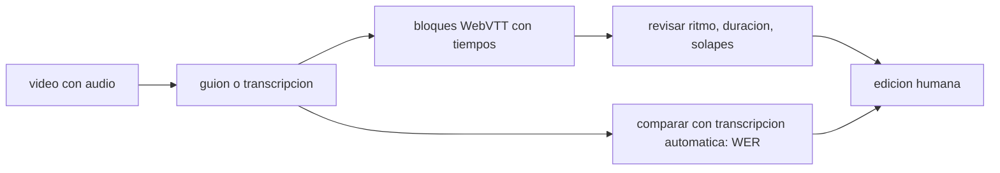

# B128-C05 — Subtítulos y transcripciones

<!-- nav:top -->
[🏠 Programa](../../../../README.md) · [📚 Bloque B128](../../../tronco-comun/B128-accesibilidad-e-inclusion-en-la-ensenanza-de-la-astronomia.md) · [← Anterior: B128-C04 — Documentos y contenidos para lectores de pantalla](../B128-C04-documentos-y-contenidos-para-lectores-de-pantalla/CLASE.md) · [Siguiente: B128-C06 — Contraste y color accesibles →](../B128-C06-contraste-y-color-accesibles/CLASE.md)
<!-- /nav -->

## 1. Ubicación, nivel y alcance

Clase 5 del bloque B128. Nivel N4. Un video de una clase de astronomía sin subtítulos deja fuera a las personas sordas o con dificultades de audición y a quien mira sin sonido. Aquí revisas un archivo de subtítulos en formato WebVTT (ritmo de lectura, duración, solapes) y mides el error de una transcripción automática. El guion y la «transcripción automática» son sintéticos; los umbrales de lectura son del curso y no se consultaron.

## 2. Por qué esta clase existe

Un subtítulo mal sincronizado o demasiado rápido no se alcanza a leer, y una transcripción automática sin revisar puede decir lo contrario de lo dicho. La decisión central: **¿cómo compruebo que los subtítulos se pueden leer y que no cambian el sentido?**

## 3. Lo que podrás hacer al terminar

1. Distinguir subtítulos, captions, transcripción y audiodescripción.
2. Leer un archivo WebVTT y calcular la velocidad de lectura de cada bloque.
3. Detectar bloques demasiado rápidos, largos, solapados o fuera de duración.
4. Calcular la tasa de error de palabras (WER) por programación dinámica.
5. Explicar por qué un WER bajo no garantiza el sentido.
6. Declarar qué umbral es consultado y cuál es del curso.

La evidencia es el **informe de calidad de subtítulos** del ejercicio 12 (sección 20).

## 4. Con qué llegas y cómo comprobarlo

1. ¿Qué es un subtítulo?
2. ¿Qué es una tasa por segundo?
3. ¿Qué es una distancia de edición entre dos textos?
4. ¿Qué es un dato sintético?
5. ¿Qué es una verificación por segunda vía?

<details>
<summary>Ver respuestas</summary>

1. Texto sincronizado con el audio de un video. 2. Una cantidad dividida por la duración en segundos. 3. El mínimo de inserciones, borrados y sustituciones para pasar de un texto a otro. 4. Un dato inventado para el ejemplo. 5. Calcular lo mismo con otro método y comparar.
</details>

Con cuatro o cinco aciertos, sigue; si no, repasa los prerrequisitos.

## 5. Un caso de contexto y casos de referencia

Un archivo de 5 bloques tiene **7 hallazgos**: el bloque 2 muestra 65,0 caracteres por segundo (4,0 a 5,2 s), el bloque 4 se solapa 0,5 s con el anterior y llega a 17,2 car/s, y el bloque 5 dura 8,5 s. Una transcripción automática que omite el «no» de «el brillo no cambia» tiene WER = 1/12 = 8,3 %, pero afirma lo contrario. Es el **ejemplo conductor**; todo es **sintético** o **ilustrativo**.

## 6. Vocabulario

Los **subtítulos** (captions) son texto sincronizado con el habla y con los sonidos no hablados relevantes. La **transcripción** es el texto completo, sin sincronía. La **audiodescripción** narra lo visual. **WebVTT** es el formato web común de subtítulos. El **WER** es `(S + D + I)/N`: sustituciones, borrados e inserciones sobre las palabras de referencia.

## 7. Modelo mental: un rótulo que debe leerse a tiempo



*Descripción textual:* del video sale un guion; se divide en bloques con tiempos que se revisan, y la transcripción automática se compara con el guion para medir el error; todo termina en edición humana.

Analogía: un rótulo de película que pasa demasiado rápido no se lee aunque esté bien escrito. Límite: el ritmo ideal depende de la persona lectora y del idioma; el umbral del curso es solo un punto de partida.

## 8. La explicación, paso a paso

### 8.1 Qué es cada cosa

W3C WAI distingue: los *captions* son el texto del habla y de los sonidos no hablados necesarios, sincronizados y normalmente activables; los *subtítulos* suelen ser traducciones a otro idioma; las transcripciones tienen el mismo texto que los captions; la audiodescripción describe lo visual. No hay que depender solo de captions automáticos: necesitan edición porque los errores pueden cambiar el sentido.

### 8.2 Ritmo de lectura

Velocidad: `caracteres / duración`. Bloque 1: `47 caracteres / 3,0 s = 15,7 car/s`. Bloque 2: `78/1,2 = 65,0 car/s`, casi cuatro veces el umbral ilustrativo de 17 car/s. Los umbrales del curso (17 car/s, 2 líneas, 37 caracteres por línea, 1–7 s) **no se consultaron**.

### 8.3 Estructura y tiempos

Cada bloque tiene inicio, fin y texto. El bloque 4 empieza en 8,0 s pero el 3 termina en 8,5 s: solape de 0,5 s. Un sonido no hablado como «[sonido de aplausos]» es información que los captions deben incluir si es relevante.

### 8.4 WER y sentido

Con referencia de 12 palabras y una hipótesis sin «no»: `D = 1`, `WER = 1/12 = 8,3 %`. Un WER pequeño puede ocultar un error que invierte el sentido. Por eso el criterio no es solo numérico: se revisa a mano lo que afirma el texto.

## 9. Magnitudes, símbolos y unidades

| Símbolo | Qué es | Unidad | Valor / nota |
|---|---|---|---|
| `cps` | velocidad de lectura | car/s | 15,7; 65,0; 17,2 |
| duración | fin − inicio | s | 3,0; 1,2; 8,5 |
| `S, D, I` | sustituciones, borrados, inserciones | conteo | 0; 1; 0 |
| `N` | palabras de la referencia | conteo | 12 |
| `WER` | `(S+D+I)/N` | % | 8,3 |

## 10. Convenciones y referencias

Tiempos `hh:mm:ss.mmm`, texto en español sin tildes en el laboratorio para evitar problemas de consola. Los umbrales de lectura son del curso. La tokenización del WER separa por caracteres alfanuméricos, en minúsculas y sin puntuación.

## 11. De dónde sale lo que afirmamos

| ID | Fuente | Localizador | Respalda | Estado |
|---|---|---|---|---|
| S1 | W3C WAI, Captions/Subtitles — https://www.w3.org/WAI/media/av/captions/ (consultada 2026-11-11) | página completa | definiciones de captions, subtítulos, transcripciones y audiodescripción; no confiar solo en captions automáticos; sincronización; WebVTT | Consultada |
| S2 | W3C, WCAG 2.2 — https://www.w3.org/TR/WCAG22/ (consultada 2026-11-11; solo el primer tramo del documento) | criterios 1.2.1 y 1.2.2 | los medios sincronizados pregrabados necesitan subtítulos (nivel A) | Consultada |
| — | Umbrales de velocidad de lectura de subtítulos; calidad de reconocimiento de voz en español | — | — | No consultada |

Límites: los umbrales numéricos son del curso; la tasa de error de la transcripción automática de este laboratorio es sintética y no describe ningún sistema real.

## 12. Cómo ver el informe

| Bloque | car/s | Hallazgos |
|---|---|---|
| 1 | 15,7 | línea larga |
| 2 | 65,0 | demasiado rápido, línea larga |
| 4 | 17,2 | solape, ritmo, línea larga |
| 5 | 1,5 | duración 8,5 s |

Descripción larga: 5 bloques, 7 hallazgos; el bloque 2 es el peor por ritmo y el 5 el único con duración excesiva.

## 13. Ejemplo trabajado: arreglar el bloque 2

**Paso 1 · Medida.** 78 caracteres en 1,2 s = 65,0 car/s.

**Paso 2 · Meta.** ≤ 17 car/s.

**Paso 3 · Duración necesaria.** `78/17 = 4,6 s` o bien partir el texto en dos bloques.

**Paso 4 · Corrección.** Dos bloques de 39 caracteres y 2,3 s cada uno (17,0 car/s).

## 14. Distintas formas de describir la calidad

**Por ritmo:** car/s. **Por forma:** líneas y ancho. **Por tiempo:** duración y solape. **Por sentido:** revisión humana contra el audio.

## 15. Práctica guiada

**Ejercicio 1 · con los pasos indicados.** Calcula car/s de un bloque de 51 caracteres en 3 s. *Pasos:* divide.

<details><summary>Solución comentada</summary>

`51/3 = 17,0 car/s`, en el umbral.
</details>

**Ejercicio 2 · con una pista.** ¿Cuánto debe durar un bloque de 85 caracteres a 17 car/s? *Pista:* `85/17`.

<details><summary>Solución comentada</summary>

5,0 s.
</details>

**Ejercicio 3 · casi autónomo.** ¿Cómo se calcula el WER si la hipótesis inserta una palabra?

<details><summary>Solución comentada</summary>

`I = 1`; `WER = 1/N`.
</details>

## 16. Práctica autónoma, transferencia e integrador

**Ejercicio 4 · autónomo.** WER con 2 sustituciones y 1 borrado sobre 20 palabras.

<details><summary>Solución comentada</summary>

`3/20 = 15 %`.
</details>

**Ejercicio 5 · autónomo.** ¿Qué hallazgos tiene un bloque de 0,5 s?

<details><summary>Solución comentada</summary>

Duración fuera de [1,0; 7,0] s (con el umbral del curso).
</details>

**Ejercicio 6 · autónomo.** Parte un bloque de 70 caracteres en dos de 2,1 s cada uno.

<details><summary>Solución comentada</summary>

35 caracteres en 2,1 s = 16,7 car/s; cumple.
</details>

**Ejercicio 7 · autónomo.** ¿Qué sonidos no hablados incluirías en una clase de observatorio?

<details><summary>Solución comentada</summary>

Los que aportan información: «[alarma de la cúpula]», «[aplausos]»; los decorativos se omiten.
</details>

**Ejercicio 8 · autónomo.** Convierte los subtítulos en una transcripción.

<details><summary>Solución comentada</summary>

Une los textos sin tiempos, con indicación de quién habla.
</details>

**Ejercicio 9 · transferencia.** **Transferencia.** Un video usa captions automáticos con WER 5 %. ¿Es suficiente?

<details><summary>Solución comentada</summary>

No necesariamente: un solo error puede invertir el sentido; hay que revisarlo (S1).
</details>

**Ejercicio 10 · transferencia.** **Transferencia.** Un video solo con imágenes de un tránsito y sin audio. ¿Qué necesita?

<details><summary>Solución comentada</summary>

Una alternativa para video sin audio: descripción o transcripción de lo visual (criterio 1.2.1).
</details>

**Ejercicio 11 · transferencia.** **Transferencia.** ¿Por qué el umbral de 17 car/s podría no servir en otro idioma o para otra audiencia?

<details><summary>Solución comentada</summary>

La lectura depende del idioma, del sistema de escritura y de la persona; el umbral es del curso y no se consultó.
</details>

**Ejercicio 12 · integrador.** **Integrador.** Elabora tu *informe de calidad de subtítulos* de un video de 1 minuto: bloques, car/s, hallazgos, correcciones, WER de una transcripción automática contra tu guion y revisión de sentido.

<details><summary>Solución comentada</summary>

Secciones 8.2–8.4 y la salida del laboratorio.
</details>

## 17. Laboratorio: subtítulos y WER

El script [subtitulos.py](subtitulos.py) analiza un WebVTT sintético y calcula el WER por programación dinámica (**comprueba** contra una recursión con memoria y una hipótesis idéntica).

**Datos:** guion y transcripción **sintéticos**; umbrales **del curso**. **Predice antes de ejecutar:** ¿cuántos hallazgos habrá? (7.) **Ejecución del 2026-11-11 (Python 3.12.9):**

```text
Python 3.12.9 (biblioteca estandar)
Guion y 'transcripcion automatica' SINTETICOS; umbrales de lectura ILUSTRATIVOS (no consultados).
Cues: 5
  1:   1.0-  4.0 s   15.7 car/s
  2:   4.0-  5.2 s   65.0 car/s
  3:   5.5-  8.5 s    6.7 car/s
  4:   8.0- 12.0 s   17.2 car/s
  5:  12.0- 20.5 s    1.5 car/s
Hallazgos de formato: 7
  - cue 1: linea > 37 car
  - cue 2: 65.0 car/s > 17.0
  - cue 2: linea > 37 car
  - cue 4: 17.2 car/s > 17.0
  - cue 4: linea > 37 car
  - cue 4: se solapa con el anterior (0.5 s)
  - cue 5: duracion 8.5 s fuera de [1.0,7.0]
Referencia: 12 palabras; hipotesis: 11; errores = 1; WER = 8.3 %
Un WER bajo no garantiza el sentido: la hipotesis OMITE 'no' y afirma lo contrario con un solo error.
Pruebas superadas.
```

```bash
python programa/clases/B128/B128-C05-subtitulos-y-transcripciones/subtitulos.py
```

**Límites:** el WER ignora el significado; el análisis no oye el audio.

## 18. Errores frecuentes y cómo corregirlos

**Publicar captions automáticos sin revisar.** Se corrige con 8.4.

**Confundir subtítulos y transcripción.** Se corrige con 8.1.

**Poner mucho texto en poco tiempo.** Se corrige con el ejemplo 13.

**Omitir los sonidos relevantes.** Se corrige con el ejercicio 7.

## 19. Cómo sabrás que vas bien

Tras la sección 8: ¿qué car/s esperabas para el bloque 2 y cuál obtuviste? Si dudas, repasa el ejemplo 13. Tras el laboratorio: ¿qué comprueba? (ver la sección 17).

## 20. Qué entregas y cómo se evalúa

El producto es tu **informe de calidad de subtítulos** (ejercicio 12).

| Criterio | Inicial | En desarrollo | Logrado | Destacado |
|---|---|---|---|---|
| Conceptos | Los confunde | Parciales | Distingue captions, transcripción y audiodescripción | Explica los límites |
| Cálculo | Sin unidades | Con errores | car/s y WER correctos | Calcula casos nuevos |
| Numérico | Sin comprobar | Un caso | Contraste con una segunda vía | Interpreta las diferencias |
| Fuentes | Sin fuente | Sin fecha | Fuentes con fecha y estado | Declara lo del curso y lo no consultado |
| Límites | No los nombra | Uno | Tres | Discute qué falta del informe |

**Condiciones críticas (no se compensan con promedio):** revisar el sentido además del WER; rotular los umbrales como del curso; citar solo lo consultado.

## 21. Ética, seguridad y límites

Clase educativa y respetuosa: los subtítulos benefician a muchas personas y se diseñan con las comunidades sordas y con dificultades de audición, no «para» ellas. Los datos son sintéticos. Accesibilidad: tablas equivalentes a las gráficas, fórmulas en texto, ejercicios sin conexión.

## 22. Para cerrar y seguir

Cinco bloques, siete hallazgos y un WER de 8,3 % que oculta una inversión de sentido. Queda una pregunta: ¿cómo se elige un color que todas las personas puedan leer?

**Glosario español–inglés.** subtítulos (captions) · *captions*; transcripción · *transcript*; audiodescripción · *audio description*; tasa de error de palabras · *word error rate*; sincronización · *synchronization*.

**Continuidad.** [B128-C06](../B128-C06-contraste-y-color-accesibles/CLASE.md) trata el contraste y el color.

**Referencias:** ver sección 11.

<!-- nav:bottom -->
---

[← Anterior: B128-C04 — Documentos y contenidos para lectores de pantalla](../B128-C04-documentos-y-contenidos-para-lectores-de-pantalla/CLASE.md) · [📚 Bloque B128](../../../tronco-comun/B128-accesibilidad-e-inclusion-en-la-ensenanza-de-la-astronomia.md) · [Siguiente: B128-C06 — Contraste y color accesibles →](../B128-C06-contraste-y-color-accesibles/CLASE.md)
<!-- /nav -->
