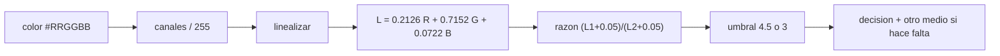

# B128-C06 — Contraste y color accesibles

<!-- nav:top -->
[🏠 Programa](../../../../README.md) · [📚 Bloque B128](../../../tronco-comun/B128-accesibilidad-e-inclusion-en-la-ensenanza-de-la-astronomia.md) · [← Anterior: B128-C05 — Subtítulos y transcripciones](../B128-C05-subtitulos-y-transcripciones/CLASE.md) · [Siguiente: B128-C07 — Modelos táctiles y sonificación →](../B128-C07-modelos-tactiles-y-sonificacion/CLASE.md)
<!-- /nav -->

## 1. Ubicación, nivel y alcance

Clase 6 del bloque B128. Nivel N4. Las presentaciones de astronomía abundan en fondos oscuros, imágenes en falso color y leyendas de colores. Aquí calculas la razón de contraste de WCAG 2.2 a partir de la luminancia relativa de colores sRGB, la comparas con los umbrales publicados y revisas una leyenda sintética para ver si el color es el único medio de distinguir las series. Las paletas son sintéticas; los umbrales y la fórmula provienen de WCAG 2.2.

## 2. Por qué esta clase existe

Un texto gris claro sobre blanco, un azul puro sobre negro o una leyenda donde solo cambia el tono se pierden para quien tiene baja visión, daltonismo o una pantalla poco luminosa. La decisión central: **¿cómo compruebo con números que un par de colores se lee, y cuándo el color no basta?**

## 3. Lo que podrás hacer al terminar

1. Calcular la luminancia relativa de un color sRGB.
2. Calcular la razón de contraste entre dos colores.
3. Aplicar los umbrales de 4,5:1 (texto) y 3:1 (texto grande y gráficos).
4. Comprobar tu código con valores conocidos (21:1, 1:1, 4,54).
5. Detectar cuándo solo el color distingue las series de una leyenda.
6. Separar lo consultado (fórmula y umbrales) de lo ilustrativo (paletas).

La evidencia es la **ficha de paleta accesible** del ejercicio 12 (sección 20).

## 4. Con qué llegas y cómo comprobarlo

1. ¿Qué es un canal de color de 8 bits?
2. ¿Qué es una potencia 2,4?
3. ¿Qué es una razón?
4. ¿Qué es un dato sintético?
5. ¿Qué es una verificación por segunda vía?

<details>
<summary>Ver respuestas</summary>

1. Un valor entero de 0 a 255 para rojo, verde o azul. 2. Elevar a la 2,4. 3. Un cociente de dos cantidades. 4. Un dato inventado para el ejemplo. 5. Calcular lo mismo con otro método y comparar.
</details>

Con cuatro o cinco aciertos, sigue; si no, repasa los prerrequisitos.

## 5. Un caso de contexto y casos de referencia

Texto negro sobre blanco: `21,00:1`. Gris `#767676` sobre blanco: `4,54:1` (pasa el 4,5). Gris `#777777`: `4,48:1`, que **no** pasa: WCAG no redondea. Rojo `#FF0000` sobre negro, típico del modo nocturno: `5,25:1`. Azul `#0000FF` sobre negro: `2,44:1`, no pasa. Es el **ejemplo conductor**; las paletas son **sintéticas**.

## 6. Vocabulario

La **luminancia relativa** `L` es el brillo percibido de un color, de 0 (negro) a 1 (blanco). La **razón de contraste** `(L₁ + 0,05)/(L₂ + 0,05)` va de 1 a 21. **Texto grande** es de al menos 18 pt, o 14 pt en negrita. **sRGB** es el espacio de color de las pantallas. El **uso del color** pide que el color no sea el único medio de transmitir información.

## 7. Modelo mental: contar la luz, no el tono



*Descripción textual:* se normalizan los canales, se linealizan, se combinan en luminancia, se calcula la razón entre dos colores y se compara con el umbral; si no basta, se añade otro medio (etiqueta o patrón).

Analogía: dos luces se distinguen por cuánta luz emiten, no por su color. Límite: la razón no considera tamaño, grosor del trazo ni brillo de la pantalla.

## 8. La explicación, paso a paso

### 8.1 Fórmulas (WCAG 2.2)

Cada canal `c = valor/255` se linealiza: si `c ≤ 0,04045`, `c/12,92`; si no, `((c + 0,055)/1,055)^2,4`. Luego `L = 0,2126 R + 0,7152 G + 0,0722 B`. La razón es `(L₁ + 0,05)/(L₂ + 0,05)` con `L₁` el color más claro. Los valores no se redondean: 4,499 no cumple 4,5.

### 8.2 Umbrales

Texto normal: 4,5:1; texto grande: 3:1; componentes gráficos y estados necesarios: 3:1 (criterio 1.4.11). El color no puede ser el único medio de transmitir información (1.4.1).

### 8.3 Tabla de pares

| Par | Razón | Texto 4,5 | Grande 3,0 |
|---|---|---|---|
| negro sobre blanco | 21,00 | pasa | pasa |
| `#767676` sobre blanco | 4,54 | pasa | pasa |
| `#777777` sobre blanco | 4,48 | no | pasa |
| `#FF0000` sobre negro | 5,25 | pasa | pasa |
| `#800000` sobre negro | 1,92 | no | no |
| `#0000FF` sobre negro | 2,44 | no | no |
| `#FFD400` sobre blanco | 1,43 | no | no |

### 8.4 Leyenda y uso del color

La leyenda sintética (`#1B3A6B`, `#2E8B57`, `#D95F02`) pasa 3:1 contra el blanco en las tres series, pero «templado» y «caliente» solo se separan por `1,13:1` de luminancia. Si dos series dependen del tono, una persona con visión de color diferente podría no distinguirlas: hay que agregar etiquetas o patrones. Según el NEI, alrededor de 1 de cada 12 hombres tiene alguna deficiencia de visión de color; el dato no se usa para decidir umbrales.

## 9. Magnitudes, símbolos y unidades

| Símbolo | Qué es | Unidad | Valor / nota |
|---|---|---|---|
| `c` | canal normalizado | — | 0 a 1 |
| `L` | luminancia relativa | — | 0 a 1 |
| razón | contraste | `n:1` | 1 a 21 |
| umbral texto | mínimo AA | `n:1` | 4,5 |
| umbral grande / gráficos | mínimo AA | `n:1` | 3 |

## 10. Convenciones y referencias

Colores sRGB de 8 bits. Fórmulas y umbrales de WCAG 2.2. El umbral de 1,2 para decidir si dos series se distinguen por luminancia es **del curso** y no se consultó. El laboratorio no simula daltonismo.

## 11. De dónde sale lo que afirmamos

| ID | Fuente | Localizador | Respalda | Estado |
|---|---|---|---|---|
| S1 | W3C WAI, Understanding 1.4.3 — https://www.w3.org/WAI/WCAG22/Understanding/contrast-minimum.html (consultada 2026-11-11) | página completa | fórmula de luminancia y de razón; 4,5:1 y 3:1; sin redondeo; texto grande 18 pt o 14 pt negrita | Consultada |
| S2 | W3C, WCAG 2.2 — https://www.w3.org/TR/WCAG22/ (consultada 2026-11-11; solo el primer tramo) | criterios 1.4.1, 1.4.3 y 1.4.11 | el color no es el único medio; 4,5:1; 3:1 para componentes gráficos | Consultada |
| S3 | W3C WAI, Understanding 1.4.1 — https://www.w3.org/WAI/WCAG22/Understanding/use-of-color.html (consultada 2026-11-11) | página completa | quién se beneficia y técnicas (texto, patrones, iconos) | Consultada |
| S4 | NEI/NIH, Color blindness — https://www.nei.nih.gov/learn-about-eye-health/eye-conditions-and-diseases/color-blindness (consultada 2026-11-11) | página completa | aproximadamente 1 de cada 12 hombres tiene deficiencia de visión de color | Consultada |
| — | Simulación de daltonismo; paletas «seguras» publicadas | — | — | No consultada |

Límites: la razón de contraste es una condición necesaria, no suficiente; no se probó nada con personas.

## 12. Cómo ver el contraste

| Magnitud | Valor |
|---|---|
| negro/blanco | 21,00:1 |
| `#767676`/blanco | 4,54:1 |
| `#777777`/blanco | 4,48:1 |
| rojo/negro | 5,25:1 |
| templado/caliente | 1,13:1 |

Descripción larga: el umbral de 4,5 separa dos grises casi idénticos, y una leyenda puede pasar contra el fondo y aun así fallar entre series.

## 13. Ejemplo trabajado: rojo sobre negro

**Paso 1 · Linealizar.** Rojo `255 → 1,0`; verde y azul `0 → 0`.

**Paso 2 · Luminancia.** `L = 0,2126 × 1 = 0,2126`; negro `L = 0`.

**Paso 3 · Razón.** `(0,2126 + 0,05)/(0 + 0,05) = 5,252`.

**Paso 4 · Decisión.** `5,25 ≥ 4,5`: pasa para texto normal.

## 14. Distintas formas de describir un color

**Por canales:** `#RRGGBB`. **Por luminancia:** `L`. **Por razón:** contra un fondo. **Por función:** texto, gráfico o fondo. **Por redundancia:** color más texto o patrón.

## 15. Práctica guiada

**Ejercicio 1 · con los pasos indicados.** Calcula la razón de `#FFFFFF` sobre `#000000`. *Pasos:* `L = 1` y `L = 0`.

<details><summary>Solución comentada</summary>

`(1 + 0,05)/(0 + 0,05) = 21`.
</details>

**Ejercicio 2 · con una pista.** ¿Por qué `#777777` no pasa? *Pista:* no se redondea.

<details><summary>Solución comentada</summary>

Da 4,48, menor que 4,5.
</details>

**Ejercicio 3 · casi autónomo.** ¿Cuál es la razón entre un color y sí mismo?

<details><summary>Solución comentada</summary>

1:1; es el mínimo.
</details>

## 16. Práctica autónoma, transferencia e integrador

**Ejercicio 4 · autónomo.** ¿Pasa `#FFD400` sobre blanco como texto grande?

<details><summary>Solución comentada</summary>

1,43 < 3: no.
</details>

**Ejercicio 5 · autónomo.** ¿Cuántos puntos de píxel mide 14 pt?

<details><summary>Solución comentada</summary>

`14 × 1,333 ≈ 18,7 px` (S1 indica 18,5 px).
</details>

**Ejercicio 6 · autónomo.** Un texto tiene razón 3,8. ¿Cuándo es válido?

<details><summary>Solución comentada</summary>

Solo si es texto grande (≥ 3).
</details>

**Ejercicio 7 · autónomo.** Para dos series con razón 1,13, propón dos refuerzos.

<details><summary>Solución comentada</summary>

Etiqueta directa en la curva y patrón de línea (punteada/continua).
</details>

**Ejercicio 8 · autónomo.** Explica por qué la razón es simétrica.

<details><summary>Solución comentada</summary>

Se usa siempre el más claro como `L₁`; por eso `razon(a,b) = razon(b,a)`.
</details>

**Ejercicio 9 · transferencia.** **Transferencia.** Una presentación astronómica usa texto azul puro sobre fondo negro. ¿Qué haces?

<details><summary>Solución comentada</summary>

La razón es 2,44: no pasa; se cambia a un azul más claro o a blanco y se vuelve a medir.
</details>

**Ejercicio 10 · transferencia.** **Transferencia.** Una imagen en falso color con escala solo de colores. ¿Qué agregar?

<details><summary>Solución comentada</summary>

Valores numéricos en la barra, contornos o etiquetas, y descripción textual de qué indica cada rango.
</details>

**Ejercicio 11 · transferencia.** **Transferencia.** ¿Qué no sabes sobre cómo ven los colores tus estudiantes?

<details><summary>Solución comentada</summary>

Nada de lo calculado describe a personas concretas; la razón es un criterio, no una medición del usuario; se prueba con ellas.
</details>

**Ejercicio 12 · integrador.** **Integrador.** Elabora tu *ficha de paleta accesible*: 5 pares de tu material, razón de cada uno, veredicto (texto/gráfico) y el refuerzo no cromático donde el color sea el único medio.

<details><summary>Solución comentada</summary>

Secciones 8.1–8.4 y la salida del laboratorio.
</details>

## 17. Laboratorio: razón de contraste

El script [contraste.py](contraste.py) implementa luminancia y razón WCAG, comprueba valores conocidos y evalúa pares y una leyenda (**comprueba** 21:1, 1:1, 4,54, 4,48 y simetría).

**Datos:** fórmula y umbrales **consultados**; paletas **sintéticas**; umbral de 1,2 **del curso**. **Predice antes de ejecutar:** ¿pasa `#777777` sobre blanco? (no: 4,48.) **Ejecución del 2026-11-11 (Python 3.12.9):**

```text
Python 3.12.9 (biblioteca estandar)
Formula y umbrales: WCAG 2.2 Understanding 1.4.3 (consultado 2026-11-11). Paletas SINTETICAS.
Pruebas de la implementacion superadas (21:1, 1:1, 4.54, 4.48, simetria).
par                                            razon  texto 4.5  grande 3.0
texto negro sobre blanco                       21.00  pasa      pasa
gris #767676 sobre blanco                       4.54  pasa      pasa
gris #777777 sobre blanco                       4.48  NO pasa   pasa
rojo #FF0000 sobre negro (modo nocturno)        5.25  pasa      pasa
rojo oscuro #800000 sobre negro                 1.92  NO pasa   NO pasa
azul #0000FF sobre negro                        2.44  NO pasa   NO pasa
amarillo #FFD400 sobre blanco                   1.43  NO pasa   NO pasa
Leyenda SINTETICA contra fondo blanco (1.4.11 pide >= 3):
  frio      #1B3A6B  razon 11.27  pasa
  templado  #2E8B57  razon  4.25  pasa
  caliente  #D95F02  razon  3.76  pasa
Distincion por luminancia entre series (si es < 1.2 hace falta etiqueta o patron, 1.4.1; umbral del curso):
  frio      vs templado :  2.65  distinguible por luminancia
  frio      vs caliente :  3.00  distinguible por luminancia
  templado  vs caliente :  1.13  solo color insuficiente
Pruebas superadas.
```

```bash
python programa/clases/B128/B128-C06-contraste-y-color-accesibles/contraste.py
```

**Límites:** no simula daltonismo ni considera tamaño del trazo ni brillo de pantalla.

## 18. Errores frecuentes y cómo corregirlos

**Redondear 4,48 a 4,5.** Se corrige con 8.1.

**Pasar solo contra el fondo y no entre series.** Se corrige con 8.4.

**Usar el color como único medio.** Se corrige con el ejercicio 7.

**Creer que la razón garantiza legibilidad.** Se corrige con la sección 10.

## 19. Cómo sabrás que vas bien

Tras la sección 8: ¿qué razón esperabas para rojo sobre negro y cuál obtuviste? Si dudas, repasa el ejemplo 13. Tras el laboratorio: ¿qué comprueba? (ver la sección 17).

## 20. Qué entregas y cómo se evalúa

El producto es tu **ficha de paleta accesible** (ejercicio 12).

| Criterio | Inicial | En desarrollo | Logrado | Destacado |
|---|---|---|---|---|
| Conceptos | Los confunde | Parciales | Distingue razón y uso del color | Explica los límites |
| Cálculo | Sin unidades | Con errores | Razones correctas | Calcula casos nuevos |
| Numérico | Sin comprobar | Un caso | Valores conocidos verificados | Interpreta las diferencias |
| Fuentes | Sin fuente | Sin fecha | Fuentes con fecha y estado | Declara lo del curso y lo no consultado |
| Límites | No los nombra | Uno | Tres | Discute qué falta del método |

**Condiciones críticas (no se compensan con promedio):** no redondear los umbrales; no usar el color como único medio; citar solo lo consultado.

## 21. Ética, seguridad y límites

Clase educativa y respetuosa: el color se diseña para que no excluya, sin etiquetar a las personas por cómo ven. Las paletas son sintéticas y la razón no sustituye la prueba con personas. Accesibilidad: tablas equivalentes a las gráficas, fórmulas en texto, ejercicios sin conexión.

## 22. Para cerrar y seguir

`#777777` falla con 4,48 y `#767676` pasa con 4,54, y una leyenda puede pasar contra el fondo y fallar entre series. Queda una pregunta: ¿cómo se comunica una curva de luz sin vista?

**Glosario español–inglés.** luminancia relativa · *relative luminance*; razón de contraste · *contrast ratio*; texto grande · *large text*; falso color · *false color*; uso del color · *use of color*.

**Continuidad.** [B128-C07](../B128-C07-modelos-tactiles-y-sonificacion/CLASE.md) convierte datos en relieve y sonido.

**Referencias:** ver sección 11.

<!-- nav:bottom -->
---

[← Anterior: B128-C05 — Subtítulos y transcripciones](../B128-C05-subtitulos-y-transcripciones/CLASE.md) · [📚 Bloque B128](../../../tronco-comun/B128-accesibilidad-e-inclusion-en-la-ensenanza-de-la-astronomia.md) · [Siguiente: B128-C07 — Modelos táctiles y sonificación →](../B128-C07-modelos-tactiles-y-sonificacion/CLASE.md)
<!-- /nav -->
