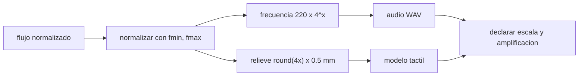

# B128-C07 — Modelos táctiles y sonificación

<!-- nav:top -->
[🏠 Programa](../../../../README.md) · [📚 Bloque B128](../../../tronco-comun/B128-accesibilidad-e-inclusion-en-la-ensenanza-de-la-astronomia.md) · [← Anterior: B128-C06 — Contraste y color accesibles](../B128-C06-contraste-y-color-accesibles/CLASE.md) · [Siguiente: B128-C08 — Lenguaje claro y redacción accesible →](../B128-C08-lenguaje-claro-y-redaccion-accesible/CLASE.md)
<!-- /nav -->

## 1. Ubicación, nivel y alcance

Clase 7 del bloque B128. Nivel N4. Una curva de luz es un gráfico; también puede ser un sonido o un relieve. Aquí conviertes una curva de luz **sintética** de un tránsito (caída de 1 %) en una secuencia de frecuencias (mapeo logarítmico de 220 a 880 Hz) y en un relieve de cinco niveles con paso de 0,5 mm, y compruebas qué información conserva cada mapeo. No usas datos de ninguna estrella real ni ninguna evaluación con personas.

## 2. Por qué esta clase existe

Un mapeo sin reglas explícitas engaña: si la escala de tono se estira para que se oiga una caída de 1 %, el oyente puede creer que la caída fue enorme. La decisión central: **¿qué se mapea a qué, con qué escala, y cómo se avisa de la amplificación?**

## 3. Lo que podrás hacer al terminar

1. Definir un mapeo de flujo a frecuencia y comprobar que es monótono.
2. Calcular el rango musical en semitonos y la razón de frecuencias.
3. Cuantizar un flujo en relieve de cinco niveles con paso explícito.
4. Generar un audio WAV determinista y verificarlo con su hash.
5. Declarar la amplificación del eje y la pérdida de resolución.
6. Separar lo consultado (revisión de proyectos sonoros) de lo ilustrativo (parámetros).

La evidencia es la **ficha de mapeo sonoro y táctil** del ejercicio 12 (sección 20).

## 4. Con qué llegas y cómo comprobarlo

1. ¿Qué es una curva de luz?
2. ¿Qué es una octava?
3. ¿Qué es un mapeo logarítmico?
4. ¿Qué es un dato sintético?
5. ¿Qué es una verificación por segunda vía?

<details>
<summary>Ver respuestas</summary>

1. El brillo de un astro en función del tiempo. 2. Una duplicación de la frecuencia. 3. Un mapeo en que cocientes iguales dan diferencias iguales. 4. Un dato inventado para el ejemplo. 5. Calcular lo mismo con otro método y comparar.
</details>

Con cuatro o cinco aciertos, sigue; si no, repasa los prerrequisitos.

## 5. Un caso de contexto y casos de referencia

La curva sintética tiene 60 puntos (0,1 s cada uno) con un tránsito de profundidad 1 %: flujo `1,0000` fuera y `0,9900` en el fondo. El mapeo `f = 220 × 4^((flujo − fmin)/(fmax − fmin))` lleva 0,9900 a 220 Hz y 1,0000 a 880 Hz: **24 semitonos para una caída de 1 %**. El relieve usa alturas de 0 a 2,0 mm. Es el **ejemplo conductor**; todo es **sintético** o **ilustrativo**.

## 6. Vocabulario

La **sonificación** representa datos con sonido. El **mapeo** asocia un valor a un tono. Un **semitono** es un doceavo de octava. El **relieve** o modelo táctil representa un valor como altura. La **cuantización** reduce un valor continuo a unos niveles. La **amplificación del eje** es ensanchar un rango pequeño para que se note.

## 7. Modelo mental: un gráfico que se oye y se toca



*Descripción textual:* el flujo se normaliza y de ahí salen la frecuencia (audio) y el relieve (modelo táctil); en ambos casos se declara la escala y la amplificación.

Analogía: un mapa con la escala impresa. Límite: la elección de mapeo (subir el tono con el brillo) es una convención que debe explicarse; no es universal.

## 8. La explicación, paso a paso

### 8.1 Qué revisa la literatura

Zanella et al. (2022) revisan cerca de cien proyectos que usan sonido en astronomía; según el resumen consultado, sirven para investigación, educación y divulgación, y para hacer accesible la astronomía a personas ciegas o con baja visión, y se discuten sus limitaciones. Solo se consultó el resumen.

### 8.2 Mapeo sonoro

`x = (flujo − fmin)/(fmax − fmin)`; `f = 220 × 4^x`. Con `x = 0` (fondo del tránsito) `f = 220 Hz`; con `x = 1`, `880 Hz`. Con `x = 0,5`, `440 Hz`; con `x = 0,6` (punto 21 del ingreso), `505,4 Hz`. Se comprueba que `fmax/fmin = 4` y que la secuencia sube al salir del tránsito.

### 8.3 Mapeo táctil

`nivel = round(4x)` y `altura = 0,5 mm × nivel`: 0, 0,5, 1,0, 1,5 y 2,0 mm. El ingreso, que pasa gradualmente de 1,0000 a 0,9900, queda en escalones.

### 8.4 Qué decir al usuario

Hay que decir que el eje está amplificado (1 % de caída se oye como dos octavas), que arriba significa más brillo y que el relieve tiene solo cinco niveles. Hay que dar también la tabla de datos. La decisión de qué mapeo es más comprensible requiere probarlo con personas; esta clase no lo hizo.

## 9. Magnitudes, símbolos y unidades

| Símbolo | Qué es | Unidad | Valor / nota |
|---|---|---|---|
| flujo | brillo normalizado | — | 0,9900 a 1,0000 |
| `f` | frecuencia | Hz | 220 a 880 |
| `fs` | frecuencia de muestreo | Hz | 8000 |
| altura | relieve | mm | 0 a 2,0 |
| `N` | puntos | — | 60 |

## 10. Convenciones y referencias

Flujo adimensional normalizado a 1 fuera del tránsito. Tono mayor con brillo mayor (convención del curso). Los parámetros (220–880 Hz, 0,1 s por punto, cinco niveles, 0,5 mm) son del curso y no se consultaron. El audio se genera en memoria; el hash es del sistema del laboratorio.

## 11. De dónde sale lo que afirmamos

| ID | Fuente | Localizador | Respalda | Estado |
|---|---|---|---|---|
| S1 | Zanella et al. (2022), arXiv:2206.13536 — https://arxiv.org/abs/2206.13536 (resumen consultado 2026-11-11) | resumen | revisión de cerca de cien proyectos de sonificación, con usos en investigación, educación y accesibilidad, y discusión de limitaciones | Consultada (solo el resumen) |
| S2 | I-OAE (IAU), Accessible Prints — https://oae.inaf.it/projects/educational-resources/accessible-prints (consultada 2026-11-11) | página completa | impresoras táctiles de relieve y 3D, usadas para modelos de telescopios, imágenes y mapas táctiles de fases lunares | Consultada |
| — | Texto completo de Zanella et al.; evaluación del espectáculo «Audio Universe» de Harrison et al.; evidencia de eficacia táctil o sonora | — | solo aparecieron en una búsqueda | No consultada |

Límites: la cifra de «cerca de cien proyectos» viene del resumen consultado; no se consultaron resultados de evaluación con personas y no se afirma que el mapeo del laboratorio sea comprensible.

## 12. Cómo ver el mapeo

| Magnitud | Valor |
|---|---|
| frecuencias | 220,0–880,0 Hz |
| rango | 24,0 semitonos |
| niveles de relieve | 5 (0 a 2,0 mm) |
| audio | 48 000 muestras, 6,0 s |

Descripción larga: la caída de 1 % se amplifica a dos octavas y a cinco niveles táctiles; el ingreso gradual aparece como escalones.

## 13. Ejemplo trabajado: un punto del ingreso

**Paso 1 · Dato.** Punto 21, flujo `0,9960`.

**Paso 2 · Normalizar.** `x = (0,9960 − 0,9900)/0,0100 = 0,6`.

**Paso 3 · Frecuencia.** `220 × 4^0,6 = 505,4 Hz`.

**Paso 4 · Relieve.** `round(4 × 0,6) = 2` → 1,0 mm.

## 14. Distintas formas de describir una curva de luz

**Gráfico:** puntos y línea. **Tabla:** tiempo y flujo. **Sonido:** frecuencia por punto. **Relieve:** altura por punto. **Texto:** «el brillo cae 1 % durante 1,2 s y vuelve».

## 15. Práctica guiada

**Ejercicio 1 · con los pasos indicados.** Frecuencia para `x = 0,5`. *Pasos:* `4^0,5 = 2`; multiplica por 220.

<details><summary>Solución comentada</summary>

`440 Hz`.
</details>

**Ejercicio 2 · con una pista.** Relieve para `x = 0,25`. *Pista:* `round(4x) = 1`.

<details><summary>Solución comentada</summary>

0,5 mm.
</details>

**Ejercicio 3 · casi autónomo.** ¿Cuántos semitonos hay entre 220 y 880 Hz?

<details><summary>Solución comentada</summary>

`12 × log₂(4) = 24`.
</details>

## 16. Práctica autónoma, transferencia e integrador

**Ejercicio 4 · autónomo.** ¿Cuántas muestras tiene un audio de 60 puntos de 0,1 s a 8000 Hz?

<details><summary>Solución comentada</summary>

`60 × 800 = 48 000`.
</details>

**Ejercicio 5 · autónomo.** ¿Por qué el mapeo es logarítmico?

<details><summary>Solución comentada</summary>

Porque el oído percibe los intervalos por cocientes de frecuencia; pasos iguales de flujo dan intervalos musicales iguales.
</details>

**Ejercicio 6 · autónomo.** Con profundidad 0,5 %, ¿cambia el rango sonoro?

<details><summary>Solución comentada</summary>

No: el mapeo normaliza con `fmin` y `fmax`; sigue siendo 24 semitonos. Por eso hay que declarar la amplificación.
</details>

**Ejercicio 7 · autónomo.** ¿Cuántos niveles de relieve usarías para distinguir 8 valores?

<details><summary>Solución comentada</summary>

8 niveles como mínimo; con 5 se pierde resolución (ver C03).
</details>

**Ejercicio 8 · autónomo.** Redacta la frase de declaración del eje para el usuario.

<details><summary>Solución comentada</summary>

«El tono sube con el brillo; la escala de 2 octavas representa una caída de solo 1 %».
</details>

**Ejercicio 9 · transferencia.** **Transferencia.** Un colega afirma que el sonido es «mejor» que el gráfico para personas ciegas. ¿Qué respondes?

<details><summary>Solución comentada</summary>

No hay evidencia consultada aquí que lo respalde; depende de la tarea y de las personas, y se prueba con ellas.
</details>

**Ejercicio 10 · transferencia.** **Transferencia.** Dos tránsitos de profundidades 1 % y 5 % se sonifican por separado con normalización propia. ¿Qué problema aparece?

<details><summary>Solución comentada</summary>

Suenan igual de «profundos»; hay que normalizar con la misma escala o declarar la diferencia.
</details>

**Ejercicio 11 · transferencia.** **Transferencia.** Un modelo táctil impreso de 2,0 mm de relieve máximo, ¿qué debe ir junto a él?

<details><summary>Solución comentada</summary>

Una leyenda táctil y en texto con la escala, la tabla de datos y las unidades.
</details>

**Ejercicio 12 · integrador.** **Integrador.** Elabora tu *ficha de mapeo sonoro y táctil* de una curva de luz sintética: mapeo, escala, amplificación, tabla de puntos, hash del audio y lista de qué es consultado e ilustrativo.

<details><summary>Solución comentada</summary>

Secciones 8.2–8.4 y la salida del laboratorio.
</details>

## 17. Laboratorio: curva de luz en tono y relieve

El script [sonificacion.py](sonificacion.py) genera la curva, las frecuencias, el relieve y un audio WAV en memoria (**comprueba** la monotonía, la razón de 4, el número de muestras y un hash estable).

**Datos:** curva **sintética**; parámetros **ilustrativos**. **Predice antes de ejecutar:** ¿cuántos semitonos abarca el rango? (24.) **Ejecución del 2026-11-11 (Python 3.12.9):**

```text
Python 3.12.9 (biblioteca estandar)
Curva SINTETICA de transito (profundidad 1 %); parametros de mapeo ILUSTRATIVOS (no consultados).
Flujo: min 0.9900, max 1.0000; frecuencias 220.0-880.0 Hz (razon 4.000)
Rango musical: 24.0 semitonos para una caida de 1 % (el eje se AMPLIFICA; hay que decirlo)
Relieve: alturas distintas [0.0, 0.5, 1.0, 1.5, 2.0] mm; maximo 2.0 mm
Puntos de cambio (i, flujo, Hz, relieve mm): 19: 1.0000, 880.0, 2.0; 21: 0.9960, 505.4, 1.0; 24: 0.9900, 220.0, 0.0; 30: 0.9900, 220.0, 0.0; 36: 0.9920, 290.3, 0.5; 38: 0.9960, 505.4, 1.0; 40: 1.0000, 880.0, 2.0
Audio: 48000 muestras a 8000 Hz = 6.0 s; SHA-256 (16 primeros) 6e353f26de2d33b1
Niveles tactiles usados: 5 (el ingreso gradual se ve como escalones; la tabla de datos lo completa)
Pruebas superadas.
```

```bash
python programa/clases/B128/B128-C07-modelos-tactiles-y-sonificacion/sonificacion.py
```

**Límites:** no hay evaluación con personas; el hash depende de la aritmética de punto flotante del sistema.

## 18. Errores frecuentes y cómo corregirlos

**No declarar la amplificación.** Se corrige con 8.4.

**Dar el mapeo por universal.** Se corrige con la sección 10.

**Pensar que más niveles de relieve siempre ayudan.** El límite es el tacto y el tamaño; se prueba con personas.

**Omitir la tabla de datos.** Se corrige con el ejercicio 11.

## 19. Cómo sabrás que vas bien

Tras la sección 8: ¿qué frecuencia esperabas para `x = 0,6` y cuál obtuviste? Si dudas, repasa el ejemplo 13. Tras el laboratorio: ¿qué comprueba? (ver la sección 17).

## 20. Qué entregas y cómo se evalúa

El producto es tu **ficha de mapeo sonoro y táctil** (ejercicio 12).

| Criterio | Inicial | En desarrollo | Logrado | Destacado |
|---|---|---|---|---|
| Conceptos | Los confunde | Parciales | Distingue mapeo, escala y amplificación | Explica los límites |
| Cálculo | Sin unidades | Con errores | Frecuencias y alturas correctas | Calcula casos nuevos |
| Numérico | Sin comprobar | Un caso | Pruebas superadas | Interpreta las diferencias |
| Fuentes | Sin fuente | Sin fecha | Fuentes con fecha y estado | Declara lo no consultado |
| Límites | No los nombra | Uno | Tres | Discute qué falta del mapeo |

**Condiciones críticas (no se compensan con promedio):** declarar la amplificación y la escala; no afirmar eficacia sin pruebas con personas; citar solo lo consultado.

## 21. Ética, seguridad y límites

Clase educativa y respetuosa: los mapeos se diseñan y se prueban con las personas usuarias, y ningún formato se presenta como «el» formato para un grupo. El audio debe reproducirse a volumen moderado y ofrecerse con control de volumen. Los datos son sintéticos. Accesibilidad: tablas equivalentes a las gráficas, fórmulas en texto, ejercicios sin conexión.

## 22. Para cerrar y seguir

Una caída de 1 % se oye como 24 semitonos y se toca como 5 niveles, y por eso cada mapeo lleva su declaración de escala. Queda una pregunta: ¿cómo se redacta un texto que todas las personas entiendan?

**Glosario español–inglés.** sonificación · *sonification*; modelo táctil · *tactile model*; semitono · *semitone*; cuantización · *quantization*; amplificación del eje · *axis exaggeration*.

**Continuidad.** [B128-C08](../B128-C08-lenguaje-claro-y-redaccion-accesible/CLASE.md) trata el lenguaje claro.

**Referencias:** ver sección 11.

<!-- nav:bottom -->
---

[← Anterior: B128-C06 — Contraste y color accesibles](../B128-C06-contraste-y-color-accesibles/CLASE.md) · [📚 Bloque B128](../../../tronco-comun/B128-accesibilidad-e-inclusion-en-la-ensenanza-de-la-astronomia.md) · [Siguiente: B128-C08 — Lenguaje claro y redacción accesible →](../B128-C08-lenguaje-claro-y-redaccion-accesible/CLASE.md)
<!-- /nav -->
